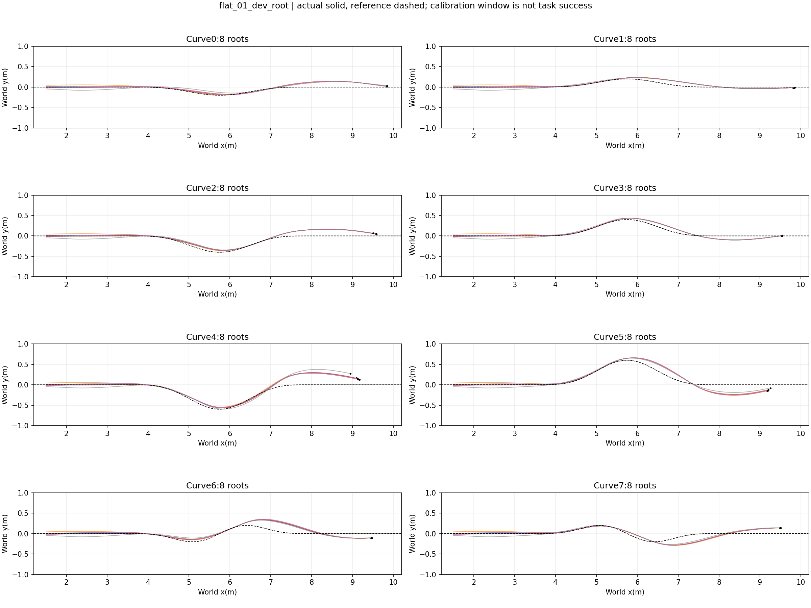
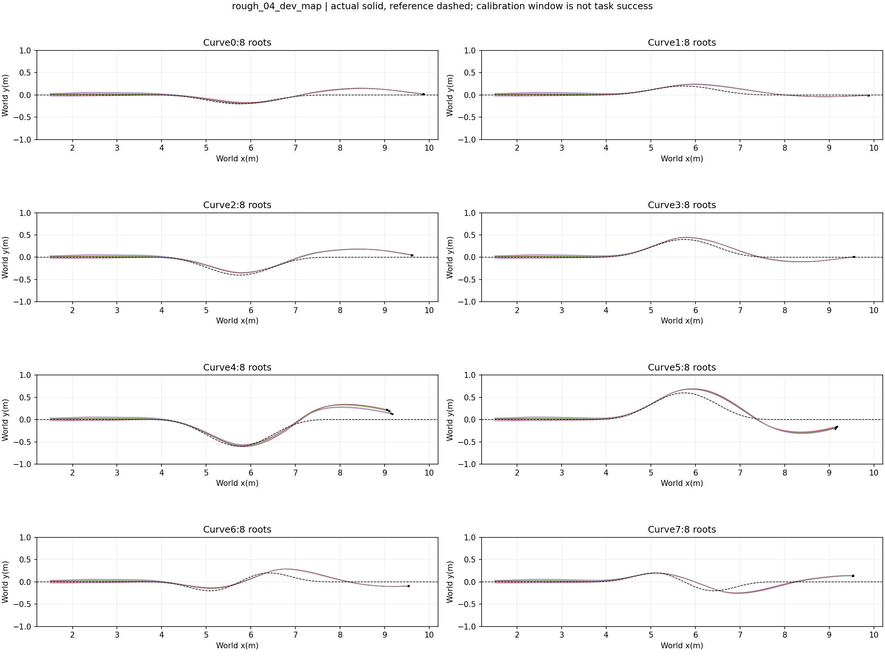
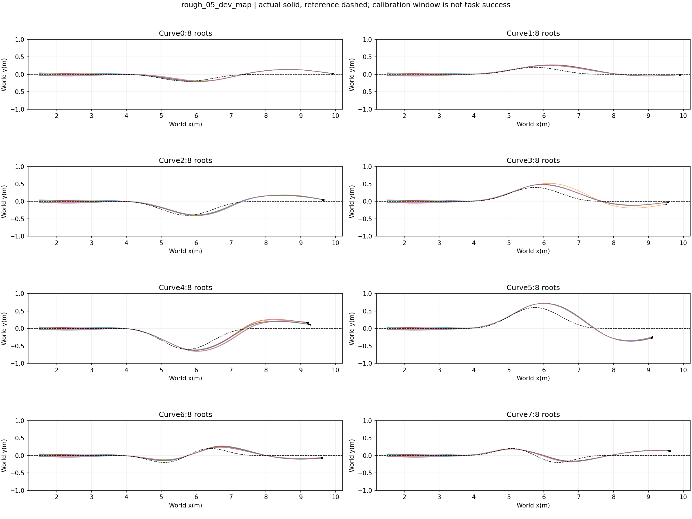
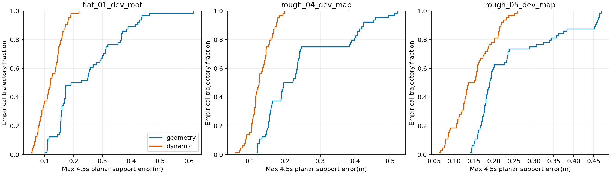

# E1整车平面支持界校准

只用于固定轴对齐道路/禁止矩形的整车平面边界，不是一般三维表面的Hausdorff距离，也不是安全概率保证。误差取每条完整预测时域内所有碰撞几何x/y上下界的最大差，保持几何与动态方法、同根/曲线/地图配对。所有初态已用于DEV；同根的八条曲线相关，非独立TEST。

本轮最大时域4.5s，从reset后20ms开始，不能外推为任意滚动初态或RB回交后模型。裕量规则在评估前冻结：每方法取DEV组P95误差的最大值，再加0.02m地图/离散检查余量。未根据E1成败调节。

|Method|Group|Horizon s|Trajectories/roots|P95 support m|Worst support m|P95 historical global3D bound m|
|---|---|---:|---:|---:|---:|---:|
|geometry|flat_01_dev_root|1.0|64/8|0.0856|0.0856|0.1520|
|geometry|rough_04_dev_map|1.0|64/8|0.0663|0.0671|0.1469|
|geometry|rough_05_dev_map|1.0|64/8|0.0732|0.0750|0.1227|
|geometry|flat_01_dev_root|2.0|64/8|0.1142|0.1443|0.2506|
|geometry|rough_04_dev_map|2.0|64/8|0.1190|0.1218|0.2576|
|geometry|rough_05_dev_map|2.0|64/8|0.1217|0.1380|0.2590|
|geometry|flat_01_dev_root|3.0|64/8|0.3000|0.3116|0.7313|
|geometry|rough_04_dev_map|3.0|64/8|0.3356|0.3520|0.7128|
|geometry|rough_05_dev_map|3.0|64/8|0.4045|0.4154|0.7937|
|geometry|flat_01_dev_root|3.8|64/8|0.3832|0.5169|0.9065|
|geometry|rough_04_dev_map|3.8|64/8|0.4166|0.4440|0.9954|
|geometry|rough_05_dev_map|3.8|64/8|0.4464|0.4508|1.0658|
|geometry|flat_01_dev_root|4.5|64/8|0.4336|0.6156|0.9065|
|geometry|rough_04_dev_map|4.5|64/8|0.4571|0.5203|0.9954|
|geometry|rough_05_dev_map|4.5|64/8|0.4615|0.4688|1.0658|
|dynamic|flat_01_dev_root|1.0|64/8|0.0374|0.0397|0.0792|
|dynamic|rough_04_dev_map|1.0|64/8|0.0309|0.0325|0.0938|
|dynamic|rough_05_dev_map|1.0|64/8|0.0342|0.0368|0.0740|
|dynamic|flat_01_dev_root|2.0|64/8|0.0627|0.0730|0.1529|
|dynamic|rough_04_dev_map|2.0|64/8|0.0715|0.0858|0.1370|
|dynamic|rough_05_dev_map|2.0|64/8|0.0636|0.0677|0.1534|
|dynamic|flat_01_dev_root|3.0|64/8|0.1695|0.2126|0.3217|
|dynamic|rough_04_dev_map|3.0|64/8|0.1597|0.1744|0.3098|
|dynamic|rough_05_dev_map|3.0|64/8|0.1806|0.1876|0.3122|
|dynamic|flat_01_dev_root|3.8|64/8|0.1797|0.2184|0.3265|
|dynamic|rough_04_dev_map|3.8|64/8|0.1607|0.1751|0.3098|
|dynamic|rough_05_dev_map|3.8|64/8|0.2015|0.2232|0.4493|
|dynamic|flat_01_dev_root|4.5|64/8|0.1824|0.2184|0.3265|
|dynamic|rough_04_dev_map|4.5|64/8|0.1787|0.1988|0.3098|
|dynamic|rough_05_dev_map|4.5|64/8|0.2297|0.2585|0.4563|

|Method|Horizon s|Frozen margin m|
|---|---:|---:|
|geometry|1.0|0.1056|
|geometry|2.0|0.1417|
|geometry|3.0|0.4245|
|geometry|3.8|0.4664|
|geometry|4.5|0.4815|
|dynamic|1.0|0.0574|
|dynamic|2.0|0.0915|
|dynamic|3.0|0.2006|
|dynamic|3.8|0.2215|
|dynamic|4.5|0.2497|

逐轨迹误差见records.json，缺失/完整窗口见coverage.json，预算和适用域见protocol.json。先前3.8秒校准与本次4.5秒延长分目录保留；后者同一批192个DEV初态/曲线重放到4.6秒，不能称新增独立初态。无策略或模型续训。
