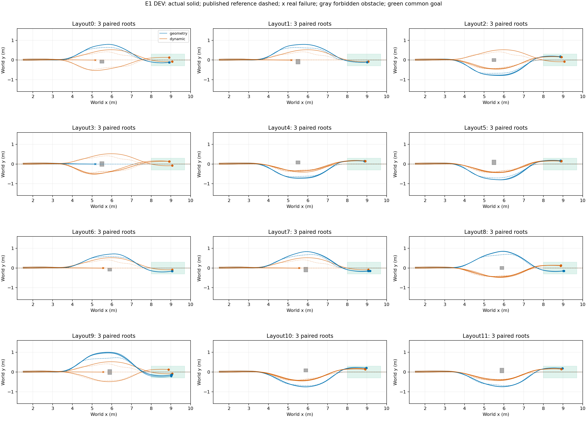

# E1 ground planning DEV pilot

Static saved-state planning with shared delayed publication; no live rolling query or independent TEST. No-plan cases execute their existing straight reference but remain planner failures. See manifest for exact frozen physics, skills, maps, roots, budget and common target.

|Method|Plans /36|Physical goal /36|Task success /36|Penalized mean s|Planner median/P95/max ms|
|---|---:|---:|---:|---:|---:|
|geometry|33|33|33|4.568|9.78/10.62/11.36|
|dynamic|28|28|28|4.403|63.70/66.81/69.29|

|Layout|Root|Method|Plan|Outcome|Physical outcome|Time s|Query pose/velocity gap|Executed XY error m|
|---|---|---|---|---|---|---|---|---|
|0|0|geometry|True|goal|goal|4.475|3.49e-10/1.56e-07|0.3957906663417816|
|0|0|dynamic|False|no_plan|forbidden_obstacle_contact|1.980|3.49e-10/1.56e-07|None|
|0|1|geometry|True|goal|goal|4.480|3.49e-10/9.69e-08|0.3914811611175537|
|0|1|dynamic|True|goal|goal|4.235|3.49e-10/9.69e-08|0.22775371372699738|
|0|2|geometry|True|goal|goal|4.475|2.33e-10/4.47e-08|0.3978833258152008|
|0|2|dynamic|True|goal|goal|4.285|2.33e-10/4.47e-08|0.12588165700435638|
|1|0|geometry|True|goal|goal|4.505|3.49e-10/1.56e-07|0.3218613266944885|
|1|0|dynamic|False|no_plan|forbidden_obstacle_contact|1.980|3.49e-10/1.56e-07|None|
|1|1|geometry|True|goal|goal|4.505|3.49e-10/9.69e-08|0.3184729218482971|
|1|1|dynamic|True|goal|goal|4.235|3.49e-10/9.69e-08|0.22796334326267242|
|1|2|geometry|True|goal|goal|4.505|2.33e-10/4.47e-08|0.32441800832748413|
|1|2|dynamic|False|no_plan|forbidden_obstacle_contact|1.980|2.33e-10/4.47e-08|None|
|2|0|geometry|True|goal|goal|4.515|3.49e-10/1.56e-07|0.3690384328365326|
|2|0|dynamic|True|goal|goal|4.240|3.49e-10/1.56e-07|0.13991639018058777|
|2|1|geometry|True|goal|goal|4.510|3.49e-10/9.69e-08|0.36849379539489746|
|2|1|dynamic|True|goal|goal|4.235|3.49e-10/9.69e-08|0.22851762175559998|
|2|2|geometry|True|goal|goal|4.515|2.33e-10/4.47e-08|0.36832836270332336|
|2|2|dynamic|True|goal|goal|4.255|2.33e-10/4.47e-08|0.13518784940242767|
|3|0|geometry|False|no_plan|forbidden_obstacle_contact|1.980|3.49e-10/1.56e-07|None|
|3|0|dynamic|True|goal|goal|4.285|3.49e-10/1.56e-07|0.10412105172872543|
|3|1|geometry|False|no_plan|forbidden_obstacle_contact|1.980|3.49e-10/9.69e-08|None|
|3|1|dynamic|True|goal|goal|4.235|3.49e-10/9.69e-08|0.2282256931066513|
|3|2|geometry|False|no_plan|forbidden_obstacle_contact|1.985|2.33e-10/4.47e-08|None|
|3|2|dynamic|True|goal|goal|4.245|2.33e-10/4.47e-08|0.14433394372463226|
|4|0|geometry|True|goal|goal|4.470|3.49e-10/1.56e-07|0.3481050133705139|
|4|0|dynamic|True|goal|goal|4.210|3.49e-10/1.56e-07|0.1473149061203003|
|4|1|geometry|True|goal|goal|4.465|3.49e-10/9.69e-08|0.339642733335495|
|4|1|dynamic|True|goal|goal|4.150|3.49e-10/9.69e-08|0.19971369206905365|
|4|2|geometry|True|goal|goal|4.480|2.33e-10/4.47e-08|0.3566889464855194|
|4|2|dynamic|True|goal|goal|4.165|2.33e-10/4.47e-08|0.16593830287456512|
|5|0|geometry|True|goal|goal|4.510|3.49e-10/1.56e-07|0.36786720156669617|
|5|0|dynamic|True|goal|goal|4.220|3.49e-10/1.56e-07|0.1621885597705841|
|5|1|geometry|True|goal|goal|4.520|3.49e-10/9.69e-08|0.3794275224208832|
|5|1|dynamic|True|goal|goal|4.220|3.49e-10/9.69e-08|0.1717456877231598|
|5|2|geometry|True|goal|goal|4.510|2.33e-10/4.47e-08|0.36250796914100647|
|5|2|dynamic|True|goal|goal|4.220|2.33e-10/4.47e-08|0.13388632237911224|
|6|0|geometry|True|goal|goal|4.505|3.49e-10/1.56e-07|0.3166958689689636|
|6|0|dynamic|False|no_plan|forbidden_obstacle_contact|2.190|3.49e-10/1.56e-07|None|
|6|1|geometry|True|goal|goal|4.505|3.49e-10/9.69e-08|0.31067410111427307|
|6|1|dynamic|True|goal|goal|4.235|3.49e-10/9.69e-08|0.22789965569972992|
|6|2|geometry|True|goal|goal|4.500|2.33e-10/4.47e-08|0.3175143897533417|
|6|2|dynamic|False|no_plan|forbidden_obstacle_contact|2.195|2.33e-10/4.47e-08|None|
|7|0|geometry|True|goal|goal|4.530|3.49e-10/1.56e-07|0.2659499943256378|
|7|0|dynamic|False|no_plan|forbidden_obstacle_contact|2.190|3.49e-10/1.56e-07|None|
|7|1|geometry|True|goal|goal|4.565|3.49e-10/9.69e-08|0.27535516023635864|
|7|1|dynamic|True|goal|goal|4.235|3.49e-10/9.69e-08|0.22703547775745392|
|7|2|geometry|True|goal|goal|4.505|2.33e-10/4.47e-08|0.2659810781478882|
|7|2|dynamic|False|no_plan|forbidden_obstacle_contact|2.200|2.33e-10/4.47e-08|None|
|8|0|geometry|True|goal|goal|4.520|3.49e-10/1.56e-07|0.29088643193244934|
|8|0|dynamic|True|goal|goal|4.260|3.49e-10/1.56e-07|0.1339978128671646|
|8|1|geometry|True|goal|goal|4.540|3.49e-10/9.69e-08|0.33028045296669006|
|8|1|dynamic|True|goal|goal|4.260|3.49e-10/9.69e-08|0.1342298984527588|
|8|2|geometry|True|goal|goal|4.525|2.33e-10/4.47e-08|0.2870943546295166|
|8|2|dynamic|True|goal|goal|4.265|2.33e-10/4.47e-08|0.12572050094604492|
|9|0|geometry|True|goal|goal|4.700|3.49e-10/1.56e-07|0.5322262644767761|
|9|0|dynamic|True|goal|goal|4.260|3.49e-10/1.56e-07|0.14604681730270386|
|9|1|geometry|True|goal|goal|4.740|3.49e-10/9.69e-08|0.5526625514030457|
|9|1|dynamic|True|goal|goal|4.235|3.49e-10/9.69e-08|0.22682364284992218|
|9|2|geometry|True|goal|goal|4.685|2.33e-10/4.47e-08|0.49595001339912415|
|9|2|dynamic|False|no_plan|forbidden_obstacle_contact|2.195|2.33e-10/4.47e-08|None|
|10|0|geometry|True|goal|goal|4.535|3.49e-10/1.56e-07|0.29147857427597046|
|10|0|dynamic|True|goal|goal|4.215|3.49e-10/1.56e-07|0.1450013369321823|
|10|1|geometry|True|goal|goal|4.525|3.49e-10/9.69e-08|0.2841264605522156|
|10|1|dynamic|True|goal|goal|4.220|3.49e-10/9.69e-08|0.1709684133529663|
|10|2|geometry|True|goal|goal|4.550|2.33e-10/4.47e-08|0.3129475712776184|
|10|2|dynamic|True|goal|goal|4.260|2.33e-10/4.47e-08|0.12365863472223282|
|11|0|geometry|True|goal|goal|4.520|3.49e-10/1.56e-07|0.26862114667892456|
|11|0|dynamic|True|goal|goal|4.195|3.49e-10/1.56e-07|0.18280592560768127|
|11|1|geometry|True|goal|goal|4.510|3.49e-10/9.69e-08|0.26004064083099365|
|11|1|dynamic|True|goal|goal|4.220|3.49e-10/9.69e-08|0.17098559439182281|
|11|2|geometry|True|goal|goal|4.540|2.33e-10/4.47e-08|0.2845296561717987|
|11|2|dynamic|True|goal|goal|4.225|2.33e-10/4.47e-08|0.14642509818077087|

Prediction comparisons use only the committed, actually executed route and stop at the real terminal state. Rejected hypothetical curves are not scored as executed predictions. Margins are frozen in the manifest and each plan record; empirical DEV calibration is not a probability or safety guarantee. Planar support errors apply only to the axis-aligned geometry checks; the global3D bound is retained separately. Planner timing includes both topologies and GPU synchronization but not live state acquisition, initial graph compilation or the physical publication call. No claim of complete online 200ms acceptance.
