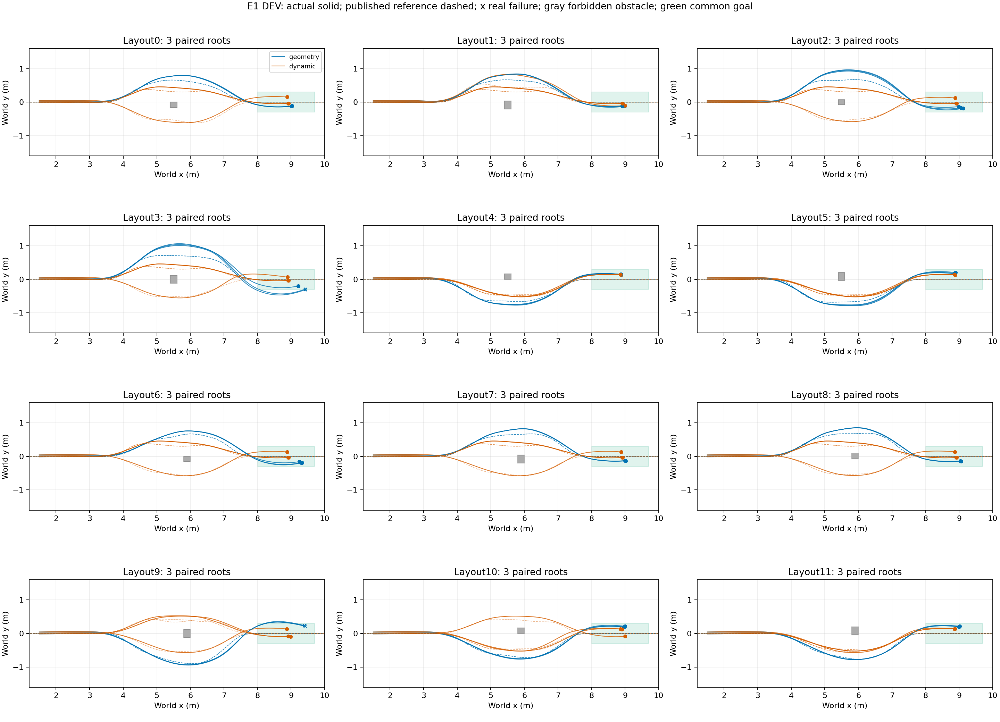
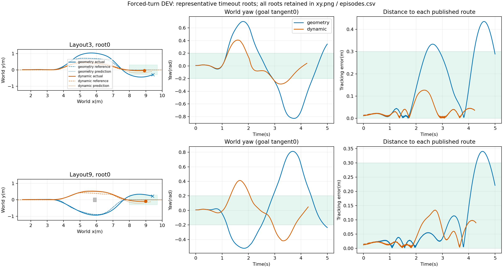

# E1强制绕行：动态36/36，几何31/36，限当前DEV

同一12个中央障碍布局、每图3初态、同一H75/ECBC/ESO、1ms物理、1.8m/s请求、alpha0和5秒截止：动态36/36完成，几何31/36完成、5条超时。两方法均找到36条可发布计划，未用no_plan改变这批分母。搜索同为左右两方向、每方向64候选×4轮、8精英。比较包含各自按同规则校准的误差裕量，不是固定相同裕量的单因素消融。

平均惩罚完成时间为几何4.628s、动态4.289s，配对差−0.339s，按12布局重采样的描述性95%区间[−0.440,−0.256]s；31条共同成功任务中动态平均快0.275s。新增成功5、丢失0。完成率差13.89个百分点，但布局组区间[0,33.33]百分点仍含零，不能宣称已统计证明泛化成功率提升。按当前DEV中无新增失败且用时更短的结果，暂保留动态方案推进P2；正式新布局TEST仍在P4。

## 五条失败：已通过障碍，但未完成目标保持

几何失败全部在layout03根0/2、layout09根0/1/2。5秒时x约9.40–9.43m，速度约1.80–1.86m/s，但航向误差约0.236–0.345rad，超过0.2rad目标门槛；部分横向/跟踪误差也超过0.3m，最终连续保持均为0秒。不能把这些超时说成已经到达或物理摔倒。绿色阈值仅用于目标区，不用于否定正常转弯过程。全部根而非仅这两个示例见episodes.csv/failures.json。

## 预测长度、校准与时延

此前3.8秒强制绕行试验为几何33/36、动态28/36，未覆盖完整目标保持；该负结果保留。随后同192个DEV根/曲线身份延长采集到4.6秒，192/192具有完整4.5秒窗口，未续训策略或名义模型，也不称新增独立样本。当前预测4.5秒，最后0.5秒逐步检查同一目标区间、横向、航向和速度条件，物理目标与截止时间未变。

所有碰撞几何的平面支持界校准得到几何裕量0.4815m、动态0.2497m（各DEV组P95最大值加0.02m地图/离散余量）。它只适用于当前轴对齐道路/障碍，非三维Hausdorff或概率安全保证。在本批已执行预测前缀上，几何最大支持误差0.7193m、8/36超过裕量；动态最大0.2069m、0/36超过裕量。成功后停止的真实轨迹不补齐，误差只报实际执行前缀，不冒称所有任务都执行了完整4.5秒预测。

动态双方向搜索中位73.72ms、P95 74.42ms、最大81.12ms；几何9.76/10.63/11.73ms。包含GPU候选生成、展开、约束与同步，不含实际在线读取和发布。当前仍是匹配保存20ms状态的静态规划，并在仿真中保留原前缀、按实测规划耗时统一延后发布；不能称滚动在线规划或200ms端到端验收。完整控制器可预测域门槛已接入：转角±0.8rad、跟踪0.6m、前视x>0.05m、相对航向小于pi/2。

下一步是P2合法RB启动域、完整运动库及上下游联合规划。当前名义模型仅覆盖reset后地面入口；RB回交后phase2预测问题仍未解决，不能把本结果直接外推到完整跳跃链。原始源文件快照是事后补录并明确标注，后续准备入口已改为启动前保存源码；不将补录伪称预运行锁定。

# E1 ground planning DEV pilot

Static saved-state planning with shared delayed publication; no live rolling query or independent TEST. No-plan cases execute their existing straight reference but remain planner failures. See manifest for exact frozen physics, skills, maps, roots, budget and common target.

|Method|Plans /36|Physical goal /36|Task success /36|Penalized mean s|Planner median/P95/max ms|
|---|---:|---:|---:|---:|---:|
|geometry|36|31|31|4.628|9.76/10.63/11.73|
|dynamic|36|36|36|4.289|73.72/74.42/81.12|

|Layout|Root|Method|Plan|Outcome|Physical outcome|Time s|Query pose/velocity gap|Executed XY error m|
|---|---|---|---|---|---|---|---|---|
|0|0|geometry|True|goal|goal|4.495|3.49e-10/1.56e-07|0.34704113006591797|
|0|0|dynamic|True|goal|goal|4.225|3.49e-10/1.56e-07|0.1713685691356659|
|0|1|geometry|True|goal|goal|4.495|3.49e-10/9.69e-08|0.3398909866809845|
|0|1|dynamic|True|goal|goal|4.390|3.49e-10/9.69e-08|0.20872797071933746|
|0|2|geometry|True|goal|goal|4.495|2.33e-10/4.47e-08|0.35446885228157043|
|0|2|dynamic|True|goal|goal|4.230|2.33e-10/4.47e-08|0.17301811277866364|
|1|0|geometry|True|goal|goal|4.505|3.49e-10/1.56e-07|0.4407902657985687|
|1|0|dynamic|True|goal|goal|4.225|3.49e-10/1.56e-07|0.17137405276298523|
|1|1|geometry|True|goal|goal|4.535|3.49e-10/9.69e-08|0.4290693402290344|
|1|1|dynamic|True|goal|goal|4.490|3.49e-10/9.69e-08|0.20109164714813232|
|1|2|geometry|True|goal|goal|4.515|2.33e-10/4.47e-08|0.4535825848579407|
|1|2|dynamic|True|goal|goal|4.230|2.33e-10/4.47e-08|0.17291268706321716|
|2|0|geometry|True|goal|goal|4.635|3.49e-10/1.56e-07|0.5202950239181519|
|2|0|dynamic|True|goal|goal|4.225|3.49e-10/1.56e-07|0.17105379700660706|
|2|1|geometry|True|goal|goal|4.685|3.49e-10/9.69e-08|0.5494455695152283|
|2|1|dynamic|True|goal|goal|4.360|3.49e-10/9.69e-08|0.18903735280036926|
|2|2|geometry|True|goal|goal|4.570|2.33e-10/4.47e-08|0.46863263845443726|
|2|2|dynamic|True|goal|goal|4.230|2.33e-10/4.47e-08|0.17365556955337524|
|3|0|geometry|True|timeout|timeout|5.000|3.49e-10/1.56e-07|0.8113985061645508|
|3|0|dynamic|True|goal|goal|4.225|3.49e-10/1.56e-07|0.17125993967056274|
|3|1|geometry|True|goal|goal|4.815|3.49e-10/9.69e-08|0.6462413668632507|
|3|1|dynamic|True|goal|goal|4.385|3.49e-10/9.69e-08|0.18468859791755676|
|3|2|geometry|True|timeout|timeout|5.000|2.33e-10/4.47e-08|0.8420110940933228|
|3|2|dynamic|True|goal|goal|4.230|2.33e-10/4.47e-08|0.1727338433265686|
|4|0|geometry|True|goal|goal|4.500|3.49e-10/1.56e-07|0.4682111442089081|
|4|0|dynamic|True|goal|goal|4.295|3.49e-10/1.56e-07|0.16831983625888824|
|4|1|geometry|True|goal|goal|4.500|3.49e-10/9.69e-08|0.4650658667087555|
|4|1|dynamic|True|goal|goal|4.305|3.49e-10/9.69e-08|0.19015614688396454|
|4|2|geometry|True|goal|goal|4.500|2.33e-10/4.47e-08|0.46336784958839417|
|4|2|dynamic|True|goal|goal|4.305|2.33e-10/4.47e-08|0.15073876082897186|
|5|0|geometry|True|goal|goal|4.515|3.49e-10/1.56e-07|0.49662214517593384|
|5|0|dynamic|True|goal|goal|4.295|3.49e-10/1.56e-07|0.16847871243953705|
|5|1|geometry|True|goal|goal|4.515|3.49e-10/9.69e-08|0.48916420340538025|
|5|1|dynamic|True|goal|goal|4.305|3.49e-10/9.69e-08|0.19034016132354736|
|5|2|geometry|True|goal|goal|4.535|2.33e-10/4.47e-08|0.512566089630127|
|5|2|dynamic|True|goal|goal|4.305|2.33e-10/4.47e-08|0.15064144134521484|
|6|0|geometry|True|goal|goal|4.630|3.49e-10/1.56e-07|0.3682910203933716|
|6|0|dynamic|True|goal|goal|4.225|3.49e-10/1.56e-07|0.17094074189662933|
|6|1|geometry|True|goal|goal|4.660|3.49e-10/9.69e-08|0.39165958762168884|
|6|1|dynamic|True|goal|goal|4.355|3.49e-10/9.69e-08|0.22092844545841217|
|6|2|geometry|True|goal|goal|4.580|2.33e-10/4.47e-08|0.31120771169662476|
|6|2|dynamic|True|goal|goal|4.230|2.33e-10/4.47e-08|0.17291833460330963|
|7|0|geometry|True|goal|goal|4.560|3.49e-10/1.56e-07|0.4352520704269409|
|7|0|dynamic|True|goal|goal|4.225|3.49e-10/1.56e-07|0.1711360216140747|
|7|1|geometry|True|goal|goal|4.565|3.49e-10/9.69e-08|0.43517690896987915|
|7|1|dynamic|True|goal|goal|4.355|3.49e-10/9.69e-08|0.22100207209587097|
|7|2|geometry|True|goal|goal|4.555|2.33e-10/4.47e-08|0.4351564645767212|
|7|2|dynamic|True|goal|goal|4.230|2.33e-10/4.47e-08|0.1730699986219406|
|8|0|geometry|True|goal|goal|4.595|3.49e-10/1.56e-07|0.4503669738769531|
|8|0|dynamic|True|goal|goal|4.225|3.49e-10/1.56e-07|0.17089709639549255|
|8|1|geometry|True|goal|goal|4.610|3.49e-10/9.69e-08|0.45363500714302063|
|8|1|dynamic|True|goal|goal|4.340|3.49e-10/9.69e-08|0.21128638088703156|
|8|2|geometry|True|goal|goal|4.595|2.33e-10/4.47e-08|0.45180532336235046|
|8|2|dynamic|True|goal|goal|4.230|2.33e-10/4.47e-08|0.17313069105148315|
|9|0|geometry|True|timeout|timeout|5.000|3.49e-10/1.56e-07|0.6771717071533203|
|9|0|dynamic|True|goal|goal|4.275|3.49e-10/1.56e-07|0.175388902425766|
|9|1|geometry|True|timeout|timeout|5.000|3.49e-10/9.69e-08|0.671963095664978|
|9|1|dynamic|True|goal|goal|4.340|3.49e-10/9.69e-08|0.21144132316112518|
|9|2|geometry|True|timeout|timeout|5.000|2.33e-10/4.47e-08|0.6960119009017944|
|9|2|dynamic|True|goal|goal|4.265|2.33e-10/4.47e-08|0.1612682342529297|
|10|0|geometry|True|goal|goal|4.540|3.49e-10/1.56e-07|0.4359821081161499|
|10|0|dynamic|True|goal|goal|4.280|3.49e-10/1.56e-07|0.1766582578420639|
|10|1|geometry|True|goal|goal|4.520|3.49e-10/9.69e-08|0.4157693684101105|
|10|1|dynamic|True|goal|goal|4.345|3.49e-10/9.69e-08|0.1510782539844513|
|10|2|geometry|True|goal|goal|4.575|2.33e-10/4.47e-08|0.48473286628723145|
|10|2|dynamic|True|goal|goal|4.305|2.33e-10/4.47e-08|0.15065830945968628|
|11|0|geometry|True|goal|goal|4.600|3.49e-10/1.56e-07|0.4909264147281647|
|11|0|dynamic|True|goal|goal|4.295|3.49e-10/1.56e-07|0.16628965735435486|
|11|1|geometry|True|goal|goal|4.595|3.49e-10/9.69e-08|0.48762181401252747|
|11|1|dynamic|True|goal|goal|4.340|3.49e-10/9.69e-08|0.21145233511924744|
|11|2|geometry|True|goal|goal|4.625|2.33e-10/4.47e-08|0.5244367718696594|
|11|2|dynamic|True|goal|goal|4.305|2.33e-10/4.47e-08|0.15169279277324677|

Prediction comparisons use only the committed, actually executed route and stop at the real terminal state. Rejected hypothetical curves are not scored as executed predictions. Margins are frozen in the manifest and each plan record; empirical DEV calibration is not a probability or safety guarantee. Planar support errors apply only to the axis-aligned geometry checks; the global3D bound is retained separately. Planner timing includes both topologies and GPU synchronization but not live state acquisition, initial graph compilation or the physical publication call. No claim of complete online 200ms acceptance.
