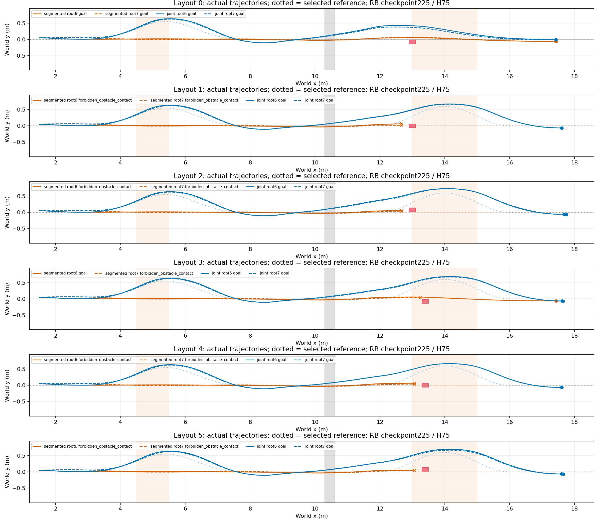

# E2有限运动库联合规划 DEV 对照

实际全程成功：分段 3/12，联合 12/12；新增 9，丢失 0。失败按10秒计，配对平均时间差（联合减分段）-0.4113秒。

无可行计划时执行原直线候选，实际成功仍计入主结果。规划可行且成功与物理成功分别统计。

|布局|根|方法|计划可行|路线|启动x m|实际结果|时长s|交回s|
|---|---|---|---|---|---|---|---|---|
|0|6|joint|True|3|8.75|goal|9.080|5.614999771118164|
|0|6|segmented|False|0|8.45|goal|8.700|5.275000095367432|
|0|7|joint|True|3|8.75|goal|9.055|5.574999809265137|
|0|7|segmented|False|0|8.45|goal|8.725|5.304999828338623|
|1|6|joint|True|4|8.55|goal|9.290|5.619999885559082|
|1|6|segmented|False|0|8.45|forbidden_obstacle_contact|6.125|5.260000228881836|
|1|7|joint|True|4|8.55|goal|9.280|5.585000038146973|
|1|7|segmented|False|0|8.45|forbidden_obstacle_contact|6.150|5.269999980926514|
|2|6|joint|True|4|8.75|goal|9.320|5.585000038146973|
|2|6|segmented|False|0|8.45|forbidden_obstacle_contact|6.140|5.289999961853027|
|2|7|joint|True|4|8.75|goal|9.360|5.625|
|2|7|segmented|False|0|8.45|forbidden_obstacle_contact|6.145|5.289999961853027|
|3|6|joint|True|4|8.55|goal|9.320|5.570000171661377|
|3|6|segmented|False|0|8.45|goal|8.710|5.284999847412109|
|3|7|joint|True|4|8.55|goal|9.295|5.585000038146973|
|3|7|segmented|False|0|8.45|forbidden_obstacle_contact|6.460|5.295000076293945|
|4|6|joint|True|4|8.55|goal|9.290|5.605000019073486|
|4|6|segmented|False|0|8.45|forbidden_obstacle_contact|6.350|5.315000057220459|
|4|7|joint|True|4|8.55|goal|9.285|5.585000038146973|
|4|7|segmented|False|0|8.45|forbidden_obstacle_contact|6.355|5.295000076293945|
|5|6|joint|True|4|8.55|goal|9.335|5.585000038146973|
|5|6|segmented|False|0|8.45|forbidden_obstacle_contact|6.355|5.300000190734863|
|5|7|joint|True|4|8.55|goal|9.290|5.585000038146973|
|5|7|segmented|False|0|8.45|forbidden_obstacle_contact|6.360|5.289999961853027|

两方法同36个实测完整候选、同原粗糙地图/沟两侧2m平地/终点保持/冻结RB225和H75。H0先选直下游的最低代价前缀，再选同启动/上游下的后续；H1联合选择全链。H0无可行后续时保留原始候选，不能代表所有允许回溯的分段算法。

候选来自72条TRAIN轨迹，空间支持包络用既有18条DEV校准。六个新增障碍布局×两个复用DEV初态，非独立TEST。最初各向同性0.4565m裕量令两方法全部无计划；该负结果保存于e2_primitive_pilot且未启动物理评测。本轮按固定物理区域/坐标轴最大偏差加0.02m扩张，不是安全概率或连续碰撞证明。

静态启动前选计划；不是200ms滚动发布或完整P2。计时只覆盖共享GPU候选评分，不包含数据上传/完整在线循环。全部实际轨迹在真实终止处截止。

原始证据：`/media/qy/6A7E3DB07E3D75C3/STTW_runs/chapter3_playground_sttw_rb_sttw/e2_primitive_spatial_envelope`。逐例路径和完整数值见summary.json；未重跑物理。
