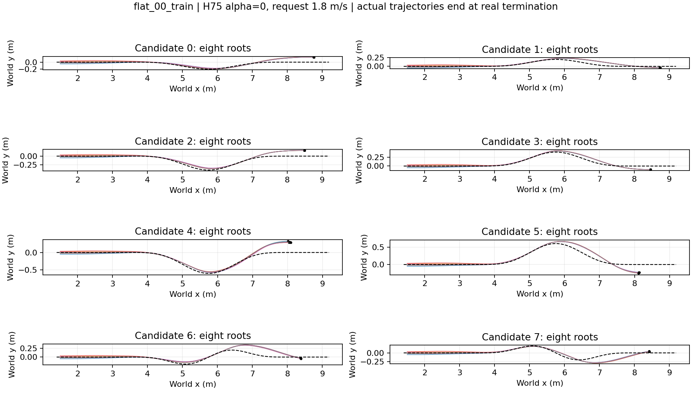
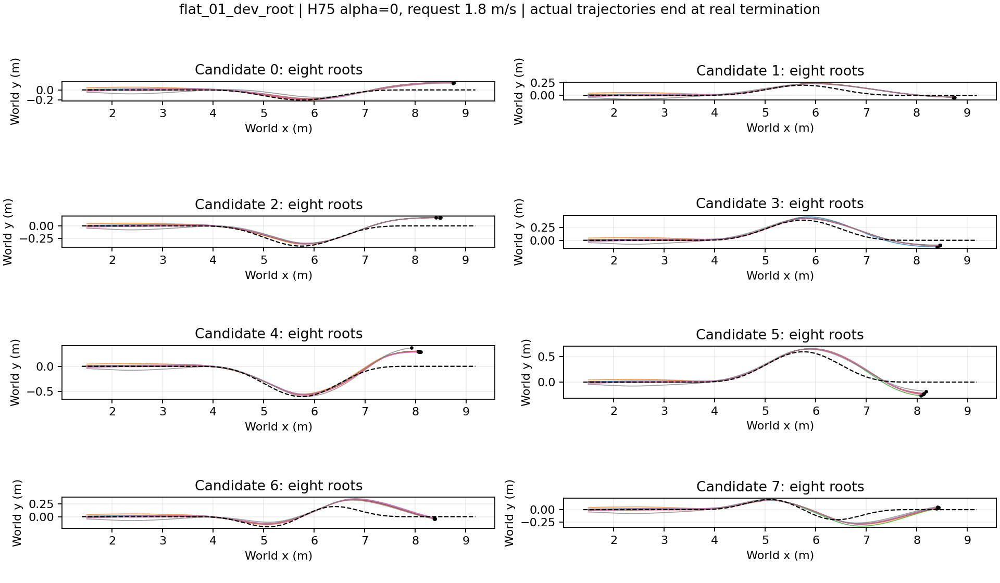
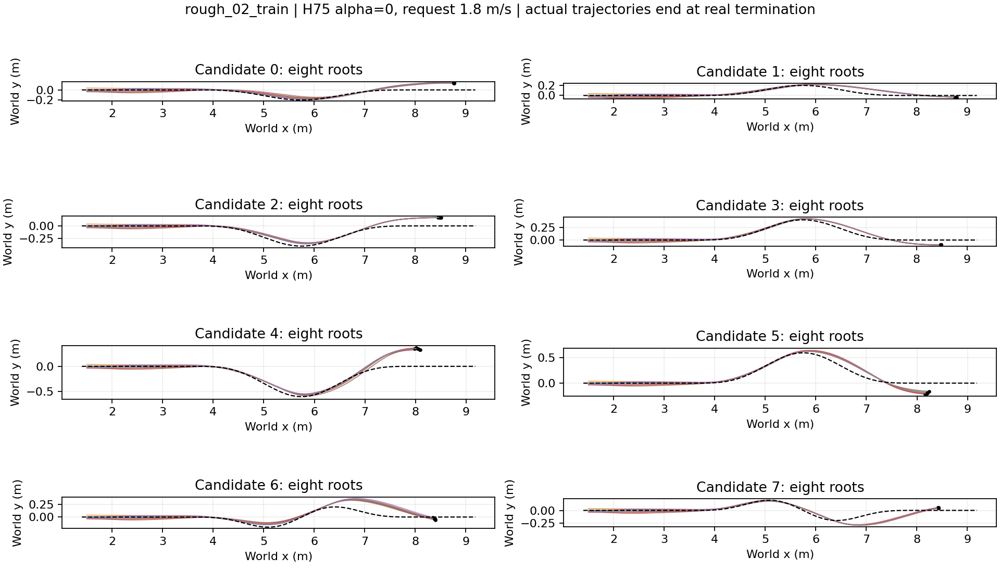
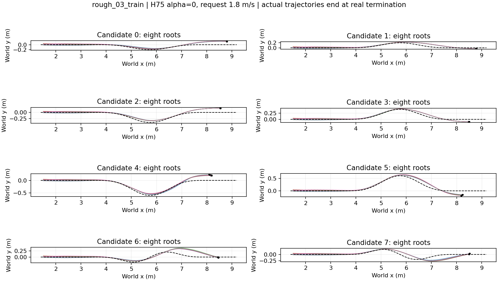
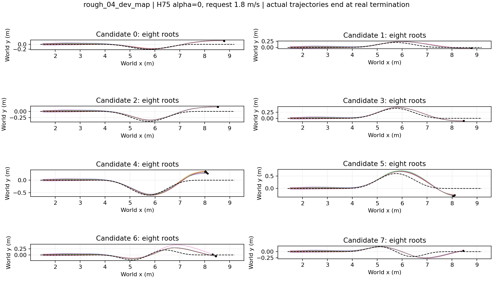
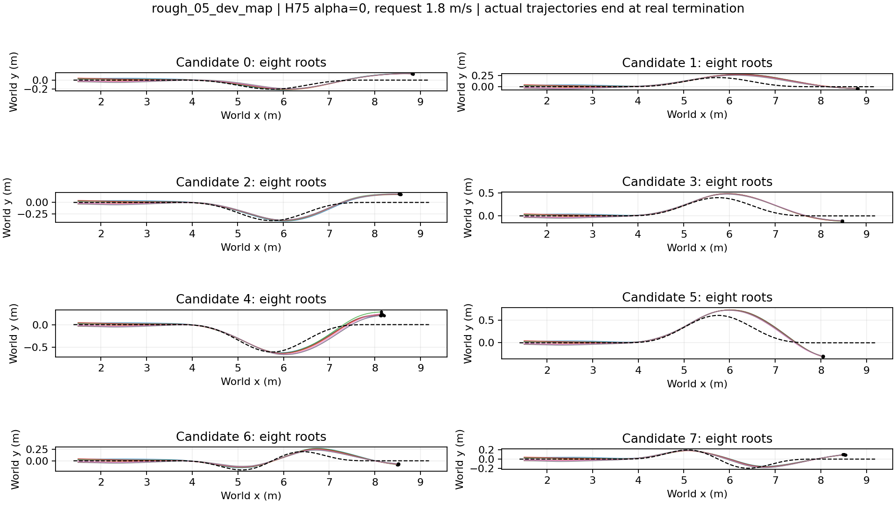
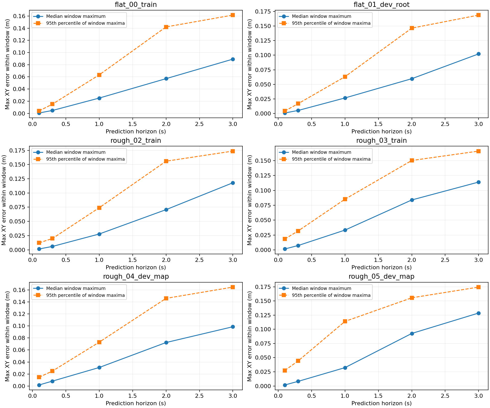
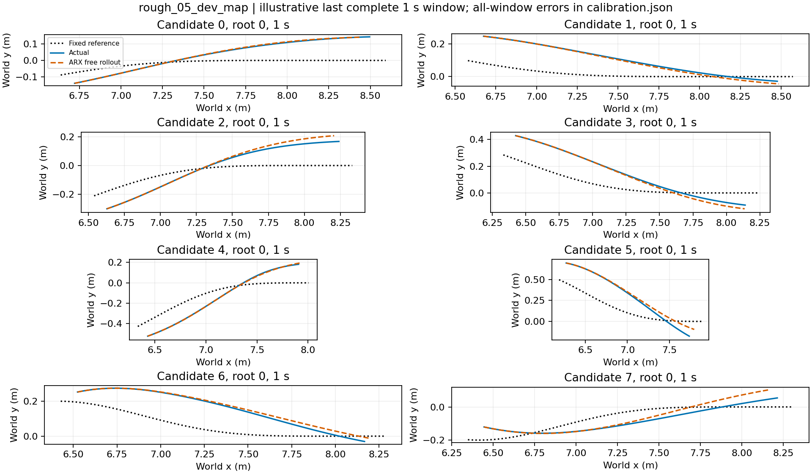

# P1 nominal closed-loop model: first bounded collection

## Actual/reference XY coverage

Fixed H75 and native locked plant, 1.8 m/s, alpha=0. Flat TRAIN only fits ARX(2), ridge=0.001 with training-only scaling. No policy training. Rough maps are out-of-domain model diagnostics. Flat DEV_ROOT is a disjoint-root split on the same planar map, not independent map validation.

| Batch | 4 s slices | Early failures | Actual 20 ms transitions |
|---|---:|---:|---:|
| flat_00_train | 64/64 | 0 | 12800 |
| flat_01_dev_root | 64/64 | 0 | 12800 |
| rough_02_train | 64/64 | 0 | 12800 |
| rough_03_train | 64/64 | 0 | 12800 |
| rough_04_dev_map | 64/64 | 0 | 12800 |
| rough_05_dev_map | 64/64 | 0 | 12800 |

Four-second slices are data collection, not goal success. Failure trajectories remain through the real terminal state. Initial snapshot and all 5 ms controller states are archived. Contact normals are collected at 1 ms; row zero has no prior interval.

## Causal free prediction

| Group | Horizon s | Windows / roots | Median max XY m | P95 max XY m | Worst max XY m | P95 max body bound m |
|---|---:|---:|---:|---:|---:|---:|
| flat_00_train | 0.1 | 1280/8 | 0.0007 | 0.0041 | 0.0068 | 0.0095 |
| flat_00_train | 0.3 | 1216/8 | 0.0048 | 0.0152 | 0.0242 | 0.0353 |
| flat_00_train | 1.0 | 960/8 | 0.0252 | 0.0633 | 0.0820 | 0.1598 |
| flat_00_train | 2.0 | 640/8 | 0.0571 | 0.1421 | 0.1722 | 0.2591 |
| flat_00_train | 3.0 | 320/8 | 0.0892 | 0.1615 | 0.1878 | 0.2968 |
| flat_01_dev_root | 0.1 | 1280/8 | 0.0008 | 0.0041 | 0.0216 | 0.0107 |
| flat_01_dev_root | 0.3 | 1216/8 | 0.0051 | 0.0168 | 0.0278 | 0.0399 |
| flat_01_dev_root | 1.0 | 960/8 | 0.0266 | 0.0630 | 0.0976 | 0.1626 |
| flat_01_dev_root | 2.0 | 640/8 | 0.0596 | 0.1465 | 0.2022 | 0.2664 |
| flat_01_dev_root | 3.0 | 320/8 | 0.1022 | 0.1688 | 0.2180 | 0.3053 |
| rough_02_train | 0.1 | 1280/8 | 0.0014 | 0.0122 | 0.0226 | 0.0490 |
| rough_02_train | 0.3 | 1216/8 | 0.0059 | 0.0198 | 0.0271 | 0.0587 |
| rough_02_train | 1.0 | 960/8 | 0.0278 | 0.0740 | 0.1185 | 0.1862 |
| rough_02_train | 2.0 | 640/8 | 0.0706 | 0.1559 | 0.2085 | 0.2800 |
| rough_02_train | 3.0 | 320/8 | 0.1179 | 0.1737 | 0.1996 | 0.3010 |
| rough_03_train | 0.1 | 1280/8 | 0.0015 | 0.0182 | 0.0386 | 0.0938 |
| rough_03_train | 0.3 | 1216/8 | 0.0073 | 0.0319 | 0.0450 | 0.1105 |
| rough_03_train | 1.0 | 960/8 | 0.0332 | 0.0852 | 0.1281 | 0.1932 |
| rough_03_train | 2.0 | 640/8 | 0.0839 | 0.1503 | 0.1963 | 0.2882 |
| rough_03_train | 3.0 | 320/8 | 0.1140 | 0.1661 | 0.2010 | 0.3038 |
| rough_04_dev_map | 0.1 | 1280/8 | 0.0017 | 0.0146 | 0.0307 | 0.0737 |
| rough_04_dev_map | 0.3 | 1216/8 | 0.0081 | 0.0249 | 0.0561 | 0.0798 |
| rough_04_dev_map | 1.0 | 960/8 | 0.0308 | 0.0730 | 0.1051 | 0.1754 |
| rough_04_dev_map | 2.0 | 640/8 | 0.0724 | 0.1459 | 0.1803 | 0.2886 |
| rough_04_dev_map | 3.0 | 320/8 | 0.0987 | 0.1647 | 0.1804 | 0.3134 |
| rough_05_dev_map | 0.1 | 1280/8 | 0.0018 | 0.0274 | 0.0447 | 0.1350 |
| rough_05_dev_map | 0.3 | 1216/8 | 0.0082 | 0.0443 | 0.0970 | 0.1439 |
| rough_05_dev_map | 1.0 | 960/8 | 0.0323 | 0.1139 | 0.2553 | 0.2348 |
| rough_05_dev_map | 2.0 | 640/8 | 0.0927 | 0.1556 | 0.2248 | 0.3132 |
| rough_05_dev_map | 3.0 | 320/8 | 0.1287 | 0.1745 | 0.2074 | 0.3397 |

Each anchor uses two observed states; all later state, reference projection, curvature and preview features are recomputed from prediction. Quaternion integration uses predicted body angular velocity. No future true controller state enters the predictor. Overlapping windows are not independent trials; percentiles are descriptive and not probability guarantees.

Full-body diagnostic uses a conservative point-displacement upper bound with kinematic radius 1.0420 m: translation plus root rotation and all shape-changing hinge rotations. Exact spin invariance of centered axisymmetric leaf wheel ellipsoids is recognized; per-joint radii are in geometry_bound.json. The maximum over the prediction window is stored per window and summarized in calibration.json. This is not exact surface distance, obstacle clearance, or a probabilistic safety guarantee. P1 is not accepted until errors on the actual planning horizon fit the scene clearance and a paired E1 pilot is executed. Long-horizon drift and early failures must guide additional data or a smaller supported planning horizon.

TRAIN regression rows: 12736. Full per-window records: windows.json; frozen collection manifest: /media/qy/6A7E3DB07E3D75C3/STTW_runs/chapter3_playground_sttw_rb_sttw/p1_ground_collection/manifest.json. No independent TEST or E1/E2/E3 benefit has been established.

## Prediction geometry and scope

All 48 illustrative one-second windows (six groups, eight candidates, root zero) were checked using MuJoCo forward kinematics and 26 directional supports of the seven collision primitives. No sampled support discrepancy exceeded the conservative bound. This checks the bound implementation, not scene collision clearance. The first loose bound included wheel spin even though the leaf wheel ellipsoids are axisymmetric; it is retained as calibration_initial_loose_bound.json. Corrected bounds detect this exact geometric invariance.

This first collection covers upstream ground phase 0 with lookahead multiplier 1.0. Post-RB phase 2 with multiplier 1.3, its inherited controller history, downstream 4 cm ridge, new command speeds/alpha, and actual four-second planning windows remain uncalibrated. An early 4-second slice is not full-route evidence. The ARX source implementation is an offline NumPy calibration tool; it is not yet a GPU online planner. No policy convergence or planning-benefit claim follows from least-squares fitting.
