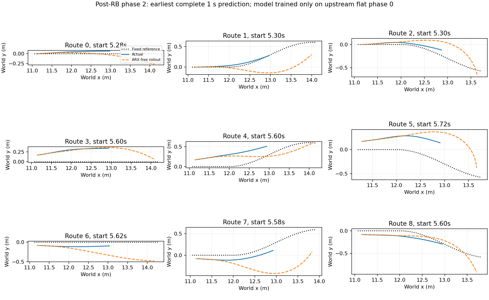

# Post-handoff nominal model transfer diagnostic

Reuses existing nine full-chain DEV trajectories; no simulation or policy/model refitting. Model remains flat upstream TRAIN ARX. Phase-2 lookahead multiplier 1.3 is supplied explicitly. Initial two states are observed; future state and reference inputs are predicted. This is a domain diagnostic, not training coverage or independent TEST. The original full-chain nine goals remain physical-run facts, not prediction success.

| Route | Horizon s | Windows | P95 maximum XY m | Worst XY m | P95 body bound m |
|---|---:|---:|---:|---:|---:|
| 0 | 0.1 | 17 | 0.0727 | 0.0777 | 0.1548 |
| 0 | 0.3 | 16 | 0.3243 | 0.3254 | 0.4345 |
| 0 | 1.0 | 13 | 1.2105 | 1.2115 | 1.6146 |
| 0 | 2.0 | 8 | 2.2340 | 2.2489 | 2.9261 |
| 0 | 3.0 | 3 | 2.8332 | 2.8625 | 4.1982 |
| 1 | 0.1 | 19 | 0.0694 | 0.0717 | 0.1433 |
| 1 | 0.3 | 18 | 0.3392 | 0.3559 | 0.5402 |
| 1 | 1.0 | 14 | 1.1130 | 1.1132 | 2.3678 |
| 1 | 2.0 | 9 | 1.5451 | 1.5612 | 3.2764 |
| 1 | 3.0 | 4 | 2.0319 | 2.0839 | 3.2803 |
| 2 | 0.1 | 19 | 0.0662 | 0.0683 | 0.1657 |
| 2 | 0.3 | 18 | 0.3371 | 0.3496 | 0.6414 |
| 2 | 1.0 | 15 | 1.1901 | 1.2037 | 2.0734 |
| 2 | 2.0 | 10 | 2.1009 | 2.3035 | 3.2422 |
| 2 | 3.0 | 5 | 1.3156 | 1.3460 | 3.0169 |
| 3 | 0.1 | 17 | 0.0683 | 0.0777 | 0.1608 |
| 3 | 0.3 | 16 | 0.3274 | 0.3285 | 0.4468 |
| 3 | 1.0 | 13 | 1.2064 | 1.2095 | 1.8644 |
| 3 | 2.0 | 8 | 1.9770 | 2.0049 | 2.9548 |
| 3 | 3.0 | 3 | 1.9855 | 2.0049 | 3.2841 |
| 4 | 0.1 | 19 | 0.0696 | 0.0736 | 0.1487 |
| 4 | 0.3 | 18 | 0.3309 | 0.3553 | 0.5514 |
| 4 | 1.0 | 14 | 1.1534 | 1.1555 | 2.4244 |
| 4 | 2.0 | 9 | 1.6331 | 1.6410 | 3.3206 |
| 4 | 3.0 | 4 | 2.2115 | 2.2244 | 3.3344 |
| 5 | 0.1 | 19 | 0.0639 | 0.0664 | 0.1617 |
| 5 | 0.3 | 18 | 0.3369 | 0.3545 | 0.6332 |
| 5 | 1.0 | 15 | 1.2146 | 1.2258 | 2.1437 |
| 5 | 2.0 | 10 | 2.0414 | 2.2773 | 3.1519 |
| 5 | 3.0 | 5 | 2.1203 | 2.2394 | 3.3109 |
| 6 | 0.1 | 17 | 0.0713 | 0.0742 | 0.1513 |
| 6 | 0.3 | 16 | 0.3238 | 0.3271 | 0.4383 |
| 6 | 1.0 | 12 | 1.2233 | 1.2289 | 1.5728 |
| 6 | 2.0 | 7 | 2.3310 | 2.3321 | 2.8583 |
| 6 | 3.0 | 2 | 2.7989 | 2.8095 | 3.9730 |
| 7 | 0.1 | 19 | 0.0719 | 0.0809 | 0.1467 |
| 7 | 0.3 | 18 | 0.3513 | 0.3563 | 0.5495 |
| 7 | 1.0 | 14 | 1.1187 | 1.1195 | 2.3750 |
| 7 | 2.0 | 9 | 1.4836 | 1.4939 | 3.2009 |
| 7 | 3.0 | 4 | 1.8001 | 1.8133 | 3.2162 |
| 8 | 0.1 | 19 | 0.0708 | 0.0731 | 0.1678 |
| 8 | 0.3 | 18 | 0.3349 | 0.3379 | 0.6241 |
| 8 | 1.0 | 14 | 1.2047 | 1.2072 | 1.9938 |
| 8 | 2.0 | 9 | 1.7365 | 1.8510 | 3.2567 |
| 8 | 3.0 | 4 | 1.2227 | 1.2268 | 2.8519 |

Windows overlap and each route has one initial root. No probabilistic safety or whole-domain calibration is inferred. The source full-chain run did not save controller histories at every step; its physical states suffice for this ARX diagnostic but not for later controller-history learning. Expanded phase-2 collection remains needed.

Source: /media/qy/6A7E3DB07E3D75C3/STTW_runs/chapter3_playground_sttw_rb_sttw/p1_contact_telemetry/evaluation; model: /media/qy/6A7E3DB07E3D75C3/STTW_runs/chapter3_playground_sttw_rb_sttw/p1_ground_collection/model/nominal_arx.npz.
