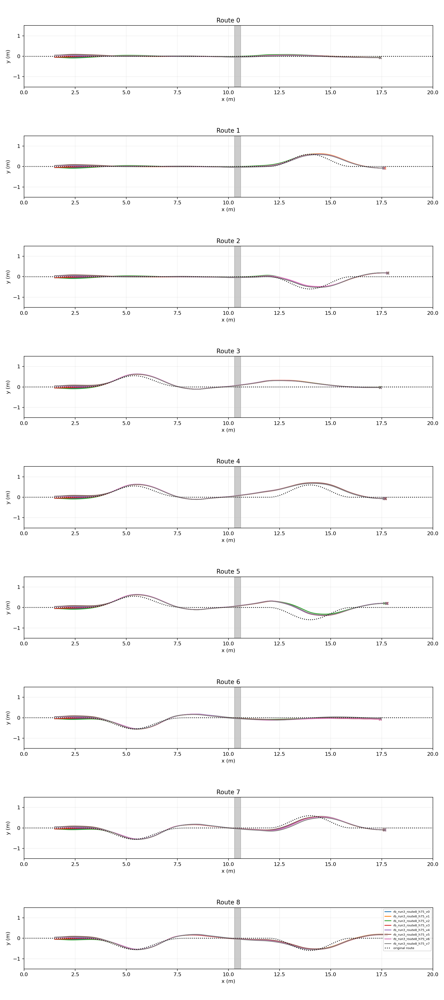
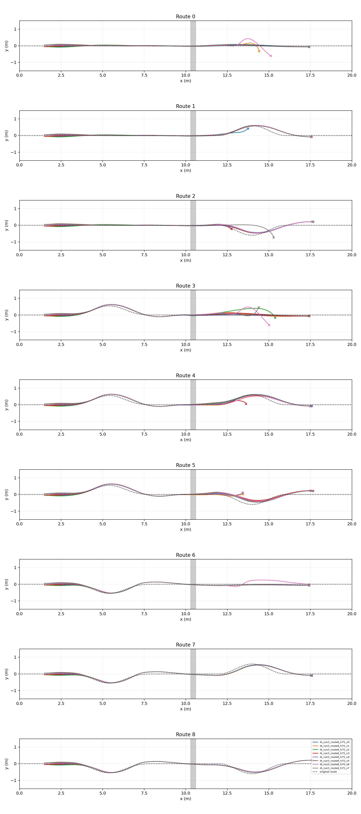
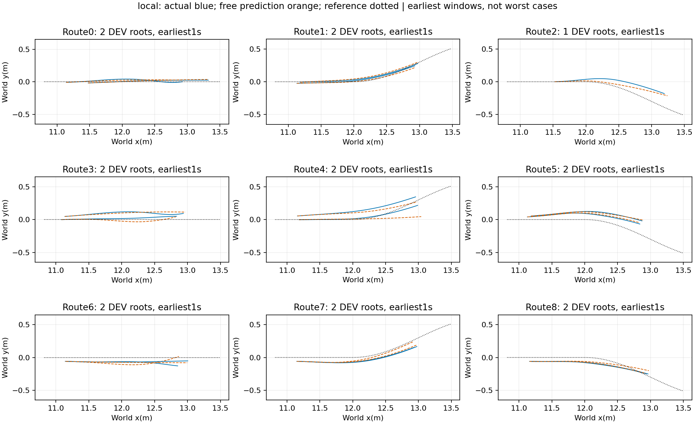

# P1真实回交数据与名义模型对照

原粗糙地图新增72条完整链采集71到达、1物理失败，222.531秒；失败route8_v3未在落地前记录到5ms腾空事件，已双轮在远岸却未进入收尾。候选增加双轮远岸支撑触发，原姿态/关节/重锁门槛不变，配对重跑72/72到达，221.249秒。但逐步接触和阶段重建发现新增分支实际触发0/72，不能把改善归因于修改；默认配置未采用。原失败保留，不能宣布跨初态鲁棒性已解决。详见[event audit](event_audit.json)。

## 名义辨识夹具及负结果

为了采集回交后的平地转向，另设仅远岸平坦的名义辨识夹具：近岸和沟不变，移除远岸粗糙及4cm脊坡。该夹具不是原越野任务，更不是降低原测试难度后的成功率。72条中61到达、6越跟踪域、5物理失败，218.677秒。全部失败轨迹保留。TRAIN初差0–5、DEV_ROOT初差6–7；同上游初差的三条下游曲线归同组，窗口重叠不独立。

相同8883条TRAIN转换、相同状态/参考输入与积分器比较全局ARX和16邻居局部凸组合。仅离线辨识；局部模型尚无在线GPU实现或时延证据。ARX齐次两阶递推谱半径1.077933，显示其自由递推不稳定；不能单由此推断完整闭环稳定性。局部预测输出位于TRAIN速度分量包络内，但这也不是安全保证。

|Route|DEV根数 / 1秒窗口|ARX P95最大XY m|局部 P95最大XY m|局部最坏XY m|局部 P95全车保守界 m|
|---|---:|---:|---:|---:|---:|
|0|2 / 21|3.2273|0.7825|1.1764|2.7728|
|1|2 / 28|0.6698|0.0219|0.0279|0.0419|
|2|1 / 13|3.5359|0.0988|0.1490|0.2350|
|3|2 / 14|3.2971|1.0428|1.3298|3.2330|
|4|2 / 28|0.5244|0.0610|0.1797|0.1236|
|5|2 / 29|7.1582|0.0291|0.0322|0.0877|
|6|2 / 27|2.3498|0.8842|1.8091|2.4485|
|7|2 / 28|0.4488|0.0351|0.0878|0.0800|
|8|2 / 28|0.8876|0.0198|0.0512|0.0397|

route0/3/6仍有大误差，不能采用为联合规划模型。route2只有一个DEV根具有完整1秒phase2窗口，另一根早终止不可补齐或算成功。完整多时域数据见[线性](linear/RESULTS.md)、[局部](local/RESULTS.md)、[仅平缓冲区拟合](buffer/RESULTS.md)。将正则先验改为恒速的早期尝试仍有约1米回交误差，也未采用。

本阶段没有续训RB或H75，没有改变默认物理/地形/目标。P1预测校准仍未通过，E1/E2/E3未执行；后续先推进已覆盖phase0的地面规划先导，同时将phase2大误差保留为P2联合规划的明确限制，不再扩无针对性RB训练。原始完整控制历史/接触/快照位于外盘同名运行目录。
