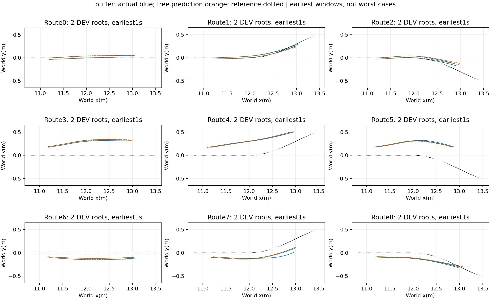

# Phase2 nominal flat-buffer identification

{"training_rows": 1460, "training_region_root_x_m": [11.0, 12.2], "terrain_flat_interval_m": [10.6, 12.6], "grouping": "TRAIN variants0-5, DEV_ROOT6-7; downstream siblings grouped by upstream+variant; same map, not independent map TEST", "physics_and_policy": "Frozen successful shared runner; actual handoff histories; no RB adaptation", "model": "ARX2 fitted only from flat-buffer phase2 triples; all later rollout inputs predicted", "limitation": "Short flat buffer may not excite downstream curvature; does not establish whole-route coverage or planning safety"}

| Model | Split | Route | Horizon s | Windows/roots | P95 max XY m | Worst XY m | P95 body bound m |
|---|---|---:|---:|---:|---:|---:|---:|
|phase0_model|TRAIN|0|0.1|102/6|0.0762|0.0773|0.1763|
|phase0_model|TRAIN|0|0.3|96/6|0.3260|0.3283|0.4435|
|phase0_model|TRAIN|0|1.0|73/6|1.2126|1.2157|1.6305|
|phase0_model|TRAIN|0|2.0|43/6|2.2344|2.2647|2.9618|
|phase0_model|TRAIN|0|3.0|13/6|2.8200|2.8264|4.2096|
|phase0_model|TRAIN|1|0.1|113/6|0.0703|0.0726|0.1499|
|phase0_model|TRAIN|1|0.3|107/6|0.3509|0.3579|0.5426|
|phase0_model|TRAIN|1|1.0|84/6|1.1152|1.1213|2.4225|
|phase0_model|TRAIN|1|2.0|54/6|1.5791|1.6561|3.2926|
|phase0_model|TRAIN|1|3.0|24/6|2.1475|2.2103|3.3297|
|phase0_model|TRAIN|2|0.1|114/6|0.0694|0.0714|0.1666|
|phase0_model|TRAIN|2|0.3|108/6|0.3468|0.3558|0.6446|
|phase0_model|TRAIN|2|1.0|86/6|1.2045|1.2328|2.0949|
|phase0_model|TRAIN|2|2.0|56/6|1.9003|2.2735|3.2946|
|phase0_model|TRAIN|2|3.0|26/6|1.3569|1.4999|3.0810|
|phase0_model|TRAIN|3|0.1|102/6|0.0763|0.0777|0.1848|
|phase0_model|TRAIN|3|0.3|96/6|0.3403|0.3498|0.4514|
|phase0_model|TRAIN|3|1.0|78/6|1.2071|1.2140|1.9728|
|phase0_model|TRAIN|3|2.0|48/6|1.9751|2.0038|2.9817|
|phase0_model|TRAIN|3|3.0|18/6|1.9763|1.9831|3.4385|
|phase0_model|TRAIN|4|0.1|110/6|0.0735|0.0816|0.1544|
|phase0_model|TRAIN|4|0.3|104/6|0.3512|0.3570|0.5544|
|phase0_model|TRAIN|4|1.0|84/6|1.1593|1.1711|2.4288|
|phase0_model|TRAIN|4|2.0|54/6|1.6666|1.6864|3.3238|
|phase0_model|TRAIN|4|3.0|24/6|2.2287|2.2356|3.3394|
|phase0_model|TRAIN|5|0.1|115/6|0.0669|0.0733|0.1624|
|phase0_model|TRAIN|5|0.3|109/6|0.3431|0.3509|0.6663|
|phase0_model|TRAIN|5|1.0|90/6|1.2265|1.2356|2.2504|
|phase0_model|TRAIN|5|2.0|60/6|2.0949|2.2374|3.2029|
|phase0_model|TRAIN|5|3.0|30/6|2.3268|2.3709|3.2852|
|phase0_model|TRAIN|6|0.1|93/6|0.0725|0.0807|0.1591|
|phase0_model|TRAIN|6|0.3|87/6|0.3280|0.3454|0.4360|
|phase0_model|TRAIN|6|1.0|65/6|1.2268|1.3007|1.5704|
|phase0_model|TRAIN|6|2.0|36/5|2.3319|2.3527|2.8455|
|phase0_model|TRAIN|6|3.0|11/5|2.9246|2.9941|4.1052|
|phase0_model|TRAIN|7|0.1|114/6|0.0675|0.0711|0.1483|
|phase0_model|TRAIN|7|0.3|108/6|0.3531|0.3565|0.5523|
|phase0_model|TRAIN|7|1.0|85/6|1.1189|1.1251|2.4092|
|phase0_model|TRAIN|7|2.0|55/6|1.4834|1.6123|3.2297|
|phase0_model|TRAIN|7|3.0|25/6|1.9564|2.1041|3.2486|
|phase0_model|TRAIN|8|0.1|95/5|0.0685|0.0732|0.1773|
|phase0_model|TRAIN|8|0.3|90/5|0.3355|0.3440|0.6459|
|phase0_model|TRAIN|8|1.0|70/5|1.2015|1.2029|1.9895|
|phase0_model|TRAIN|8|2.0|45/5|1.8661|2.2164|3.3091|
|phase0_model|TRAIN|8|3.0|20/5|1.2351|1.2368|2.8775|
|phase0_model|DEV_ROOT|0|0.1|34/2|0.0760|0.0783|0.1593|
|phase0_model|DEV_ROOT|0|0.3|32/2|0.3266|0.3272|0.4358|
|phase0_model|DEV_ROOT|0|1.0|24/2|1.2125|1.2151|1.5857|
|phase0_model|DEV_ROOT|0|2.0|14/2|2.2542|2.2598|2.9247|
|phase0_model|DEV_ROOT|0|3.0|4/2|2.8771|2.8946|4.2414|
|phase0_model|DEV_ROOT|1|0.1|37/2|0.0691|0.0723|0.1515|
|phase0_model|DEV_ROOT|1|0.3|35/2|0.3430|0.3584|0.5385|
|phase0_model|DEV_ROOT|1|1.0|28/2|1.1154|1.1182|2.3912|
|phase0_model|DEV_ROOT|1|2.0|18/2|1.5483|1.5542|3.2687|
|phase0_model|DEV_ROOT|1|3.0|8/2|2.0924|2.1121|3.2723|
|phase0_model|DEV_ROOT|2|0.1|38/2|0.0723|0.0741|0.1636|
|phase0_model|DEV_ROOT|2|0.3|36/2|0.3383|0.3566|0.6353|
|phase0_model|DEV_ROOT|2|1.0|29/2|1.2007|1.2321|2.0847|
|phase0_model|DEV_ROOT|2|2.0|19/2|1.9069|2.3575|3.2984|
|phase0_model|DEV_ROOT|2|3.0|9/2|1.3270|1.3487|3.0391|
|phase0_model|DEV_ROOT|3|0.1|34/2|0.0713|0.0777|0.1660|
|phase0_model|DEV_ROOT|3|0.3|32/2|0.3305|0.3423|0.4530|
|phase0_model|DEV_ROOT|3|1.0|26/2|1.2078|1.2087|1.9170|
|phase0_model|DEV_ROOT|3|2.0|16/2|1.9602|1.9696|2.9768|
|phase0_model|DEV_ROOT|3|3.0|6/2|1.9665|1.9696|3.3682|
|phase0_model|DEV_ROOT|4|0.1|37/2|0.0729|0.0752|0.1500|
|phase0_model|DEV_ROOT|4|0.3|35/2|0.3403|0.3564|0.5521|
|phase0_model|DEV_ROOT|4|1.0|28/2|1.1635|1.1671|2.4281|
|phase0_model|DEV_ROOT|4|2.0|18/2|1.7167|1.7344|3.3707|
|phase0_model|DEV_ROOT|4|3.0|8/2|2.2266|2.2315|3.3982|
|phase0_model|DEV_ROOT|5|0.1|39/2|0.0666|0.0699|0.1570|
|phase0_model|DEV_ROOT|5|0.3|37/2|0.3355|0.3503|0.6301|
|phase0_model|DEV_ROOT|5|1.0|30/2|1.2198|1.2360|2.2148|
|phase0_model|DEV_ROOT|5|2.0|20/2|2.0748|2.1446|3.1878|
|phase0_model|DEV_ROOT|5|3.0|10/2|2.3221|2.3692|3.2458|
|phase0_model|DEV_ROOT|6|0.1|34/2|0.0758|0.0792|0.1569|
|phase0_model|DEV_ROOT|6|0.3|32/2|0.3268|0.3311|0.4422|
|phase0_model|DEV_ROOT|6|1.0|24/2|1.2271|1.2355|1.5929|
|phase0_model|DEV_ROOT|6|2.0|14/2|2.3993|2.4275|2.9369|
|phase0_model|DEV_ROOT|6|3.0|4/2|2.9557|2.9795|3.9722|
|phase0_model|DEV_ROOT|7|0.1|40/2|0.0664|0.0705|0.1428|
|phase0_model|DEV_ROOT|7|0.3|38/2|0.3306|0.3571|0.5675|
|phase0_model|DEV_ROOT|7|1.0|30/2|1.1313|1.1538|2.3958|
|phase0_model|DEV_ROOT|7|2.0|20/2|1.7774|1.9954|3.6278|
|phase0_model|DEV_ROOT|7|3.0|10/2|2.5003|2.5875|3.6439|
|phase0_model|DEV_ROOT|8|0.1|38/2|0.0662|0.0732|0.1572|
|phase0_model|DEV_ROOT|8|0.3|36/2|0.3371|0.3536|0.6284|
|phase0_model|DEV_ROOT|8|1.0|28/2|1.1999|1.2104|2.0005|
|phase0_model|DEV_ROOT|8|2.0|18/2|2.0827|2.1717|3.3432|
|phase0_model|DEV_ROOT|8|3.0|8/2|1.2381|1.2433|2.8784|
|phase2_flat_model|TRAIN|0|0.1|102/6|0.1143|0.1198|0.5837|
|phase2_flat_model|TRAIN|0|0.3|96/6|0.1830|0.1874|1.2782|
|phase2_flat_model|TRAIN|0|1.0|73/6|0.2176|0.2244|1.2832|
|phase2_flat_model|TRAIN|0|2.0|43/6|0.1156|0.1535|0.4966|
|phase2_flat_model|TRAIN|0|3.0|13/6|0.0450|0.0454|0.1037|
|phase2_flat_model|TRAIN|1|0.1|113/6|0.1228|0.1306|0.5794|
|phase2_flat_model|TRAIN|1|0.3|107/6|0.1818|0.1938|1.1630|
|phase2_flat_model|TRAIN|1|1.0|84/6|0.3975|0.4009|1.1782|
|phase2_flat_model|TRAIN|1|2.0|54/6|0.5374|0.5514|1.1308|
|phase2_flat_model|TRAIN|1|3.0|24/6|0.4454|0.4485|0.6979|
|phase2_flat_model|TRAIN|2|0.1|114/6|0.1194|0.1293|0.5914|
|phase2_flat_model|TRAIN|2|0.3|108/6|0.2072|0.2177|1.3366|
|phase2_flat_model|TRAIN|2|1.0|86/6|0.3779|0.4225|1.3559|
|phase2_flat_model|TRAIN|2|2.0|56/6|0.7398|0.8248|1.3907|
|phase2_flat_model|TRAIN|2|3.0|26/6|0.4554|0.4558|0.7787|
|phase2_flat_model|TRAIN|3|0.1|102/6|0.1196|0.1212|0.6015|
|phase2_flat_model|TRAIN|3|0.3|96/6|0.1644|0.1649|1.2729|
|phase2_flat_model|TRAIN|3|1.0|78/6|0.2851|0.2900|1.2771|
|phase2_flat_model|TRAIN|3|2.0|48/6|0.1766|0.2065|0.8991|
|phase2_flat_model|TRAIN|3|3.0|18/6|0.1054|0.1065|0.1354|
|phase2_flat_model|TRAIN|4|0.1|110/6|0.1165|0.1247|0.5694|
|phase2_flat_model|TRAIN|4|0.3|104/6|0.1693|0.1896|1.1546|
|phase2_flat_model|TRAIN|4|1.0|84/6|0.4088|0.4161|1.1827|
|phase2_flat_model|TRAIN|4|2.0|54/6|0.4782|0.4922|1.1448|
|phase2_flat_model|TRAIN|4|3.0|24/6|0.3417|0.3448|0.6265|
|phase2_flat_model|TRAIN|5|0.1|115/6|0.1387|0.1494|0.6064|
|phase2_flat_model|TRAIN|5|0.3|109/6|0.1988|0.2050|1.3553|
|phase2_flat_model|TRAIN|5|1.0|90/6|0.4744|0.4872|1.5601|
|phase2_flat_model|TRAIN|5|2.0|60/6|1.2971|1.4842|3.5867|
|phase2_flat_model|TRAIN|5|3.0|30/6|0.4745|0.4779|0.8395|
|phase2_flat_model|TRAIN|6|0.1|93/6|0.1109|0.1195|0.5386|
|phase2_flat_model|TRAIN|6|0.3|87/6|0.1959|0.2410|1.2188|
|phase2_flat_model|TRAIN|6|1.0|65/6|0.2034|0.3165|1.2759|
|phase2_flat_model|TRAIN|6|2.0|36/5|0.1229|0.1694|0.4527|
|phase2_flat_model|TRAIN|6|3.0|11/5|0.0923|0.0926|0.1198|
|phase2_flat_model|TRAIN|7|0.1|114/6|0.1286|0.1340|0.5890|
|phase2_flat_model|TRAIN|7|0.3|108/6|0.2140|0.2326|1.1783|
|phase2_flat_model|TRAIN|7|1.0|85/6|0.3898|0.4134|1.2072|
|phase2_flat_model|TRAIN|7|2.0|55/6|0.7200|0.7509|1.2689|
|phase2_flat_model|TRAIN|7|3.0|25/6|0.5694|0.5810|0.8679|
|phase2_flat_model|TRAIN|8|0.1|95/5|0.1181|0.1295|0.5675|
|phase2_flat_model|TRAIN|8|0.3|90/5|0.2198|0.2295|1.3292|
|phase2_flat_model|TRAIN|8|1.0|70/5|0.3606|0.3935|1.3311|
|phase2_flat_model|TRAIN|8|2.0|45/5|0.7231|0.7457|1.3825|
|phase2_flat_model|TRAIN|8|3.0|20/5|0.4370|0.4429|0.7176|
|phase2_flat_model|DEV_ROOT|0|0.1|34/2|0.1098|0.1187|0.5342|
|phase2_flat_model|DEV_ROOT|0|0.3|32/2|0.1812|0.1868|1.1557|
|phase2_flat_model|DEV_ROOT|0|1.0|24/2|0.2096|0.2169|1.2480|
|phase2_flat_model|DEV_ROOT|0|2.0|14/2|0.1152|0.1155|0.4366|
|phase2_flat_model|DEV_ROOT|0|3.0|4/2|0.0535|0.0538|0.1014|
|phase2_flat_model|DEV_ROOT|1|0.1|37/2|0.1186|0.1308|0.5782|
|phase2_flat_model|DEV_ROOT|1|0.3|35/2|0.1845|0.1918|1.1657|
|phase2_flat_model|DEV_ROOT|1|1.0|28/2|0.3697|0.3947|1.1714|
|phase2_flat_model|DEV_ROOT|1|2.0|18/2|0.5467|0.5577|1.1459|
|phase2_flat_model|DEV_ROOT|1|3.0|8/2|0.4573|0.4575|0.7086|
|phase2_flat_model|DEV_ROOT|2|0.1|38/2|0.1129|0.1286|0.5879|
|phase2_flat_model|DEV_ROOT|2|0.3|36/2|0.1987|0.2162|1.3063|
|phase2_flat_model|DEV_ROOT|2|1.0|29/2|0.3684|0.3810|1.3382|
|phase2_flat_model|DEV_ROOT|2|2.0|19/2|0.7203|0.7875|1.3564|
|phase2_flat_model|DEV_ROOT|2|3.0|9/2|0.4248|0.4258|0.7353|
|phase2_flat_model|DEV_ROOT|3|0.1|34/2|0.1056|0.1210|0.5275|
|phase2_flat_model|DEV_ROOT|3|0.3|32/2|0.1632|0.1638|1.2139|
|phase2_flat_model|DEV_ROOT|3|1.0|26/2|0.2854|0.2885|1.2759|
|phase2_flat_model|DEV_ROOT|3|2.0|16/2|0.1898|0.1917|0.9243|
|phase2_flat_model|DEV_ROOT|3|3.0|6/2|0.0980|0.0984|0.1283|
|phase2_flat_model|DEV_ROOT|4|0.1|37/2|0.1145|0.1239|0.5538|
|phase2_flat_model|DEV_ROOT|4|0.3|35/2|0.1658|0.1895|1.1543|
|phase2_flat_model|DEV_ROOT|4|1.0|28/2|0.3876|0.4184|1.1743|
|phase2_flat_model|DEV_ROOT|4|2.0|18/2|0.4537|0.4916|1.0833|
|phase2_flat_model|DEV_ROOT|4|3.0|8/2|0.3389|0.3397|0.6313|
|phase2_flat_model|DEV_ROOT|5|0.1|39/2|0.1380|0.1447|0.5818|
|phase2_flat_model|DEV_ROOT|5|0.3|37/2|0.1944|0.2036|1.2989|
|phase2_flat_model|DEV_ROOT|5|1.0|30/2|0.4674|0.4811|1.5043|
|phase2_flat_model|DEV_ROOT|5|2.0|20/2|1.3350|1.4446|3.4578|
|phase2_flat_model|DEV_ROOT|5|3.0|10/2|0.4844|0.4844|0.8530|
|phase2_flat_model|DEV_ROOT|6|0.1|34/2|0.1111|0.1192|0.5375|
|phase2_flat_model|DEV_ROOT|6|0.3|32/2|0.1934|0.2005|1.1570|
|phase2_flat_model|DEV_ROOT|6|1.0|24/2|0.2023|0.2065|1.2389|
|phase2_flat_model|DEV_ROOT|6|2.0|14/2|0.1252|0.1301|0.4476|
|phase2_flat_model|DEV_ROOT|6|3.0|4/2|0.0988|0.0998|0.1420|
|phase2_flat_model|DEV_ROOT|7|0.1|40/2|0.1343|0.1390|0.5884|
|phase2_flat_model|DEV_ROOT|7|0.3|38/2|0.2314|0.3073|1.1449|
|phase2_flat_model|DEV_ROOT|7|1.0|30/2|0.7079|0.9199|1.4631|
|phase2_flat_model|DEV_ROOT|7|2.0|20/2|2.0226|3.1754|3.1645|
|phase2_flat_model|DEV_ROOT|7|3.0|10/2|0.8775|1.0093|1.3213|
|phase2_flat_model|DEV_ROOT|8|0.1|38/2|0.1183|0.1241|0.5412|
|phase2_flat_model|DEV_ROOT|8|0.3|36/2|0.2216|0.2263|1.3247|
|phase2_flat_model|DEV_ROOT|8|1.0|28/2|0.3511|0.3680|1.3419|
|phase2_flat_model|DEV_ROOT|8|2.0|18/2|0.7326|0.7373|1.4272|
|phase2_flat_model|DEV_ROOT|8|3.0|8/2|0.4357|0.4381|0.7141|

Overlapping windows are dependent descriptive diagnostics. All failures remain in physical reports; prediction windows stop at the real terminal state. Methods share states, integrator and geometric-bound calculation. No independent TEST, planner benefit or physical-success improvement follows from these model fits.
