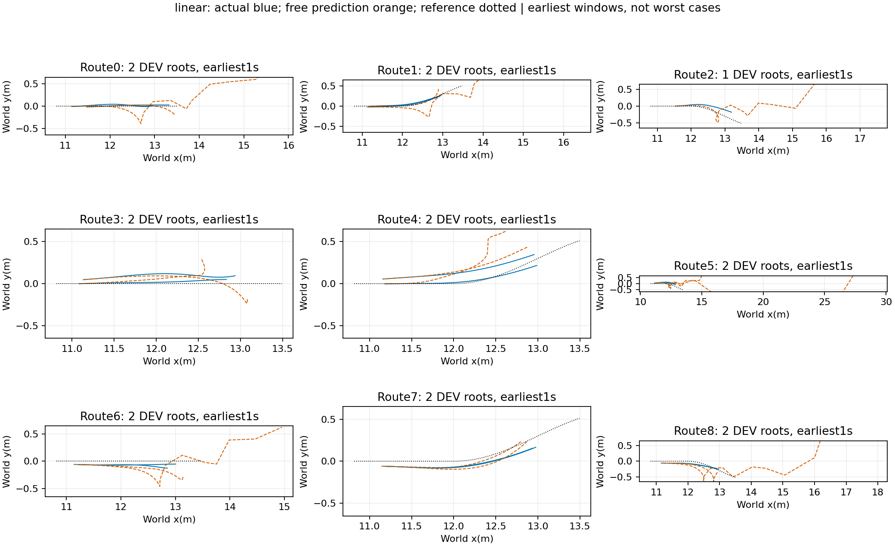

# Phase2 nominal flat-buffer identification

{"training_rows": 8883, "training_region_root_x_m": [11.0, 25.0], "terrain_flat_interval_m": [10.6, 25.0], "grouping": "TRAIN variants0-5, DEV_ROOT6-7; downstream siblings grouped by upstream+variant; same map, not independent map TEST", "physics_and_policy": "Frozen successful shared runner; actual handoff histories; no RB adaptation", "model": "ARX2 fitted only from flat-buffer phase2 triples; all later rollout inputs predicted", "limitation": "Short flat buffer may not excite downstream curvature; does not establish whole-route coverage or planning safety"}

| Model | Split | Route | Horizon s | Windows/roots | P95 max XY m | Worst XY m | P95 body bound m |
|---|---|---:|---:|---:|---:|---:|---:|
|phase0_model|TRAIN|0|0.1|95/6|0.0665|0.0877|0.1350|
|phase0_model|TRAIN|0|0.3|89/6|0.3381|0.3545|0.4369|
|phase0_model|TRAIN|0|1.0|67/6|1.3185|1.4610|1.9887|
|phase0_model|TRAIN|0|2.0|37/5|2.2055|2.3450|2.9735|
|phase0_model|TRAIN|0|3.0|12/5|2.9592|2.9882|4.2170|
|phase0_model|TRAIN|1|0.1|101/6|0.0649|0.0839|0.1036|
|phase0_model|TRAIN|1|0.3|95/6|0.3394|0.3436|0.5493|
|phase0_model|TRAIN|1|1.0|73/6|1.1283|1.2131|2.3993|
|phase0_model|TRAIN|1|2.0|45/5|1.5829|1.5983|3.2710|
|phase0_model|TRAIN|1|3.0|20/5|2.1392|2.1663|3.2833|
|phase0_model|TRAIN|2|0.1|100/6|0.0656|0.0812|0.1045|
|phase0_model|TRAIN|2|0.3|94/6|0.3478|0.3720|0.6659|
|phase0_model|TRAIN|2|1.0|70/5|1.2229|1.2303|2.1187|
|phase0_model|TRAIN|2|2.0|45/5|1.9195|1.9689|3.3521|
|phase0_model|TRAIN|2|3.0|20/5|1.3773|1.4231|3.1103|
|phase0_model|TRAIN|3|0.1|85/5|0.0652|0.0785|0.0956|
|phase0_model|TRAIN|3|0.3|80/5|0.3181|0.3271|0.4427|
|phase0_model|TRAIN|3|1.0|64/5|1.2097|1.2128|1.6450|
|phase0_model|TRAIN|3|2.0|39/5|2.1557|2.1985|2.9296|
|phase0_model|TRAIN|3|3.0|14/5|2.6969|2.7341|4.0828|
|phase0_model|TRAIN|4|0.1|99/6|0.0653|0.0858|0.1150|
|phase0_model|TRAIN|4|0.3|93/6|0.3394|0.3455|0.5466|
|phase0_model|TRAIN|4|1.0|73/6|1.1287|1.1995|2.3857|
|phase0_model|TRAIN|4|2.0|45/5|1.6070|1.7340|3.3012|
|phase0_model|TRAIN|4|3.0|20/5|2.1836|2.2410|3.3098|
|phase0_model|TRAIN|5|0.1|88/6|0.0722|0.0860|0.2597|
|phase0_model|TRAIN|5|0.3|82/6|0.3557|0.3734|0.7255|
|phase0_model|TRAIN|5|1.0|62/6|1.2328|1.4815|2.5323|
|phase0_model|TRAIN|5|2.0|37/4|2.1654|2.3114|3.2992|
|phase0_model|TRAIN|5|3.0|17/4|1.8928|2.2377|3.2746|
|phase0_model|TRAIN|6|0.1|102/6|0.0656|0.0895|0.0948|
|phase0_model|TRAIN|6|0.3|96/6|0.3184|0.3357|0.4286|
|phase0_model|TRAIN|6|1.0|73/6|1.2183|1.2257|1.5391|
|phase0_model|TRAIN|6|2.0|43/6|2.3190|2.3462|2.8556|
|phase0_model|TRAIN|6|3.0|13/6|2.9722|3.0152|4.1472|
|phase0_model|TRAIN|7|0.1|113/6|0.0651|0.0782|0.1026|
|phase0_model|TRAIN|7|0.3|107/6|0.3398|0.3447|0.5436|
|phase0_model|TRAIN|7|1.0|84/6|1.1334|1.1348|2.3779|
|phase0_model|TRAIN|7|2.0|54/6|1.4963|1.5086|3.2137|
|phase0_model|TRAIN|7|3.0|24/6|1.9162|1.9518|3.2254|
|phase0_model|TRAIN|8|0.1|111/6|0.0643|0.0836|0.1021|
|phase0_model|TRAIN|8|0.3|105/6|0.3327|0.3414|0.6412|
|phase0_model|TRAIN|8|1.0|84/6|1.2225|1.2284|2.0147|
|phase0_model|TRAIN|8|2.0|54/6|1.9641|2.0419|3.3625|
|phase0_model|TRAIN|8|3.0|24/6|1.2481|1.2494|2.9099|
|phase0_model|DEV_ROOT|0|0.1|29/2|0.0751|0.0788|0.1824|
|phase0_model|DEV_ROOT|0|0.3|27/2|0.3674|0.3790|0.6405|
|phase0_model|DEV_ROOT|0|1.0|21/2|1.5710|1.5846|2.5157|
|phase0_model|DEV_ROOT|0|2.0|11/2|3.0047|3.1667|4.0630|
|phase0_model|DEV_ROOT|0|3.0|2/1|2.6667|2.6734|4.0757|
|phase0_model|DEV_ROOT|1|0.1|38/2|0.0648|0.0809|0.1026|
|phase0_model|DEV_ROOT|1|0.3|36/2|0.3386|0.3430|0.5415|
|phase0_model|DEV_ROOT|1|1.0|28/2|1.1262|1.1288|2.3776|
|phase0_model|DEV_ROOT|1|2.0|18/2|1.5723|1.5845|3.2727|
|phase0_model|DEV_ROOT|1|3.0|8/2|2.1058|2.1232|3.2799|
|phase0_model|DEV_ROOT|2|0.1|18/1|0.0633|0.0636|0.0993|
|phase0_model|DEV_ROOT|2|0.3|17/1|0.3417|0.3487|0.6478|
|phase0_model|DEV_ROOT|2|1.0|13/1|1.2205|1.2330|1.9618|
|phase0_model|DEV_ROOT|2|2.0|8/1|1.6839|1.9148|3.1754|
|phase0_model|DEV_ROOT|2|3.0|3/1|1.1576|1.1582|2.8201|
|phase0_model|DEV_ROOT|3|0.1|23/2|0.0790|0.0819|0.2656|
|phase0_model|DEV_ROOT|3|0.3|21/2|0.3647|0.4030|0.7324|
|phase0_model|DEV_ROOT|3|1.0|14/2|1.6223|1.7264|2.9138|
|phase0_model|DEV_ROOT|3|2.0|4/2|2.6425|2.6513|4.1968|
|phase0_model|DEV_ROOT|4|0.1|36/2|0.0662|0.0833|0.1025|
|phase0_model|DEV_ROOT|4|0.3|34/2|0.3404|0.3430|0.5282|
|phase0_model|DEV_ROOT|4|1.0|28/2|1.1358|1.1364|2.3401|
|phase0_model|DEV_ROOT|4|2.0|18/2|1.6443|1.6535|3.2966|
|phase0_model|DEV_ROOT|4|3.0|8/2|2.1656|2.1918|3.3248|
|phase0_model|DEV_ROOT|5|0.1|38/2|0.0662|0.0821|0.1037|
|phase0_model|DEV_ROOT|5|0.3|36/2|0.3449|0.3593|0.6600|
|phase0_model|DEV_ROOT|5|1.0|29/2|1.2275|1.2347|2.1374|
|phase0_model|DEV_ROOT|5|2.0|19/2|2.0262|2.3155|3.3071|
|phase0_model|DEV_ROOT|5|3.0|9/2|1.9365|2.0287|3.3789|
|phase0_model|DEV_ROOT|6|0.1|35/2|0.0659|0.0767|0.1313|
|phase0_model|DEV_ROOT|6|0.3|33/2|0.3411|0.3656|0.5105|
|phase0_model|DEV_ROOT|6|1.0|27/2|1.4330|1.5440|2.3952|
|phase0_model|DEV_ROOT|6|2.0|17/2|2.4961|2.6270|3.1073|
|phase0_model|DEV_ROOT|6|3.0|7/2|3.0920|3.1686|4.2838|
|phase0_model|DEV_ROOT|7|0.1|38/2|0.0647|0.0651|0.1028|
|phase0_model|DEV_ROOT|7|0.3|36/2|0.3404|0.3458|0.5419|
|phase0_model|DEV_ROOT|7|1.0|28/2|1.1321|1.1341|2.3643|
|phase0_model|DEV_ROOT|7|2.0|18/2|1.4911|1.4920|3.2091|
|phase0_model|DEV_ROOT|7|3.0|8/2|1.8449|1.8538|3.2099|
|phase0_model|DEV_ROOT|8|0.1|37/2|0.0645|0.0748|0.1014|
|phase0_model|DEV_ROOT|8|0.3|35/2|0.3277|0.3416|0.6183|
|phase0_model|DEV_ROOT|8|1.0|28/2|1.2166|1.2281|2.0143|
|phase0_model|DEV_ROOT|8|2.0|18/2|1.9615|2.0286|3.3628|
|phase0_model|DEV_ROOT|8|3.0|8/2|1.2500|1.2530|2.9100|
|phase2_flat_model|TRAIN|0|0.1|95/6|0.0048|0.0166|0.0199|
|phase2_flat_model|TRAIN|0|0.3|89/6|0.0292|0.1150|0.1543|
|phase2_flat_model|TRAIN|0|1.0|67/6|1.2494|8.7205|3.7238|
|phase2_flat_model|TRAIN|0|2.0|37/5|6051.9550|47479.5609|7076.2917|
|phase2_flat_model|TRAIN|0|3.0|12/5|3766730793.0631|8086444051.0427|4463527045.0124|
|phase2_flat_model|TRAIN|1|0.1|101/6|0.0034|0.0242|0.0212|
|phase2_flat_model|TRAIN|1|0.3|95/6|0.0240|0.0713|0.1085|
|phase2_flat_model|TRAIN|1|1.0|73/6|0.6952|3.2545|2.8348|
|phase2_flat_model|TRAIN|1|2.0|45/5|48551.8383|66781.2432|62349.5134|
|phase2_flat_model|TRAIN|1|3.0|20/5|5912540917.0870|5967175024.1056|7856658841.0379|
|phase2_flat_model|TRAIN|2|0.1|100/6|0.0045|0.0186|0.0254|
|phase2_flat_model|TRAIN|2|0.3|94/6|0.0270|0.0558|0.1498|
|phase2_flat_model|TRAIN|2|1.0|70/5|2.8472|21.5491|5.8974|
|phase2_flat_model|TRAIN|2|2.0|45/5|84104.5846|217490.0054|88925.6247|
|phase2_flat_model|TRAIN|2|3.0|20/5|3850818707.0659|9255433139.1503|4548126359.9551|
|phase2_flat_model|TRAIN|3|0.1|85/5|0.0021|0.0115|0.0142|
|phase2_flat_model|TRAIN|3|0.3|80/5|0.0186|0.0298|0.0775|
|phase2_flat_model|TRAIN|3|1.0|64/5|0.4014|7.8779|2.7227|
|phase2_flat_model|TRAIN|3|2.0|39/5|490.8429|2520.2232|492.8684|
|phase2_flat_model|TRAIN|3|3.0|14/5|969481.6130|1701230.0470|1120669.3570|
|phase2_flat_model|TRAIN|4|0.1|99/6|0.0049|0.0203|0.0270|
|phase2_flat_model|TRAIN|4|0.3|93/6|0.0250|0.1481|0.1347|
|phase2_flat_model|TRAIN|4|1.0|73/6|0.4842|0.7051|2.7810|
|phase2_flat_model|TRAIN|4|2.0|45/5|17369.9670|46817.5220|20645.8260|
|phase2_flat_model|TRAIN|4|3.0|20/5|310101852.8089|400257094.5943|424766236.8613|
|phase2_flat_model|TRAIN|5|0.1|88/6|0.0064|0.0096|0.0319|
|phase2_flat_model|TRAIN|5|0.3|82/6|0.0454|0.0578|0.2482|
|phase2_flat_model|TRAIN|5|1.0|62/6|8.3227|19.0857|11.4862|
|phase2_flat_model|TRAIN|5|2.0|37/4|336751.3286|765664.3251|544404.1176|
|phase2_flat_model|TRAIN|5|3.0|17/4|79488237291.5253|187094943703.7825|135257681701.4009|
|phase2_flat_model|TRAIN|6|0.1|102/6|0.0021|0.0124|0.0097|
|phase2_flat_model|TRAIN|6|0.3|96/6|0.0113|0.0344|0.0862|
|phase2_flat_model|TRAIN|6|1.0|73/6|0.7158|1.8323|2.7614|
|phase2_flat_model|TRAIN|6|2.0|43/6|1271.0297|1824.3763|1286.1109|
|phase2_flat_model|TRAIN|6|3.0|13/6|8757637.6566|18751301.7375|9963076.1981|
|phase2_flat_model|TRAIN|7|0.1|113/6|0.0032|0.0088|0.0108|
|phase2_flat_model|TRAIN|7|0.3|107/6|0.0204|0.0291|0.1062|
|phase2_flat_model|TRAIN|7|1.0|84/6|0.4685|0.7198|2.7912|
|phase2_flat_model|TRAIN|7|2.0|54/6|24641.9892|48551.5518|44320.0585|
|phase2_flat_model|TRAIN|7|3.0|24/6|2037748230.8991|8909475789.4693|2465788430.3337|
|phase2_flat_model|TRAIN|8|0.1|111/6|0.0039|0.0103|0.0148|
|phase2_flat_model|TRAIN|8|0.3|105/6|0.0242|0.0467|0.1165|
|phase2_flat_model|TRAIN|8|1.0|84/6|0.9961|14.1407|3.7218|
|phase2_flat_model|TRAIN|8|2.0|54/6|10615.6536|127856.9820|13216.9164|
|phase2_flat_model|TRAIN|8|3.0|24/6|8914186804.3683|19788773633.7690|11868300777.9167|
|phase2_flat_model|DEV_ROOT|0|0.1|29/2|0.0130|0.0200|0.0580|
|phase2_flat_model|DEV_ROOT|0|0.3|27/2|0.0840|0.1005|0.4735|
|phase2_flat_model|DEV_ROOT|0|1.0|21/2|3.2273|6.7223|5.8911|
|phase2_flat_model|DEV_ROOT|0|2.0|11/2|41577.2607|74053.8925|110791.1950|
|phase2_flat_model|DEV_ROOT|0|3.0|2/1|497250808.1487|523421894.6068|625877250.7601|
|phase2_flat_model|DEV_ROOT|1|0.1|38/2|0.0030|0.0105|0.0101|
|phase2_flat_model|DEV_ROOT|1|0.3|36/2|0.0200|0.0270|0.0958|
|phase2_flat_model|DEV_ROOT|1|1.0|28/2|0.6698|3.6758|2.8265|
|phase2_flat_model|DEV_ROOT|1|2.0|18/2|16816.7997|22718.6627|29542.4583|
|phase2_flat_model|DEV_ROOT|1|3.0|8/2|1826936984.2292|2007747870.4713|2892786950.7151|
|phase2_flat_model|DEV_ROOT|2|0.1|18/1|0.0076|0.0106|0.0254|
|phase2_flat_model|DEV_ROOT|2|0.3|17/1|0.0348|0.0375|0.1692|
|phase2_flat_model|DEV_ROOT|2|1.0|13/1|3.5359|6.1521|6.6341|
|phase2_flat_model|DEV_ROOT|2|2.0|8/1|47282.8648|72411.3132|65216.0629|
|phase2_flat_model|DEV_ROOT|2|3.0|3/1|8463795948.7351|9404217436.7509|12833558040.2283|
|phase2_flat_model|DEV_ROOT|3|0.1|23/2|0.0151|0.0154|0.0653|
|phase2_flat_model|DEV_ROOT|3|0.3|21/2|0.0793|0.1114|0.5955|
|phase2_flat_model|DEV_ROOT|3|1.0|14/2|3.2971|6.7678|6.1086|
|phase2_flat_model|DEV_ROOT|3|2.0|4/2|19109.2375|22471.9190|24237.2371|
|phase2_flat_model|DEV_ROOT|4|0.1|36/2|0.0043|0.0056|0.0103|
|phase2_flat_model|DEV_ROOT|4|0.3|34/2|0.0213|0.0392|0.0798|
|phase2_flat_model|DEV_ROOT|4|1.0|28/2|0.5244|0.8352|2.7522|
|phase2_flat_model|DEV_ROOT|4|2.0|18/2|2996.3943|7168.6642|3095.5385|
|phase2_flat_model|DEV_ROOT|4|3.0|8/2|5973456.7963|7271314.6123|6353772.3238|
|phase2_flat_model|DEV_ROOT|5|0.1|38/2|0.0075|0.0095|0.0225|
|phase2_flat_model|DEV_ROOT|5|0.3|36/2|0.0375|0.0560|0.1577|
|phase2_flat_model|DEV_ROOT|5|1.0|29/2|7.1582|16.6951|10.4909|
|phase2_flat_model|DEV_ROOT|5|2.0|19/2|42153.5724|252440.0624|74477.6300|
|phase2_flat_model|DEV_ROOT|5|3.0|9/2|17756129411.1568|29449911882.0586|39292467640.4363|
|phase2_flat_model|DEV_ROOT|6|0.1|35/2|0.0048|0.0160|0.0658|
|phase2_flat_model|DEV_ROOT|6|0.3|33/2|0.0423|0.0538|0.3461|
|phase2_flat_model|DEV_ROOT|6|1.0|27/2|2.3498|6.6656|4.8511|
|phase2_flat_model|DEV_ROOT|6|2.0|17/2|24893.5452|108670.7971|78632.5629|
|phase2_flat_model|DEV_ROOT|6|3.0|7/2|870318.9493|1204884.9102|1083086.3653|
|phase2_flat_model|DEV_ROOT|7|0.1|38/2|0.0025|0.0046|0.0094|
|phase2_flat_model|DEV_ROOT|7|0.3|36/2|0.0204|0.0227|0.0977|
|phase2_flat_model|DEV_ROOT|7|1.0|28/2|0.4488|0.4996|2.7839|
|phase2_flat_model|DEV_ROOT|7|2.0|18/2|2390.0423|3513.6928|3306.5501|
|phase2_flat_model|DEV_ROOT|7|3.0|8/2|145458939.7115|203826242.3225|222893098.8781|
|phase2_flat_model|DEV_ROOT|8|0.1|37/2|0.0028|0.0089|0.0165|
|phase2_flat_model|DEV_ROOT|8|0.3|35/2|0.0235|0.0371|0.0940|
|phase2_flat_model|DEV_ROOT|8|1.0|28/2|0.8876|6.7562|3.2521|
|phase2_flat_model|DEV_ROOT|8|2.0|18/2|2066.2686|4174.6961|2126.5628|
|phase2_flat_model|DEV_ROOT|8|3.0|8/2|16707872.2308|25659943.0016|72117589.1872|

Overlapping windows are dependent descriptive diagnostics. All failures remain in physical reports; prediction windows stop at the real terminal state. Methods share states, integrator and geometric-bound calculation. No independent TEST, planner benefit or physical-success improvement follows from these model fits.
