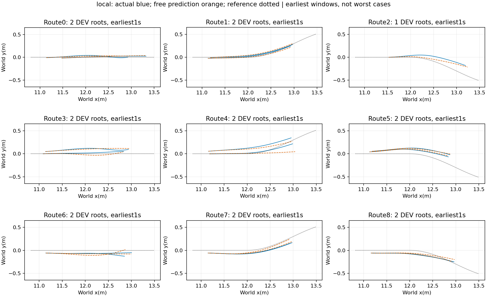

# Phase2 nominal flat-buffer identification

{"training_rows": 8883, "training_region_root_x_m": [11.0, 25.0], "terrain_flat_interval_m": [10.6, 25.0], "grouping": "TRAIN variants0-5, DEV_ROOT6-7; downstream siblings grouped by upstream+variant; same map, not independent map TEST", "physics_and_policy": "Frozen successful shared runner; actual handoff histories; no RB adaptation", "model": "local fitted only from declared nominal phase2 triples; all later rollout inputs predicted", "limitation": "Short flat buffer may not excite downstream curvature; does not establish whole-route coverage or planning safety"}

| Model | Split | Route | Horizon s | Windows/roots | P95 max XY m | Worst XY m | P95 body bound m |
|---|---|---:|---:|---:|---:|---:|---:|
|phase0_model|TRAIN|0|0.1|95/6|0.0665|0.0877|0.1350|
|phase0_model|TRAIN|0|0.3|89/6|0.3381|0.3545|0.4369|
|phase0_model|TRAIN|0|1.0|67/6|1.3185|1.4610|1.9887|
|phase0_model|TRAIN|0|2.0|37/5|2.2055|2.3450|2.9735|
|phase0_model|TRAIN|0|3.0|12/5|2.9592|2.9882|4.2170|
|phase0_model|TRAIN|1|0.1|101/6|0.0649|0.0839|0.1036|
|phase0_model|TRAIN|1|0.3|95/6|0.3394|0.3436|0.5493|
|phase0_model|TRAIN|1|1.0|73/6|1.1283|1.2131|2.3993|
|phase0_model|TRAIN|1|2.0|45/5|1.5829|1.5983|3.2710|
|phase0_model|TRAIN|1|3.0|20/5|2.1392|2.1663|3.2833|
|phase0_model|TRAIN|2|0.1|100/6|0.0656|0.0812|0.1045|
|phase0_model|TRAIN|2|0.3|94/6|0.3478|0.3720|0.6659|
|phase0_model|TRAIN|2|1.0|70/5|1.2229|1.2303|2.1187|
|phase0_model|TRAIN|2|2.0|45/5|1.9195|1.9689|3.3521|
|phase0_model|TRAIN|2|3.0|20/5|1.3773|1.4231|3.1103|
|phase0_model|TRAIN|3|0.1|85/5|0.0652|0.0785|0.0956|
|phase0_model|TRAIN|3|0.3|80/5|0.3181|0.3271|0.4427|
|phase0_model|TRAIN|3|1.0|64/5|1.2097|1.2128|1.6450|
|phase0_model|TRAIN|3|2.0|39/5|2.1557|2.1985|2.9296|
|phase0_model|TRAIN|3|3.0|14/5|2.6969|2.7341|4.0828|
|phase0_model|TRAIN|4|0.1|99/6|0.0653|0.0858|0.1150|
|phase0_model|TRAIN|4|0.3|93/6|0.3394|0.3455|0.5466|
|phase0_model|TRAIN|4|1.0|73/6|1.1287|1.1995|2.3857|
|phase0_model|TRAIN|4|2.0|45/5|1.6070|1.7340|3.3012|
|phase0_model|TRAIN|4|3.0|20/5|2.1836|2.2410|3.3098|
|phase0_model|TRAIN|5|0.1|88/6|0.0722|0.0860|0.2597|
|phase0_model|TRAIN|5|0.3|82/6|0.3557|0.3734|0.7255|
|phase0_model|TRAIN|5|1.0|62/6|1.2328|1.4815|2.5323|
|phase0_model|TRAIN|5|2.0|37/4|2.1654|2.3114|3.2992|
|phase0_model|TRAIN|5|3.0|17/4|1.8928|2.2377|3.2746|
|phase0_model|TRAIN|6|0.1|102/6|0.0656|0.0895|0.0948|
|phase0_model|TRAIN|6|0.3|96/6|0.3184|0.3357|0.4286|
|phase0_model|TRAIN|6|1.0|73/6|1.2183|1.2257|1.5391|
|phase0_model|TRAIN|6|2.0|43/6|2.3190|2.3462|2.8556|
|phase0_model|TRAIN|6|3.0|13/6|2.9722|3.0152|4.1472|
|phase0_model|TRAIN|7|0.1|113/6|0.0651|0.0782|0.1026|
|phase0_model|TRAIN|7|0.3|107/6|0.3398|0.3447|0.5436|
|phase0_model|TRAIN|7|1.0|84/6|1.1334|1.1348|2.3779|
|phase0_model|TRAIN|7|2.0|54/6|1.4963|1.5086|3.2137|
|phase0_model|TRAIN|7|3.0|24/6|1.9162|1.9518|3.2254|
|phase0_model|TRAIN|8|0.1|111/6|0.0643|0.0836|0.1021|
|phase0_model|TRAIN|8|0.3|105/6|0.3327|0.3414|0.6412|
|phase0_model|TRAIN|8|1.0|84/6|1.2225|1.2284|2.0147|
|phase0_model|TRAIN|8|2.0|54/6|1.9641|2.0419|3.3625|
|phase0_model|TRAIN|8|3.0|24/6|1.2481|1.2494|2.9099|
|phase0_model|DEV_ROOT|0|0.1|29/2|0.0751|0.0788|0.1824|
|phase0_model|DEV_ROOT|0|0.3|27/2|0.3674|0.3790|0.6405|
|phase0_model|DEV_ROOT|0|1.0|21/2|1.5710|1.5846|2.5157|
|phase0_model|DEV_ROOT|0|2.0|11/2|3.0047|3.1667|4.0630|
|phase0_model|DEV_ROOT|0|3.0|2/1|2.6667|2.6734|4.0757|
|phase0_model|DEV_ROOT|1|0.1|38/2|0.0648|0.0809|0.1026|
|phase0_model|DEV_ROOT|1|0.3|36/2|0.3386|0.3430|0.5415|
|phase0_model|DEV_ROOT|1|1.0|28/2|1.1262|1.1288|2.3776|
|phase0_model|DEV_ROOT|1|2.0|18/2|1.5723|1.5845|3.2727|
|phase0_model|DEV_ROOT|1|3.0|8/2|2.1058|2.1232|3.2799|
|phase0_model|DEV_ROOT|2|0.1|18/1|0.0633|0.0636|0.0993|
|phase0_model|DEV_ROOT|2|0.3|17/1|0.3417|0.3487|0.6478|
|phase0_model|DEV_ROOT|2|1.0|13/1|1.2205|1.2330|1.9618|
|phase0_model|DEV_ROOT|2|2.0|8/1|1.6839|1.9148|3.1754|
|phase0_model|DEV_ROOT|2|3.0|3/1|1.1576|1.1582|2.8201|
|phase0_model|DEV_ROOT|3|0.1|23/2|0.0790|0.0819|0.2656|
|phase0_model|DEV_ROOT|3|0.3|21/2|0.3647|0.4030|0.7324|
|phase0_model|DEV_ROOT|3|1.0|14/2|1.6223|1.7264|2.9138|
|phase0_model|DEV_ROOT|3|2.0|4/2|2.6425|2.6513|4.1968|
|phase0_model|DEV_ROOT|4|0.1|36/2|0.0662|0.0833|0.1025|
|phase0_model|DEV_ROOT|4|0.3|34/2|0.3404|0.3430|0.5282|
|phase0_model|DEV_ROOT|4|1.0|28/2|1.1358|1.1364|2.3401|
|phase0_model|DEV_ROOT|4|2.0|18/2|1.6443|1.6535|3.2966|
|phase0_model|DEV_ROOT|4|3.0|8/2|2.1656|2.1918|3.3248|
|phase0_model|DEV_ROOT|5|0.1|38/2|0.0662|0.0821|0.1037|
|phase0_model|DEV_ROOT|5|0.3|36/2|0.3449|0.3593|0.6600|
|phase0_model|DEV_ROOT|5|1.0|29/2|1.2275|1.2347|2.1374|
|phase0_model|DEV_ROOT|5|2.0|19/2|2.0262|2.3155|3.3071|
|phase0_model|DEV_ROOT|5|3.0|9/2|1.9365|2.0287|3.3789|
|phase0_model|DEV_ROOT|6|0.1|35/2|0.0659|0.0767|0.1313|
|phase0_model|DEV_ROOT|6|0.3|33/2|0.3411|0.3656|0.5105|
|phase0_model|DEV_ROOT|6|1.0|27/2|1.4330|1.5440|2.3952|
|phase0_model|DEV_ROOT|6|2.0|17/2|2.4961|2.6270|3.1073|
|phase0_model|DEV_ROOT|6|3.0|7/2|3.0920|3.1686|4.2838|
|phase0_model|DEV_ROOT|7|0.1|38/2|0.0647|0.0651|0.1028|
|phase0_model|DEV_ROOT|7|0.3|36/2|0.3404|0.3458|0.5419|
|phase0_model|DEV_ROOT|7|1.0|28/2|1.1321|1.1341|2.3643|
|phase0_model|DEV_ROOT|7|2.0|18/2|1.4911|1.4920|3.2091|
|phase0_model|DEV_ROOT|7|3.0|8/2|1.8449|1.8538|3.2099|
|phase0_model|DEV_ROOT|8|0.1|37/2|0.0645|0.0748|0.1014|
|phase0_model|DEV_ROOT|8|0.3|35/2|0.3277|0.3416|0.6183|
|phase0_model|DEV_ROOT|8|1.0|28/2|1.2166|1.2281|2.0143|
|phase0_model|DEV_ROOT|8|2.0|18/2|1.9615|2.0286|3.3628|
|phase0_model|DEV_ROOT|8|3.0|8/2|1.2500|1.2530|2.9100|
|phase2_flat_model|TRAIN|0|0.1|95/6|0.0023|0.0027|0.0141|
|phase2_flat_model|TRAIN|0|0.3|89/6|0.0102|0.0139|0.1298|
|phase2_flat_model|TRAIN|0|1.0|67/6|0.1468|0.5622|0.5256|
|phase2_flat_model|TRAIN|0|2.0|37/5|0.0272|0.0700|0.0467|
|phase2_flat_model|TRAIN|0|3.0|12/5|0.0589|0.0700|0.1004|
|phase2_flat_model|TRAIN|1|0.1|101/6|0.0022|0.0029|0.0092|
|phase2_flat_model|TRAIN|1|0.3|95/6|0.0055|0.0234|0.0338|
|phase2_flat_model|TRAIN|1|1.0|73/6|0.0236|0.2159|0.0802|
|phase2_flat_model|TRAIN|1|2.0|45/5|0.0462|0.1581|0.1119|
|phase2_flat_model|TRAIN|1|3.0|20/5|0.3484|0.3708|0.4648|
|phase2_flat_model|TRAIN|2|0.1|100/6|0.0014|0.0053|0.0122|
|phase2_flat_model|TRAIN|2|0.3|94/6|0.0065|0.0218|0.0311|
|phase2_flat_model|TRAIN|2|1.0|70/5|0.0321|0.0393|0.0613|
|phase2_flat_model|TRAIN|2|2.0|45/5|0.0823|0.1128|0.1364|
|phase2_flat_model|TRAIN|2|3.0|20/5|0.7504|0.7630|2.5668|
|phase2_flat_model|TRAIN|3|0.1|85/5|0.0020|0.0056|0.0079|
|phase2_flat_model|TRAIN|3|0.3|80/5|0.0074|0.0246|0.0286|
|phase2_flat_model|TRAIN|3|1.0|64/5|0.0212|0.0729|0.0501|
|phase2_flat_model|TRAIN|3|2.0|39/5|0.0515|0.2234|0.0857|
|phase2_flat_model|TRAIN|3|3.0|14/5|0.1848|0.2234|0.2965|
|phase2_flat_model|TRAIN|4|0.1|99/6|0.0033|0.0077|0.0182|
|phase2_flat_model|TRAIN|4|0.3|93/6|0.0173|0.0345|0.0779|
|phase2_flat_model|TRAIN|4|1.0|73/6|0.1052|0.5783|0.3178|
|phase2_flat_model|TRAIN|4|2.0|45/5|0.1163|0.3948|0.1946|
|phase2_flat_model|TRAIN|4|3.0|20/5|0.4226|0.8269|0.6687|
|phase2_flat_model|TRAIN|5|0.1|88/6|0.0032|0.0076|0.0249|
|phase2_flat_model|TRAIN|5|0.3|82/6|0.0164|0.0378|0.1426|
|phase2_flat_model|TRAIN|5|1.0|62/6|0.1504|0.3589|0.8441|
|phase2_flat_model|TRAIN|5|2.0|37/4|2.0316|2.4085|4.6259|
|phase2_flat_model|TRAIN|5|3.0|17/4|3.4185|3.4204|5.4358|
|phase2_flat_model|TRAIN|6|0.1|102/6|0.0010|0.0041|0.0045|
|phase2_flat_model|TRAIN|6|0.3|96/6|0.0045|0.0168|0.0212|
|phase2_flat_model|TRAIN|6|1.0|73/6|0.0197|0.0561|0.0494|
|phase2_flat_model|TRAIN|6|2.0|43/6|0.0522|0.0914|0.0769|
|phase2_flat_model|TRAIN|6|3.0|13/6|0.0835|0.0914|0.1118|
|phase2_flat_model|TRAIN|7|0.1|113/6|0.0011|0.0028|0.0061|
|phase2_flat_model|TRAIN|7|0.3|107/6|0.0082|0.0138|0.0235|
|phase2_flat_model|TRAIN|7|1.0|84/6|0.0415|0.1118|0.0743|
|phase2_flat_model|TRAIN|7|2.0|54/6|0.0760|0.2098|0.2060|
|phase2_flat_model|TRAIN|7|3.0|24/6|0.4972|0.8370|1.5083|
|phase2_flat_model|TRAIN|8|0.1|111/6|0.0009|0.0047|0.0050|
|phase2_flat_model|TRAIN|8|0.3|105/6|0.0035|0.0103|0.0142|
|phase2_flat_model|TRAIN|8|1.0|84/6|0.0161|0.0263|0.0358|
|phase2_flat_model|TRAIN|8|2.0|54/6|0.0535|0.0679|0.1169|
|phase2_flat_model|TRAIN|8|3.0|24/6|0.2679|0.3167|0.4620|
|phase2_flat_model|DEV_ROOT|0|0.1|29/2|0.0192|0.0344|0.1652|
|phase2_flat_model|DEV_ROOT|0|0.3|27/2|0.0657|0.1221|0.7584|
|phase2_flat_model|DEV_ROOT|0|1.0|21/2|0.7825|1.1764|2.7728|
|phase2_flat_model|DEV_ROOT|0|2.0|11/2|1.8560|2.4242|3.8257|
|phase2_flat_model|DEV_ROOT|0|3.0|2/1|0.0664|0.0692|0.0898|
|phase2_flat_model|DEV_ROOT|1|0.1|38/2|0.0012|0.0047|0.0065|
|phase2_flat_model|DEV_ROOT|1|0.3|36/2|0.0045|0.0134|0.0190|
|phase2_flat_model|DEV_ROOT|1|1.0|28/2|0.0219|0.0279|0.0419|
|phase2_flat_model|DEV_ROOT|1|2.0|18/2|0.1002|0.1014|0.2363|
|phase2_flat_model|DEV_ROOT|1|3.0|8/2|0.3415|0.3596|0.4615|
|phase2_flat_model|DEV_ROOT|2|0.1|18/1|0.0050|0.0063|0.0257|
|phase2_flat_model|DEV_ROOT|2|0.3|17/1|0.0349|0.0439|0.1284|
|phase2_flat_model|DEV_ROOT|2|1.0|13/1|0.0988|0.1490|0.2350|
|phase2_flat_model|DEV_ROOT|2|2.0|8/1|0.3098|0.3357|0.5597|
|phase2_flat_model|DEV_ROOT|2|3.0|3/1|1.2644|1.3708|2.9254|
|phase2_flat_model|DEV_ROOT|3|0.1|23/2|0.0322|0.0334|0.2362|
|phase2_flat_model|DEV_ROOT|3|0.3|21/2|0.1385|0.1576|0.8413|
|phase2_flat_model|DEV_ROOT|3|1.0|14/2|1.0428|1.3298|3.2330|
|phase2_flat_model|DEV_ROOT|3|2.0|4/2|0.9769|1.0010|3.1063|
|phase2_flat_model|DEV_ROOT|4|0.1|36/2|0.0021|0.0041|0.0108|
|phase2_flat_model|DEV_ROOT|4|0.3|34/2|0.0076|0.0121|0.0256|
|phase2_flat_model|DEV_ROOT|4|1.0|28/2|0.0610|0.1797|0.1236|
|phase2_flat_model|DEV_ROOT|4|2.0|18/2|0.1540|0.3476|0.3391|
|phase2_flat_model|DEV_ROOT|4|3.0|8/2|0.3957|0.4078|0.7080|
|phase2_flat_model|DEV_ROOT|5|0.1|38/2|0.0021|0.0029|0.0134|
|phase2_flat_model|DEV_ROOT|5|0.3|36/2|0.0112|0.0285|0.0361|
|phase2_flat_model|DEV_ROOT|5|1.0|29/2|0.0291|0.0322|0.0877|
|phase2_flat_model|DEV_ROOT|5|2.0|19/2|0.1525|0.1658|0.2989|
|phase2_flat_model|DEV_ROOT|5|3.0|9/2|0.7432|1.0267|1.8857|
|phase2_flat_model|DEV_ROOT|6|0.1|35/2|0.0182|0.0227|0.1142|
|phase2_flat_model|DEV_ROOT|6|0.3|33/2|0.0499|0.1203|0.5901|
|phase2_flat_model|DEV_ROOT|6|1.0|27/2|0.8842|1.8091|2.4485|
|phase2_flat_model|DEV_ROOT|6|2.0|17/2|3.8150|4.9014|6.0909|
|phase2_flat_model|DEV_ROOT|6|3.0|7/2|0.7136|0.7306|1.1939|
|phase2_flat_model|DEV_ROOT|7|0.1|38/2|0.0020|0.0069|0.0087|
|phase2_flat_model|DEV_ROOT|7|0.3|36/2|0.0090|0.0104|0.0262|
|phase2_flat_model|DEV_ROOT|7|1.0|28/2|0.0351|0.0878|0.0800|
|phase2_flat_model|DEV_ROOT|7|2.0|18/2|0.1352|0.1939|0.2724|
|phase2_flat_model|DEV_ROOT|7|3.0|8/2|0.5675|0.6543|1.7376|
|phase2_flat_model|DEV_ROOT|8|0.1|37/2|0.0035|0.0074|0.0123|
|phase2_flat_model|DEV_ROOT|8|0.3|35/2|0.0103|0.0134|0.0315|
|phase2_flat_model|DEV_ROOT|8|1.0|28/2|0.0198|0.0512|0.0397|
|phase2_flat_model|DEV_ROOT|8|2.0|18/2|0.0713|0.0800|0.1642|
|phase2_flat_model|DEV_ROOT|8|3.0|8/2|0.2962|0.3100|0.4997|

Overlapping windows are dependent descriptive diagnostics. All failures remain in physical reports; prediction windows stop at the real terminal state. Methods share states, integrator and geometric-bound calculation. No independent TEST, planner benefit or physical-success improvement follows from these model fits.
