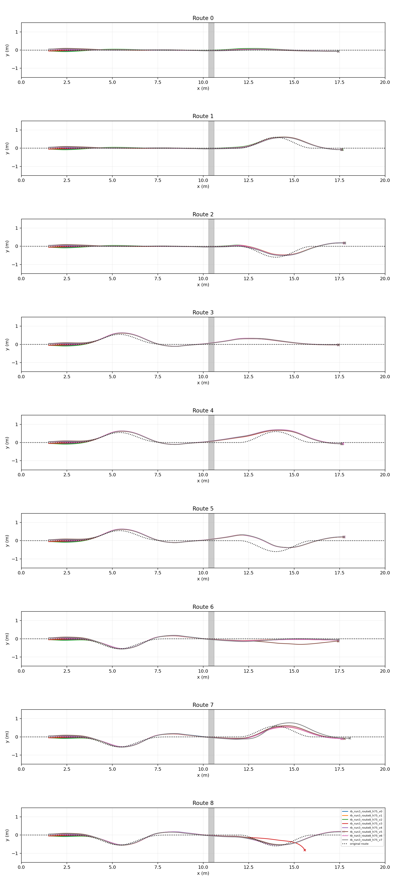

# Native Playground RB–STTW handoff trial

Role: bounded integration DEV with the declared initial variants below; not an independent success-rate estimate.

| Skill | Route | Variant | Continuation | RB entry s | Airborne | Far contact | Handoff s | End | Final XY m |
|---|---:|---|---|---:|---|---|---:|---|---|
|rb_run3|0|{'landing_height_m': 0.6, 'swing_scale': 1.0, 'jump_start_x_m': 8.600000000000001, 'rb_far_height_offset_m': 0.0, 'gate_roll_rad': 0.15, 'gate_roll_rate': 0.6, 'gate_hold_s': 0.0, 'recovery_wc': 8.0, 'body_speed_feedback': True, 'recovery_eso_scale': 1.0, 'recovery_eso_delay_s': 0.0, 'start_y_m': -0.05, 'start_yaw_rad': -0.03, 'start_roll_rad': -0.015, 'lookahead_scale': 1.3, 'root_variant': 0, 'data_split': 'TRAIN'}|h75|3.8399999141693115|True|True|5.289999961853027|goal|[17.429550170898438, -0.061597902327775955]|
|rb_run3|1|{'landing_height_m': 0.6, 'swing_scale': 1.0, 'jump_start_x_m': 8.600000000000001, 'rb_far_height_offset_m': 0.0, 'gate_roll_rad': 0.15, 'gate_roll_rate': 0.6, 'gate_hold_s': 0.0, 'recovery_wc': 8.0, 'body_speed_feedback': True, 'recovery_eso_scale': 1.0, 'recovery_eso_delay_s': 0.0, 'start_y_m': -0.05, 'start_yaw_rad': -0.03, 'start_roll_rad': -0.015, 'lookahead_scale': 1.3, 'root_variant': 0, 'data_split': 'TRAIN'}|h75|3.8399999141693115|True|True|5.260000228881836|goal|[17.622350692749023, -0.0807558223605156]|
|rb_run3|2|{'landing_height_m': 0.6, 'swing_scale': 1.0, 'jump_start_x_m': 8.600000000000001, 'rb_far_height_offset_m': 0.0, 'gate_roll_rad': 0.15, 'gate_roll_rate': 0.6, 'gate_hold_s': 0.0, 'recovery_wc': 8.0, 'body_speed_feedback': True, 'recovery_eso_scale': 1.0, 'recovery_eso_delay_s': 0.0, 'start_y_m': -0.05, 'start_yaw_rad': -0.03, 'start_roll_rad': -0.015, 'lookahead_scale': 1.3, 'root_variant': 0, 'data_split': 'TRAIN'}|h75|3.8399999141693115|True|True|5.289999961853027|goal|[17.76047134399414, 0.17777341604232788]|
|rb_run3|3|{'landing_height_m': 0.6, 'swing_scale': 1.0, 'jump_start_x_m': 8.600000000000001, 'rb_far_height_offset_m': 0.0, 'gate_roll_rad': 0.15, 'gate_roll_rate': 0.6, 'gate_hold_s': 0.0, 'recovery_wc': 8.0, 'body_speed_feedback': True, 'recovery_eso_scale': 1.0, 'recovery_eso_delay_s': 0.0, 'start_y_m': -0.05, 'start_yaw_rad': -0.03, 'start_roll_rad': -0.015, 'lookahead_scale': 1.3, 'root_variant': 0, 'data_split': 'TRAIN'}|h75|4.139999866485596|True|True|5.59499979019165|goal|[17.426090240478516, -0.019712131470441818]|
|rb_run3|4|{'landing_height_m': 0.6, 'swing_scale': 1.0, 'jump_start_x_m': 8.600000000000001, 'rb_far_height_offset_m': 0.0, 'gate_roll_rad': 0.15, 'gate_roll_rate': 0.6, 'gate_hold_s': 0.0, 'recovery_wc': 8.0, 'body_speed_feedback': True, 'recovery_eso_scale': 1.0, 'recovery_eso_delay_s': 0.0, 'start_y_m': -0.05, 'start_yaw_rad': -0.03, 'start_roll_rad': -0.015, 'lookahead_scale': 1.3, 'root_variant': 0, 'data_split': 'TRAIN'}|h75|4.139999866485596|True|True|5.570000171661377|goal|[17.605798721313477, -0.062056172639131546]|
|rb_run3|5|{'landing_height_m': 0.6, 'swing_scale': 1.0, 'jump_start_x_m': 8.600000000000001, 'rb_far_height_offset_m': 0.0, 'gate_roll_rad': 0.15, 'gate_roll_rate': 0.6, 'gate_hold_s': 0.0, 'recovery_wc': 8.0, 'body_speed_feedback': True, 'recovery_eso_scale': 1.0, 'recovery_eso_delay_s': 0.0, 'start_y_m': -0.05, 'start_yaw_rad': -0.03, 'start_roll_rad': -0.015, 'lookahead_scale': 1.3, 'root_variant': 0, 'data_split': 'TRAIN'}|h75|4.139999866485596|True|True|5.570000171661377|goal|[17.737960815429688, 0.20445649325847626]|
|rb_run3|6|{'landing_height_m': 0.6, 'swing_scale': 1.0, 'jump_start_x_m': 8.600000000000001, 'rb_far_height_offset_m': 0.0, 'gate_roll_rad': 0.15, 'gate_roll_rate': 0.6, 'gate_hold_s': 0.0, 'recovery_wc': 8.0, 'body_speed_feedback': True, 'recovery_eso_scale': 1.0, 'recovery_eso_delay_s': 0.0, 'start_y_m': -0.05, 'start_yaw_rad': -0.03, 'start_roll_rad': -0.015, 'lookahead_scale': 1.3, 'root_variant': 0, 'data_split': 'TRAIN'}|h75|4.119999885559082|True|True|5.565000057220459|goal|[17.427066802978516, -0.07246007025241852]|
|rb_run3|7|{'landing_height_m': 0.6, 'swing_scale': 1.0, 'jump_start_x_m': 8.600000000000001, 'rb_far_height_offset_m': 0.0, 'gate_roll_rad': 0.15, 'gate_roll_rate': 0.6, 'gate_hold_s': 0.0, 'recovery_wc': 8.0, 'body_speed_feedback': True, 'recovery_eso_scale': 1.0, 'recovery_eso_delay_s': 0.0, 'start_y_m': -0.05, 'start_yaw_rad': -0.03, 'start_roll_rad': -0.015, 'lookahead_scale': 1.3, 'root_variant': 0, 'data_split': 'TRAIN'}|h75|4.099999904632568|True|True|5.565000057220459|goal|[17.623899459838867, -0.08803844451904297]|
|rb_run3|8|{'landing_height_m': 0.6, 'swing_scale': 1.0, 'jump_start_x_m': 8.600000000000001, 'rb_far_height_offset_m': 0.0, 'gate_roll_rad': 0.15, 'gate_roll_rate': 0.6, 'gate_hold_s': 0.0, 'recovery_wc': 8.0, 'body_speed_feedback': True, 'recovery_eso_scale': 1.0, 'recovery_eso_delay_s': 0.0, 'start_y_m': -0.05, 'start_yaw_rad': -0.03, 'start_roll_rad': -0.015, 'lookahead_scale': 1.3, 'root_variant': 0, 'data_split': 'TRAIN'}|h75|4.119999885559082|True|True|5.570000171661377|goal|[17.677907943725586, 0.1741810292005539]|
|rb_run3|0|{'landing_height_m': 0.6, 'swing_scale': 1.0, 'jump_start_x_m': 8.600000000000001, 'rb_far_height_offset_m': 0.0, 'gate_roll_rad': 0.15, 'gate_roll_rate': 0.6, 'gate_hold_s': 0.0, 'recovery_wc': 8.0, 'body_speed_feedback': True, 'recovery_eso_scale': 1.0, 'recovery_eso_delay_s': 0.0, 'start_y_m': -0.05, 'start_yaw_rad': 0.03, 'start_roll_rad': -0.015, 'lookahead_scale': 1.3, 'root_variant': 1, 'data_split': 'TRAIN'}|h75|3.859999895095825|True|True|5.315000057220459|goal|[17.42433738708496, -0.06502489745616913]|
|rb_run3|1|{'landing_height_m': 0.6, 'swing_scale': 1.0, 'jump_start_x_m': 8.600000000000001, 'rb_far_height_offset_m': 0.0, 'gate_roll_rad': 0.15, 'gate_roll_rate': 0.6, 'gate_hold_s': 0.0, 'recovery_wc': 8.0, 'body_speed_feedback': True, 'recovery_eso_scale': 1.0, 'recovery_eso_delay_s': 0.0, 'start_y_m': -0.05, 'start_yaw_rad': 0.03, 'start_roll_rad': -0.015, 'lookahead_scale': 1.3, 'root_variant': 1, 'data_split': 'TRAIN'}|h75|3.859999895095825|True|True|5.289999961853027|goal|[17.633188247680664, -0.07887765765190125]|
|rb_run3|2|{'landing_height_m': 0.6, 'swing_scale': 1.0, 'jump_start_x_m': 8.600000000000001, 'rb_far_height_offset_m': 0.0, 'gate_roll_rad': 0.15, 'gate_roll_rate': 0.6, 'gate_hold_s': 0.0, 'recovery_wc': 8.0, 'body_speed_feedback': True, 'recovery_eso_scale': 1.0, 'recovery_eso_delay_s': 0.0, 'start_y_m': -0.05, 'start_yaw_rad': 0.03, 'start_roll_rad': -0.015, 'lookahead_scale': 1.3, 'root_variant': 1, 'data_split': 'TRAIN'}|h75|3.859999895095825|True|True|5.269999980926514|goal|[17.739839553833008, 0.18346275389194489]|
|rb_run3|3|{'landing_height_m': 0.6, 'swing_scale': 1.0, 'jump_start_x_m': 8.600000000000001, 'rb_far_height_offset_m': 0.0, 'gate_roll_rad': 0.15, 'gate_roll_rate': 0.6, 'gate_hold_s': 0.0, 'recovery_wc': 8.0, 'body_speed_feedback': True, 'recovery_eso_scale': 1.0, 'recovery_eso_delay_s': 0.0, 'start_y_m': -0.05, 'start_yaw_rad': 0.03, 'start_roll_rad': -0.015, 'lookahead_scale': 1.3, 'root_variant': 1, 'data_split': 'TRAIN'}|h75|4.139999866485596|True|True|5.59499979019165|goal|[17.42670440673828, -0.01880241185426712]|
|rb_run3|4|{'landing_height_m': 0.6, 'swing_scale': 1.0, 'jump_start_x_m': 8.600000000000001, 'rb_far_height_offset_m': 0.0, 'gate_roll_rad': 0.15, 'gate_roll_rate': 0.6, 'gate_hold_s': 0.0, 'recovery_wc': 8.0, 'body_speed_feedback': True, 'recovery_eso_scale': 1.0, 'recovery_eso_delay_s': 0.0, 'start_y_m': -0.05, 'start_yaw_rad': 0.03, 'start_roll_rad': -0.015, 'lookahead_scale': 1.3, 'root_variant': 1, 'data_split': 'TRAIN'}|h75|4.139999866485596|True|True|5.579999923706055|goal|[17.65999412536621, -0.06603533774614334]|
|rb_run3|5|{'landing_height_m': 0.6, 'swing_scale': 1.0, 'jump_start_x_m': 8.600000000000001, 'rb_far_height_offset_m': 0.0, 'gate_roll_rad': 0.15, 'gate_roll_rate': 0.6, 'gate_hold_s': 0.0, 'recovery_wc': 8.0, 'body_speed_feedback': True, 'recovery_eso_scale': 1.0, 'recovery_eso_delay_s': 0.0, 'start_y_m': -0.05, 'start_yaw_rad': 0.03, 'start_roll_rad': -0.015, 'lookahead_scale': 1.3, 'root_variant': 1, 'data_split': 'TRAIN'}|h75|4.139999866485596|True|True|5.579999923706055|goal|[17.745471954345703, 0.20236390829086304]|
|rb_run3|6|{'landing_height_m': 0.6, 'swing_scale': 1.0, 'jump_start_x_m': 8.600000000000001, 'rb_far_height_offset_m': 0.0, 'gate_roll_rad': 0.15, 'gate_roll_rate': 0.6, 'gate_hold_s': 0.0, 'recovery_wc': 8.0, 'body_speed_feedback': True, 'recovery_eso_scale': 1.0, 'recovery_eso_delay_s': 0.0, 'start_y_m': -0.05, 'start_yaw_rad': 0.03, 'start_roll_rad': -0.015, 'lookahead_scale': 1.3, 'root_variant': 1, 'data_split': 'TRAIN'}|h75|4.159999847412109|True|True|5.610000133514404|goal|[17.427379608154297, -0.07431569695472717]|
|rb_run3|7|{'landing_height_m': 0.6, 'swing_scale': 1.0, 'jump_start_x_m': 8.600000000000001, 'rb_far_height_offset_m': 0.0, 'gate_roll_rad': 0.15, 'gate_roll_rate': 0.6, 'gate_hold_s': 0.0, 'recovery_wc': 8.0, 'body_speed_feedback': True, 'recovery_eso_scale': 1.0, 'recovery_eso_delay_s': 0.0, 'start_y_m': -0.05, 'start_yaw_rad': 0.03, 'start_roll_rad': -0.015, 'lookahead_scale': 1.3, 'root_variant': 1, 'data_split': 'TRAIN'}|h75|4.159999847412109|True|True|5.610000133514404|goal|[17.616153717041016, -0.09143422544002533]|
|rb_run3|8|{'landing_height_m': 0.6, 'swing_scale': 1.0, 'jump_start_x_m': 8.600000000000001, 'rb_far_height_offset_m': 0.0, 'gate_roll_rad': 0.15, 'gate_roll_rate': 0.6, 'gate_hold_s': 0.0, 'recovery_wc': 8.0, 'body_speed_feedback': True, 'recovery_eso_scale': 1.0, 'recovery_eso_delay_s': 0.0, 'start_y_m': -0.05, 'start_yaw_rad': 0.03, 'start_roll_rad': -0.015, 'lookahead_scale': 1.3, 'root_variant': 1, 'data_split': 'TRAIN'}|h75|4.159999847412109|True|True|5.585000038146973|goal|[17.711902618408203, 0.17794156074523926]|
|rb_run3|0|{'landing_height_m': 0.6, 'swing_scale': 1.0, 'jump_start_x_m': 8.600000000000001, 'rb_far_height_offset_m': 0.0, 'gate_roll_rad': 0.15, 'gate_roll_rate': 0.6, 'gate_hold_s': 0.0, 'recovery_wc': 8.0, 'body_speed_feedback': True, 'recovery_eso_scale': 1.0, 'recovery_eso_delay_s': 0.0, 'start_y_m': -0.05, 'start_yaw_rad': -0.03, 'start_roll_rad': 0.015, 'lookahead_scale': 1.3, 'root_variant': 2, 'data_split': 'TRAIN'}|h75|3.859999895095825|True|True|5.355000019073486|goal|[17.430524826049805, -0.05915512144565582]|
|rb_run3|1|{'landing_height_m': 0.6, 'swing_scale': 1.0, 'jump_start_x_m': 8.600000000000001, 'rb_far_height_offset_m': 0.0, 'gate_roll_rad': 0.15, 'gate_roll_rate': 0.6, 'gate_hold_s': 0.0, 'recovery_wc': 8.0, 'body_speed_feedback': True, 'recovery_eso_scale': 1.0, 'recovery_eso_delay_s': 0.0, 'start_y_m': -0.05, 'start_yaw_rad': -0.03, 'start_roll_rad': 0.015, 'lookahead_scale': 1.3, 'root_variant': 2, 'data_split': 'TRAIN'}|h75|3.859999895095825|True|True|5.289999961853027|goal|[17.64779281616211, -0.0783388763666153]|
|rb_run3|2|{'landing_height_m': 0.6, 'swing_scale': 1.0, 'jump_start_x_m': 8.600000000000001, 'rb_far_height_offset_m': 0.0, 'gate_roll_rad': 0.15, 'gate_roll_rate': 0.6, 'gate_hold_s': 0.0, 'recovery_wc': 8.0, 'body_speed_feedback': True, 'recovery_eso_scale': 1.0, 'recovery_eso_delay_s': 0.0, 'start_y_m': -0.05, 'start_yaw_rad': -0.03, 'start_roll_rad': 0.015, 'lookahead_scale': 1.3, 'root_variant': 2, 'data_split': 'TRAIN'}|h75|3.859999895095825|True|True|5.289999961853027|goal|[17.78666877746582, 0.18211659789085388]|
|rb_run3|3|{'landing_height_m': 0.6, 'swing_scale': 1.0, 'jump_start_x_m': 8.600000000000001, 'rb_far_height_offset_m': 0.0, 'gate_roll_rad': 0.15, 'gate_roll_rate': 0.6, 'gate_hold_s': 0.0, 'recovery_wc': 8.0, 'body_speed_feedback': True, 'recovery_eso_scale': 1.0, 'recovery_eso_delay_s': 0.0, 'start_y_m': -0.05, 'start_yaw_rad': -0.03, 'start_roll_rad': 0.015, 'lookahead_scale': 1.3, 'root_variant': 2, 'data_split': 'TRAIN'}|h75|4.139999866485596|True|True|5.59499979019165|goal|[17.43332862854004, -0.019103389233350754]|
|rb_run3|4|{'landing_height_m': 0.6, 'swing_scale': 1.0, 'jump_start_x_m': 8.600000000000001, 'rb_far_height_offset_m': 0.0, 'gate_roll_rad': 0.15, 'gate_roll_rate': 0.6, 'gate_hold_s': 0.0, 'recovery_wc': 8.0, 'body_speed_feedback': True, 'recovery_eso_scale': 1.0, 'recovery_eso_delay_s': 0.0, 'start_y_m': -0.05, 'start_yaw_rad': -0.03, 'start_roll_rad': 0.015, 'lookahead_scale': 1.3, 'root_variant': 2, 'data_split': 'TRAIN'}|h75|4.139999866485596|True|True|5.590000152587891|goal|[17.65206527709961, -0.06810031086206436]|
|rb_run3|5|{'landing_height_m': 0.6, 'swing_scale': 1.0, 'jump_start_x_m': 8.600000000000001, 'rb_far_height_offset_m': 0.0, 'gate_roll_rad': 0.15, 'gate_roll_rate': 0.6, 'gate_hold_s': 0.0, 'recovery_wc': 8.0, 'body_speed_feedback': True, 'recovery_eso_scale': 1.0, 'recovery_eso_delay_s': 0.0, 'start_y_m': -0.05, 'start_yaw_rad': -0.03, 'start_roll_rad': 0.015, 'lookahead_scale': 1.3, 'root_variant': 2, 'data_split': 'TRAIN'}|h75|4.139999866485596|True|True|5.625|goal|[17.7385311126709, 0.2048269808292389]|
|rb_run3|6|{'landing_height_m': 0.6, 'swing_scale': 1.0, 'jump_start_x_m': 8.600000000000001, 'rb_far_height_offset_m': 0.0, 'gate_roll_rad': 0.15, 'gate_roll_rate': 0.6, 'gate_hold_s': 0.0, 'recovery_wc': 8.0, 'body_speed_feedback': True, 'recovery_eso_scale': 1.0, 'recovery_eso_delay_s': 0.0, 'start_y_m': -0.05, 'start_yaw_rad': -0.03, 'start_roll_rad': 0.015, 'lookahead_scale': 1.3, 'root_variant': 2, 'data_split': 'TRAIN'}|h75|4.139999866485596|True|True|5.590000152587891|goal|[17.430280685424805, -0.06982255727052689]|
|rb_run3|7|{'landing_height_m': 0.6, 'swing_scale': 1.0, 'jump_start_x_m': 8.600000000000001, 'rb_far_height_offset_m': 0.0, 'gate_roll_rad': 0.15, 'gate_roll_rate': 0.6, 'gate_hold_s': 0.0, 'recovery_wc': 8.0, 'body_speed_feedback': True, 'recovery_eso_scale': 1.0, 'recovery_eso_delay_s': 0.0, 'start_y_m': -0.05, 'start_yaw_rad': -0.03, 'start_roll_rad': 0.015, 'lookahead_scale': 1.3, 'root_variant': 2, 'data_split': 'TRAIN'}|h75|4.139999866485596|True|True|5.585000038146973|goal|[17.62575340270996, -0.09070780128240585]|
|rb_run3|8|{'landing_height_m': 0.6, 'swing_scale': 1.0, 'jump_start_x_m': 8.600000000000001, 'rb_far_height_offset_m': 0.0, 'gate_roll_rad': 0.15, 'gate_roll_rate': 0.6, 'gate_hold_s': 0.0, 'recovery_wc': 8.0, 'body_speed_feedback': True, 'recovery_eso_scale': 1.0, 'recovery_eso_delay_s': 0.0, 'start_y_m': -0.05, 'start_yaw_rad': -0.03, 'start_roll_rad': 0.015, 'lookahead_scale': 1.3, 'root_variant': 2, 'data_split': 'TRAIN'}|h75|4.139999866485596|True|True|5.590000152587891|goal|[17.70167350769043, 0.17652574181556702]|
|rb_run3|0|{'landing_height_m': 0.6, 'swing_scale': 1.0, 'jump_start_x_m': 8.600000000000001, 'rb_far_height_offset_m': 0.0, 'gate_roll_rad': 0.15, 'gate_roll_rate': 0.6, 'gate_hold_s': 0.0, 'recovery_wc': 8.0, 'body_speed_feedback': True, 'recovery_eso_scale': 1.0, 'recovery_eso_delay_s': 0.0, 'start_y_m': -0.05, 'start_yaw_rad': 0.03, 'start_roll_rad': 0.015, 'lookahead_scale': 1.3, 'root_variant': 3, 'data_split': 'TRAIN'}|h75|3.8399999141693115|True|True|5.260000228881836|goal|[17.42501449584961, -0.06618361920118332]|
|rb_run3|1|{'landing_height_m': 0.6, 'swing_scale': 1.0, 'jump_start_x_m': 8.600000000000001, 'rb_far_height_offset_m': 0.0, 'gate_roll_rad': 0.15, 'gate_roll_rate': 0.6, 'gate_hold_s': 0.0, 'recovery_wc': 8.0, 'body_speed_feedback': True, 'recovery_eso_scale': 1.0, 'recovery_eso_delay_s': 0.0, 'start_y_m': -0.05, 'start_yaw_rad': 0.03, 'start_roll_rad': 0.015, 'lookahead_scale': 1.3, 'root_variant': 3, 'data_split': 'TRAIN'}|h75|3.8399999141693115|True|True|5.25|goal|[17.62534523010254, -0.0759071484208107]|
|rb_run3|2|{'landing_height_m': 0.6, 'swing_scale': 1.0, 'jump_start_x_m': 8.600000000000001, 'rb_far_height_offset_m': 0.0, 'gate_roll_rad': 0.15, 'gate_roll_rate': 0.6, 'gate_hold_s': 0.0, 'recovery_wc': 8.0, 'body_speed_feedback': True, 'recovery_eso_scale': 1.0, 'recovery_eso_delay_s': 0.0, 'start_y_m': -0.05, 'start_yaw_rad': 0.03, 'start_roll_rad': 0.015, 'lookahead_scale': 1.3, 'root_variant': 3, 'data_split': 'TRAIN'}|h75|3.8399999141693115|True|True|5.309999942779541|goal|[17.773649215698242, 0.1867758184671402]|
|rb_run3|3|{'landing_height_m': 0.6, 'swing_scale': 1.0, 'jump_start_x_m': 8.600000000000001, 'rb_far_height_offset_m': 0.0, 'gate_roll_rad': 0.15, 'gate_roll_rate': 0.6, 'gate_hold_s': 0.0, 'recovery_wc': 8.0, 'body_speed_feedback': True, 'recovery_eso_scale': 1.0, 'recovery_eso_delay_s': 0.0, 'start_y_m': -0.05, 'start_yaw_rad': 0.03, 'start_roll_rad': 0.015, 'lookahead_scale': 1.3, 'root_variant': 3, 'data_split': 'TRAIN'}|h75|4.119999885559082|True|True|5.570000171661377|goal|[17.433242797851562, -0.026177020743489265]|
|rb_run3|4|{'landing_height_m': 0.6, 'swing_scale': 1.0, 'jump_start_x_m': 8.600000000000001, 'rb_far_height_offset_m': 0.0, 'gate_roll_rad': 0.15, 'gate_roll_rate': 0.6, 'gate_hold_s': 0.0, 'recovery_wc': 8.0, 'body_speed_feedback': True, 'recovery_eso_scale': 1.0, 'recovery_eso_delay_s': 0.0, 'start_y_m': -0.05, 'start_yaw_rad': 0.03, 'start_roll_rad': 0.015, 'lookahead_scale': 1.3, 'root_variant': 3, 'data_split': 'TRAIN'}|h75|4.119999885559082|True|True|5.574999809265137|goal|[17.60462760925293, -0.06376670300960541]|
|rb_run3|5|{'landing_height_m': 0.6, 'swing_scale': 1.0, 'jump_start_x_m': 8.600000000000001, 'rb_far_height_offset_m': 0.0, 'gate_roll_rad': 0.15, 'gate_roll_rate': 0.6, 'gate_hold_s': 0.0, 'recovery_wc': 8.0, 'body_speed_feedback': True, 'recovery_eso_scale': 1.0, 'recovery_eso_delay_s': 0.0, 'start_y_m': -0.05, 'start_yaw_rad': 0.03, 'start_roll_rad': 0.015, 'lookahead_scale': 1.3, 'root_variant': 3, 'data_split': 'TRAIN'}|h75|4.119999885559082|True|True|5.579999923706055|goal|[17.730195999145508, 0.2014612853527069]|
|rb_run3|6|{'landing_height_m': 0.6, 'swing_scale': 1.0, 'jump_start_x_m': 8.600000000000001, 'rb_far_height_offset_m': 0.0, 'gate_roll_rad': 0.15, 'gate_roll_rate': 0.6, 'gate_hold_s': 0.0, 'recovery_wc': 8.0, 'body_speed_feedback': True, 'recovery_eso_scale': 1.0, 'recovery_eso_delay_s': 0.0, 'start_y_m': -0.05, 'start_yaw_rad': 0.03, 'start_roll_rad': 0.015, 'lookahead_scale': 1.3, 'root_variant': 3, 'data_split': 'TRAIN'}|h75|4.139999866485596|True|True|5.570000171661377|goal|[17.422801971435547, -0.07418707013130188]|
|rb_run3|7|{'landing_height_m': 0.6, 'swing_scale': 1.0, 'jump_start_x_m': 8.600000000000001, 'rb_far_height_offset_m': 0.0, 'gate_roll_rad': 0.15, 'gate_roll_rate': 0.6, 'gate_hold_s': 0.0, 'recovery_wc': 8.0, 'body_speed_feedback': True, 'recovery_eso_scale': 1.0, 'recovery_eso_delay_s': 0.0, 'start_y_m': -0.05, 'start_yaw_rad': 0.03, 'start_roll_rad': 0.015, 'lookahead_scale': 1.3, 'root_variant': 3, 'data_split': 'TRAIN'}|h75|4.139999866485596|True|True|5.590000152587891|goal|[17.62413787841797, -0.09028828889131546]|
|rb_run3|8|{'landing_height_m': 0.6, 'swing_scale': 1.0, 'jump_start_x_m': 8.600000000000001, 'rb_far_height_offset_m': 0.0, 'gate_roll_rad': 0.15, 'gate_roll_rate': 0.6, 'gate_hold_s': 0.0, 'recovery_wc': 8.0, 'body_speed_feedback': True, 'recovery_eso_scale': 1.0, 'recovery_eso_delay_s': 0.0, 'start_y_m': -0.05, 'start_yaw_rad': 0.03, 'start_roll_rad': 0.015, 'lookahead_scale': 1.3, 'root_variant': 3, 'data_split': 'TRAIN'}|h75|4.139999866485596|True|False|None|physical_failure|[15.585938453674316, -0.8229190707206726]|
|rb_run3|0|{'landing_height_m': 0.6, 'swing_scale': 1.0, 'jump_start_x_m': 8.600000000000001, 'rb_far_height_offset_m': 0.0, 'gate_roll_rad': 0.15, 'gate_roll_rate': 0.6, 'gate_hold_s': 0.0, 'recovery_wc': 8.0, 'body_speed_feedback': True, 'recovery_eso_scale': 1.0, 'recovery_eso_delay_s': 0.0, 'start_y_m': 0.05, 'start_yaw_rad': -0.03, 'start_roll_rad': -0.015, 'lookahead_scale': 1.3, 'root_variant': 4, 'data_split': 'TRAIN'}|h75|3.8399999141693115|True|True|5.284999847412109|goal|[17.426069259643555, -0.06466631591320038]|
|rb_run3|1|{'landing_height_m': 0.6, 'swing_scale': 1.0, 'jump_start_x_m': 8.600000000000001, 'rb_far_height_offset_m': 0.0, 'gate_roll_rad': 0.15, 'gate_roll_rate': 0.6, 'gate_hold_s': 0.0, 'recovery_wc': 8.0, 'body_speed_feedback': True, 'recovery_eso_scale': 1.0, 'recovery_eso_delay_s': 0.0, 'start_y_m': 0.05, 'start_yaw_rad': -0.03, 'start_roll_rad': -0.015, 'lookahead_scale': 1.3, 'root_variant': 4, 'data_split': 'TRAIN'}|h75|3.8399999141693115|True|True|5.329999923706055|goal|[17.626916885375977, -0.07788137346506119]|
|rb_run3|2|{'landing_height_m': 0.6, 'swing_scale': 1.0, 'jump_start_x_m': 8.600000000000001, 'rb_far_height_offset_m': 0.0, 'gate_roll_rad': 0.15, 'gate_roll_rate': 0.6, 'gate_hold_s': 0.0, 'recovery_wc': 8.0, 'body_speed_feedback': True, 'recovery_eso_scale': 1.0, 'recovery_eso_delay_s': 0.0, 'start_y_m': 0.05, 'start_yaw_rad': -0.03, 'start_roll_rad': -0.015, 'lookahead_scale': 1.3, 'root_variant': 4, 'data_split': 'TRAIN'}|h75|3.8399999141693115|True|True|5.284999847412109|goal|[17.78143882751465, 0.19192327558994293]|
|rb_run3|3|{'landing_height_m': 0.6, 'swing_scale': 1.0, 'jump_start_x_m': 8.600000000000001, 'rb_far_height_offset_m': 0.0, 'gate_roll_rad': 0.15, 'gate_roll_rate': 0.6, 'gate_hold_s': 0.0, 'recovery_wc': 8.0, 'body_speed_feedback': True, 'recovery_eso_scale': 1.0, 'recovery_eso_delay_s': 0.0, 'start_y_m': 0.05, 'start_yaw_rad': -0.03, 'start_roll_rad': -0.015, 'lookahead_scale': 1.3, 'root_variant': 4, 'data_split': 'TRAIN'}|h75|4.139999866485596|True|True|5.599999904632568|goal|[17.43014144897461, -0.020692206919193268]|
|rb_run3|4|{'landing_height_m': 0.6, 'swing_scale': 1.0, 'jump_start_x_m': 8.600000000000001, 'rb_far_height_offset_m': 0.0, 'gate_roll_rad': 0.15, 'gate_roll_rate': 0.6, 'gate_hold_s': 0.0, 'recovery_wc': 8.0, 'body_speed_feedback': True, 'recovery_eso_scale': 1.0, 'recovery_eso_delay_s': 0.0, 'start_y_m': 0.05, 'start_yaw_rad': -0.03, 'start_roll_rad': -0.015, 'lookahead_scale': 1.3, 'root_variant': 4, 'data_split': 'TRAIN'}|h75|4.139999866485596|True|True|5.579999923706055|goal|[17.657306671142578, -0.06730478256940842]|
|rb_run3|5|{'landing_height_m': 0.6, 'swing_scale': 1.0, 'jump_start_x_m': 8.600000000000001, 'rb_far_height_offset_m': 0.0, 'gate_roll_rad': 0.15, 'gate_roll_rate': 0.6, 'gate_hold_s': 0.0, 'recovery_wc': 8.0, 'body_speed_feedback': True, 'recovery_eso_scale': 1.0, 'recovery_eso_delay_s': 0.0, 'start_y_m': 0.05, 'start_yaw_rad': -0.03, 'start_roll_rad': -0.015, 'lookahead_scale': 1.3, 'root_variant': 4, 'data_split': 'TRAIN'}|h75|4.139999866485596|True|True|5.605000019073486|goal|[17.757160186767578, 0.2100597321987152]|
|rb_run3|6|{'landing_height_m': 0.6, 'swing_scale': 1.0, 'jump_start_x_m': 8.600000000000001, 'rb_far_height_offset_m': 0.0, 'gate_roll_rad': 0.15, 'gate_roll_rate': 0.6, 'gate_hold_s': 0.0, 'recovery_wc': 8.0, 'body_speed_feedback': True, 'recovery_eso_scale': 1.0, 'recovery_eso_delay_s': 0.0, 'start_y_m': 0.05, 'start_yaw_rad': -0.03, 'start_roll_rad': -0.015, 'lookahead_scale': 1.3, 'root_variant': 4, 'data_split': 'TRAIN'}|h75|4.119999885559082|True|True|5.585000038146973|goal|[17.426969528198242, -0.07366053760051727]|
|rb_run3|7|{'landing_height_m': 0.6, 'swing_scale': 1.0, 'jump_start_x_m': 8.600000000000001, 'rb_far_height_offset_m': 0.0, 'gate_roll_rad': 0.15, 'gate_roll_rate': 0.6, 'gate_hold_s': 0.0, 'recovery_wc': 8.0, 'body_speed_feedback': True, 'recovery_eso_scale': 1.0, 'recovery_eso_delay_s': 0.0, 'start_y_m': 0.05, 'start_yaw_rad': -0.03, 'start_roll_rad': -0.015, 'lookahead_scale': 1.3, 'root_variant': 4, 'data_split': 'TRAIN'}|h75|4.119999885559082|True|True|5.565000057220459|goal|[17.624963760375977, -0.09216222167015076]|
|rb_run3|8|{'landing_height_m': 0.6, 'swing_scale': 1.0, 'jump_start_x_m': 8.600000000000001, 'rb_far_height_offset_m': 0.0, 'gate_roll_rad': 0.15, 'gate_roll_rate': 0.6, 'gate_hold_s': 0.0, 'recovery_wc': 8.0, 'body_speed_feedback': True, 'recovery_eso_scale': 1.0, 'recovery_eso_delay_s': 0.0, 'start_y_m': 0.05, 'start_yaw_rad': -0.03, 'start_roll_rad': -0.015, 'lookahead_scale': 1.3, 'root_variant': 4, 'data_split': 'TRAIN'}|h75|4.119999885559082|True|True|5.59499979019165|goal|[17.697439193725586, 0.17424294352531433]|
|rb_run3|0|{'landing_height_m': 0.6, 'swing_scale': 1.0, 'jump_start_x_m': 8.600000000000001, 'rb_far_height_offset_m': 0.0, 'gate_roll_rad': 0.15, 'gate_roll_rate': 0.6, 'gate_hold_s': 0.0, 'recovery_wc': 8.0, 'body_speed_feedback': True, 'recovery_eso_scale': 1.0, 'recovery_eso_delay_s': 0.0, 'start_y_m': 0.05, 'start_yaw_rad': 0.03, 'start_roll_rad': -0.015, 'lookahead_scale': 1.3, 'root_variant': 5, 'data_split': 'TRAIN'}|h75|3.859999895095825|True|True|5.284999847412109|goal|[17.431034088134766, -0.06846682727336884]|
|rb_run3|1|{'landing_height_m': 0.6, 'swing_scale': 1.0, 'jump_start_x_m': 8.600000000000001, 'rb_far_height_offset_m': 0.0, 'gate_roll_rad': 0.15, 'gate_roll_rate': 0.6, 'gate_hold_s': 0.0, 'recovery_wc': 8.0, 'body_speed_feedback': True, 'recovery_eso_scale': 1.0, 'recovery_eso_delay_s': 0.0, 'start_y_m': 0.05, 'start_yaw_rad': 0.03, 'start_roll_rad': -0.015, 'lookahead_scale': 1.3, 'root_variant': 5, 'data_split': 'TRAIN'}|h75|3.859999895095825|True|True|5.295000076293945|goal|[17.613157272338867, -0.07762184739112854]|
|rb_run3|2|{'landing_height_m': 0.6, 'swing_scale': 1.0, 'jump_start_x_m': 8.600000000000001, 'rb_far_height_offset_m': 0.0, 'gate_roll_rad': 0.15, 'gate_roll_rate': 0.6, 'gate_hold_s': 0.0, 'recovery_wc': 8.0, 'body_speed_feedback': True, 'recovery_eso_scale': 1.0, 'recovery_eso_delay_s': 0.0, 'start_y_m': 0.05, 'start_yaw_rad': 0.03, 'start_roll_rad': -0.015, 'lookahead_scale': 1.3, 'root_variant': 5, 'data_split': 'TRAIN'}|h75|3.859999895095825|True|True|5.269999980926514|goal|[17.743331909179688, 0.18217699229717255]|
|rb_run3|3|{'landing_height_m': 0.6, 'swing_scale': 1.0, 'jump_start_x_m': 8.600000000000001, 'rb_far_height_offset_m': 0.0, 'gate_roll_rad': 0.15, 'gate_roll_rate': 0.6, 'gate_hold_s': 0.0, 'recovery_wc': 8.0, 'body_speed_feedback': True, 'recovery_eso_scale': 1.0, 'recovery_eso_delay_s': 0.0, 'start_y_m': 0.05, 'start_yaw_rad': 0.03, 'start_roll_rad': -0.015, 'lookahead_scale': 1.3, 'root_variant': 5, 'data_split': 'TRAIN'}|h75|4.139999866485596|True|True|5.625|goal|[17.42989730834961, -0.015035460703074932]|
|rb_run3|4|{'landing_height_m': 0.6, 'swing_scale': 1.0, 'jump_start_x_m': 8.600000000000001, 'rb_far_height_offset_m': 0.0, 'gate_roll_rad': 0.15, 'gate_roll_rate': 0.6, 'gate_hold_s': 0.0, 'recovery_wc': 8.0, 'body_speed_feedback': True, 'recovery_eso_scale': 1.0, 'recovery_eso_delay_s': 0.0, 'start_y_m': 0.05, 'start_yaw_rad': 0.03, 'start_roll_rad': -0.015, 'lookahead_scale': 1.3, 'root_variant': 5, 'data_split': 'TRAIN'}|h75|4.139999866485596|True|True|5.59499979019165|goal|[17.60799789428711, -0.06289728730916977]|
|rb_run3|5|{'landing_height_m': 0.6, 'swing_scale': 1.0, 'jump_start_x_m': 8.600000000000001, 'rb_far_height_offset_m': 0.0, 'gate_roll_rad': 0.15, 'gate_roll_rate': 0.6, 'gate_hold_s': 0.0, 'recovery_wc': 8.0, 'body_speed_feedback': True, 'recovery_eso_scale': 1.0, 'recovery_eso_delay_s': 0.0, 'start_y_m': 0.05, 'start_yaw_rad': 0.03, 'start_roll_rad': -0.015, 'lookahead_scale': 1.3, 'root_variant': 5, 'data_split': 'TRAIN'}|h75|4.139999866485596|True|True|5.590000152587891|goal|[17.72547721862793, 0.20286189019680023]|
|rb_run3|6|{'landing_height_m': 0.6, 'swing_scale': 1.0, 'jump_start_x_m': 8.600000000000001, 'rb_far_height_offset_m': 0.0, 'gate_roll_rad': 0.15, 'gate_roll_rate': 0.6, 'gate_hold_s': 0.0, 'recovery_wc': 8.0, 'body_speed_feedback': True, 'recovery_eso_scale': 1.0, 'recovery_eso_delay_s': 0.0, 'start_y_m': 0.05, 'start_yaw_rad': 0.03, 'start_roll_rad': -0.015, 'lookahead_scale': 1.3, 'root_variant': 5, 'data_split': 'TRAIN'}|h75|4.139999866485596|True|True|7.804999828338623|goal|[17.41118621826172, -0.12496825307607651]|
|rb_run3|7|{'landing_height_m': 0.6, 'swing_scale': 1.0, 'jump_start_x_m': 8.600000000000001, 'rb_far_height_offset_m': 0.0, 'gate_roll_rad': 0.15, 'gate_roll_rate': 0.6, 'gate_hold_s': 0.0, 'recovery_wc': 8.0, 'body_speed_feedback': True, 'recovery_eso_scale': 1.0, 'recovery_eso_delay_s': 0.0, 'start_y_m': 0.05, 'start_yaw_rad': 0.03, 'start_roll_rad': -0.015, 'lookahead_scale': 1.3, 'root_variant': 5, 'data_split': 'TRAIN'}|h75|4.139999866485596|True|True|5.585000038146973|goal|[17.766969680786133, -0.08668387681245804]|
|rb_run3|8|{'landing_height_m': 0.6, 'swing_scale': 1.0, 'jump_start_x_m': 8.600000000000001, 'rb_far_height_offset_m': 0.0, 'gate_roll_rad': 0.15, 'gate_roll_rate': 0.6, 'gate_hold_s': 0.0, 'recovery_wc': 8.0, 'body_speed_feedback': True, 'recovery_eso_scale': 1.0, 'recovery_eso_delay_s': 0.0, 'start_y_m': 0.05, 'start_yaw_rad': 0.03, 'start_roll_rad': -0.015, 'lookahead_scale': 1.3, 'root_variant': 5, 'data_split': 'TRAIN'}|h75|4.139999866485596|True|True|5.585000038146973|goal|[17.736692428588867, 0.1879604458808899]|
|rb_run3|0|{'landing_height_m': 0.6, 'swing_scale': 1.0, 'jump_start_x_m': 8.600000000000001, 'rb_far_height_offset_m': 0.0, 'gate_roll_rad': 0.15, 'gate_roll_rate': 0.6, 'gate_hold_s': 0.0, 'recovery_wc': 8.0, 'body_speed_feedback': True, 'recovery_eso_scale': 1.0, 'recovery_eso_delay_s': 0.0, 'start_y_m': 0.05, 'start_yaw_rad': -0.03, 'start_roll_rad': 0.015, 'lookahead_scale': 1.3, 'root_variant': 6, 'data_split': 'DEV_ROOT'}|h75|3.8399999141693115|True|True|5.284999847412109|goal|[17.424850463867188, -0.06350405514240265]|
|rb_run3|1|{'landing_height_m': 0.6, 'swing_scale': 1.0, 'jump_start_x_m': 8.600000000000001, 'rb_far_height_offset_m': 0.0, 'gate_roll_rad': 0.15, 'gate_roll_rate': 0.6, 'gate_hold_s': 0.0, 'recovery_wc': 8.0, 'body_speed_feedback': True, 'recovery_eso_scale': 1.0, 'recovery_eso_delay_s': 0.0, 'start_y_m': 0.05, 'start_yaw_rad': -0.03, 'start_roll_rad': 0.015, 'lookahead_scale': 1.3, 'root_variant': 6, 'data_split': 'DEV_ROOT'}|h75|3.8399999141693115|True|True|5.309999942779541|goal|[17.599529266357422, -0.0777258425951004]|
|rb_run3|2|{'landing_height_m': 0.6, 'swing_scale': 1.0, 'jump_start_x_m': 8.600000000000001, 'rb_far_height_offset_m': 0.0, 'gate_roll_rad': 0.15, 'gate_roll_rate': 0.6, 'gate_hold_s': 0.0, 'recovery_wc': 8.0, 'body_speed_feedback': True, 'recovery_eso_scale': 1.0, 'recovery_eso_delay_s': 0.0, 'start_y_m': 0.05, 'start_yaw_rad': -0.03, 'start_roll_rad': 0.015, 'lookahead_scale': 1.3, 'root_variant': 6, 'data_split': 'DEV_ROOT'}|h75|3.8399999141693115|True|True|5.284999847412109|goal|[17.770954132080078, 0.1806090772151947]|
|rb_run3|3|{'landing_height_m': 0.6, 'swing_scale': 1.0, 'jump_start_x_m': 8.600000000000001, 'rb_far_height_offset_m': 0.0, 'gate_roll_rad': 0.15, 'gate_roll_rate': 0.6, 'gate_hold_s': 0.0, 'recovery_wc': 8.0, 'body_speed_feedback': True, 'recovery_eso_scale': 1.0, 'recovery_eso_delay_s': 0.0, 'start_y_m': 0.05, 'start_yaw_rad': -0.03, 'start_roll_rad': 0.015, 'lookahead_scale': 1.3, 'root_variant': 6, 'data_split': 'DEV_ROOT'}|h75|4.139999866485596|True|True|5.614999771118164|goal|[17.427736282348633, -0.014745398424565792]|
|rb_run3|4|{'landing_height_m': 0.6, 'swing_scale': 1.0, 'jump_start_x_m': 8.600000000000001, 'rb_far_height_offset_m': 0.0, 'gate_roll_rad': 0.15, 'gate_roll_rate': 0.6, 'gate_hold_s': 0.0, 'recovery_wc': 8.0, 'body_speed_feedback': True, 'recovery_eso_scale': 1.0, 'recovery_eso_delay_s': 0.0, 'start_y_m': 0.05, 'start_yaw_rad': -0.03, 'start_roll_rad': 0.015, 'lookahead_scale': 1.3, 'root_variant': 6, 'data_split': 'DEV_ROOT'}|h75|4.139999866485596|True|True|5.559999942779541|goal|[17.68431282043457, -0.061002105474472046]|
|rb_run3|5|{'landing_height_m': 0.6, 'swing_scale': 1.0, 'jump_start_x_m': 8.600000000000001, 'rb_far_height_offset_m': 0.0, 'gate_roll_rad': 0.15, 'gate_roll_rate': 0.6, 'gate_hold_s': 0.0, 'recovery_wc': 8.0, 'body_speed_feedback': True, 'recovery_eso_scale': 1.0, 'recovery_eso_delay_s': 0.0, 'start_y_m': 0.05, 'start_yaw_rad': -0.03, 'start_roll_rad': 0.015, 'lookahead_scale': 1.3, 'root_variant': 6, 'data_split': 'DEV_ROOT'}|h75|4.139999866485596|True|True|5.599999904632568|goal|[17.756698608398438, 0.20640091598033905]|
|rb_run3|6|{'landing_height_m': 0.6, 'swing_scale': 1.0, 'jump_start_x_m': 8.600000000000001, 'rb_far_height_offset_m': 0.0, 'gate_roll_rad': 0.15, 'gate_roll_rate': 0.6, 'gate_hold_s': 0.0, 'recovery_wc': 8.0, 'body_speed_feedback': True, 'recovery_eso_scale': 1.0, 'recovery_eso_delay_s': 0.0, 'start_y_m': 0.05, 'start_yaw_rad': -0.03, 'start_roll_rad': 0.015, 'lookahead_scale': 1.3, 'root_variant': 6, 'data_split': 'DEV_ROOT'}|h75|4.119999885559082|True|True|5.579999923706055|goal|[17.426610946655273, -0.07289515435695648]|
|rb_run3|7|{'landing_height_m': 0.6, 'swing_scale': 1.0, 'jump_start_x_m': 8.600000000000001, 'rb_far_height_offset_m': 0.0, 'gate_roll_rad': 0.15, 'gate_roll_rate': 0.6, 'gate_hold_s': 0.0, 'recovery_wc': 8.0, 'body_speed_feedback': True, 'recovery_eso_scale': 1.0, 'recovery_eso_delay_s': 0.0, 'start_y_m': 0.05, 'start_yaw_rad': -0.03, 'start_roll_rad': 0.015, 'lookahead_scale': 1.3, 'root_variant': 6, 'data_split': 'DEV_ROOT'}|h75|4.119999885559082|True|True|5.590000152587891|goal|[17.641332626342773, -0.09162923693656921]|
|rb_run3|8|{'landing_height_m': 0.6, 'swing_scale': 1.0, 'jump_start_x_m': 8.600000000000001, 'rb_far_height_offset_m': 0.0, 'gate_roll_rad': 0.15, 'gate_roll_rate': 0.6, 'gate_hold_s': 0.0, 'recovery_wc': 8.0, 'body_speed_feedback': True, 'recovery_eso_scale': 1.0, 'recovery_eso_delay_s': 0.0, 'start_y_m': 0.05, 'start_yaw_rad': -0.03, 'start_roll_rad': 0.015, 'lookahead_scale': 1.3, 'root_variant': 6, 'data_split': 'DEV_ROOT'}|h75|4.119999885559082|True|True|5.585000038146973|goal|[17.69407081604004, 0.18762406706809998]|
|rb_run3|0|{'landing_height_m': 0.6, 'swing_scale': 1.0, 'jump_start_x_m': 8.600000000000001, 'rb_far_height_offset_m': 0.0, 'gate_roll_rad': 0.15, 'gate_roll_rate': 0.6, 'gate_hold_s': 0.0, 'recovery_wc': 8.0, 'body_speed_feedback': True, 'recovery_eso_scale': 1.0, 'recovery_eso_delay_s': 0.0, 'start_y_m': 0.05, 'start_yaw_rad': 0.03, 'start_roll_rad': 0.015, 'lookahead_scale': 1.3, 'root_variant': 7, 'data_split': 'DEV_ROOT'}|h75|3.859999895095825|True|True|5.264999866485596|goal|[17.428010940551758, -0.07182358205318451]|
|rb_run3|1|{'landing_height_m': 0.6, 'swing_scale': 1.0, 'jump_start_x_m': 8.600000000000001, 'rb_far_height_offset_m': 0.0, 'gate_roll_rad': 0.15, 'gate_roll_rate': 0.6, 'gate_hold_s': 0.0, 'recovery_wc': 8.0, 'body_speed_feedback': True, 'recovery_eso_scale': 1.0, 'recovery_eso_delay_s': 0.0, 'start_y_m': 0.05, 'start_yaw_rad': 0.03, 'start_roll_rad': 0.015, 'lookahead_scale': 1.3, 'root_variant': 7, 'data_split': 'DEV_ROOT'}|h75|3.859999895095825|True|True|5.309999942779541|goal|[17.59558868408203, -0.07988333702087402]|
|rb_run3|2|{'landing_height_m': 0.6, 'swing_scale': 1.0, 'jump_start_x_m': 8.600000000000001, 'rb_far_height_offset_m': 0.0, 'gate_roll_rad': 0.15, 'gate_roll_rate': 0.6, 'gate_hold_s': 0.0, 'recovery_wc': 8.0, 'body_speed_feedback': True, 'recovery_eso_scale': 1.0, 'recovery_eso_delay_s': 0.0, 'start_y_m': 0.05, 'start_yaw_rad': 0.03, 'start_roll_rad': 0.015, 'lookahead_scale': 1.3, 'root_variant': 7, 'data_split': 'DEV_ROOT'}|h75|3.859999895095825|True|True|5.284999847412109|goal|[17.789846420288086, 0.1826409250497818]|
|rb_run3|3|{'landing_height_m': 0.6, 'swing_scale': 1.0, 'jump_start_x_m': 8.600000000000001, 'rb_far_height_offset_m': 0.0, 'gate_roll_rad': 0.15, 'gate_roll_rate': 0.6, 'gate_hold_s': 0.0, 'recovery_wc': 8.0, 'body_speed_feedback': True, 'recovery_eso_scale': 1.0, 'recovery_eso_delay_s': 0.0, 'start_y_m': 0.05, 'start_yaw_rad': 0.03, 'start_roll_rad': 0.015, 'lookahead_scale': 1.3, 'root_variant': 7, 'data_split': 'DEV_ROOT'}|h75|4.139999866485596|True|True|5.585000038146973|goal|[17.429140090942383, -0.020804496482014656]|
|rb_run3|4|{'landing_height_m': 0.6, 'swing_scale': 1.0, 'jump_start_x_m': 8.600000000000001, 'rb_far_height_offset_m': 0.0, 'gate_roll_rad': 0.15, 'gate_roll_rate': 0.6, 'gate_hold_s': 0.0, 'recovery_wc': 8.0, 'body_speed_feedback': True, 'recovery_eso_scale': 1.0, 'recovery_eso_delay_s': 0.0, 'start_y_m': 0.05, 'start_yaw_rad': 0.03, 'start_roll_rad': 0.015, 'lookahead_scale': 1.3, 'root_variant': 7, 'data_split': 'DEV_ROOT'}|h75|4.139999866485596|True|True|5.59499979019165|goal|[17.625396728515625, -0.06326267868280411]|
|rb_run3|5|{'landing_height_m': 0.6, 'swing_scale': 1.0, 'jump_start_x_m': 8.600000000000001, 'rb_far_height_offset_m': 0.0, 'gate_roll_rad': 0.15, 'gate_roll_rate': 0.6, 'gate_hold_s': 0.0, 'recovery_wc': 8.0, 'body_speed_feedback': True, 'recovery_eso_scale': 1.0, 'recovery_eso_delay_s': 0.0, 'start_y_m': 0.05, 'start_yaw_rad': 0.03, 'start_roll_rad': 0.015, 'lookahead_scale': 1.3, 'root_variant': 7, 'data_split': 'DEV_ROOT'}|h75|4.139999866485596|True|True|5.619999885559082|goal|[17.74703025817871, 0.20774304866790771]|
|rb_run3|6|{'landing_height_m': 0.6, 'swing_scale': 1.0, 'jump_start_x_m': 8.600000000000001, 'rb_far_height_offset_m': 0.0, 'gate_roll_rad': 0.15, 'gate_roll_rate': 0.6, 'gate_hold_s': 0.0, 'recovery_wc': 8.0, 'body_speed_feedback': True, 'recovery_eso_scale': 1.0, 'recovery_eso_delay_s': 0.0, 'start_y_m': 0.05, 'start_yaw_rad': 0.03, 'start_roll_rad': 0.015, 'lookahead_scale': 1.3, 'root_variant': 7, 'data_split': 'DEV_ROOT'}|h75|4.119999885559082|True|True|5.590000152587891|goal|[17.432079315185547, -0.05760499835014343]|
|rb_run3|7|{'landing_height_m': 0.6, 'swing_scale': 1.0, 'jump_start_x_m': 8.600000000000001, 'rb_far_height_offset_m': 0.0, 'gate_roll_rad': 0.15, 'gate_roll_rate': 0.6, 'gate_hold_s': 0.0, 'recovery_wc': 8.0, 'body_speed_feedback': True, 'recovery_eso_scale': 1.0, 'recovery_eso_delay_s': 0.0, 'start_y_m': 0.05, 'start_yaw_rad': 0.03, 'start_roll_rad': 0.015, 'lookahead_scale': 1.3, 'root_variant': 7, 'data_split': 'DEV_ROOT'}|h75|4.119999885559082|True|True|5.570000171661377|goal|[18.055805206298828, -0.07302013784646988]|
|rb_run3|8|{'landing_height_m': 0.6, 'swing_scale': 1.0, 'jump_start_x_m': 8.600000000000001, 'rb_far_height_offset_m': 0.0, 'gate_roll_rad': 0.15, 'gate_roll_rate': 0.6, 'gate_hold_s': 0.0, 'recovery_wc': 8.0, 'body_speed_feedback': True, 'recovery_eso_scale': 1.0, 'recovery_eso_delay_s': 0.0, 'start_y_m': 0.05, 'start_yaw_rad': 0.03, 'start_roll_rad': 0.015, 'lookahead_scale': 1.3, 'root_variant': 7, 'data_split': 'DEV_ROOT'}|h75|4.159999847412109|True|True|5.605000019073486|goal|[17.69578742980957, 0.17244674265384674]|

Completed 72/72 episodes. The declared approach controller (see declaration.json) precedes native RB jumping; handoff mechanism is landing_state, landing control=native. State-triggered runs use descent/contact/posture/joint readiness; the legacy fixed delay 0.5 s applies only to contact_delay runs. STTW hip/knee brakes are active; RB releases them and measured handoff re-locks the actual pose. No pose reset. Final goal/hold follows declaration and source config.

Terrain uses original Isaac rectangular samples and matching triangle diagonals, without resampling. Ground physics dt=0.001 s, RB physics=None, contact domain={'integrator': 'implicitfast', 'friction': 0.8, 'native_wheel_contacts': False}, lower dt=0.005 s, upper dt=0.02 s. This is a transfer feasibility trial, not a simulator-only causal comparison. H75 starts with measured ESO state and empty policy history.

Controller ownership: phase4 retains RB wheel commands while finite joint servos home the pendulum; only phase2 transfers wheels to STTW with hip/knee brakes active. Both far-wheel contact is required before homing and locking. No physical state reset.

Fixed map: chapter3_rough_ditch_030, whole-body planar bounds [-5.0, 25.0, -3.9, 3.9] m. Tracking-domain exit is distinct from physical-map exit. Nonwheel contact counts below are sampled at the 5 ms control boundary, not every 1 ms substep.

| Case | New vs legacy actuator-target max difference | Nonwheel contact samples |
|---|---:|---:|
|rb_run3_route0_h75_v0|None|0|
|rb_run3_route1_h75_v0|None|0|
|rb_run3_route2_h75_v0|None|0|
|rb_run3_route3_h75_v0|None|0|
|rb_run3_route4_h75_v0|None|0|
|rb_run3_route5_h75_v0|None|0|
|rb_run3_route6_h75_v0|None|0|
|rb_run3_route7_h75_v0|None|0|
|rb_run3_route8_h75_v0|None|0|
|rb_run3_route0_h75_v1|None|0|
|rb_run3_route1_h75_v1|None|0|
|rb_run3_route2_h75_v1|None|0|
|rb_run3_route3_h75_v1|None|0|
|rb_run3_route4_h75_v1|None|0|
|rb_run3_route5_h75_v1|None|0|
|rb_run3_route6_h75_v1|None|0|
|rb_run3_route7_h75_v1|None|0|
|rb_run3_route8_h75_v1|None|0|
|rb_run3_route0_h75_v2|None|0|
|rb_run3_route1_h75_v2|None|0|
|rb_run3_route2_h75_v2|None|0|
|rb_run3_route3_h75_v2|None|0|
|rb_run3_route4_h75_v2|None|0|
|rb_run3_route5_h75_v2|None|0|
|rb_run3_route6_h75_v2|None|0|
|rb_run3_route7_h75_v2|None|0|
|rb_run3_route8_h75_v2|None|0|
|rb_run3_route0_h75_v3|None|0|
|rb_run3_route1_h75_v3|None|0|
|rb_run3_route2_h75_v3|None|0|
|rb_run3_route3_h75_v3|None|0|
|rb_run3_route4_h75_v3|None|0|
|rb_run3_route5_h75_v3|None|0|
|rb_run3_route6_h75_v3|None|0|
|rb_run3_route7_h75_v3|None|0|
|rb_run3_route8_h75_v3|None|3|
|rb_run3_route0_h75_v4|None|0|
|rb_run3_route1_h75_v4|None|0|
|rb_run3_route2_h75_v4|None|0|
|rb_run3_route3_h75_v4|None|0|
|rb_run3_route4_h75_v4|None|0|
|rb_run3_route5_h75_v4|None|0|
|rb_run3_route6_h75_v4|None|0|
|rb_run3_route7_h75_v4|None|0|
|rb_run3_route8_h75_v4|None|0|
|rb_run3_route0_h75_v5|None|0|
|rb_run3_route1_h75_v5|None|0|
|rb_run3_route2_h75_v5|None|0|
|rb_run3_route3_h75_v5|None|0|
|rb_run3_route4_h75_v5|None|0|
|rb_run3_route5_h75_v5|None|0|
|rb_run3_route6_h75_v5|None|0|
|rb_run3_route7_h75_v5|None|0|
|rb_run3_route8_h75_v5|None|0|
|rb_run3_route0_h75_v6|None|0|
|rb_run3_route1_h75_v6|None|0|
|rb_run3_route2_h75_v6|None|0|
|rb_run3_route3_h75_v6|None|0|
|rb_run3_route4_h75_v6|None|0|
|rb_run3_route5_h75_v6|None|0|
|rb_run3_route6_h75_v6|None|0|
|rb_run3_route7_h75_v6|None|0|
|rb_run3_route8_h75_v6|None|0|
|rb_run3_route0_h75_v7|None|0|
|rb_run3_route1_h75_v7|None|0|
|rb_run3_route2_h75_v7|None|0|
|rb_run3_route3_h75_v7|None|0|
|rb_run3_route4_h75_v7|None|0|
|rb_run3_route5_h75_v7|None|0|
|rb_run3_route6_h75_v7|None|0|
|rb_run3_route7_h75_v7|None|0|
|rb_run3_route8_h75_v7|None|0|
