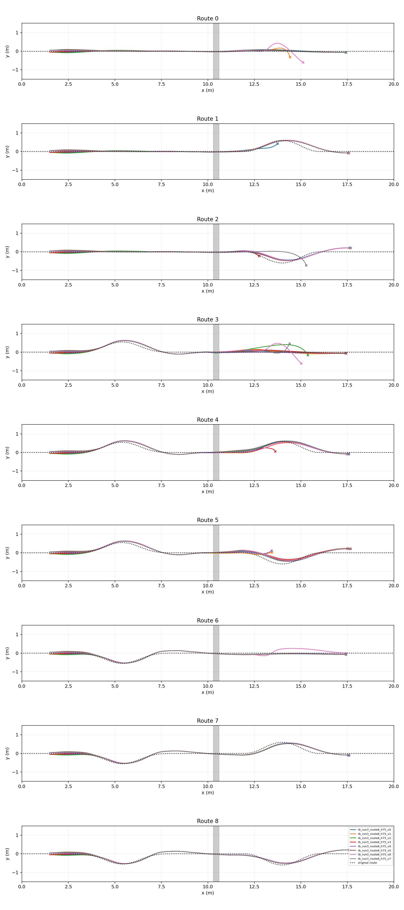

# Native Playground RB–STTW handoff trial

Role: bounded integration DEV with the declared initial variants below; not an independent success-rate estimate.

| Skill | Route | Variant | Continuation | RB entry s | Airborne | Far contact | Handoff s | End | Final XY m |
|---|---:|---|---|---:|---|---|---:|---|---|
|rb_run3|0|{'landing_height_m': 0.6, 'swing_scale': 1.0, 'jump_start_x_m': 8.600000000000001, 'rb_far_height_offset_m': 0.0, 'gate_roll_rad': 0.15, 'gate_roll_rate': 0.6, 'gate_hold_s': 0.0, 'recovery_wc': 8.0, 'body_speed_feedback': True, 'recovery_eso_scale': 1.0, 'recovery_eso_delay_s': 0.0, 'start_y_m': -0.05, 'start_yaw_rad': -0.03, 'start_roll_rad': -0.015, 'lookahead_scale': 1.3, 'root_variant': 0, 'data_split': 'TRAIN'}|h75|3.8399999141693115|True|True|5.289999961853027|goal|[17.427574157714844, -0.058936432003974915]|
|rb_run3|1|{'landing_height_m': 0.6, 'swing_scale': 1.0, 'jump_start_x_m': 8.600000000000001, 'rb_far_height_offset_m': 0.0, 'gate_roll_rad': 0.15, 'gate_roll_rate': 0.6, 'gate_hold_s': 0.0, 'recovery_wc': 8.0, 'body_speed_feedback': True, 'recovery_eso_scale': 1.0, 'recovery_eso_delay_s': 0.0, 'start_y_m': -0.05, 'start_yaw_rad': -0.03, 'start_roll_rad': -0.015, 'lookahead_scale': 1.3, 'root_variant': 0, 'data_split': 'TRAIN'}|h75|3.8399999141693115|True|True|5.28000020980835|tracking_domain_exit|[13.748085021972656, 0.4245033264160156]|
|rb_run3|2|{'landing_height_m': 0.6, 'swing_scale': 1.0, 'jump_start_x_m': 8.600000000000001, 'rb_far_height_offset_m': 0.0, 'gate_roll_rad': 0.15, 'gate_roll_rate': 0.6, 'gate_hold_s': 0.0, 'recovery_wc': 8.0, 'body_speed_feedback': True, 'recovery_eso_scale': 1.0, 'recovery_eso_delay_s': 0.0, 'start_y_m': -0.05, 'start_yaw_rad': -0.03, 'start_roll_rad': -0.015, 'lookahead_scale': 1.3, 'root_variant': 0, 'data_split': 'TRAIN'}|h75|3.8399999141693115|True|True|5.289999961853027|goal|[17.622804641723633, 0.21642038226127625]|
|rb_run3|3|{'landing_height_m': 0.6, 'swing_scale': 1.0, 'jump_start_x_m': 8.600000000000001, 'rb_far_height_offset_m': 0.0, 'gate_roll_rad': 0.15, 'gate_roll_rate': 0.6, 'gate_hold_s': 0.0, 'recovery_wc': 8.0, 'body_speed_feedback': True, 'recovery_eso_scale': 1.0, 'recovery_eso_delay_s': 0.0, 'start_y_m': -0.05, 'start_yaw_rad': -0.03, 'start_roll_rad': -0.015, 'lookahead_scale': 1.3, 'root_variant': 0, 'data_split': 'TRAIN'}|h75|4.119999885559082|True|True|5.525000095367432|goal|[17.421138763427734, -0.05741259083151817]|
|rb_run3|4|{'landing_height_m': 0.6, 'swing_scale': 1.0, 'jump_start_x_m': 8.600000000000001, 'rb_far_height_offset_m': 0.0, 'gate_roll_rad': 0.15, 'gate_roll_rate': 0.6, 'gate_hold_s': 0.0, 'recovery_wc': 8.0, 'body_speed_feedback': True, 'recovery_eso_scale': 1.0, 'recovery_eso_delay_s': 0.0, 'start_y_m': -0.05, 'start_yaw_rad': -0.03, 'start_roll_rad': -0.015, 'lookahead_scale': 1.3, 'root_variant': 0, 'data_split': 'TRAIN'}|h75|4.119999885559082|True|True|5.550000190734863|goal|[17.579883575439453, -0.07510741800069809]|
|rb_run3|5|{'landing_height_m': 0.6, 'swing_scale': 1.0, 'jump_start_x_m': 8.600000000000001, 'rb_far_height_offset_m': 0.0, 'gate_roll_rad': 0.15, 'gate_roll_rate': 0.6, 'gate_hold_s': 0.0, 'recovery_wc': 8.0, 'body_speed_feedback': True, 'recovery_eso_scale': 1.0, 'recovery_eso_delay_s': 0.0, 'start_y_m': -0.05, 'start_yaw_rad': -0.03, 'start_roll_rad': -0.015, 'lookahead_scale': 1.3, 'root_variant': 0, 'data_split': 'TRAIN'}|h75|4.119999885559082|True|True|5.559999942779541|goal|[17.668760299682617, 0.21409659087657928]|
|rb_run3|6|{'landing_height_m': 0.6, 'swing_scale': 1.0, 'jump_start_x_m': 8.600000000000001, 'rb_far_height_offset_m': 0.0, 'gate_roll_rad': 0.15, 'gate_roll_rate': 0.6, 'gate_hold_s': 0.0, 'recovery_wc': 8.0, 'body_speed_feedback': True, 'recovery_eso_scale': 1.0, 'recovery_eso_delay_s': 0.0, 'start_y_m': -0.05, 'start_yaw_rad': -0.03, 'start_roll_rad': -0.015, 'lookahead_scale': 1.3, 'root_variant': 0, 'data_split': 'TRAIN'}|h75|4.139999866485596|True|True|5.590000152587891|goal|[17.426025390625, -0.0771574154496193]|
|rb_run3|7|{'landing_height_m': 0.6, 'swing_scale': 1.0, 'jump_start_x_m': 8.600000000000001, 'rb_far_height_offset_m': 0.0, 'gate_roll_rad': 0.15, 'gate_roll_rate': 0.6, 'gate_hold_s': 0.0, 'recovery_wc': 8.0, 'body_speed_feedback': True, 'recovery_eso_scale': 1.0, 'recovery_eso_delay_s': 0.0, 'start_y_m': -0.05, 'start_yaw_rad': -0.03, 'start_roll_rad': -0.015, 'lookahead_scale': 1.3, 'root_variant': 0, 'data_split': 'TRAIN'}|h75|4.139999866485596|True|True|5.585000038146973|goal|[17.593732833862305, -0.08941946178674698]|
|rb_run3|8|{'landing_height_m': 0.6, 'swing_scale': 1.0, 'jump_start_x_m': 8.600000000000001, 'rb_far_height_offset_m': 0.0, 'gate_roll_rad': 0.15, 'gate_roll_rate': 0.6, 'gate_hold_s': 0.0, 'recovery_wc': 8.0, 'body_speed_feedback': True, 'recovery_eso_scale': 1.0, 'recovery_eso_delay_s': 0.0, 'start_y_m': -0.05, 'start_yaw_rad': -0.03, 'start_roll_rad': -0.015, 'lookahead_scale': 1.3, 'root_variant': 0, 'data_split': 'TRAIN'}|h75|4.139999866485596|True|True|5.565000057220459|goal|[17.630186080932617, 0.20548734068870544]|
|rb_run3|0|{'landing_height_m': 0.6, 'swing_scale': 1.0, 'jump_start_x_m': 8.600000000000001, 'rb_far_height_offset_m': 0.0, 'gate_roll_rad': 0.15, 'gate_roll_rate': 0.6, 'gate_hold_s': 0.0, 'recovery_wc': 8.0, 'body_speed_feedback': True, 'recovery_eso_scale': 1.0, 'recovery_eso_delay_s': 0.0, 'start_y_m': -0.05, 'start_yaw_rad': 0.03, 'start_roll_rad': -0.015, 'lookahead_scale': 1.3, 'root_variant': 1, 'data_split': 'TRAIN'}|h75|3.859999895095825|True|True|5.360000133514404|tracking_domain_exit|[14.415084838867188, -0.3147997558116913]|
|rb_run3|1|{'landing_height_m': 0.6, 'swing_scale': 1.0, 'jump_start_x_m': 8.600000000000001, 'rb_far_height_offset_m': 0.0, 'gate_roll_rad': 0.15, 'gate_roll_rate': 0.6, 'gate_hold_s': 0.0, 'recovery_wc': 8.0, 'body_speed_feedback': True, 'recovery_eso_scale': 1.0, 'recovery_eso_delay_s': 0.0, 'start_y_m': -0.05, 'start_yaw_rad': 0.03, 'start_roll_rad': -0.015, 'lookahead_scale': 1.3, 'root_variant': 1, 'data_split': 'TRAIN'}|h75|3.859999895095825|True|True|5.28000020980835|goal|[17.57486343383789, -0.07762977480888367]|
|rb_run3|2|{'landing_height_m': 0.6, 'swing_scale': 1.0, 'jump_start_x_m': 8.600000000000001, 'rb_far_height_offset_m': 0.0, 'gate_roll_rad': 0.15, 'gate_roll_rate': 0.6, 'gate_hold_s': 0.0, 'recovery_wc': 8.0, 'body_speed_feedback': True, 'recovery_eso_scale': 1.0, 'recovery_eso_delay_s': 0.0, 'start_y_m': -0.05, 'start_yaw_rad': 0.03, 'start_roll_rad': -0.015, 'lookahead_scale': 1.3, 'root_variant': 1, 'data_split': 'TRAIN'}|h75|3.859999895095825|True|True|5.289999961853027|goal|[17.650861740112305, 0.2121235579252243]|
|rb_run3|3|{'landing_height_m': 0.6, 'swing_scale': 1.0, 'jump_start_x_m': 8.600000000000001, 'rb_far_height_offset_m': 0.0, 'gate_roll_rad': 0.15, 'gate_roll_rate': 0.6, 'gate_hold_s': 0.0, 'recovery_wc': 8.0, 'body_speed_feedback': True, 'recovery_eso_scale': 1.0, 'recovery_eso_delay_s': 0.0, 'start_y_m': -0.05, 'start_yaw_rad': 0.03, 'start_roll_rad': -0.015, 'lookahead_scale': 1.3, 'root_variant': 1, 'data_split': 'TRAIN'}|h75|4.119999885559082|True|True|5.679999828338623|goal|[17.42376136779785, -0.05647585913538933]|
|rb_run3|4|{'landing_height_m': 0.6, 'swing_scale': 1.0, 'jump_start_x_m': 8.600000000000001, 'rb_far_height_offset_m': 0.0, 'gate_roll_rad': 0.15, 'gate_roll_rate': 0.6, 'gate_hold_s': 0.0, 'recovery_wc': 8.0, 'body_speed_feedback': True, 'recovery_eso_scale': 1.0, 'recovery_eso_delay_s': 0.0, 'start_y_m': -0.05, 'start_yaw_rad': 0.03, 'start_roll_rad': -0.015, 'lookahead_scale': 1.3, 'root_variant': 1, 'data_split': 'TRAIN'}|h75|4.119999885559082|True|True|5.550000190734863|goal|[17.544361114501953, -0.08395854383707047]|
|rb_run3|5|{'landing_height_m': 0.6, 'swing_scale': 1.0, 'jump_start_x_m': 8.600000000000001, 'rb_far_height_offset_m': 0.0, 'gate_roll_rad': 0.15, 'gate_roll_rate': 0.6, 'gate_hold_s': 0.0, 'recovery_wc': 8.0, 'body_speed_feedback': True, 'recovery_eso_scale': 1.0, 'recovery_eso_delay_s': 0.0, 'start_y_m': -0.05, 'start_yaw_rad': 0.03, 'start_roll_rad': -0.015, 'lookahead_scale': 1.3, 'root_variant': 1, 'data_split': 'TRAIN'}|h75|4.119999885559082|True|True|5.519999980926514|physical_failure|[13.44236946105957, 0.02249455451965332]|
|rb_run3|6|{'landing_height_m': 0.6, 'swing_scale': 1.0, 'jump_start_x_m': 8.600000000000001, 'rb_far_height_offset_m': 0.0, 'gate_roll_rad': 0.15, 'gate_roll_rate': 0.6, 'gate_hold_s': 0.0, 'recovery_wc': 8.0, 'body_speed_feedback': True, 'recovery_eso_scale': 1.0, 'recovery_eso_delay_s': 0.0, 'start_y_m': -0.05, 'start_yaw_rad': 0.03, 'start_roll_rad': -0.015, 'lookahead_scale': 1.3, 'root_variant': 1, 'data_split': 'TRAIN'}|h75|4.159999847412109|True|True|5.585000038146973|goal|[17.421981811523438, -0.07719253748655319]|
|rb_run3|7|{'landing_height_m': 0.6, 'swing_scale': 1.0, 'jump_start_x_m': 8.600000000000001, 'rb_far_height_offset_m': 0.0, 'gate_roll_rad': 0.15, 'gate_roll_rate': 0.6, 'gate_hold_s': 0.0, 'recovery_wc': 8.0, 'body_speed_feedback': True, 'recovery_eso_scale': 1.0, 'recovery_eso_delay_s': 0.0, 'start_y_m': -0.05, 'start_yaw_rad': 0.03, 'start_roll_rad': -0.015, 'lookahead_scale': 1.3, 'root_variant': 1, 'data_split': 'TRAIN'}|h75|4.159999847412109|True|True|5.585000038146973|goal|[17.544464111328125, -0.08909378200769424]|
|rb_run3|8|{'landing_height_m': 0.6, 'swing_scale': 1.0, 'jump_start_x_m': 8.600000000000001, 'rb_far_height_offset_m': 0.0, 'gate_roll_rad': 0.15, 'gate_roll_rate': 0.6, 'gate_hold_s': 0.0, 'recovery_wc': 8.0, 'body_speed_feedback': True, 'recovery_eso_scale': 1.0, 'recovery_eso_delay_s': 0.0, 'start_y_m': -0.05, 'start_yaw_rad': 0.03, 'start_roll_rad': -0.015, 'lookahead_scale': 1.3, 'root_variant': 1, 'data_split': 'TRAIN'}|h75|4.159999847412109|True|True|5.585000038146973|goal|[17.63338851928711, 0.2037883847951889]|
|rb_run3|0|{'landing_height_m': 0.6, 'swing_scale': 1.0, 'jump_start_x_m': 8.600000000000001, 'rb_far_height_offset_m': 0.0, 'gate_roll_rad': 0.15, 'gate_roll_rate': 0.6, 'gate_hold_s': 0.0, 'recovery_wc': 8.0, 'body_speed_feedback': True, 'recovery_eso_scale': 1.0, 'recovery_eso_delay_s': 0.0, 'start_y_m': -0.05, 'start_yaw_rad': -0.03, 'start_roll_rad': 0.015, 'lookahead_scale': 1.3, 'root_variant': 2, 'data_split': 'TRAIN'}|h75|3.859999895095825|True|True|5.244999885559082|goal|[17.423357009887695, -0.06293729692697525]|
|rb_run3|1|{'landing_height_m': 0.6, 'swing_scale': 1.0, 'jump_start_x_m': 8.600000000000001, 'rb_far_height_offset_m': 0.0, 'gate_roll_rad': 0.15, 'gate_roll_rate': 0.6, 'gate_hold_s': 0.0, 'recovery_wc': 8.0, 'body_speed_feedback': True, 'recovery_eso_scale': 1.0, 'recovery_eso_delay_s': 0.0, 'start_y_m': -0.05, 'start_yaw_rad': -0.03, 'start_roll_rad': 0.015, 'lookahead_scale': 1.3, 'root_variant': 2, 'data_split': 'TRAIN'}|h75|3.859999895095825|True|True|5.28000020980835|goal|[17.549665451049805, -0.08048274368047714]|
|rb_run3|2|{'landing_height_m': 0.6, 'swing_scale': 1.0, 'jump_start_x_m': 8.600000000000001, 'rb_far_height_offset_m': 0.0, 'gate_roll_rad': 0.15, 'gate_roll_rate': 0.6, 'gate_hold_s': 0.0, 'recovery_wc': 8.0, 'body_speed_feedback': True, 'recovery_eso_scale': 1.0, 'recovery_eso_delay_s': 0.0, 'start_y_m': -0.05, 'start_yaw_rad': -0.03, 'start_roll_rad': 0.015, 'lookahead_scale': 1.3, 'root_variant': 2, 'data_split': 'TRAIN'}|h75|3.859999895095825|True|True|5.244999885559082|goal|[17.67100715637207, 0.21001212298870087]|
|rb_run3|3|{'landing_height_m': 0.6, 'swing_scale': 1.0, 'jump_start_x_m': 8.600000000000001, 'rb_far_height_offset_m': 0.0, 'gate_roll_rad': 0.15, 'gate_roll_rate': 0.6, 'gate_hold_s': 0.0, 'recovery_wc': 8.0, 'body_speed_feedback': True, 'recovery_eso_scale': 1.0, 'recovery_eso_delay_s': 0.0, 'start_y_m': -0.05, 'start_yaw_rad': -0.03, 'start_roll_rad': 0.015, 'lookahead_scale': 1.3, 'root_variant': 2, 'data_split': 'TRAIN'}|h75|4.139999866485596|True|False|None|physical_failure|[15.379364967346191, -0.1583179086446762]|
|rb_run3|4|{'landing_height_m': 0.6, 'swing_scale': 1.0, 'jump_start_x_m': 8.600000000000001, 'rb_far_height_offset_m': 0.0, 'gate_roll_rad': 0.15, 'gate_roll_rate': 0.6, 'gate_hold_s': 0.0, 'recovery_wc': 8.0, 'body_speed_feedback': True, 'recovery_eso_scale': 1.0, 'recovery_eso_delay_s': 0.0, 'start_y_m': -0.05, 'start_yaw_rad': -0.03, 'start_roll_rad': 0.015, 'lookahead_scale': 1.3, 'root_variant': 2, 'data_split': 'TRAIN'}|h75|4.139999866485596|True|True|5.545000076293945|goal|[17.535999298095703, -0.07632381469011307]|
|rb_run3|5|{'landing_height_m': 0.6, 'swing_scale': 1.0, 'jump_start_x_m': 8.600000000000001, 'rb_far_height_offset_m': 0.0, 'gate_roll_rad': 0.15, 'gate_roll_rate': 0.6, 'gate_hold_s': 0.0, 'recovery_wc': 8.0, 'body_speed_feedback': True, 'recovery_eso_scale': 1.0, 'recovery_eso_delay_s': 0.0, 'start_y_m': -0.05, 'start_yaw_rad': -0.03, 'start_roll_rad': 0.015, 'lookahead_scale': 1.3, 'root_variant': 2, 'data_split': 'TRAIN'}|h75|4.139999866485596|True|True|5.534999847412109|goal|[17.50868797302246, 0.23312193155288696]|
|rb_run3|6|{'landing_height_m': 0.6, 'swing_scale': 1.0, 'jump_start_x_m': 8.600000000000001, 'rb_far_height_offset_m': 0.0, 'gate_roll_rad': 0.15, 'gate_roll_rate': 0.6, 'gate_hold_s': 0.0, 'recovery_wc': 8.0, 'body_speed_feedback': True, 'recovery_eso_scale': 1.0, 'recovery_eso_delay_s': 0.0, 'start_y_m': -0.05, 'start_yaw_rad': -0.03, 'start_roll_rad': 0.015, 'lookahead_scale': 1.3, 'root_variant': 2, 'data_split': 'TRAIN'}|h75|4.159999847412109|True|True|5.585000038146973|goal|[17.422609329223633, -0.07670056074857712]|
|rb_run3|7|{'landing_height_m': 0.6, 'swing_scale': 1.0, 'jump_start_x_m': 8.600000000000001, 'rb_far_height_offset_m': 0.0, 'gate_roll_rad': 0.15, 'gate_roll_rate': 0.6, 'gate_hold_s': 0.0, 'recovery_wc': 8.0, 'body_speed_feedback': True, 'recovery_eso_scale': 1.0, 'recovery_eso_delay_s': 0.0, 'start_y_m': -0.05, 'start_yaw_rad': -0.03, 'start_roll_rad': 0.015, 'lookahead_scale': 1.3, 'root_variant': 2, 'data_split': 'TRAIN'}|h75|4.159999847412109|True|True|5.644999980926514|goal|[17.56138038635254, -0.08918032795190811]|
|rb_run3|8|{'landing_height_m': 0.6, 'swing_scale': 1.0, 'jump_start_x_m': 8.600000000000001, 'rb_far_height_offset_m': 0.0, 'gate_roll_rad': 0.15, 'gate_roll_rate': 0.6, 'gate_hold_s': 0.0, 'recovery_wc': 8.0, 'body_speed_feedback': True, 'recovery_eso_scale': 1.0, 'recovery_eso_delay_s': 0.0, 'start_y_m': -0.05, 'start_yaw_rad': -0.03, 'start_roll_rad': 0.015, 'lookahead_scale': 1.3, 'root_variant': 2, 'data_split': 'TRAIN'}|h75|4.159999847412109|True|True|5.579999923706055|goal|[17.648685455322266, 0.20182637870311737]|
|rb_run3|0|{'landing_height_m': 0.6, 'swing_scale': 1.0, 'jump_start_x_m': 8.600000000000001, 'rb_far_height_offset_m': 0.0, 'gate_roll_rad': 0.15, 'gate_roll_rate': 0.6, 'gate_hold_s': 0.0, 'recovery_wc': 8.0, 'body_speed_feedback': True, 'recovery_eso_scale': 1.0, 'recovery_eso_delay_s': 0.0, 'start_y_m': -0.05, 'start_yaw_rad': 0.03, 'start_roll_rad': 0.015, 'lookahead_scale': 1.3, 'root_variant': 3, 'data_split': 'TRAIN'}|h75|3.8399999141693115|True|True|5.284999847412109|goal|[17.426471710205078, -0.0643625408411026]|
|rb_run3|1|{'landing_height_m': 0.6, 'swing_scale': 1.0, 'jump_start_x_m': 8.600000000000001, 'rb_far_height_offset_m': 0.0, 'gate_roll_rad': 0.15, 'gate_roll_rate': 0.6, 'gate_hold_s': 0.0, 'recovery_wc': 8.0, 'body_speed_feedback': True, 'recovery_eso_scale': 1.0, 'recovery_eso_delay_s': 0.0, 'start_y_m': -0.05, 'start_yaw_rad': 0.03, 'start_roll_rad': 0.015, 'lookahead_scale': 1.3, 'root_variant': 3, 'data_split': 'TRAIN'}|h75|3.8399999141693115|True|True|5.289999961853027|goal|[17.581262588500977, -0.07845215499401093]|
|rb_run3|2|{'landing_height_m': 0.6, 'swing_scale': 1.0, 'jump_start_x_m': 8.600000000000001, 'rb_far_height_offset_m': 0.0, 'gate_roll_rad': 0.15, 'gate_roll_rate': 0.6, 'gate_hold_s': 0.0, 'recovery_wc': 8.0, 'body_speed_feedback': True, 'recovery_eso_scale': 1.0, 'recovery_eso_delay_s': 0.0, 'start_y_m': -0.05, 'start_yaw_rad': 0.03, 'start_roll_rad': 0.015, 'lookahead_scale': 1.3, 'root_variant': 3, 'data_split': 'TRAIN'}|h75|3.8399999141693115|True|True|5.28000020980835|physical_failure|[12.749045372009277, -0.2244025021791458]|
|rb_run3|3|{'landing_height_m': 0.6, 'swing_scale': 1.0, 'jump_start_x_m': 8.600000000000001, 'rb_far_height_offset_m': 0.0, 'gate_roll_rad': 0.15, 'gate_roll_rate': 0.6, 'gate_hold_s': 0.0, 'recovery_wc': 8.0, 'body_speed_feedback': True, 'recovery_eso_scale': 1.0, 'recovery_eso_delay_s': 0.0, 'start_y_m': -0.05, 'start_yaw_rad': 0.03, 'start_roll_rad': 0.015, 'lookahead_scale': 1.3, 'root_variant': 3, 'data_split': 'TRAIN'}|h75|4.119999885559082|True|True|5.519999980926514|goal|[17.425281524658203, -0.05292709544301033]|
|rb_run3|4|{'landing_height_m': 0.6, 'swing_scale': 1.0, 'jump_start_x_m': 8.600000000000001, 'rb_far_height_offset_m': 0.0, 'gate_roll_rad': 0.15, 'gate_roll_rate': 0.6, 'gate_hold_s': 0.0, 'recovery_wc': 8.0, 'body_speed_feedback': True, 'recovery_eso_scale': 1.0, 'recovery_eso_delay_s': 0.0, 'start_y_m': -0.05, 'start_yaw_rad': 0.03, 'start_roll_rad': 0.015, 'lookahead_scale': 1.3, 'root_variant': 3, 'data_split': 'TRAIN'}|h75|4.119999885559082|True|True|5.489999771118164|tracking_domain_exit|[13.62061595916748, 0.06018230691552162]|
|rb_run3|5|{'landing_height_m': 0.6, 'swing_scale': 1.0, 'jump_start_x_m': 8.600000000000001, 'rb_far_height_offset_m': 0.0, 'gate_roll_rad': 0.15, 'gate_roll_rate': 0.6, 'gate_hold_s': 0.0, 'recovery_wc': 8.0, 'body_speed_feedback': True, 'recovery_eso_scale': 1.0, 'recovery_eso_delay_s': 0.0, 'start_y_m': -0.05, 'start_yaw_rad': 0.03, 'start_roll_rad': 0.015, 'lookahead_scale': 1.3, 'root_variant': 3, 'data_split': 'TRAIN'}|h75|4.119999885559082|True|True|5.510000228881836|goal|[17.521595001220703, 0.2341061681509018]|
|rb_run3|6|{'landing_height_m': 0.6, 'swing_scale': 1.0, 'jump_start_x_m': 8.600000000000001, 'rb_far_height_offset_m': 0.0, 'gate_roll_rad': 0.15, 'gate_roll_rate': 0.6, 'gate_hold_s': 0.0, 'recovery_wc': 8.0, 'body_speed_feedback': True, 'recovery_eso_scale': 1.0, 'recovery_eso_delay_s': 0.0, 'start_y_m': -0.05, 'start_yaw_rad': 0.03, 'start_roll_rad': 0.015, 'lookahead_scale': 1.3, 'root_variant': 3, 'data_split': 'TRAIN'}|h75|4.139999866485596|True|True|5.570000171661377|goal|[17.42290687561035, -0.06945094466209412]|
|rb_run3|7|{'landing_height_m': 0.6, 'swing_scale': 1.0, 'jump_start_x_m': 8.600000000000001, 'rb_far_height_offset_m': 0.0, 'gate_roll_rad': 0.15, 'gate_roll_rate': 0.6, 'gate_hold_s': 0.0, 'recovery_wc': 8.0, 'body_speed_feedback': True, 'recovery_eso_scale': 1.0, 'recovery_eso_delay_s': 0.0, 'start_y_m': -0.05, 'start_yaw_rad': 0.03, 'start_roll_rad': 0.015, 'lookahead_scale': 1.3, 'root_variant': 3, 'data_split': 'TRAIN'}|h75|4.139999866485596|True|True|5.570000171661377|goal|[17.585216522216797, -0.08876600861549377]|
|rb_run3|8|{'landing_height_m': 0.6, 'swing_scale': 1.0, 'jump_start_x_m': 8.600000000000001, 'rb_far_height_offset_m': 0.0, 'gate_roll_rad': 0.15, 'gate_roll_rate': 0.6, 'gate_hold_s': 0.0, 'recovery_wc': 8.0, 'body_speed_feedback': True, 'recovery_eso_scale': 1.0, 'recovery_eso_delay_s': 0.0, 'start_y_m': -0.05, 'start_yaw_rad': 0.03, 'start_roll_rad': 0.015, 'lookahead_scale': 1.3, 'root_variant': 3, 'data_split': 'TRAIN'}|h75|4.139999866485596|True|True|5.570000171661377|goal|[17.60735511779785, 0.20831570029258728]|
|rb_run3|0|{'landing_height_m': 0.6, 'swing_scale': 1.0, 'jump_start_x_m': 8.600000000000001, 'rb_far_height_offset_m': 0.0, 'gate_roll_rad': 0.15, 'gate_roll_rate': 0.6, 'gate_hold_s': 0.0, 'recovery_wc': 8.0, 'body_speed_feedback': True, 'recovery_eso_scale': 1.0, 'recovery_eso_delay_s': 0.0, 'start_y_m': 0.05, 'start_yaw_rad': -0.03, 'start_roll_rad': -0.015, 'lookahead_scale': 1.3, 'root_variant': 4, 'data_split': 'TRAIN'}|h75|3.859999895095825|True|True|5.264999866485596|goal|[17.422161102294922, -0.06513775140047073]|
|rb_run3|1|{'landing_height_m': 0.6, 'swing_scale': 1.0, 'jump_start_x_m': 8.600000000000001, 'rb_far_height_offset_m': 0.0, 'gate_roll_rad': 0.15, 'gate_roll_rate': 0.6, 'gate_hold_s': 0.0, 'recovery_wc': 8.0, 'body_speed_feedback': True, 'recovery_eso_scale': 1.0, 'recovery_eso_delay_s': 0.0, 'start_y_m': 0.05, 'start_yaw_rad': -0.03, 'start_roll_rad': -0.015, 'lookahead_scale': 1.3, 'root_variant': 4, 'data_split': 'TRAIN'}|h75|3.859999895095825|True|True|5.289999961853027|goal|[17.554677963256836, -0.08193149417638779]|
|rb_run3|2|{'landing_height_m': 0.6, 'swing_scale': 1.0, 'jump_start_x_m': 8.600000000000001, 'rb_far_height_offset_m': 0.0, 'gate_roll_rad': 0.15, 'gate_roll_rate': 0.6, 'gate_hold_s': 0.0, 'recovery_wc': 8.0, 'body_speed_feedback': True, 'recovery_eso_scale': 1.0, 'recovery_eso_delay_s': 0.0, 'start_y_m': 0.05, 'start_yaw_rad': -0.03, 'start_roll_rad': -0.015, 'lookahead_scale': 1.3, 'root_variant': 4, 'data_split': 'TRAIN'}|h75|3.859999895095825|True|True|5.309999942779541|goal|[17.656679153442383, 0.21194061636924744]|
|rb_run3|3|{'landing_height_m': 0.6, 'swing_scale': 1.0, 'jump_start_x_m': 8.600000000000001, 'rb_far_height_offset_m': 0.0, 'gate_roll_rad': 0.15, 'gate_roll_rate': 0.6, 'gate_hold_s': 0.0, 'recovery_wc': 8.0, 'body_speed_feedback': True, 'recovery_eso_scale': 1.0, 'recovery_eso_delay_s': 0.0, 'start_y_m': 0.05, 'start_yaw_rad': -0.03, 'start_roll_rad': -0.015, 'lookahead_scale': 1.3, 'root_variant': 4, 'data_split': 'TRAIN'}|h75|4.119999885559082|True|True|5.514999866485596|goal|[17.4218807220459, -0.07433547079563141]|
|rb_run3|4|{'landing_height_m': 0.6, 'swing_scale': 1.0, 'jump_start_x_m': 8.600000000000001, 'rb_far_height_offset_m': 0.0, 'gate_roll_rad': 0.15, 'gate_roll_rate': 0.6, 'gate_hold_s': 0.0, 'recovery_wc': 8.0, 'body_speed_feedback': True, 'recovery_eso_scale': 1.0, 'recovery_eso_delay_s': 0.0, 'start_y_m': 0.05, 'start_yaw_rad': -0.03, 'start_roll_rad': -0.015, 'lookahead_scale': 1.3, 'root_variant': 4, 'data_split': 'TRAIN'}|h75|4.119999885559082|True|True|5.489999771118164|goal|[17.530712127685547, -0.08015907555818558]|
|rb_run3|5|{'landing_height_m': 0.6, 'swing_scale': 1.0, 'jump_start_x_m': 8.600000000000001, 'rb_far_height_offset_m': 0.0, 'gate_roll_rad': 0.15, 'gate_roll_rate': 0.6, 'gate_hold_s': 0.0, 'recovery_wc': 8.0, 'body_speed_feedback': True, 'recovery_eso_scale': 1.0, 'recovery_eso_delay_s': 0.0, 'start_y_m': 0.05, 'start_yaw_rad': -0.03, 'start_roll_rad': -0.015, 'lookahead_scale': 1.3, 'root_variant': 4, 'data_split': 'TRAIN'}|h75|4.159999847412109|True|True|5.550000190734863|physical_failure|[13.435349464416504, 0.12200628221035004]|
|rb_run3|6|{'landing_height_m': 0.6, 'swing_scale': 1.0, 'jump_start_x_m': 8.600000000000001, 'rb_far_height_offset_m': 0.0, 'gate_roll_rad': 0.15, 'gate_roll_rate': 0.6, 'gate_hold_s': 0.0, 'recovery_wc': 8.0, 'body_speed_feedback': True, 'recovery_eso_scale': 1.0, 'recovery_eso_delay_s': 0.0, 'start_y_m': 0.05, 'start_yaw_rad': -0.03, 'start_roll_rad': -0.015, 'lookahead_scale': 1.3, 'root_variant': 4, 'data_split': 'TRAIN'}|h75|4.139999866485596|True|True|5.610000133514404|goal|[17.42643165588379, -0.06739617139101028]|
|rb_run3|7|{'landing_height_m': 0.6, 'swing_scale': 1.0, 'jump_start_x_m': 8.600000000000001, 'rb_far_height_offset_m': 0.0, 'gate_roll_rad': 0.15, 'gate_roll_rate': 0.6, 'gate_hold_s': 0.0, 'recovery_wc': 8.0, 'body_speed_feedback': True, 'recovery_eso_scale': 1.0, 'recovery_eso_delay_s': 0.0, 'start_y_m': 0.05, 'start_yaw_rad': -0.03, 'start_roll_rad': -0.015, 'lookahead_scale': 1.3, 'root_variant': 4, 'data_split': 'TRAIN'}|h75|4.139999866485596|True|True|5.565000057220459|goal|[17.580341339111328, -0.08759545534849167]|
|rb_run3|8|{'landing_height_m': 0.6, 'swing_scale': 1.0, 'jump_start_x_m': 8.600000000000001, 'rb_far_height_offset_m': 0.0, 'gate_roll_rad': 0.15, 'gate_roll_rate': 0.6, 'gate_hold_s': 0.0, 'recovery_wc': 8.0, 'body_speed_feedback': True, 'recovery_eso_scale': 1.0, 'recovery_eso_delay_s': 0.0, 'start_y_m': 0.05, 'start_yaw_rad': -0.03, 'start_roll_rad': -0.015, 'lookahead_scale': 1.3, 'root_variant': 4, 'data_split': 'TRAIN'}|h75|4.139999866485596|True|True|5.559999942779541|goal|[17.607295989990234, 0.20841990411281586]|
|rb_run3|0|{'landing_height_m': 0.6, 'swing_scale': 1.0, 'jump_start_x_m': 8.600000000000001, 'rb_far_height_offset_m': 0.0, 'gate_roll_rad': 0.15, 'gate_roll_rate': 0.6, 'gate_hold_s': 0.0, 'recovery_wc': 8.0, 'body_speed_feedback': True, 'recovery_eso_scale': 1.0, 'recovery_eso_delay_s': 0.0, 'start_y_m': 0.05, 'start_yaw_rad': 0.03, 'start_roll_rad': -0.015, 'lookahead_scale': 1.3, 'root_variant': 5, 'data_split': 'TRAIN'}|h75|3.859999895095825|True|True|5.25|goal|[17.421106338500977, -0.06718329340219498]|
|rb_run3|1|{'landing_height_m': 0.6, 'swing_scale': 1.0, 'jump_start_x_m': 8.600000000000001, 'rb_far_height_offset_m': 0.0, 'gate_roll_rad': 0.15, 'gate_roll_rate': 0.6, 'gate_hold_s': 0.0, 'recovery_wc': 8.0, 'body_speed_feedback': True, 'recovery_eso_scale': 1.0, 'recovery_eso_delay_s': 0.0, 'start_y_m': 0.05, 'start_yaw_rad': 0.03, 'start_roll_rad': -0.015, 'lookahead_scale': 1.3, 'root_variant': 5, 'data_split': 'TRAIN'}|h75|3.859999895095825|True|True|5.28000020980835|goal|[17.546449661254883, -0.08184651285409927]|
|rb_run3|2|{'landing_height_m': 0.6, 'swing_scale': 1.0, 'jump_start_x_m': 8.600000000000001, 'rb_far_height_offset_m': 0.0, 'gate_roll_rad': 0.15, 'gate_roll_rate': 0.6, 'gate_hold_s': 0.0, 'recovery_wc': 8.0, 'body_speed_feedback': True, 'recovery_eso_scale': 1.0, 'recovery_eso_delay_s': 0.0, 'start_y_m': 0.05, 'start_yaw_rad': 0.03, 'start_roll_rad': -0.015, 'lookahead_scale': 1.3, 'root_variant': 5, 'data_split': 'TRAIN'}|h75|3.859999895095825|True|True|5.284999847412109|goal|[17.65760040283203, 0.20840492844581604]|
|rb_run3|3|{'landing_height_m': 0.6, 'swing_scale': 1.0, 'jump_start_x_m': 8.600000000000001, 'rb_far_height_offset_m': 0.0, 'gate_roll_rad': 0.15, 'gate_roll_rate': 0.6, 'gate_hold_s': 0.0, 'recovery_wc': 8.0, 'body_speed_feedback': True, 'recovery_eso_scale': 1.0, 'recovery_eso_delay_s': 0.0, 'start_y_m': 0.05, 'start_yaw_rad': 0.03, 'start_roll_rad': -0.015, 'lookahead_scale': 1.3, 'root_variant': 5, 'data_split': 'TRAIN'}|h75|4.119999885559082|True|True|5.5|goal|[17.42327308654785, -0.0642094537615776]|
|rb_run3|4|{'landing_height_m': 0.6, 'swing_scale': 1.0, 'jump_start_x_m': 8.600000000000001, 'rb_far_height_offset_m': 0.0, 'gate_roll_rad': 0.15, 'gate_roll_rate': 0.6, 'gate_hold_s': 0.0, 'recovery_wc': 8.0, 'body_speed_feedback': True, 'recovery_eso_scale': 1.0, 'recovery_eso_delay_s': 0.0, 'start_y_m': 0.05, 'start_yaw_rad': 0.03, 'start_roll_rad': -0.015, 'lookahead_scale': 1.3, 'root_variant': 5, 'data_split': 'TRAIN'}|h75|4.119999885559082|True|True|5.570000171661377|goal|[17.564281463623047, -0.07136934995651245]|
|rb_run3|5|{'landing_height_m': 0.6, 'swing_scale': 1.0, 'jump_start_x_m': 8.600000000000001, 'rb_far_height_offset_m': 0.0, 'gate_roll_rad': 0.15, 'gate_roll_rate': 0.6, 'gate_hold_s': 0.0, 'recovery_wc': 8.0, 'body_speed_feedback': True, 'recovery_eso_scale': 1.0, 'recovery_eso_delay_s': 0.0, 'start_y_m': 0.05, 'start_yaw_rad': 0.03, 'start_roll_rad': -0.015, 'lookahead_scale': 1.3, 'root_variant': 5, 'data_split': 'TRAIN'}|h75|4.119999885559082|True|True|5.510000228881836|goal|[17.669248580932617, 0.21790818870067596]|
|rb_run3|6|{'landing_height_m': 0.6, 'swing_scale': 1.0, 'jump_start_x_m': 8.600000000000001, 'rb_far_height_offset_m': 0.0, 'gate_roll_rad': 0.15, 'gate_roll_rate': 0.6, 'gate_hold_s': 0.0, 'recovery_wc': 8.0, 'body_speed_feedback': True, 'recovery_eso_scale': 1.0, 'recovery_eso_delay_s': 0.0, 'start_y_m': 0.05, 'start_yaw_rad': 0.03, 'start_roll_rad': -0.015, 'lookahead_scale': 1.3, 'root_variant': 5, 'data_split': 'TRAIN'}|h75|4.159999847412109|True|True|5.590000152587891|goal|[17.420780181884766, -0.07610123604536057]|
|rb_run3|7|{'landing_height_m': 0.6, 'swing_scale': 1.0, 'jump_start_x_m': 8.600000000000001, 'rb_far_height_offset_m': 0.0, 'gate_roll_rad': 0.15, 'gate_roll_rate': 0.6, 'gate_hold_s': 0.0, 'recovery_wc': 8.0, 'body_speed_feedback': True, 'recovery_eso_scale': 1.0, 'recovery_eso_delay_s': 0.0, 'start_y_m': 0.05, 'start_yaw_rad': 0.03, 'start_roll_rad': -0.015, 'lookahead_scale': 1.3, 'root_variant': 5, 'data_split': 'TRAIN'}|h75|4.159999847412109|True|True|5.590000152587891|goal|[17.554073333740234, -0.08926853537559509]|
|rb_run3|8|{'landing_height_m': 0.6, 'swing_scale': 1.0, 'jump_start_x_m': 8.600000000000001, 'rb_far_height_offset_m': 0.0, 'gate_roll_rad': 0.15, 'gate_roll_rate': 0.6, 'gate_hold_s': 0.0, 'recovery_wc': 8.0, 'body_speed_feedback': True, 'recovery_eso_scale': 1.0, 'recovery_eso_delay_s': 0.0, 'start_y_m': 0.05, 'start_yaw_rad': 0.03, 'start_roll_rad': -0.015, 'lookahead_scale': 1.3, 'root_variant': 5, 'data_split': 'TRAIN'}|h75|4.159999847412109|True|True|5.585000038146973|goal|[17.630908966064453, 0.20397108793258667]|
|rb_run3|0|{'landing_height_m': 0.6, 'swing_scale': 1.0, 'jump_start_x_m': 8.600000000000001, 'rb_far_height_offset_m': 0.0, 'gate_roll_rad': 0.15, 'gate_roll_rate': 0.6, 'gate_hold_s': 0.0, 'recovery_wc': 8.0, 'body_speed_feedback': True, 'recovery_eso_scale': 1.0, 'recovery_eso_delay_s': 0.0, 'start_y_m': 0.05, 'start_yaw_rad': -0.03, 'start_roll_rad': 0.015, 'lookahead_scale': 1.3, 'root_variant': 6, 'data_split': 'DEV_ROOT'}|h75|3.859999895095825|True|True|5.239999771118164|tracking_domain_exit|[15.11960220336914, -0.6042395234107971]|
|rb_run3|1|{'landing_height_m': 0.6, 'swing_scale': 1.0, 'jump_start_x_m': 8.600000000000001, 'rb_far_height_offset_m': 0.0, 'gate_roll_rad': 0.15, 'gate_roll_rate': 0.6, 'gate_hold_s': 0.0, 'recovery_wc': 8.0, 'body_speed_feedback': True, 'recovery_eso_scale': 1.0, 'recovery_eso_delay_s': 0.0, 'start_y_m': 0.05, 'start_yaw_rad': -0.03, 'start_roll_rad': 0.015, 'lookahead_scale': 1.3, 'root_variant': 6, 'data_split': 'DEV_ROOT'}|h75|3.859999895095825|True|True|5.25|goal|[17.580841064453125, -0.07925557345151901]|
|rb_run3|2|{'landing_height_m': 0.6, 'swing_scale': 1.0, 'jump_start_x_m': 8.600000000000001, 'rb_far_height_offset_m': 0.0, 'gate_roll_rad': 0.15, 'gate_roll_rate': 0.6, 'gate_hold_s': 0.0, 'recovery_wc': 8.0, 'body_speed_feedback': True, 'recovery_eso_scale': 1.0, 'recovery_eso_delay_s': 0.0, 'start_y_m': 0.05, 'start_yaw_rad': -0.03, 'start_roll_rad': 0.015, 'lookahead_scale': 1.3, 'root_variant': 6, 'data_split': 'DEV_ROOT'}|h75|3.859999895095825|True|True|5.40500020980835|goal|[17.65797996520996, 0.21273750066757202]|
|rb_run3|3|{'landing_height_m': 0.6, 'swing_scale': 1.0, 'jump_start_x_m': 8.600000000000001, 'rb_far_height_offset_m': 0.0, 'gate_roll_rad': 0.15, 'gate_roll_rate': 0.6, 'gate_hold_s': 0.0, 'recovery_wc': 8.0, 'body_speed_feedback': True, 'recovery_eso_scale': 1.0, 'recovery_eso_delay_s': 0.0, 'start_y_m': 0.05, 'start_yaw_rad': -0.03, 'start_roll_rad': 0.015, 'lookahead_scale': 1.3, 'root_variant': 6, 'data_split': 'DEV_ROOT'}|h75|4.139999866485596|True|True|5.53000020980835|tracking_domain_exit|[15.022154808044434, -0.6007137298583984]|
|rb_run3|4|{'landing_height_m': 0.6, 'swing_scale': 1.0, 'jump_start_x_m': 8.600000000000001, 'rb_far_height_offset_m': 0.0, 'gate_roll_rad': 0.15, 'gate_roll_rate': 0.6, 'gate_hold_s': 0.0, 'recovery_wc': 8.0, 'body_speed_feedback': True, 'recovery_eso_scale': 1.0, 'recovery_eso_delay_s': 0.0, 'start_y_m': 0.05, 'start_yaw_rad': -0.03, 'start_roll_rad': 0.015, 'lookahead_scale': 1.3, 'root_variant': 6, 'data_split': 'DEV_ROOT'}|h75|4.139999866485596|True|True|5.550000190734863|goal|[17.466487884521484, -0.08561830967664719]|
|rb_run3|5|{'landing_height_m': 0.6, 'swing_scale': 1.0, 'jump_start_x_m': 8.600000000000001, 'rb_far_height_offset_m': 0.0, 'gate_roll_rad': 0.15, 'gate_roll_rate': 0.6, 'gate_hold_s': 0.0, 'recovery_wc': 8.0, 'body_speed_feedback': True, 'recovery_eso_scale': 1.0, 'recovery_eso_delay_s': 0.0, 'start_y_m': 0.05, 'start_yaw_rad': -0.03, 'start_roll_rad': 0.015, 'lookahead_scale': 1.3, 'root_variant': 6, 'data_split': 'DEV_ROOT'}|h75|4.139999866485596|True|True|5.545000076293945|goal|[17.614778518676758, 0.224003866314888]|
|rb_run3|6|{'landing_height_m': 0.6, 'swing_scale': 1.0, 'jump_start_x_m': 8.600000000000001, 'rb_far_height_offset_m': 0.0, 'gate_roll_rad': 0.15, 'gate_roll_rate': 0.6, 'gate_hold_s': 0.0, 'recovery_wc': 8.0, 'body_speed_feedback': True, 'recovery_eso_scale': 1.0, 'recovery_eso_delay_s': 0.0, 'start_y_m': 0.05, 'start_yaw_rad': -0.03, 'start_roll_rad': 0.015, 'lookahead_scale': 1.3, 'root_variant': 6, 'data_split': 'DEV_ROOT'}|h75|4.139999866485596|True|True|5.559999942779541|goal|[17.421859741210938, -0.0056677632965147495]|
|rb_run3|7|{'landing_height_m': 0.6, 'swing_scale': 1.0, 'jump_start_x_m': 8.600000000000001, 'rb_far_height_offset_m': 0.0, 'gate_roll_rad': 0.15, 'gate_roll_rate': 0.6, 'gate_hold_s': 0.0, 'recovery_wc': 8.0, 'body_speed_feedback': True, 'recovery_eso_scale': 1.0, 'recovery_eso_delay_s': 0.0, 'start_y_m': 0.05, 'start_yaw_rad': -0.03, 'start_roll_rad': 0.015, 'lookahead_scale': 1.3, 'root_variant': 6, 'data_split': 'DEV_ROOT'}|h75|4.139999866485596|True|True|5.550000190734863|goal|[17.540903091430664, -0.08853964507579803]|
|rb_run3|8|{'landing_height_m': 0.6, 'swing_scale': 1.0, 'jump_start_x_m': 8.600000000000001, 'rb_far_height_offset_m': 0.0, 'gate_roll_rad': 0.15, 'gate_roll_rate': 0.6, 'gate_hold_s': 0.0, 'recovery_wc': 8.0, 'body_speed_feedback': True, 'recovery_eso_scale': 1.0, 'recovery_eso_delay_s': 0.0, 'start_y_m': 0.05, 'start_yaw_rad': -0.03, 'start_roll_rad': 0.015, 'lookahead_scale': 1.3, 'root_variant': 6, 'data_split': 'DEV_ROOT'}|h75|4.139999866485596|True|True|5.570000171661377|goal|[17.620410919189453, 0.20727728307247162]|
|rb_run3|0|{'landing_height_m': 0.6, 'swing_scale': 1.0, 'jump_start_x_m': 8.600000000000001, 'rb_far_height_offset_m': 0.0, 'gate_roll_rad': 0.15, 'gate_roll_rate': 0.6, 'gate_hold_s': 0.0, 'recovery_wc': 8.0, 'body_speed_feedback': True, 'recovery_eso_scale': 1.0, 'recovery_eso_delay_s': 0.0, 'start_y_m': 0.05, 'start_yaw_rad': 0.03, 'start_roll_rad': 0.015, 'lookahead_scale': 1.3, 'root_variant': 7, 'data_split': 'DEV_ROOT'}|h75|3.859999895095825|True|True|5.389999866485596|goal|[17.42239761352539, -0.07147511094808578]|
|rb_run3|1|{'landing_height_m': 0.6, 'swing_scale': 1.0, 'jump_start_x_m': 8.600000000000001, 'rb_far_height_offset_m': 0.0, 'gate_roll_rad': 0.15, 'gate_roll_rate': 0.6, 'gate_hold_s': 0.0, 'recovery_wc': 8.0, 'body_speed_feedback': True, 'recovery_eso_scale': 1.0, 'recovery_eso_delay_s': 0.0, 'start_y_m': 0.05, 'start_yaw_rad': 0.03, 'start_roll_rad': 0.015, 'lookahead_scale': 1.3, 'root_variant': 7, 'data_split': 'DEV_ROOT'}|h75|3.859999895095825|True|True|5.239999771118164|goal|[17.544904708862305, -0.08120976388454437]|
|rb_run3|2|{'landing_height_m': 0.6, 'swing_scale': 1.0, 'jump_start_x_m': 8.600000000000001, 'rb_far_height_offset_m': 0.0, 'gate_roll_rad': 0.15, 'gate_roll_rate': 0.6, 'gate_hold_s': 0.0, 'recovery_wc': 8.0, 'body_speed_feedback': True, 'recovery_eso_scale': 1.0, 'recovery_eso_delay_s': 0.0, 'start_y_m': 0.05, 'start_yaw_rad': 0.03, 'start_roll_rad': 0.015, 'lookahead_scale': 1.3, 'root_variant': 7, 'data_split': 'DEV_ROOT'}|h75|3.859999895095825|True|False|None|physical_failure|[15.293350219726562, -0.7266236543655396]|
|rb_run3|3|{'landing_height_m': 0.6, 'swing_scale': 1.0, 'jump_start_x_m': 8.600000000000001, 'rb_far_height_offset_m': 0.0, 'gate_roll_rad': 0.15, 'gate_roll_rate': 0.6, 'gate_hold_s': 0.0, 'recovery_wc': 8.0, 'body_speed_feedback': True, 'recovery_eso_scale': 1.0, 'recovery_eso_delay_s': 0.0, 'start_y_m': 0.05, 'start_yaw_rad': 0.03, 'start_roll_rad': 0.015, 'lookahead_scale': 1.3, 'root_variant': 7, 'data_split': 'DEV_ROOT'}|h75|4.119999885559082|True|True|5.489999771118164|tracking_domain_exit|[14.398140907287598, 0.4558594226837158]|
|rb_run3|4|{'landing_height_m': 0.6, 'swing_scale': 1.0, 'jump_start_x_m': 8.600000000000001, 'rb_far_height_offset_m': 0.0, 'gate_roll_rad': 0.15, 'gate_roll_rate': 0.6, 'gate_hold_s': 0.0, 'recovery_wc': 8.0, 'body_speed_feedback': True, 'recovery_eso_scale': 1.0, 'recovery_eso_delay_s': 0.0, 'start_y_m': 0.05, 'start_yaw_rad': 0.03, 'start_roll_rad': 0.015, 'lookahead_scale': 1.3, 'root_variant': 7, 'data_split': 'DEV_ROOT'}|h75|4.119999885559082|True|True|5.53000020980835|goal|[17.551584243774414, -0.07308001816272736]|
|rb_run3|5|{'landing_height_m': 0.6, 'swing_scale': 1.0, 'jump_start_x_m': 8.600000000000001, 'rb_far_height_offset_m': 0.0, 'gate_roll_rad': 0.15, 'gate_roll_rate': 0.6, 'gate_hold_s': 0.0, 'recovery_wc': 8.0, 'body_speed_feedback': True, 'recovery_eso_scale': 1.0, 'recovery_eso_delay_s': 0.0, 'start_y_m': 0.05, 'start_yaw_rad': 0.03, 'start_roll_rad': 0.015, 'lookahead_scale': 1.3, 'root_variant': 7, 'data_split': 'DEV_ROOT'}|h75|4.119999885559082|True|True|5.510000228881836|goal|[17.67357635498047, 0.21414518356323242]|
|rb_run3|6|{'landing_height_m': 0.6, 'swing_scale': 1.0, 'jump_start_x_m': 8.600000000000001, 'rb_far_height_offset_m': 0.0, 'gate_roll_rad': 0.15, 'gate_roll_rate': 0.6, 'gate_hold_s': 0.0, 'recovery_wc': 8.0, 'body_speed_feedback': True, 'recovery_eso_scale': 1.0, 'recovery_eso_delay_s': 0.0, 'start_y_m': 0.05, 'start_yaw_rad': 0.03, 'start_roll_rad': 0.015, 'lookahead_scale': 1.3, 'root_variant': 7, 'data_split': 'DEV_ROOT'}|h75|4.139999866485596|True|True|5.565000057220459|goal|[17.42591094970703, -0.07656338810920715]|
|rb_run3|7|{'landing_height_m': 0.6, 'swing_scale': 1.0, 'jump_start_x_m': 8.600000000000001, 'rb_far_height_offset_m': 0.0, 'gate_roll_rad': 0.15, 'gate_roll_rate': 0.6, 'gate_hold_s': 0.0, 'recovery_wc': 8.0, 'body_speed_feedback': True, 'recovery_eso_scale': 1.0, 'recovery_eso_delay_s': 0.0, 'start_y_m': 0.05, 'start_yaw_rad': 0.03, 'start_roll_rad': 0.015, 'lookahead_scale': 1.3, 'root_variant': 7, 'data_split': 'DEV_ROOT'}|h75|4.139999866485596|True|True|5.590000152587891|goal|[17.556020736694336, -0.08845575898885727]|
|rb_run3|8|{'landing_height_m': 0.6, 'swing_scale': 1.0, 'jump_start_x_m': 8.600000000000001, 'rb_far_height_offset_m': 0.0, 'gate_roll_rad': 0.15, 'gate_roll_rate': 0.6, 'gate_hold_s': 0.0, 'recovery_wc': 8.0, 'body_speed_feedback': True, 'recovery_eso_scale': 1.0, 'recovery_eso_delay_s': 0.0, 'start_y_m': 0.05, 'start_yaw_rad': 0.03, 'start_roll_rad': 0.015, 'lookahead_scale': 1.3, 'root_variant': 7, 'data_split': 'DEV_ROOT'}|h75|4.139999866485596|True|True|5.565000057220459|goal|[17.647911071777344, 0.2021430879831314]|

Completed 72/72 episodes. The declared approach controller (see declaration.json) precedes native RB jumping; handoff mechanism is landing_state, landing control=native. State-triggered runs use descent/contact/posture/joint readiness; the legacy fixed delay 0.5 s applies only to contact_delay runs. STTW hip/knee brakes are active; RB releases them and measured handoff re-locks the actual pose. No pose reset. Final goal/hold follows declaration and source config.

Terrain uses original Isaac rectangular samples and matching triangle diagonals, without resampling. Ground physics dt=0.001 s, RB physics=None, contact domain={'integrator': 'implicitfast', 'friction': 0.8, 'native_wheel_contacts': False}, lower dt=0.005 s, upper dt=0.02 s. This is a transfer feasibility trial, not a simulator-only causal comparison. H75 starts with measured ESO state and empty policy history.

Controller ownership: phase4 retains RB wheel commands while finite joint servos home the pendulum; only phase2 transfers wheels to STTW with hip/knee brakes active. Both far-wheel contact is required before homing and locking. No physical state reset.

Fixed map: p1_phase2_nominal_far_bank, whole-body planar bounds [-5.0, 25.0, -3.9, 3.9] m. Tracking-domain exit is distinct from physical-map exit. Nonwheel contact counts below are sampled at the 5 ms control boundary, not every 1 ms substep.

| Case | New vs legacy actuator-target max difference | Nonwheel contact samples |
|---|---:|---:|
|rb_run3_route0_h75_v0|None|0|
|rb_run3_route1_h75_v0|None|0|
|rb_run3_route2_h75_v0|None|0|
|rb_run3_route3_h75_v0|None|0|
|rb_run3_route4_h75_v0|None|0|
|rb_run3_route5_h75_v0|None|0|
|rb_run3_route6_h75_v0|None|0|
|rb_run3_route7_h75_v0|None|0|
|rb_run3_route8_h75_v0|None|0|
|rb_run3_route0_h75_v1|None|0|
|rb_run3_route1_h75_v1|None|0|
|rb_run3_route2_h75_v1|None|0|
|rb_run3_route3_h75_v1|None|0|
|rb_run3_route4_h75_v1|None|0|
|rb_run3_route5_h75_v1|None|4|
|rb_run3_route6_h75_v1|None|0|
|rb_run3_route7_h75_v1|None|0|
|rb_run3_route8_h75_v1|None|0|
|rb_run3_route0_h75_v2|None|0|
|rb_run3_route1_h75_v2|None|0|
|rb_run3_route2_h75_v2|None|0|
|rb_run3_route3_h75_v2|None|2|
|rb_run3_route4_h75_v2|None|0|
|rb_run3_route5_h75_v2|None|0|
|rb_run3_route6_h75_v2|None|0|
|rb_run3_route7_h75_v2|None|0|
|rb_run3_route8_h75_v2|None|0|
|rb_run3_route0_h75_v3|None|0|
|rb_run3_route1_h75_v3|None|0|
|rb_run3_route2_h75_v3|None|2|
|rb_run3_route3_h75_v3|None|0|
|rb_run3_route4_h75_v3|None|0|
|rb_run3_route5_h75_v3|None|0|
|rb_run3_route6_h75_v3|None|0|
|rb_run3_route7_h75_v3|None|0|
|rb_run3_route8_h75_v3|None|0|
|rb_run3_route0_h75_v4|None|0|
|rb_run3_route1_h75_v4|None|0|
|rb_run3_route2_h75_v4|None|0|
|rb_run3_route3_h75_v4|None|0|
|rb_run3_route4_h75_v4|None|0|
|rb_run3_route5_h75_v4|None|0|
|rb_run3_route6_h75_v4|None|0|
|rb_run3_route7_h75_v4|None|0|
|rb_run3_route8_h75_v4|None|0|
|rb_run3_route0_h75_v5|None|0|
|rb_run3_route1_h75_v5|None|0|
|rb_run3_route2_h75_v5|None|0|
|rb_run3_route3_h75_v5|None|0|
|rb_run3_route4_h75_v5|None|0|
|rb_run3_route5_h75_v5|None|0|
|rb_run3_route6_h75_v5|None|0|
|rb_run3_route7_h75_v5|None|0|
|rb_run3_route8_h75_v5|None|0|
|rb_run3_route0_h75_v6|None|0|
|rb_run3_route1_h75_v6|None|0|
|rb_run3_route2_h75_v6|None|0|
|rb_run3_route3_h75_v6|None|0|
|rb_run3_route4_h75_v6|None|0|
|rb_run3_route5_h75_v6|None|0|
|rb_run3_route6_h75_v6|None|0|
|rb_run3_route7_h75_v6|None|0|
|rb_run3_route8_h75_v6|None|0|
|rb_run3_route0_h75_v7|None|0|
|rb_run3_route1_h75_v7|None|0|
|rb_run3_route2_h75_v7|None|3|
|rb_run3_route3_h75_v7|None|0|
|rb_run3_route4_h75_v7|None|0|
|rb_run3_route5_h75_v7|None|0|
|rb_run3_route6_h75_v7|None|0|
|rb_run3_route7_h75_v7|None|0|
|rb_run3_route8_h75_v7|None|0|
