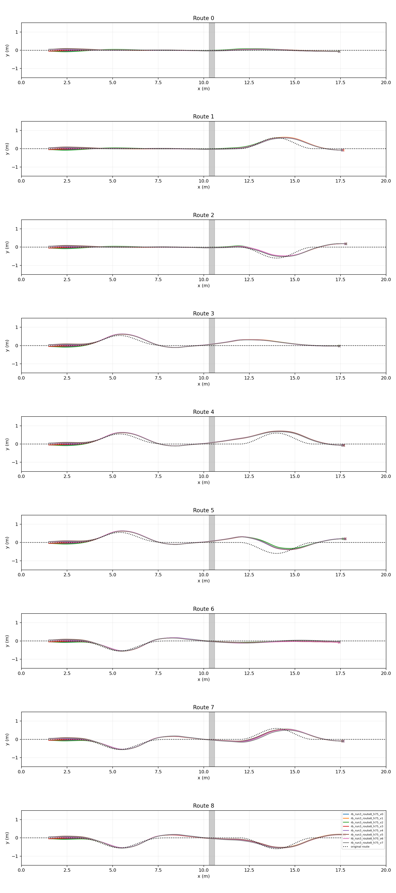

# Native Playground RB–STTW handoff trial

Role: bounded integration DEV with the declared initial variants below; not an independent success-rate estimate.

| Skill | Route | Variant | Continuation | RB entry s | Airborne | Far contact | Handoff s | End | Final XY m |
|---|---:|---|---|---:|---|---|---:|---|---|
|rb_run3|0|{'landing_height_m': 0.6, 'swing_scale': 1.0, 'jump_start_x_m': 8.600000000000001, 'rb_far_height_offset_m': 0.0, 'gate_roll_rad': 0.15, 'gate_roll_rate': 0.6, 'gate_hold_s': 0.0, 'recovery_wc': 8.0, 'body_speed_feedback': True, 'recovery_eso_scale': 1.0, 'recovery_eso_delay_s': 0.0, 'start_y_m': -0.05, 'start_yaw_rad': -0.03, 'start_roll_rad': -0.015, 'lookahead_scale': 1.3, 'root_variant': 0, 'data_split': 'TRAIN'}|h75|3.8399999141693115|True|True|5.289999961853027|goal|[17.43122673034668, -0.060428813099861145]|
|rb_run3|1|{'landing_height_m': 0.6, 'swing_scale': 1.0, 'jump_start_x_m': 8.600000000000001, 'rb_far_height_offset_m': 0.0, 'gate_roll_rad': 0.15, 'gate_roll_rate': 0.6, 'gate_hold_s': 0.0, 'recovery_wc': 8.0, 'body_speed_feedback': True, 'recovery_eso_scale': 1.0, 'recovery_eso_delay_s': 0.0, 'start_y_m': -0.05, 'start_yaw_rad': -0.03, 'start_roll_rad': -0.015, 'lookahead_scale': 1.3, 'root_variant': 0, 'data_split': 'TRAIN'}|h75|3.8399999141693115|True|True|5.255000114440918|goal|[17.646800994873047, -0.0804775208234787]|
|rb_run3|2|{'landing_height_m': 0.6, 'swing_scale': 1.0, 'jump_start_x_m': 8.600000000000001, 'rb_far_height_offset_m': 0.0, 'gate_roll_rad': 0.15, 'gate_roll_rate': 0.6, 'gate_hold_s': 0.0, 'recovery_wc': 8.0, 'body_speed_feedback': True, 'recovery_eso_scale': 1.0, 'recovery_eso_delay_s': 0.0, 'start_y_m': -0.05, 'start_yaw_rad': -0.03, 'start_roll_rad': -0.015, 'lookahead_scale': 1.3, 'root_variant': 0, 'data_split': 'TRAIN'}|h75|3.8399999141693115|True|True|5.25|goal|[17.79800033569336, 0.18048278987407684]|
|rb_run3|3|{'landing_height_m': 0.6, 'swing_scale': 1.0, 'jump_start_x_m': 8.600000000000001, 'rb_far_height_offset_m': 0.0, 'gate_roll_rad': 0.15, 'gate_roll_rate': 0.6, 'gate_hold_s': 0.0, 'recovery_wc': 8.0, 'body_speed_feedback': True, 'recovery_eso_scale': 1.0, 'recovery_eso_delay_s': 0.0, 'start_y_m': -0.05, 'start_yaw_rad': -0.03, 'start_roll_rad': -0.015, 'lookahead_scale': 1.3, 'root_variant': 0, 'data_split': 'TRAIN'}|h75|4.139999866485596|True|True|5.570000171661377|goal|[17.437305450439453, -0.02440272457897663]|
|rb_run3|4|{'landing_height_m': 0.6, 'swing_scale': 1.0, 'jump_start_x_m': 8.600000000000001, 'rb_far_height_offset_m': 0.0, 'gate_roll_rad': 0.15, 'gate_roll_rate': 0.6, 'gate_hold_s': 0.0, 'recovery_wc': 8.0, 'body_speed_feedback': True, 'recovery_eso_scale': 1.0, 'recovery_eso_delay_s': 0.0, 'start_y_m': -0.05, 'start_yaw_rad': -0.03, 'start_roll_rad': -0.015, 'lookahead_scale': 1.3, 'root_variant': 0, 'data_split': 'TRAIN'}|h75|4.139999866485596|True|True|5.570000171661377|goal|[17.61106300354004, -0.0629262700676918]|
|rb_run3|5|{'landing_height_m': 0.6, 'swing_scale': 1.0, 'jump_start_x_m': 8.600000000000001, 'rb_far_height_offset_m': 0.0, 'gate_roll_rad': 0.15, 'gate_roll_rate': 0.6, 'gate_hold_s': 0.0, 'recovery_wc': 8.0, 'body_speed_feedback': True, 'recovery_eso_scale': 1.0, 'recovery_eso_delay_s': 0.0, 'start_y_m': -0.05, 'start_yaw_rad': -0.03, 'start_roll_rad': -0.015, 'lookahead_scale': 1.3, 'root_variant': 0, 'data_split': 'TRAIN'}|h75|4.139999866485596|True|True|5.565000057220459|goal|[17.763355255126953, 0.2088639885187149]|
|rb_run3|6|{'landing_height_m': 0.6, 'swing_scale': 1.0, 'jump_start_x_m': 8.600000000000001, 'rb_far_height_offset_m': 0.0, 'gate_roll_rad': 0.15, 'gate_roll_rate': 0.6, 'gate_hold_s': 0.0, 'recovery_wc': 8.0, 'body_speed_feedback': True, 'recovery_eso_scale': 1.0, 'recovery_eso_delay_s': 0.0, 'start_y_m': -0.05, 'start_yaw_rad': -0.03, 'start_roll_rad': -0.015, 'lookahead_scale': 1.3, 'root_variant': 0, 'data_split': 'TRAIN'}|h75|4.099999904632568|True|True|5.554999828338623|goal|[17.429943084716797, -0.06355614215135574]|
|rb_run3|7|{'landing_height_m': 0.6, 'swing_scale': 1.0, 'jump_start_x_m': 8.600000000000001, 'rb_far_height_offset_m': 0.0, 'gate_roll_rad': 0.15, 'gate_roll_rate': 0.6, 'gate_hold_s': 0.0, 'recovery_wc': 8.0, 'body_speed_feedback': True, 'recovery_eso_scale': 1.0, 'recovery_eso_delay_s': 0.0, 'start_y_m': -0.05, 'start_yaw_rad': -0.03, 'start_roll_rad': -0.015, 'lookahead_scale': 1.3, 'root_variant': 0, 'data_split': 'TRAIN'}|h75|4.119999885559082|True|True|5.550000190734863|goal|[17.627222061157227, -0.09203748404979706]|
|rb_run3|8|{'landing_height_m': 0.6, 'swing_scale': 1.0, 'jump_start_x_m': 8.600000000000001, 'rb_far_height_offset_m': 0.0, 'gate_roll_rad': 0.15, 'gate_roll_rate': 0.6, 'gate_hold_s': 0.0, 'recovery_wc': 8.0, 'body_speed_feedback': True, 'recovery_eso_scale': 1.0, 'recovery_eso_delay_s': 0.0, 'start_y_m': -0.05, 'start_yaw_rad': -0.03, 'start_roll_rad': -0.015, 'lookahead_scale': 1.3, 'root_variant': 0, 'data_split': 'TRAIN'}|h75|4.119999885559082|True|True|5.574999809265137|goal|[17.701160430908203, 0.17729628086090088]|
|rb_run3|0|{'landing_height_m': 0.6, 'swing_scale': 1.0, 'jump_start_x_m': 8.600000000000001, 'rb_far_height_offset_m': 0.0, 'gate_roll_rad': 0.15, 'gate_roll_rate': 0.6, 'gate_hold_s': 0.0, 'recovery_wc': 8.0, 'body_speed_feedback': True, 'recovery_eso_scale': 1.0, 'recovery_eso_delay_s': 0.0, 'start_y_m': -0.05, 'start_yaw_rad': 0.03, 'start_roll_rad': -0.015, 'lookahead_scale': 1.3, 'root_variant': 1, 'data_split': 'TRAIN'}|h75|3.859999895095825|True|True|5.289999961853027|goal|[17.42805290222168, -0.05984582379460335]|
|rb_run3|1|{'landing_height_m': 0.6, 'swing_scale': 1.0, 'jump_start_x_m': 8.600000000000001, 'rb_far_height_offset_m': 0.0, 'gate_roll_rad': 0.15, 'gate_roll_rate': 0.6, 'gate_hold_s': 0.0, 'recovery_wc': 8.0, 'body_speed_feedback': True, 'recovery_eso_scale': 1.0, 'recovery_eso_delay_s': 0.0, 'start_y_m': -0.05, 'start_yaw_rad': 0.03, 'start_roll_rad': -0.015, 'lookahead_scale': 1.3, 'root_variant': 1, 'data_split': 'TRAIN'}|h75|3.859999895095825|True|True|5.284999847412109|goal|[17.65526580810547, -0.07830717414617538]|
|rb_run3|2|{'landing_height_m': 0.6, 'swing_scale': 1.0, 'jump_start_x_m': 8.600000000000001, 'rb_far_height_offset_m': 0.0, 'gate_roll_rad': 0.15, 'gate_roll_rate': 0.6, 'gate_hold_s': 0.0, 'recovery_wc': 8.0, 'body_speed_feedback': True, 'recovery_eso_scale': 1.0, 'recovery_eso_delay_s': 0.0, 'start_y_m': -0.05, 'start_yaw_rad': 0.03, 'start_roll_rad': -0.015, 'lookahead_scale': 1.3, 'root_variant': 1, 'data_split': 'TRAIN'}|h75|3.859999895095825|True|True|5.264999866485596|goal|[17.79848289489746, 0.18099525570869446]|
|rb_run3|3|{'landing_height_m': 0.6, 'swing_scale': 1.0, 'jump_start_x_m': 8.600000000000001, 'rb_far_height_offset_m': 0.0, 'gate_roll_rad': 0.15, 'gate_roll_rate': 0.6, 'gate_hold_s': 0.0, 'recovery_wc': 8.0, 'body_speed_feedback': True, 'recovery_eso_scale': 1.0, 'recovery_eso_delay_s': 0.0, 'start_y_m': -0.05, 'start_yaw_rad': 0.03, 'start_roll_rad': -0.015, 'lookahead_scale': 1.3, 'root_variant': 1, 'data_split': 'TRAIN'}|h75|4.139999866485596|True|True|5.59499979019165|goal|[17.426809310913086, -0.018551846966147423]|
|rb_run3|4|{'landing_height_m': 0.6, 'swing_scale': 1.0, 'jump_start_x_m': 8.600000000000001, 'rb_far_height_offset_m': 0.0, 'gate_roll_rad': 0.15, 'gate_roll_rate': 0.6, 'gate_hold_s': 0.0, 'recovery_wc': 8.0, 'body_speed_feedback': True, 'recovery_eso_scale': 1.0, 'recovery_eso_delay_s': 0.0, 'start_y_m': -0.05, 'start_yaw_rad': 0.03, 'start_roll_rad': -0.015, 'lookahead_scale': 1.3, 'root_variant': 1, 'data_split': 'TRAIN'}|h75|4.139999866485596|True|True|5.585000038146973|goal|[17.653079986572266, -0.06707973778247833]|
|rb_run3|5|{'landing_height_m': 0.6, 'swing_scale': 1.0, 'jump_start_x_m': 8.600000000000001, 'rb_far_height_offset_m': 0.0, 'gate_roll_rad': 0.15, 'gate_roll_rate': 0.6, 'gate_hold_s': 0.0, 'recovery_wc': 8.0, 'body_speed_feedback': True, 'recovery_eso_scale': 1.0, 'recovery_eso_delay_s': 0.0, 'start_y_m': -0.05, 'start_yaw_rad': 0.03, 'start_roll_rad': -0.015, 'lookahead_scale': 1.3, 'root_variant': 1, 'data_split': 'TRAIN'}|h75|4.139999866485596|True|True|5.570000171661377|goal|[17.735572814941406, 0.20205257833003998]|
|rb_run3|6|{'landing_height_m': 0.6, 'swing_scale': 1.0, 'jump_start_x_m': 8.600000000000001, 'rb_far_height_offset_m': 0.0, 'gate_roll_rad': 0.15, 'gate_roll_rate': 0.6, 'gate_hold_s': 0.0, 'recovery_wc': 8.0, 'body_speed_feedback': True, 'recovery_eso_scale': 1.0, 'recovery_eso_delay_s': 0.0, 'start_y_m': -0.05, 'start_yaw_rad': 0.03, 'start_roll_rad': -0.015, 'lookahead_scale': 1.3, 'root_variant': 1, 'data_split': 'TRAIN'}|h75|4.159999847412109|True|True|5.585000038146973|goal|[17.422590255737305, -0.07486862689256668]|
|rb_run3|7|{'landing_height_m': 0.6, 'swing_scale': 1.0, 'jump_start_x_m': 8.600000000000001, 'rb_far_height_offset_m': 0.0, 'gate_roll_rad': 0.15, 'gate_roll_rate': 0.6, 'gate_hold_s': 0.0, 'recovery_wc': 8.0, 'body_speed_feedback': True, 'recovery_eso_scale': 1.0, 'recovery_eso_delay_s': 0.0, 'start_y_m': -0.05, 'start_yaw_rad': 0.03, 'start_roll_rad': -0.015, 'lookahead_scale': 1.3, 'root_variant': 1, 'data_split': 'TRAIN'}|h75|4.159999847412109|True|True|5.585000038146973|goal|[17.61382293701172, -0.09041792154312134]|
|rb_run3|8|{'landing_height_m': 0.6, 'swing_scale': 1.0, 'jump_start_x_m': 8.600000000000001, 'rb_far_height_offset_m': 0.0, 'gate_roll_rad': 0.15, 'gate_roll_rate': 0.6, 'gate_hold_s': 0.0, 'recovery_wc': 8.0, 'body_speed_feedback': True, 'recovery_eso_scale': 1.0, 'recovery_eso_delay_s': 0.0, 'start_y_m': -0.05, 'start_yaw_rad': 0.03, 'start_roll_rad': -0.015, 'lookahead_scale': 1.3, 'root_variant': 1, 'data_split': 'TRAIN'}|h75|4.159999847412109|True|True|5.619999885559082|goal|[17.693546295166016, 0.19167999923229218]|
|rb_run3|0|{'landing_height_m': 0.6, 'swing_scale': 1.0, 'jump_start_x_m': 8.600000000000001, 'rb_far_height_offset_m': 0.0, 'gate_roll_rad': 0.15, 'gate_roll_rate': 0.6, 'gate_hold_s': 0.0, 'recovery_wc': 8.0, 'body_speed_feedback': True, 'recovery_eso_scale': 1.0, 'recovery_eso_delay_s': 0.0, 'start_y_m': -0.05, 'start_yaw_rad': -0.03, 'start_roll_rad': 0.015, 'lookahead_scale': 1.3, 'root_variant': 2, 'data_split': 'TRAIN'}|h75|3.859999895095825|True|True|5.289999961853027|goal|[17.43173599243164, -0.059117838740348816]|
|rb_run3|1|{'landing_height_m': 0.6, 'swing_scale': 1.0, 'jump_start_x_m': 8.600000000000001, 'rb_far_height_offset_m': 0.0, 'gate_roll_rad': 0.15, 'gate_roll_rate': 0.6, 'gate_hold_s': 0.0, 'recovery_wc': 8.0, 'body_speed_feedback': True, 'recovery_eso_scale': 1.0, 'recovery_eso_delay_s': 0.0, 'start_y_m': -0.05, 'start_yaw_rad': -0.03, 'start_roll_rad': 0.015, 'lookahead_scale': 1.3, 'root_variant': 2, 'data_split': 'TRAIN'}|h75|3.859999895095825|True|True|5.289999961853027|goal|[17.615419387817383, -0.0773288905620575]|
|rb_run3|2|{'landing_height_m': 0.6, 'swing_scale': 1.0, 'jump_start_x_m': 8.600000000000001, 'rb_far_height_offset_m': 0.0, 'gate_roll_rad': 0.15, 'gate_roll_rate': 0.6, 'gate_hold_s': 0.0, 'recovery_wc': 8.0, 'body_speed_feedback': True, 'recovery_eso_scale': 1.0, 'recovery_eso_delay_s': 0.0, 'start_y_m': -0.05, 'start_yaw_rad': -0.03, 'start_roll_rad': 0.015, 'lookahead_scale': 1.3, 'root_variant': 2, 'data_split': 'TRAIN'}|h75|3.859999895095825|True|True|5.304999828338623|goal|[17.79017448425293, 0.18739596009254456]|
|rb_run3|3|{'landing_height_m': 0.6, 'swing_scale': 1.0, 'jump_start_x_m': 8.600000000000001, 'rb_far_height_offset_m': 0.0, 'gate_roll_rad': 0.15, 'gate_roll_rate': 0.6, 'gate_hold_s': 0.0, 'recovery_wc': 8.0, 'body_speed_feedback': True, 'recovery_eso_scale': 1.0, 'recovery_eso_delay_s': 0.0, 'start_y_m': -0.05, 'start_yaw_rad': -0.03, 'start_roll_rad': 0.015, 'lookahead_scale': 1.3, 'root_variant': 2, 'data_split': 'TRAIN'}|h75|4.139999866485596|True|True|5.610000133514404|goal|[17.431081771850586, -0.0192075427621603]|
|rb_run3|4|{'landing_height_m': 0.6, 'swing_scale': 1.0, 'jump_start_x_m': 8.600000000000001, 'rb_far_height_offset_m': 0.0, 'gate_roll_rad': 0.15, 'gate_roll_rate': 0.6, 'gate_hold_s': 0.0, 'recovery_wc': 8.0, 'body_speed_feedback': True, 'recovery_eso_scale': 1.0, 'recovery_eso_delay_s': 0.0, 'start_y_m': -0.05, 'start_yaw_rad': -0.03, 'start_roll_rad': 0.015, 'lookahead_scale': 1.3, 'root_variant': 2, 'data_split': 'TRAIN'}|h75|4.139999866485596|True|True|5.59499979019165|goal|[17.611177444458008, -0.06218328699469566]|
|rb_run3|5|{'landing_height_m': 0.6, 'swing_scale': 1.0, 'jump_start_x_m': 8.600000000000001, 'rb_far_height_offset_m': 0.0, 'gate_roll_rad': 0.15, 'gate_roll_rate': 0.6, 'gate_hold_s': 0.0, 'recovery_wc': 8.0, 'body_speed_feedback': True, 'recovery_eso_scale': 1.0, 'recovery_eso_delay_s': 0.0, 'start_y_m': -0.05, 'start_yaw_rad': -0.03, 'start_roll_rad': 0.015, 'lookahead_scale': 1.3, 'root_variant': 2, 'data_split': 'TRAIN'}|h75|4.139999866485596|True|True|5.565000057220459|goal|[17.639663696289062, 0.2022121250629425]|
|rb_run3|6|{'landing_height_m': 0.6, 'swing_scale': 1.0, 'jump_start_x_m': 8.600000000000001, 'rb_far_height_offset_m': 0.0, 'gate_roll_rad': 0.15, 'gate_roll_rate': 0.6, 'gate_hold_s': 0.0, 'recovery_wc': 8.0, 'body_speed_feedback': True, 'recovery_eso_scale': 1.0, 'recovery_eso_delay_s': 0.0, 'start_y_m': -0.05, 'start_yaw_rad': -0.03, 'start_roll_rad': 0.015, 'lookahead_scale': 1.3, 'root_variant': 2, 'data_split': 'TRAIN'}|h75|4.119999885559082|True|True|5.554999828338623|goal|[17.426607131958008, -0.07424995303153992]|
|rb_run3|7|{'landing_height_m': 0.6, 'swing_scale': 1.0, 'jump_start_x_m': 8.600000000000001, 'rb_far_height_offset_m': 0.0, 'gate_roll_rad': 0.15, 'gate_roll_rate': 0.6, 'gate_hold_s': 0.0, 'recovery_wc': 8.0, 'body_speed_feedback': True, 'recovery_eso_scale': 1.0, 'recovery_eso_delay_s': 0.0, 'start_y_m': -0.05, 'start_yaw_rad': -0.03, 'start_roll_rad': 0.015, 'lookahead_scale': 1.3, 'root_variant': 2, 'data_split': 'TRAIN'}|h75|4.139999866485596|True|True|5.590000152587891|goal|[17.634071350097656, -0.08860423415899277]|
|rb_run3|8|{'landing_height_m': 0.6, 'swing_scale': 1.0, 'jump_start_x_m': 8.600000000000001, 'rb_far_height_offset_m': 0.0, 'gate_roll_rad': 0.15, 'gate_roll_rate': 0.6, 'gate_hold_s': 0.0, 'recovery_wc': 8.0, 'body_speed_feedback': True, 'recovery_eso_scale': 1.0, 'recovery_eso_delay_s': 0.0, 'start_y_m': -0.05, 'start_yaw_rad': -0.03, 'start_roll_rad': 0.015, 'lookahead_scale': 1.3, 'root_variant': 2, 'data_split': 'TRAIN'}|h75|4.139999866485596|True|True|5.565000057220459|goal|[17.710304260253906, 0.1730206459760666]|
|rb_run3|0|{'landing_height_m': 0.6, 'swing_scale': 1.0, 'jump_start_x_m': 8.600000000000001, 'rb_far_height_offset_m': 0.0, 'gate_roll_rad': 0.15, 'gate_roll_rate': 0.6, 'gate_hold_s': 0.0, 'recovery_wc': 8.0, 'body_speed_feedback': True, 'recovery_eso_scale': 1.0, 'recovery_eso_delay_s': 0.0, 'start_y_m': -0.05, 'start_yaw_rad': 0.03, 'start_roll_rad': 0.015, 'lookahead_scale': 1.3, 'root_variant': 3, 'data_split': 'TRAIN'}|h75|3.8399999141693115|True|True|5.284999847412109|goal|[17.43041229248047, -0.06656426936388016]|
|rb_run3|1|{'landing_height_m': 0.6, 'swing_scale': 1.0, 'jump_start_x_m': 8.600000000000001, 'rb_far_height_offset_m': 0.0, 'gate_roll_rad': 0.15, 'gate_roll_rate': 0.6, 'gate_hold_s': 0.0, 'recovery_wc': 8.0, 'body_speed_feedback': True, 'recovery_eso_scale': 1.0, 'recovery_eso_delay_s': 0.0, 'start_y_m': -0.05, 'start_yaw_rad': 0.03, 'start_roll_rad': 0.015, 'lookahead_scale': 1.3, 'root_variant': 3, 'data_split': 'TRAIN'}|h75|3.8399999141693115|True|True|5.260000228881836|goal|[17.61441421508789, -0.07924309372901917]|
|rb_run3|2|{'landing_height_m': 0.6, 'swing_scale': 1.0, 'jump_start_x_m': 8.600000000000001, 'rb_far_height_offset_m': 0.0, 'gate_roll_rad': 0.15, 'gate_roll_rate': 0.6, 'gate_hold_s': 0.0, 'recovery_wc': 8.0, 'body_speed_feedback': True, 'recovery_eso_scale': 1.0, 'recovery_eso_delay_s': 0.0, 'start_y_m': -0.05, 'start_yaw_rad': 0.03, 'start_roll_rad': 0.015, 'lookahead_scale': 1.3, 'root_variant': 3, 'data_split': 'TRAIN'}|h75|3.8399999141693115|True|True|5.264999866485596|goal|[17.79063606262207, 0.1811387836933136]|
|rb_run3|3|{'landing_height_m': 0.6, 'swing_scale': 1.0, 'jump_start_x_m': 8.600000000000001, 'rb_far_height_offset_m': 0.0, 'gate_roll_rad': 0.15, 'gate_roll_rate': 0.6, 'gate_hold_s': 0.0, 'recovery_wc': 8.0, 'body_speed_feedback': True, 'recovery_eso_scale': 1.0, 'recovery_eso_delay_s': 0.0, 'start_y_m': -0.05, 'start_yaw_rad': 0.03, 'start_roll_rad': 0.015, 'lookahead_scale': 1.3, 'root_variant': 3, 'data_split': 'TRAIN'}|h75|4.119999885559082|True|True|5.605000019073486|goal|[17.433286666870117, -0.02288075163960457]|
|rb_run3|4|{'landing_height_m': 0.6, 'swing_scale': 1.0, 'jump_start_x_m': 8.600000000000001, 'rb_far_height_offset_m': 0.0, 'gate_roll_rad': 0.15, 'gate_roll_rate': 0.6, 'gate_hold_s': 0.0, 'recovery_wc': 8.0, 'body_speed_feedback': True, 'recovery_eso_scale': 1.0, 'recovery_eso_delay_s': 0.0, 'start_y_m': -0.05, 'start_yaw_rad': 0.03, 'start_roll_rad': 0.015, 'lookahead_scale': 1.3, 'root_variant': 3, 'data_split': 'TRAIN'}|h75|4.119999885559082|True|True|5.574999809265137|goal|[17.6738224029541, -0.06798864156007767]|
|rb_run3|5|{'landing_height_m': 0.6, 'swing_scale': 1.0, 'jump_start_x_m': 8.600000000000001, 'rb_far_height_offset_m': 0.0, 'gate_roll_rad': 0.15, 'gate_roll_rate': 0.6, 'gate_hold_s': 0.0, 'recovery_wc': 8.0, 'body_speed_feedback': True, 'recovery_eso_scale': 1.0, 'recovery_eso_delay_s': 0.0, 'start_y_m': -0.05, 'start_yaw_rad': 0.03, 'start_roll_rad': 0.015, 'lookahead_scale': 1.3, 'root_variant': 3, 'data_split': 'TRAIN'}|h75|4.119999885559082|True|True|5.590000152587891|goal|[17.768165588378906, 0.206464022397995]|
|rb_run3|6|{'landing_height_m': 0.6, 'swing_scale': 1.0, 'jump_start_x_m': 8.600000000000001, 'rb_far_height_offset_m': 0.0, 'gate_roll_rad': 0.15, 'gate_roll_rate': 0.6, 'gate_hold_s': 0.0, 'recovery_wc': 8.0, 'body_speed_feedback': True, 'recovery_eso_scale': 1.0, 'recovery_eso_delay_s': 0.0, 'start_y_m': -0.05, 'start_yaw_rad': 0.03, 'start_roll_rad': 0.015, 'lookahead_scale': 1.3, 'root_variant': 3, 'data_split': 'TRAIN'}|h75|4.139999866485596|True|True|5.570000171661377|goal|[17.428163528442383, -0.07434028387069702]|
|rb_run3|7|{'landing_height_m': 0.6, 'swing_scale': 1.0, 'jump_start_x_m': 8.600000000000001, 'rb_far_height_offset_m': 0.0, 'gate_roll_rad': 0.15, 'gate_roll_rate': 0.6, 'gate_hold_s': 0.0, 'recovery_wc': 8.0, 'body_speed_feedback': True, 'recovery_eso_scale': 1.0, 'recovery_eso_delay_s': 0.0, 'start_y_m': -0.05, 'start_yaw_rad': 0.03, 'start_roll_rad': 0.015, 'lookahead_scale': 1.3, 'root_variant': 3, 'data_split': 'TRAIN'}|h75|4.139999866485596|True|True|5.570000171661377|goal|[17.61757469177246, -0.09146369248628616]|
|rb_run3|8|{'landing_height_m': 0.6, 'swing_scale': 1.0, 'jump_start_x_m': 8.600000000000001, 'rb_far_height_offset_m': 0.0, 'gate_roll_rad': 0.15, 'gate_roll_rate': 0.6, 'gate_hold_s': 0.0, 'recovery_wc': 8.0, 'body_speed_feedback': True, 'recovery_eso_scale': 1.0, 'recovery_eso_delay_s': 0.0, 'start_y_m': -0.05, 'start_yaw_rad': 0.03, 'start_roll_rad': 0.015, 'lookahead_scale': 1.3, 'root_variant': 3, 'data_split': 'TRAIN'}|h75|4.139999866485596|True|True|5.565000057220459|goal|[17.70185089111328, 0.16507649421691895]|
|rb_run3|0|{'landing_height_m': 0.6, 'swing_scale': 1.0, 'jump_start_x_m': 8.600000000000001, 'rb_far_height_offset_m': 0.0, 'gate_roll_rad': 0.15, 'gate_roll_rate': 0.6, 'gate_hold_s': 0.0, 'recovery_wc': 8.0, 'body_speed_feedback': True, 'recovery_eso_scale': 1.0, 'recovery_eso_delay_s': 0.0, 'start_y_m': 0.05, 'start_yaw_rad': -0.03, 'start_roll_rad': -0.015, 'lookahead_scale': 1.3, 'root_variant': 4, 'data_split': 'TRAIN'}|h75|3.8399999141693115|True|True|5.264999866485596|goal|[17.425689697265625, -0.06592237949371338]|
|rb_run3|1|{'landing_height_m': 0.6, 'swing_scale': 1.0, 'jump_start_x_m': 8.600000000000001, 'rb_far_height_offset_m': 0.0, 'gate_roll_rad': 0.15, 'gate_roll_rate': 0.6, 'gate_hold_s': 0.0, 'recovery_wc': 8.0, 'body_speed_feedback': True, 'recovery_eso_scale': 1.0, 'recovery_eso_delay_s': 0.0, 'start_y_m': 0.05, 'start_yaw_rad': -0.03, 'start_roll_rad': -0.015, 'lookahead_scale': 1.3, 'root_variant': 4, 'data_split': 'TRAIN'}|h75|3.8399999141693115|True|True|5.309999942779541|goal|[17.607545852661133, -0.07718566805124283]|
|rb_run3|2|{'landing_height_m': 0.6, 'swing_scale': 1.0, 'jump_start_x_m': 8.600000000000001, 'rb_far_height_offset_m': 0.0, 'gate_roll_rad': 0.15, 'gate_roll_rate': 0.6, 'gate_hold_s': 0.0, 'recovery_wc': 8.0, 'body_speed_feedback': True, 'recovery_eso_scale': 1.0, 'recovery_eso_delay_s': 0.0, 'start_y_m': 0.05, 'start_yaw_rad': -0.03, 'start_roll_rad': -0.015, 'lookahead_scale': 1.3, 'root_variant': 4, 'data_split': 'TRAIN'}|h75|3.8399999141693115|True|True|5.284999847412109|goal|[17.782062530517578, 0.18908098340034485]|
|rb_run3|3|{'landing_height_m': 0.6, 'swing_scale': 1.0, 'jump_start_x_m': 8.600000000000001, 'rb_far_height_offset_m': 0.0, 'gate_roll_rad': 0.15, 'gate_roll_rate': 0.6, 'gate_hold_s': 0.0, 'recovery_wc': 8.0, 'body_speed_feedback': True, 'recovery_eso_scale': 1.0, 'recovery_eso_delay_s': 0.0, 'start_y_m': 0.05, 'start_yaw_rad': -0.03, 'start_roll_rad': -0.015, 'lookahead_scale': 1.3, 'root_variant': 4, 'data_split': 'TRAIN'}|h75|4.139999866485596|True|True|5.599999904632568|goal|[17.432424545288086, -0.02144397236406803]|
|rb_run3|4|{'landing_height_m': 0.6, 'swing_scale': 1.0, 'jump_start_x_m': 8.600000000000001, 'rb_far_height_offset_m': 0.0, 'gate_roll_rad': 0.15, 'gate_roll_rate': 0.6, 'gate_hold_s': 0.0, 'recovery_wc': 8.0, 'body_speed_feedback': True, 'recovery_eso_scale': 1.0, 'recovery_eso_delay_s': 0.0, 'start_y_m': 0.05, 'start_yaw_rad': -0.03, 'start_roll_rad': -0.015, 'lookahead_scale': 1.3, 'root_variant': 4, 'data_split': 'TRAIN'}|h75|4.139999866485596|True|True|5.605000019073486|goal|[17.663381576538086, -0.0691232979297638]|
|rb_run3|5|{'landing_height_m': 0.6, 'swing_scale': 1.0, 'jump_start_x_m': 8.600000000000001, 'rb_far_height_offset_m': 0.0, 'gate_roll_rad': 0.15, 'gate_roll_rate': 0.6, 'gate_hold_s': 0.0, 'recovery_wc': 8.0, 'body_speed_feedback': True, 'recovery_eso_scale': 1.0, 'recovery_eso_delay_s': 0.0, 'start_y_m': 0.05, 'start_yaw_rad': -0.03, 'start_roll_rad': -0.015, 'lookahead_scale': 1.3, 'root_variant': 4, 'data_split': 'TRAIN'}|h75|4.139999866485596|True|True|5.59499979019165|goal|[17.75027847290039, 0.20690609514713287]|
|rb_run3|6|{'landing_height_m': 0.6, 'swing_scale': 1.0, 'jump_start_x_m': 8.600000000000001, 'rb_far_height_offset_m': 0.0, 'gate_roll_rad': 0.15, 'gate_roll_rate': 0.6, 'gate_hold_s': 0.0, 'recovery_wc': 8.0, 'body_speed_feedback': True, 'recovery_eso_scale': 1.0, 'recovery_eso_delay_s': 0.0, 'start_y_m': 0.05, 'start_yaw_rad': -0.03, 'start_roll_rad': -0.015, 'lookahead_scale': 1.3, 'root_variant': 4, 'data_split': 'TRAIN'}|h75|4.119999885559082|True|True|5.570000171661377|goal|[17.428285598754883, -0.0669579803943634]|
|rb_run3|7|{'landing_height_m': 0.6, 'swing_scale': 1.0, 'jump_start_x_m': 8.600000000000001, 'rb_far_height_offset_m': 0.0, 'gate_roll_rad': 0.15, 'gate_roll_rate': 0.6, 'gate_hold_s': 0.0, 'recovery_wc': 8.0, 'body_speed_feedback': True, 'recovery_eso_scale': 1.0, 'recovery_eso_delay_s': 0.0, 'start_y_m': 0.05, 'start_yaw_rad': -0.03, 'start_roll_rad': -0.015, 'lookahead_scale': 1.3, 'root_variant': 4, 'data_split': 'TRAIN'}|h75|4.119999885559082|True|True|5.579999923706055|goal|[17.630216598510742, -0.08954300731420517]|
|rb_run3|8|{'landing_height_m': 0.6, 'swing_scale': 1.0, 'jump_start_x_m': 8.600000000000001, 'rb_far_height_offset_m': 0.0, 'gate_roll_rad': 0.15, 'gate_roll_rate': 0.6, 'gate_hold_s': 0.0, 'recovery_wc': 8.0, 'body_speed_feedback': True, 'recovery_eso_scale': 1.0, 'recovery_eso_delay_s': 0.0, 'start_y_m': 0.05, 'start_yaw_rad': -0.03, 'start_roll_rad': -0.015, 'lookahead_scale': 1.3, 'root_variant': 4, 'data_split': 'TRAIN'}|h75|4.119999885559082|True|True|5.585000038146973|goal|[17.68151092529297, 0.1756812483072281]|
|rb_run3|0|{'landing_height_m': 0.6, 'swing_scale': 1.0, 'jump_start_x_m': 8.600000000000001, 'rb_far_height_offset_m': 0.0, 'gate_roll_rad': 0.15, 'gate_roll_rate': 0.6, 'gate_hold_s': 0.0, 'recovery_wc': 8.0, 'body_speed_feedback': True, 'recovery_eso_scale': 1.0, 'recovery_eso_delay_s': 0.0, 'start_y_m': 0.05, 'start_yaw_rad': 0.03, 'start_roll_rad': -0.015, 'lookahead_scale': 1.3, 'root_variant': 5, 'data_split': 'TRAIN'}|h75|3.859999895095825|True|True|5.255000114440918|goal|[17.426071166992188, -0.06492867320775986]|
|rb_run3|1|{'landing_height_m': 0.6, 'swing_scale': 1.0, 'jump_start_x_m': 8.600000000000001, 'rb_far_height_offset_m': 0.0, 'gate_roll_rad': 0.15, 'gate_roll_rate': 0.6, 'gate_hold_s': 0.0, 'recovery_wc': 8.0, 'body_speed_feedback': True, 'recovery_eso_scale': 1.0, 'recovery_eso_delay_s': 0.0, 'start_y_m': 0.05, 'start_yaw_rad': 0.03, 'start_roll_rad': -0.015, 'lookahead_scale': 1.3, 'root_variant': 5, 'data_split': 'TRAIN'}|h75|3.859999895095825|True|True|5.269999980926514|goal|[17.61646842956543, -0.07785043865442276]|
|rb_run3|2|{'landing_height_m': 0.6, 'swing_scale': 1.0, 'jump_start_x_m': 8.600000000000001, 'rb_far_height_offset_m': 0.0, 'gate_roll_rad': 0.15, 'gate_roll_rate': 0.6, 'gate_hold_s': 0.0, 'recovery_wc': 8.0, 'body_speed_feedback': True, 'recovery_eso_scale': 1.0, 'recovery_eso_delay_s': 0.0, 'start_y_m': 0.05, 'start_yaw_rad': 0.03, 'start_roll_rad': -0.015, 'lookahead_scale': 1.3, 'root_variant': 5, 'data_split': 'TRAIN'}|h75|3.859999895095825|True|True|5.28000020980835|goal|[17.79408073425293, 0.18867480754852295]|
|rb_run3|3|{'landing_height_m': 0.6, 'swing_scale': 1.0, 'jump_start_x_m': 8.600000000000001, 'rb_far_height_offset_m': 0.0, 'gate_roll_rad': 0.15, 'gate_roll_rate': 0.6, 'gate_hold_s': 0.0, 'recovery_wc': 8.0, 'body_speed_feedback': True, 'recovery_eso_scale': 1.0, 'recovery_eso_delay_s': 0.0, 'start_y_m': 0.05, 'start_yaw_rad': 0.03, 'start_roll_rad': -0.015, 'lookahead_scale': 1.3, 'root_variant': 5, 'data_split': 'TRAIN'}|h75|4.139999866485596|True|True|5.585000038146973|goal|[17.437992095947266, -0.02647099271416664]|
|rb_run3|4|{'landing_height_m': 0.6, 'swing_scale': 1.0, 'jump_start_x_m': 8.600000000000001, 'rb_far_height_offset_m': 0.0, 'gate_roll_rad': 0.15, 'gate_roll_rate': 0.6, 'gate_hold_s': 0.0, 'recovery_wc': 8.0, 'body_speed_feedback': True, 'recovery_eso_scale': 1.0, 'recovery_eso_delay_s': 0.0, 'start_y_m': 0.05, 'start_yaw_rad': 0.03, 'start_roll_rad': -0.015, 'lookahead_scale': 1.3, 'root_variant': 5, 'data_split': 'TRAIN'}|h75|4.139999866485596|True|True|5.579999923706055|goal|[17.69102668762207, -0.06349001079797745]|
|rb_run3|5|{'landing_height_m': 0.6, 'swing_scale': 1.0, 'jump_start_x_m': 8.600000000000001, 'rb_far_height_offset_m': 0.0, 'gate_roll_rad': 0.15, 'gate_roll_rate': 0.6, 'gate_hold_s': 0.0, 'recovery_wc': 8.0, 'body_speed_feedback': True, 'recovery_eso_scale': 1.0, 'recovery_eso_delay_s': 0.0, 'start_y_m': 0.05, 'start_yaw_rad': 0.03, 'start_roll_rad': -0.015, 'lookahead_scale': 1.3, 'root_variant': 5, 'data_split': 'TRAIN'}|h75|4.139999866485596|True|True|5.59499979019165|goal|[17.7367000579834, 0.200413778424263]|
|rb_run3|6|{'landing_height_m': 0.6, 'swing_scale': 1.0, 'jump_start_x_m': 8.600000000000001, 'rb_far_height_offset_m': 0.0, 'gate_roll_rad': 0.15, 'gate_roll_rate': 0.6, 'gate_hold_s': 0.0, 'recovery_wc': 8.0, 'body_speed_feedback': True, 'recovery_eso_scale': 1.0, 'recovery_eso_delay_s': 0.0, 'start_y_m': 0.05, 'start_yaw_rad': 0.03, 'start_roll_rad': -0.015, 'lookahead_scale': 1.3, 'root_variant': 5, 'data_split': 'TRAIN'}|h75|4.139999866485596|True|True|5.625|goal|[17.428159713745117, -0.06027306988835335]|
|rb_run3|7|{'landing_height_m': 0.6, 'swing_scale': 1.0, 'jump_start_x_m': 8.600000000000001, 'rb_far_height_offset_m': 0.0, 'gate_roll_rad': 0.15, 'gate_roll_rate': 0.6, 'gate_hold_s': 0.0, 'recovery_wc': 8.0, 'body_speed_feedback': True, 'recovery_eso_scale': 1.0, 'recovery_eso_delay_s': 0.0, 'start_y_m': 0.05, 'start_yaw_rad': 0.03, 'start_roll_rad': -0.015, 'lookahead_scale': 1.3, 'root_variant': 5, 'data_split': 'TRAIN'}|h75|4.139999866485596|True|True|5.599999904632568|goal|[17.61003875732422, -0.086287721991539]|
|rb_run3|8|{'landing_height_m': 0.6, 'swing_scale': 1.0, 'jump_start_x_m': 8.600000000000001, 'rb_far_height_offset_m': 0.0, 'gate_roll_rad': 0.15, 'gate_roll_rate': 0.6, 'gate_hold_s': 0.0, 'recovery_wc': 8.0, 'body_speed_feedback': True, 'recovery_eso_scale': 1.0, 'recovery_eso_delay_s': 0.0, 'start_y_m': 0.05, 'start_yaw_rad': 0.03, 'start_roll_rad': -0.015, 'lookahead_scale': 1.3, 'root_variant': 5, 'data_split': 'TRAIN'}|h75|4.139999866485596|True|True|5.570000171661377|goal|[17.727102279663086, 0.18737216293811798]|
|rb_run3|0|{'landing_height_m': 0.6, 'swing_scale': 1.0, 'jump_start_x_m': 8.600000000000001, 'rb_far_height_offset_m': 0.0, 'gate_roll_rad': 0.15, 'gate_roll_rate': 0.6, 'gate_hold_s': 0.0, 'recovery_wc': 8.0, 'body_speed_feedback': True, 'recovery_eso_scale': 1.0, 'recovery_eso_delay_s': 0.0, 'start_y_m': 0.05, 'start_yaw_rad': -0.03, 'start_roll_rad': 0.015, 'lookahead_scale': 1.3, 'root_variant': 6, 'data_split': 'DEV_ROOT'}|h75|3.8399999141693115|True|True|5.264999866485596|goal|[17.430212020874023, -0.06467923521995544]|
|rb_run3|1|{'landing_height_m': 0.6, 'swing_scale': 1.0, 'jump_start_x_m': 8.600000000000001, 'rb_far_height_offset_m': 0.0, 'gate_roll_rad': 0.15, 'gate_roll_rate': 0.6, 'gate_hold_s': 0.0, 'recovery_wc': 8.0, 'body_speed_feedback': True, 'recovery_eso_scale': 1.0, 'recovery_eso_delay_s': 0.0, 'start_y_m': 0.05, 'start_yaw_rad': -0.03, 'start_roll_rad': 0.015, 'lookahead_scale': 1.3, 'root_variant': 6, 'data_split': 'DEV_ROOT'}|h75|3.8399999141693115|True|True|5.28000020980835|goal|[17.625303268432617, -0.08025588095188141]|
|rb_run3|2|{'landing_height_m': 0.6, 'swing_scale': 1.0, 'jump_start_x_m': 8.600000000000001, 'rb_far_height_offset_m': 0.0, 'gate_roll_rad': 0.15, 'gate_roll_rate': 0.6, 'gate_hold_s': 0.0, 'recovery_wc': 8.0, 'body_speed_feedback': True, 'recovery_eso_scale': 1.0, 'recovery_eso_delay_s': 0.0, 'start_y_m': 0.05, 'start_yaw_rad': -0.03, 'start_roll_rad': 0.015, 'lookahead_scale': 1.3, 'root_variant': 6, 'data_split': 'DEV_ROOT'}|h75|3.8399999141693115|True|True|5.284999847412109|goal|[17.762954711914062, 0.18250522017478943]|
|rb_run3|3|{'landing_height_m': 0.6, 'swing_scale': 1.0, 'jump_start_x_m': 8.600000000000001, 'rb_far_height_offset_m': 0.0, 'gate_roll_rad': 0.15, 'gate_roll_rate': 0.6, 'gate_hold_s': 0.0, 'recovery_wc': 8.0, 'body_speed_feedback': True, 'recovery_eso_scale': 1.0, 'recovery_eso_delay_s': 0.0, 'start_y_m': 0.05, 'start_yaw_rad': -0.03, 'start_roll_rad': 0.015, 'lookahead_scale': 1.3, 'root_variant': 6, 'data_split': 'DEV_ROOT'}|h75|4.139999866485596|True|True|5.585000038146973|goal|[17.43779754638672, -0.025452960282564163]|
|rb_run3|4|{'landing_height_m': 0.6, 'swing_scale': 1.0, 'jump_start_x_m': 8.600000000000001, 'rb_far_height_offset_m': 0.0, 'gate_roll_rad': 0.15, 'gate_roll_rate': 0.6, 'gate_hold_s': 0.0, 'recovery_wc': 8.0, 'body_speed_feedback': True, 'recovery_eso_scale': 1.0, 'recovery_eso_delay_s': 0.0, 'start_y_m': 0.05, 'start_yaw_rad': -0.03, 'start_roll_rad': 0.015, 'lookahead_scale': 1.3, 'root_variant': 6, 'data_split': 'DEV_ROOT'}|h75|4.139999866485596|True|True|5.630000114440918|goal|[17.61524772644043, -0.06140582263469696]|
|rb_run3|5|{'landing_height_m': 0.6, 'swing_scale': 1.0, 'jump_start_x_m': 8.600000000000001, 'rb_far_height_offset_m': 0.0, 'gate_roll_rad': 0.15, 'gate_roll_rate': 0.6, 'gate_hold_s': 0.0, 'recovery_wc': 8.0, 'body_speed_feedback': True, 'recovery_eso_scale': 1.0, 'recovery_eso_delay_s': 0.0, 'start_y_m': 0.05, 'start_yaw_rad': -0.03, 'start_roll_rad': 0.015, 'lookahead_scale': 1.3, 'root_variant': 6, 'data_split': 'DEV_ROOT'}|h75|4.139999866485596|True|True|5.599999904632568|goal|[17.74334716796875, 0.20036904513835907]|
|rb_run3|6|{'landing_height_m': 0.6, 'swing_scale': 1.0, 'jump_start_x_m': 8.600000000000001, 'rb_far_height_offset_m': 0.0, 'gate_roll_rad': 0.15, 'gate_roll_rate': 0.6, 'gate_hold_s': 0.0, 'recovery_wc': 8.0, 'body_speed_feedback': True, 'recovery_eso_scale': 1.0, 'recovery_eso_delay_s': 0.0, 'start_y_m': 0.05, 'start_yaw_rad': -0.03, 'start_roll_rad': 0.015, 'lookahead_scale': 1.3, 'root_variant': 6, 'data_split': 'DEV_ROOT'}|h75|4.119999885559082|True|True|5.539999961853027|goal|[17.42178726196289, -0.07339376211166382]|
|rb_run3|7|{'landing_height_m': 0.6, 'swing_scale': 1.0, 'jump_start_x_m': 8.600000000000001, 'rb_far_height_offset_m': 0.0, 'gate_roll_rad': 0.15, 'gate_roll_rate': 0.6, 'gate_hold_s': 0.0, 'recovery_wc': 8.0, 'body_speed_feedback': True, 'recovery_eso_scale': 1.0, 'recovery_eso_delay_s': 0.0, 'start_y_m': 0.05, 'start_yaw_rad': -0.03, 'start_roll_rad': 0.015, 'lookahead_scale': 1.3, 'root_variant': 6, 'data_split': 'DEV_ROOT'}|h75|4.119999885559082|True|True|5.635000228881836|goal|[17.66083335876465, -0.09049427509307861]|
|rb_run3|8|{'landing_height_m': 0.6, 'swing_scale': 1.0, 'jump_start_x_m': 8.600000000000001, 'rb_far_height_offset_m': 0.0, 'gate_roll_rad': 0.15, 'gate_roll_rate': 0.6, 'gate_hold_s': 0.0, 'recovery_wc': 8.0, 'body_speed_feedback': True, 'recovery_eso_scale': 1.0, 'recovery_eso_delay_s': 0.0, 'start_y_m': 0.05, 'start_yaw_rad': -0.03, 'start_roll_rad': 0.015, 'lookahead_scale': 1.3, 'root_variant': 6, 'data_split': 'DEV_ROOT'}|h75|4.119999885559082|True|True|5.545000076293945|goal|[17.70143699645996, 0.17670753598213196]|
|rb_run3|0|{'landing_height_m': 0.6, 'swing_scale': 1.0, 'jump_start_x_m': 8.600000000000001, 'rb_far_height_offset_m': 0.0, 'gate_roll_rad': 0.15, 'gate_roll_rate': 0.6, 'gate_hold_s': 0.0, 'recovery_wc': 8.0, 'body_speed_feedback': True, 'recovery_eso_scale': 1.0, 'recovery_eso_delay_s': 0.0, 'start_y_m': 0.05, 'start_yaw_rad': 0.03, 'start_roll_rad': 0.015, 'lookahead_scale': 1.3, 'root_variant': 7, 'data_split': 'DEV_ROOT'}|h75|3.859999895095825|True|True|5.289999961853027|goal|[17.422143936157227, -0.06919258832931519]|
|rb_run3|1|{'landing_height_m': 0.6, 'swing_scale': 1.0, 'jump_start_x_m': 8.600000000000001, 'rb_far_height_offset_m': 0.0, 'gate_roll_rad': 0.15, 'gate_roll_rate': 0.6, 'gate_hold_s': 0.0, 'recovery_wc': 8.0, 'body_speed_feedback': True, 'recovery_eso_scale': 1.0, 'recovery_eso_delay_s': 0.0, 'start_y_m': 0.05, 'start_yaw_rad': 0.03, 'start_roll_rad': 0.015, 'lookahead_scale': 1.3, 'root_variant': 7, 'data_split': 'DEV_ROOT'}|h75|3.859999895095825|True|True|5.289999961853027|goal|[17.58795928955078, -0.07903069257736206]|
|rb_run3|2|{'landing_height_m': 0.6, 'swing_scale': 1.0, 'jump_start_x_m': 8.600000000000001, 'rb_far_height_offset_m': 0.0, 'gate_roll_rad': 0.15, 'gate_roll_rate': 0.6, 'gate_hold_s': 0.0, 'recovery_wc': 8.0, 'body_speed_feedback': True, 'recovery_eso_scale': 1.0, 'recovery_eso_delay_s': 0.0, 'start_y_m': 0.05, 'start_yaw_rad': 0.03, 'start_roll_rad': 0.015, 'lookahead_scale': 1.3, 'root_variant': 7, 'data_split': 'DEV_ROOT'}|h75|3.859999895095825|True|True|5.289999961853027|goal|[17.78323745727539, 0.18550923466682434]|
|rb_run3|3|{'landing_height_m': 0.6, 'swing_scale': 1.0, 'jump_start_x_m': 8.600000000000001, 'rb_far_height_offset_m': 0.0, 'gate_roll_rad': 0.15, 'gate_roll_rate': 0.6, 'gate_hold_s': 0.0, 'recovery_wc': 8.0, 'body_speed_feedback': True, 'recovery_eso_scale': 1.0, 'recovery_eso_delay_s': 0.0, 'start_y_m': 0.05, 'start_yaw_rad': 0.03, 'start_roll_rad': 0.015, 'lookahead_scale': 1.3, 'root_variant': 7, 'data_split': 'DEV_ROOT'}|h75|4.139999866485596|True|True|5.59499979019165|goal|[17.434974670410156, -0.026119785383343697]|
|rb_run3|4|{'landing_height_m': 0.6, 'swing_scale': 1.0, 'jump_start_x_m': 8.600000000000001, 'rb_far_height_offset_m': 0.0, 'gate_roll_rad': 0.15, 'gate_roll_rate': 0.6, 'gate_hold_s': 0.0, 'recovery_wc': 8.0, 'body_speed_feedback': True, 'recovery_eso_scale': 1.0, 'recovery_eso_delay_s': 0.0, 'start_y_m': 0.05, 'start_yaw_rad': 0.03, 'start_roll_rad': 0.015, 'lookahead_scale': 1.3, 'root_variant': 7, 'data_split': 'DEV_ROOT'}|h75|4.139999866485596|True|True|5.59499979019165|goal|[17.60255241394043, -0.0630459114909172]|
|rb_run3|5|{'landing_height_m': 0.6, 'swing_scale': 1.0, 'jump_start_x_m': 8.600000000000001, 'rb_far_height_offset_m': 0.0, 'gate_roll_rad': 0.15, 'gate_roll_rate': 0.6, 'gate_hold_s': 0.0, 'recovery_wc': 8.0, 'body_speed_feedback': True, 'recovery_eso_scale': 1.0, 'recovery_eso_delay_s': 0.0, 'start_y_m': 0.05, 'start_yaw_rad': 0.03, 'start_roll_rad': 0.015, 'lookahead_scale': 1.3, 'root_variant': 7, 'data_split': 'DEV_ROOT'}|h75|4.139999866485596|True|True|5.570000171661377|goal|[17.737516403198242, 0.19869500398635864]|
|rb_run3|6|{'landing_height_m': 0.6, 'swing_scale': 1.0, 'jump_start_x_m': 8.600000000000001, 'rb_far_height_offset_m': 0.0, 'gate_roll_rad': 0.15, 'gate_roll_rate': 0.6, 'gate_hold_s': 0.0, 'recovery_wc': 8.0, 'body_speed_feedback': True, 'recovery_eso_scale': 1.0, 'recovery_eso_delay_s': 0.0, 'start_y_m': 0.05, 'start_yaw_rad': 0.03, 'start_roll_rad': 0.015, 'lookahead_scale': 1.3, 'root_variant': 7, 'data_split': 'DEV_ROOT'}|h75|4.159999847412109|True|True|5.579999923706055|goal|[17.436511993408203, -0.03338406980037689]|
|rb_run3|7|{'landing_height_m': 0.6, 'swing_scale': 1.0, 'jump_start_x_m': 8.600000000000001, 'rb_far_height_offset_m': 0.0, 'gate_roll_rad': 0.15, 'gate_roll_rate': 0.6, 'gate_hold_s': 0.0, 'recovery_wc': 8.0, 'body_speed_feedback': True, 'recovery_eso_scale': 1.0, 'recovery_eso_delay_s': 0.0, 'start_y_m': 0.05, 'start_yaw_rad': 0.03, 'start_roll_rad': 0.015, 'lookahead_scale': 1.3, 'root_variant': 7, 'data_split': 'DEV_ROOT'}|h75|4.119999885559082|True|True|5.650000095367432|goal|[17.649019241333008, -0.09684585779905319]|
|rb_run3|8|{'landing_height_m': 0.6, 'swing_scale': 1.0, 'jump_start_x_m': 8.600000000000001, 'rb_far_height_offset_m': 0.0, 'gate_roll_rad': 0.15, 'gate_roll_rate': 0.6, 'gate_hold_s': 0.0, 'recovery_wc': 8.0, 'body_speed_feedback': True, 'recovery_eso_scale': 1.0, 'recovery_eso_delay_s': 0.0, 'start_y_m': 0.05, 'start_yaw_rad': 0.03, 'start_roll_rad': 0.015, 'lookahead_scale': 1.3, 'root_variant': 7, 'data_split': 'DEV_ROOT'}|h75|4.119999885559082|True|True|5.554999828338623|goal|[17.68480682373047, 0.17264902591705322]|

Completed 72/72 episodes. The declared approach controller (see declaration.json) precedes native RB jumping; handoff mechanism is landing_state, landing control=native. State-triggered runs use descent/contact/posture/joint readiness; the legacy fixed delay 0.5 s applies only to contact_delay runs. STTW hip/knee brakes are active; RB releases them and measured handoff re-locks the actual pose. No pose reset. Final goal/hold follows declaration and source config.

Terrain uses original Isaac rectangular samples and matching triangle diagonals, without resampling. Ground physics dt=0.001 s, RB physics=None, contact domain={'integrator': 'implicitfast', 'friction': 0.8, 'native_wheel_contacts': False}, lower dt=0.005 s, upper dt=0.02 s. This is a transfer feasibility trial, not a simulator-only causal comparison. H75 starts with measured ESO state and empty policy history.

Controller ownership: phase4 retains RB wheel commands while finite joint servos home the pendulum; only phase2 transfers wheels to STTW with hip/knee brakes active. Both far-wheel contact is required before homing and locking. No physical state reset.

Fixed map: chapter3_rough_ditch_030, whole-body planar bounds [-5.0, 25.0, -3.9, 3.9] m. Tracking-domain exit is distinct from physical-map exit. Nonwheel contact counts below are sampled at the 5 ms control boundary, not every 1 ms substep.

| Case | New vs legacy actuator-target max difference | Nonwheel contact samples |
|---|---:|---:|
|rb_run3_route0_h75_v0|None|0|
|rb_run3_route1_h75_v0|None|0|
|rb_run3_route2_h75_v0|None|0|
|rb_run3_route3_h75_v0|None|0|
|rb_run3_route4_h75_v0|None|0|
|rb_run3_route5_h75_v0|None|0|
|rb_run3_route6_h75_v0|None|0|
|rb_run3_route7_h75_v0|None|0|
|rb_run3_route8_h75_v0|None|0|
|rb_run3_route0_h75_v1|None|0|
|rb_run3_route1_h75_v1|None|0|
|rb_run3_route2_h75_v1|None|0|
|rb_run3_route3_h75_v1|None|0|
|rb_run3_route4_h75_v1|None|0|
|rb_run3_route5_h75_v1|None|0|
|rb_run3_route6_h75_v1|None|0|
|rb_run3_route7_h75_v1|None|0|
|rb_run3_route8_h75_v1|None|0|
|rb_run3_route0_h75_v2|None|0|
|rb_run3_route1_h75_v2|None|0|
|rb_run3_route2_h75_v2|None|0|
|rb_run3_route3_h75_v2|None|0|
|rb_run3_route4_h75_v2|None|0|
|rb_run3_route5_h75_v2|None|0|
|rb_run3_route6_h75_v2|None|0|
|rb_run3_route7_h75_v2|None|0|
|rb_run3_route8_h75_v2|None|0|
|rb_run3_route0_h75_v3|None|0|
|rb_run3_route1_h75_v3|None|0|
|rb_run3_route2_h75_v3|None|0|
|rb_run3_route3_h75_v3|None|0|
|rb_run3_route4_h75_v3|None|0|
|rb_run3_route5_h75_v3|None|0|
|rb_run3_route6_h75_v3|None|0|
|rb_run3_route7_h75_v3|None|0|
|rb_run3_route8_h75_v3|None|0|
|rb_run3_route0_h75_v4|None|0|
|rb_run3_route1_h75_v4|None|0|
|rb_run3_route2_h75_v4|None|0|
|rb_run3_route3_h75_v4|None|0|
|rb_run3_route4_h75_v4|None|0|
|rb_run3_route5_h75_v4|None|0|
|rb_run3_route6_h75_v4|None|0|
|rb_run3_route7_h75_v4|None|0|
|rb_run3_route8_h75_v4|None|0|
|rb_run3_route0_h75_v5|None|0|
|rb_run3_route1_h75_v5|None|0|
|rb_run3_route2_h75_v5|None|0|
|rb_run3_route3_h75_v5|None|0|
|rb_run3_route4_h75_v5|None|0|
|rb_run3_route5_h75_v5|None|0|
|rb_run3_route6_h75_v5|None|0|
|rb_run3_route7_h75_v5|None|0|
|rb_run3_route8_h75_v5|None|0|
|rb_run3_route0_h75_v6|None|0|
|rb_run3_route1_h75_v6|None|0|
|rb_run3_route2_h75_v6|None|0|
|rb_run3_route3_h75_v6|None|0|
|rb_run3_route4_h75_v6|None|0|
|rb_run3_route5_h75_v6|None|0|
|rb_run3_route6_h75_v6|None|0|
|rb_run3_route7_h75_v6|None|0|
|rb_run3_route8_h75_v6|None|0|
|rb_run3_route0_h75_v7|None|0|
|rb_run3_route1_h75_v7|None|0|
|rb_run3_route2_h75_v7|None|0|
|rb_run3_route3_h75_v7|None|0|
|rb_run3_route4_h75_v7|None|0|
|rb_run3_route5_h75_v7|None|0|
|rb_run3_route6_h75_v7|None|0|
|rb_run3_route7_h75_v7|None|0|
|rb_run3_route8_h75_v7|None|0|
