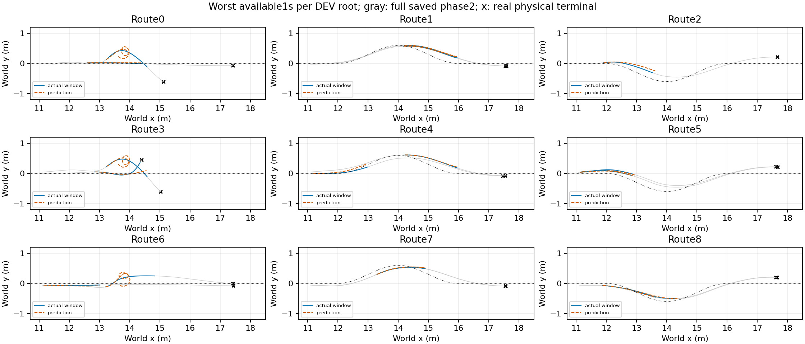
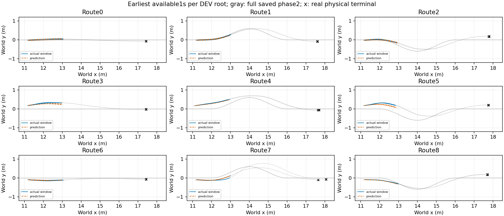
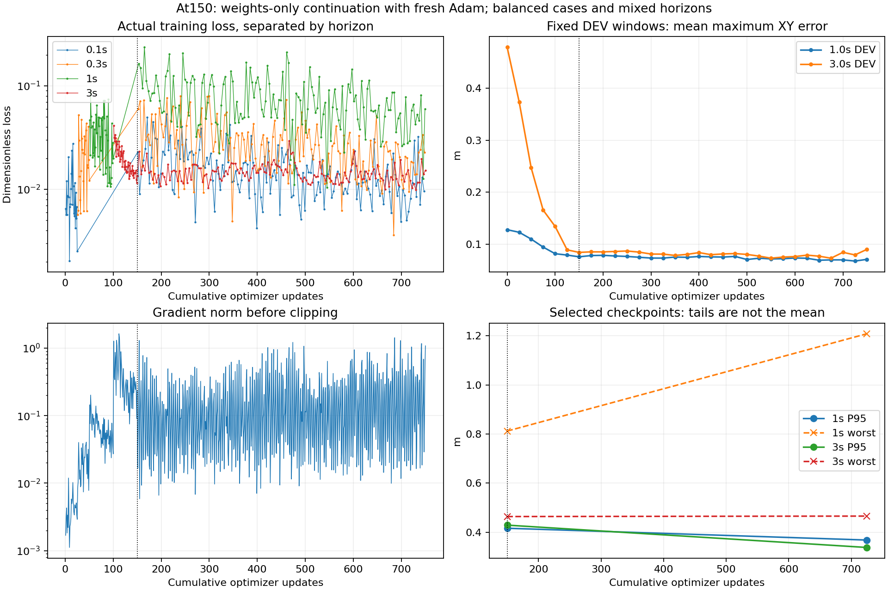

# Phase2 history model: mean improves, long-horizon adoption rejected

A frozen nominal ARX plus GRU64 correction initializes from the actual381D controller/history state. Rollout uses predicted states and evolving hidden state, never future real controller history. RB, H75, physics and physical success criteria stay unchanged.

|Stage best|Horizon s|Windows/cases|Mean max XY m|P95 max XY m|Worst XY m|
|---|---:|---|---:|---:|---:|
|150|1.0|216/17|0.0759|0.4162|0.8120|
|150|3.0|53/14|0.0845|0.4289|0.4639|
|725|1.0|216/17|0.0678|0.3681|1.2085|
|725|3.0|53/14|0.0796|0.3378|0.4657|

The first150 updates took40.14s;600 additional updates took115.00s. Seven and25 checkpoints were evaluated at25-update intervals, with the shared initial150 boundary counted in both stages. Best means best among evaluated candidates, not every update or task-qualified. The continuation used weights only and fresh Adam because the first stage had not saved optimizer state; later stages now save it.

Nominal1s and3s use216 windows/17 cases and53 windows/14 cases. Horizons have different coverage:3s is not evidence that prediction errors decrease with time. Failed physical trajectories remain in the source; no future states are padded.

The continuation1s mean improved to0.0678m, but worst error rose from0.8120m to1.2085m. Late validation means fluctuate. Formal convergence and long-horizon suitability are not established; no more pure-flat updates are launched.

[All rough-domain rows and support errors](rough_dev/RESULTS.md), [nominal tail cases](nominal_tail/RESULTS.md). Rough0.3s worst XY is0.0958m, while1s/2s worst are0.5845/0.8424m. Short-horizon evidence is not whole-plan accuracy or safety.

Next: use measured executable motion primitives for the first segmented-versus-joint planning comparison; preserve the long-horizon model failures. Terrain-conditioned M1/M2 and independent new-map tests remain unfinished.
