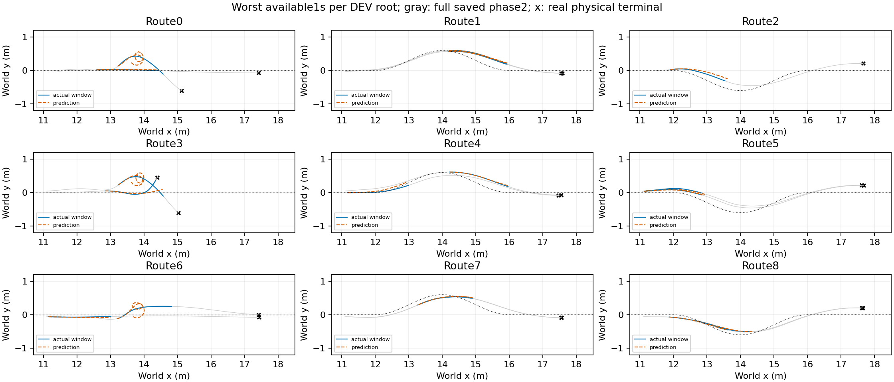

# Phase2 history prediction DEV evaluation

{"model_root": "/media/qy/6A7E3DB07E3D75C3/STTW_runs/chapter3_playground_sttw_rb_sttw/p2_history_model/continue600", "checkpoint": "best.pt", "example_selection": "worst available1s", "checkpoint_sha256": "dfff92ddbfc15218873fa60892be2cda70ee8b9bba6c96cfa912187fe1aeac92", "evaluation": "/media/qy/6A7E3DB07E3D75C3/STTW_runs/chapter3_playground_sttw_rb_sttw/p1_phase2_nominal/evaluation", "role": "Existing DEV_ROOT; no policy simulation, no future true controller input, not independent TEST", "elapsed_s": 6.750732877990231}

|Route|Horizon s|Windows/roots|Mean max XY m|P95 max XY m|Worst XY m|P95 planar support m|Worst3D support m|
|---|---:|---|---:|---:|---:|---:|---:|
|0|0.1|29/2|0.0058|0.0187|0.0235|0.0239|0.0361|
|0|0.3|27/2|0.0234|0.0897|0.1063|0.1237|0.1648|
|0|1.0|21/2|0.1712|0.5760|1.0113|0.8105|1.3058|
|0|2.0|11/2|0.2517|0.7374|0.7628|0.7268|0.7458|
|0|3.0|2/1|0.0237|0.0270|0.0274|0.0275|0.0278|
|1|0.1|38/2|0.0019|0.0059|0.0066|0.0063|0.0066|
|1|0.3|36/2|0.0074|0.0164|0.0233|0.0159|0.0200|
|1|1.0|28/2|0.0214|0.0309|0.0326|0.0382|0.0434|
|1|2.0|18/2|0.0346|0.0494|0.0515|0.0526|0.0546|
|1|3.0|8/2|0.0397|0.0476|0.0494|0.0518|0.0529|
|2|0.1|18/1|0.0034|0.0088|0.0116|0.0096|0.0128|
|2|0.3|17/1|0.0155|0.0396|0.0486|0.0396|0.0529|
|2|1.0|13/1|0.0392|0.0780|0.1028|0.0748|0.0861|
|2|2.0|8/1|0.0607|0.1110|0.1227|0.1088|0.1193|
|2|3.0|3/1|0.0921|0.1194|0.1227|0.1163|0.1193|
|3|0.1|23/2|0.0121|0.0277|0.0423|0.0301|0.0742|
|3|0.3|21/2|0.0495|0.1539|0.1540|0.1716|0.1998|
|3|1.0|14/2|0.2819|0.7807|1.0448|1.0140|1.2981|
|3|2.0|4/2|0.6196|0.7611|0.7902|0.7658|0.7828|
|4|0.1|36/2|0.0017|0.0038|0.0064|0.0059|0.0124|
|4|0.3|34/2|0.0071|0.0155|0.0224|0.0178|0.0378|
|4|1.0|28/2|0.0236|0.0442|0.1082|0.0460|0.1233|
|4|2.0|18/2|0.0477|0.0943|0.1215|0.0876|0.1327|
|4|3.0|8/2|0.0663|0.1142|0.1260|0.1147|0.1327|
|5|0.1|38/2|0.0028|0.0076|0.0083|0.0075|0.0089|
|5|0.3|36/2|0.0113|0.0375|0.0460|0.0363|0.0474|
|5|1.0|29/2|0.0305|0.0554|0.0723|0.0533|0.0673|
|5|2.0|19/2|0.0487|0.0897|0.0929|0.0828|0.0974|
|5|3.0|9/2|0.0601|0.0916|0.0929|0.0910|0.0974|
|6|0.1|35/2|0.0026|0.0100|0.0187|0.0211|0.0374|
|6|0.3|33/2|0.0103|0.0396|0.0673|0.0803|0.1546|
|6|1.0|27/2|0.1147|0.4276|1.2085|0.5500|1.4963|
|6|2.0|17/2|0.7975|3.1237|7.2502|3.2510|13.8212|
|6|3.0|7/2|0.2400|0.4537|0.4657|0.3616|0.3667|
|7|0.1|38/2|0.0020|0.0049|0.0063|0.0065|0.0069|
|7|0.3|36/2|0.0075|0.0216|0.0239|0.0192|0.0230|
|7|1.0|28/2|0.0211|0.0298|0.0329|0.0348|0.0360|
|7|2.0|18/2|0.0419|0.0602|0.0640|0.0621|0.0622|
|7|3.0|8/2|0.0586|0.0738|0.0793|0.0816|0.0866|
|8|0.1|37/2|0.0029|0.0090|0.0105|0.0097|0.0108|
|8|0.3|35/2|0.0101|0.0242|0.0298|0.0245|0.0318|
|8|1.0|28/2|0.0271|0.0429|0.0539|0.0455|0.0543|
|8|2.0|18/2|0.0410|0.0669|0.0720|0.0604|0.0626|
|8|3.0|8/2|0.0444|0.0602|0.0673|0.0660|0.0704|

Windows overlap and end before actual termination. Missing long windows are not padded or counted as successful predictions. Axis support error is not a safety guarantee. No new physical success rate follows from predictor accuracy.
