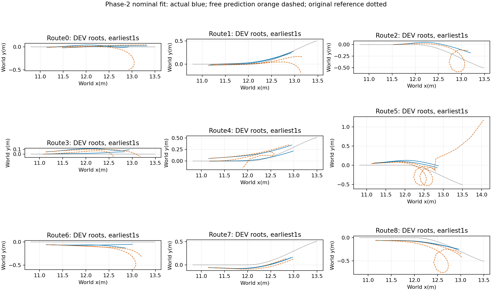
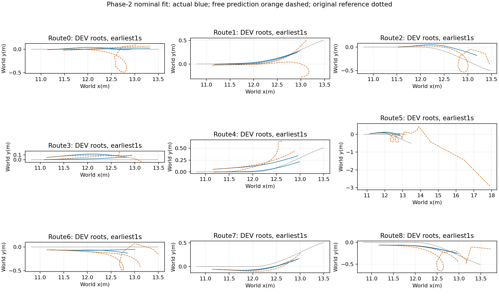
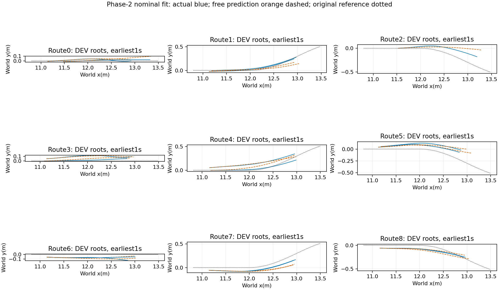
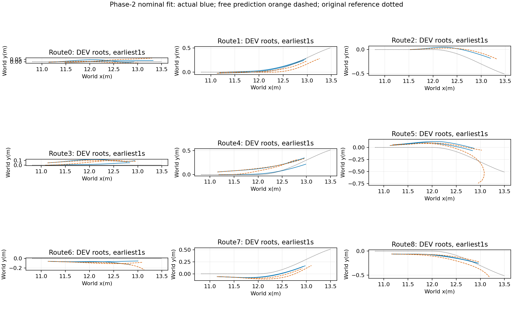
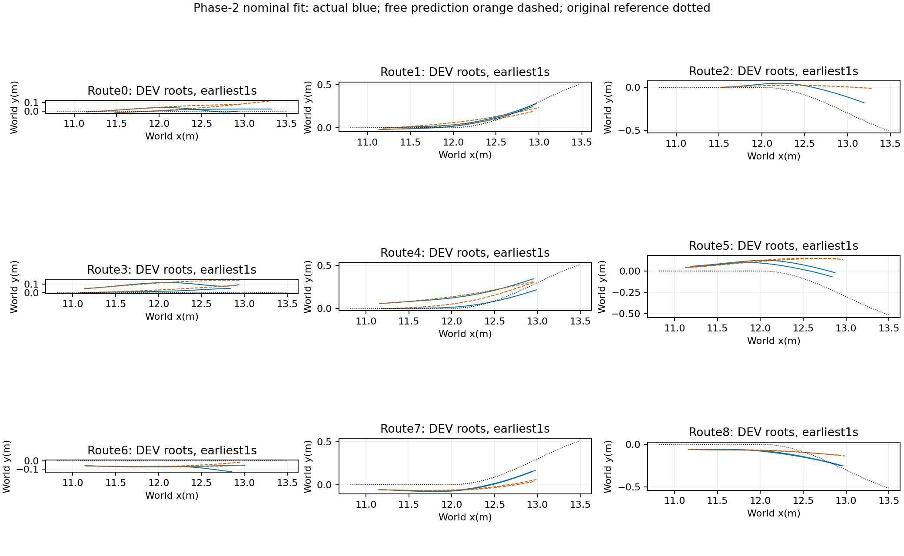
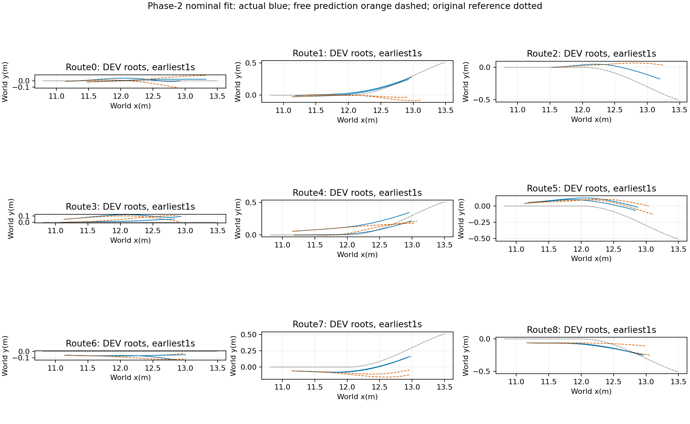

# Six finite ARX conditioning candidates rejected for long rollout

Same8883 flat TRAIN triples; same DEV roots; no new physics or policy training. Six runs completed in21.41s. Phase0 baseline windows reused exactly from the existing nominal evaluation. Homogeneous velocity-block spectral radius ignores route/state feedback and is not closed-loop stability proof.

|Candidate|Homogeneous radius|Horizon s|Worst route P95 XY m|Worst XY m|
|---|---:|---:|---:|---:|
|ridge0.01_increment0|1.02518|1.0|2.471|4.7849|
|ridge0.01_increment0|1.02518|2.0|1.7783e+05|7.9241e+05|
|ridge0.01_increment0|1.02518|3.0|2.9772e+11|4.3415e+11|
|ridge0.01_increment1|1.05851|1.0|2.0148|5.8496|
|ridge0.01_increment1|1.05851|2.0|2.0809e+05|5.7809e+05|
|ridge0.01_increment1|1.05851|3.0|1.532e+11|1.7022e+11|
|ridge0.1_increment0|0.96396|1.0|1.0413|1.2967|
|ridge0.1_increment0|0.96396|2.0|17.381|69.484|
|ridge0.1_increment0|0.96396|3.0|88.001|143.43|
|ridge0.1_increment1|1.04773|1.0|1.3135|1.5971|
|ridge0.1_increment1|1.04773|2.0|655.09|2403.6|
|ridge0.1_increment1|1.04773|3.0|1.0176e+07|1.553e+07|
|ridge1.0_increment0|0.82949|1.0|0.89001|1.1515|
|ridge1.0_increment0|0.82949|2.0|2.1383|2.4083|
|ridge1.0_increment0|0.82949|3.0|3.1093|3.3911|
|ridge1.0_increment1|1.03252|1.0|0.83607|0.97453|
|ridge1.0_increment1|1.03252|2.0|4.949|9.4254|
|ridge1.0_increment1|1.03252|3.0|127.56|206.44|

