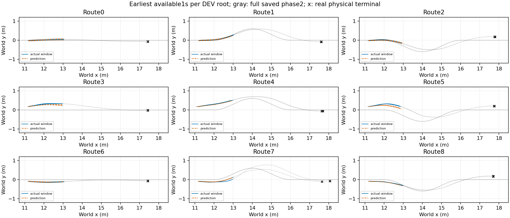

# Phase2 history prediction DEV evaluation

{"model_root": "/media/qy/6A7E3DB07E3D75C3/STTW_runs/chapter3_playground_sttw_rb_sttw/p2_history_model/continue600", "checkpoint": "best.pt", "checkpoint_sha256": "dfff92ddbfc15218873fa60892be2cda70ee8b9bba6c96cfa912187fe1aeac92", "evaluation": "/media/qy/6A7E3DB07E3D75C3/STTW_runs/chapter3_playground_sttw_rb_sttw/p1_phase2_collection/evaluation", "role": "Existing DEV_ROOT; no policy simulation, no future true controller input, not independent TEST", "elapsed_s": 7.81422401801683}

|Route|Horizon s|Windows/roots|Mean max XY m|P95 max XY m|Worst XY m|P95 planar support m|Worst3D support m|
|---|---:|---|---:|---:|---:|---:|---:|
|0|0.1|34/2|0.0055|0.0216|0.0233|0.0543|0.0599|
|0|0.3|32/2|0.0180|0.0668|0.0677|0.1309|0.1497|
|0|1.0|24/2|0.1074|0.3681|0.3746|0.3847|0.3898|
|0|2.0|14/2|0.0832|0.4323|0.4406|0.4088|0.4225|
|0|3.0|4/2|0.0206|0.0245|0.0247|0.0373|0.0460|
|1|0.1|37/2|0.0067|0.0269|0.0295|0.0645|0.0701|
|1|0.3|35/2|0.0253|0.0818|0.0927|0.1710|0.1827|
|1|1.0|28/2|0.1439|0.4878|0.5009|0.5031|0.5176|
|1|2.0|18/2|0.1669|0.5210|0.5414|0.5081|0.5226|
|1|3.0|8/2|0.0417|0.0478|0.0491|0.0524|0.0543|
|2|0.1|38/2|0.0058|0.0221|0.0290|0.0488|0.0560|
|2|0.3|36/2|0.0182|0.0514|0.0598|0.1028|0.1114|
|2|1.0|29/2|0.0777|0.2772|0.2913|0.2951|0.3048|
|2|2.0|19/2|0.1527|0.3232|0.3261|0.3002|0.3048|
|2|3.0|9/2|0.0894|0.1112|0.1184|0.1203|0.1255|
|3|0.1|34/2|0.0065|0.0226|0.0233|0.0544|0.0570|
|3|0.3|32/2|0.0226|0.0704|0.0736|0.1264|0.1378|
|3|1.0|26/2|0.1195|0.3738|0.4191|0.3911|0.4376|
|3|2.0|16/2|0.1287|0.3920|0.4192|0.4086|0.4376|
|3|3.0|6/2|0.0732|0.1123|0.1215|0.1178|0.1266|
|4|0.1|37/2|0.0069|0.0247|0.0288|0.0622|0.0679|
|4|0.3|35/2|0.0258|0.0762|0.0845|0.1639|0.1791|
|4|1.0|28/2|0.1559|0.4926|0.5345|0.5160|0.5591|
|4|2.0|18/2|0.1932|0.5615|0.6239|0.5414|0.6248|
|4|3.0|8/2|0.0823|0.0963|0.0982|0.0927|0.0972|
|5|0.1|39/2|0.0070|0.0232|0.0341|0.0468|0.0683|
|5|0.3|37/2|0.0218|0.0559|0.0673|0.1020|0.1137|
|5|1.0|30/2|0.0950|0.2659|0.3128|0.3187|0.3797|
|5|2.0|20/2|0.1677|0.3160|0.3321|0.3638|0.3797|
|5|3.0|10/2|0.1442|0.1747|0.1846|0.1648|0.1704|
|6|0.1|34/2|0.0055|0.0217|0.0231|0.0612|0.0652|
|6|0.3|32/2|0.0192|0.0661|0.0676|0.1370|0.1542|
|6|1.0|24/2|0.1094|0.3497|0.3627|0.3500|0.3681|
|6|2.0|14/2|0.1034|0.4617|0.4674|0.4313|0.4394|
|6|3.0|4/2|0.0550|0.0716|0.0720|0.0745|0.0752|
|7|0.1|40/2|0.0069|0.0244|0.0300|0.0657|0.0716|
|7|0.3|38/2|0.0272|0.0827|0.0958|0.1762|0.1834|
|7|1.0|30/2|0.1932|0.5327|0.5845|0.5630|0.6407|
|7|2.0|20/2|0.3194|0.7100|0.8424|0.6845|0.8365|
|7|3.0|10/2|0.2401|0.4247|0.4495|0.3942|0.4215|
|8|0.1|38/2|0.0066|0.0210|0.0275|0.0525|0.0586|
|8|0.3|36/2|0.0181|0.0486|0.0550|0.1110|0.1198|
|8|1.0|28/2|0.0731|0.2483|0.2512|0.2592|0.2795|
|8|2.0|18/2|0.1271|0.3375|0.3605|0.2884|0.3013|
|8|3.0|8/2|0.0591|0.0804|0.0806|0.0890|0.0957|

Windows overlap and end before actual termination. Missing long windows are not padded or counted as successful predictions. Axis support error is not a safety guarantee. No new physical success rate follows from predictor accuracy.
