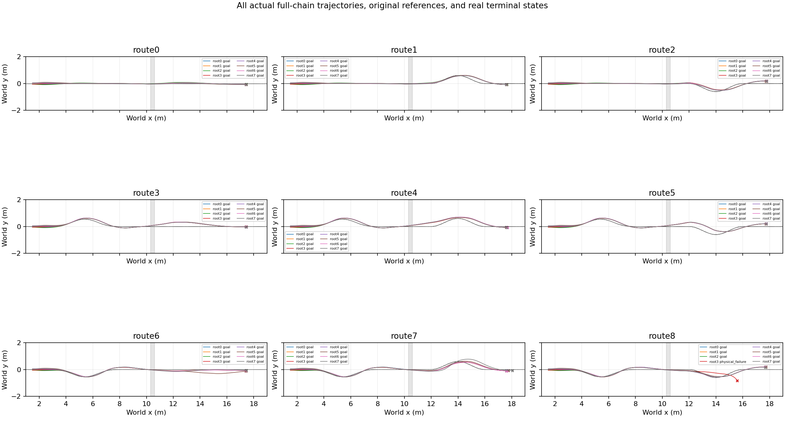
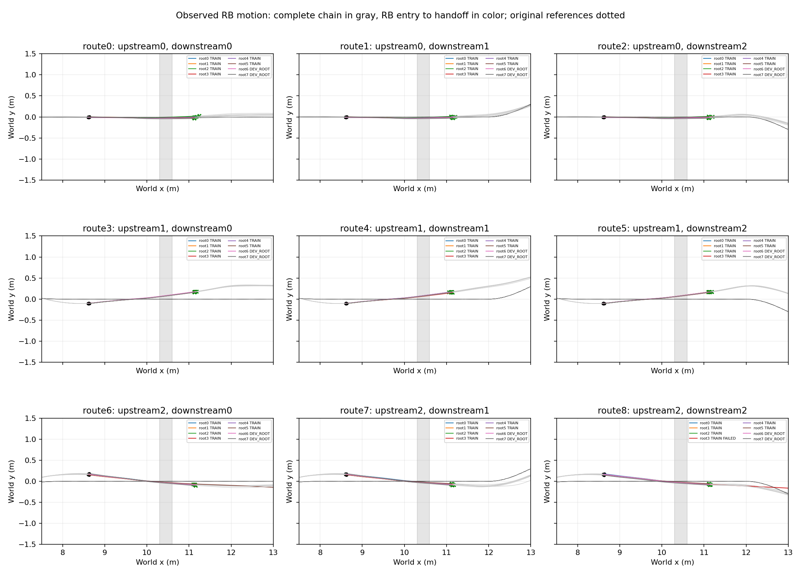

# RB observed motion library

## 当前判断（2026-11-14）

复用既有72条真实全链，提取71条完整RB和1条失败；24个上游/初态组合，TRAIN18组54条（53完整）、DEV6组18条（18完整），不把下游兄弟当独立来源。保存每5ms物理状态、控制器历史、接触和7个碰撞几何的三维轴向支持范围；未新增仿真或训练。

仅按启动状态选择最近TRAIN完整模板、只平移不旋转：18条DEV在共同覆盖时间内最大XY误差0.0721m，最大三维支持误差0.06985m；各自结束位置差最大0.07386m。仅8/18模板覆盖实际完整持续时间，时长差最大0.0500s；不能将重叠窗口误差作为全程包络保证。原生关节顺序映射修正后，以MuJoCo实际变换核对4帧×7几何，最大支持差4.02e-8m。最近邻未采用为合法入口筛选器。

旧trace四通道是前一控制间隔目标并含事件重置，不冒称本步实际RB动作；原始完整reset快照仍在源目录，但这里的入口物理/控制器历史不含RB FIFO与求解器状态，不能当恢复快照。P2仍需补齐实际动作和入口完整状态、覆盖更多合法启动条件、校准持续时间与启动域，然后执行分段/联合规划同预算比较。phase2预测仍未通过。规划器没有接入此诊断库，不改变冻结RB225或物理判据。

71/72 observed complete RB motions; 24 upstream/root groups.

- 24 upstream/root groups, three downstream siblings per group; not 72 independent starts
- Motion templates are for prediction only; actual execution remains closed-loop frozen RB225
- Per-geometry 3D supports sampled at5ms are not continuous-time clearance or exact swept-volume unions
- Controller history is available but RB FIFO/solver state at entry is not a replayable snapshot
- No calibrated nearest-template acceptance radius; do not publish unseen starts from this catalog

|Case|Split|RB complete|Full-chain outcome|Duration s|Peak roll rad|Peak pitch rad|
|---|---|---|---|---:|---:|---:|
|rb_run3_route0_h75_v0|TRAIN|True|goal|1.450|0.018|0.031|
|rb_run3_route1_h75_v0|TRAIN|True|goal|1.420|0.018|0.033|
|rb_run3_route2_h75_v0|TRAIN|True|goal|1.450|0.018|0.036|
|rb_run3_route3_h75_v0|TRAIN|True|goal|1.455|0.073|0.030|
|rb_run3_route4_h75_v0|TRAIN|True|goal|1.430|0.073|0.031|
|rb_run3_route5_h75_v0|TRAIN|True|goal|1.430|0.073|0.031|
|rb_run3_route6_h75_v0|TRAIN|True|goal|1.445|0.077|0.031|
|rb_run3_route7_h75_v0|TRAIN|True|goal|1.465|0.079|0.031|
|rb_run3_route8_h75_v0|TRAIN|True|goal|1.450|0.078|0.030|
|rb_run3_route0_h75_v1|TRAIN|True|goal|1.455|0.018|0.031|
|rb_run3_route1_h75_v1|TRAIN|True|goal|1.430|0.018|0.030|
|rb_run3_route2_h75_v1|TRAIN|True|goal|1.410|0.018|0.035|
|rb_run3_route3_h75_v1|TRAIN|True|goal|1.455|0.074|0.032|
|rb_run3_route4_h75_v1|TRAIN|True|goal|1.440|0.074|0.032|
|rb_run3_route5_h75_v1|TRAIN|True|goal|1.440|0.074|0.032|
|rb_run3_route6_h75_v1|TRAIN|True|goal|1.450|0.064|0.031|
|rb_run3_route7_h75_v1|TRAIN|True|goal|1.450|0.065|0.035|
|rb_run3_route8_h75_v1|TRAIN|True|goal|1.425|0.065|0.032|
|rb_run3_route0_h75_v2|TRAIN|True|goal|1.495|0.019|0.035|
|rb_run3_route1_h75_v2|TRAIN|True|goal|1.430|0.018|0.031|
|rb_run3_route2_h75_v2|TRAIN|True|goal|1.430|0.018|0.031|
|rb_run3_route3_h75_v2|TRAIN|True|goal|1.455|0.075|0.033|
|rb_run3_route4_h75_v2|TRAIN|True|goal|1.450|0.075|0.032|
|rb_run3_route5_h75_v2|TRAIN|True|goal|1.485|0.075|0.032|
|rb_run3_route6_h75_v2|TRAIN|True|goal|1.450|0.071|0.031|
|rb_run3_route7_h75_v2|TRAIN|True|goal|1.445|0.070|0.031|
|rb_run3_route8_h75_v2|TRAIN|True|goal|1.450|0.070|0.031|
|rb_run3_route0_h75_v3|TRAIN|True|goal|1.420|0.018|0.032|
|rb_run3_route1_h75_v3|TRAIN|True|goal|1.410|0.018|0.033|
|rb_run3_route2_h75_v3|TRAIN|True|goal|1.470|0.019|0.036|
|rb_run3_route3_h75_v3|TRAIN|True|goal|1.450|0.073|0.032|
|rb_run3_route4_h75_v3|TRAIN|True|goal|1.455|0.073|0.031|
|rb_run3_route5_h75_v3|TRAIN|True|goal|1.460|0.073|0.035|
|rb_run3_route6_h75_v3|TRAIN|True|goal|1.430|0.064|0.031|
|rb_run3_route7_h75_v3|TRAIN|True|goal|1.450|0.065|0.031|
|rb_run3_route8_h75_v3|TRAIN|False|physical_failure|4.695|0.707|0.062|
|rb_run3_route0_h75_v4|TRAIN|True|goal|1.445|0.018|0.033|
|rb_run3_route1_h75_v4|TRAIN|True|goal|1.490|0.018|0.031|
|rb_run3_route2_h75_v4|TRAIN|True|goal|1.445|0.018|0.031|
|rb_run3_route3_h75_v4|TRAIN|True|goal|1.460|0.075|0.033|
|rb_run3_route4_h75_v4|TRAIN|True|goal|1.440|0.075|0.036|
|rb_run3_route5_h75_v4|TRAIN|True|goal|1.465|0.075|0.034|
|rb_run3_route6_h75_v4|TRAIN|True|goal|1.465|0.074|0.031|
|rb_run3_route7_h75_v4|TRAIN|True|goal|1.445|0.074|0.033|
|rb_run3_route8_h75_v4|TRAIN|True|goal|1.475|0.074|0.031|
|rb_run3_route0_h75_v5|TRAIN|True|goal|1.425|0.019|0.036|
|rb_run3_route1_h75_v5|TRAIN|True|goal|1.435|0.019|0.035|
|rb_run3_route2_h75_v5|TRAIN|True|goal|1.410|0.019|0.035|
|rb_run3_route3_h75_v5|TRAIN|True|goal|1.485|0.073|0.034|
|rb_run3_route4_h75_v5|TRAIN|True|goal|1.455|0.073|0.035|
|rb_run3_route5_h75_v5|TRAIN|True|goal|1.450|0.073|0.035|
|rb_run3_route6_h75_v5|TRAIN|True|goal|3.665|0.068|0.062|
|rb_run3_route7_h75_v5|TRAIN|True|goal|1.445|0.068|0.033|
|rb_run3_route8_h75_v5|TRAIN|True|goal|1.445|0.068|0.033|
|rb_run3_route0_h75_v6|DEV_ROOT|True|goal|1.445|0.018|0.031|
|rb_run3_route1_h75_v6|DEV_ROOT|True|goal|1.470|0.018|0.031|
|rb_run3_route2_h75_v6|DEV_ROOT|True|goal|1.445|0.018|0.031|
|rb_run3_route3_h75_v6|DEV_ROOT|True|goal|1.475|0.075|0.031|
|rb_run3_route4_h75_v6|DEV_ROOT|True|goal|1.420|0.075|0.032|
|rb_run3_route5_h75_v6|DEV_ROOT|True|goal|1.460|0.075|0.030|
|rb_run3_route6_h75_v6|DEV_ROOT|True|goal|1.460|0.072|0.034|
|rb_run3_route7_h75_v6|DEV_ROOT|True|goal|1.470|0.072|0.032|
|rb_run3_route8_h75_v6|DEV_ROOT|True|goal|1.465|0.071|0.033|
|rb_run3_route0_h75_v7|DEV_ROOT|True|goal|1.405|0.017|0.034|
|rb_run3_route1_h75_v7|DEV_ROOT|True|goal|1.450|0.018|0.031|
|rb_run3_route2_h75_v7|DEV_ROOT|True|goal|1.425|0.018|0.035|
|rb_run3_route3_h75_v7|DEV_ROOT|True|goal|1.445|0.073|0.033|
|rb_run3_route4_h75_v7|DEV_ROOT|True|goal|1.455|0.073|0.033|
|rb_run3_route5_h75_v7|DEV_ROOT|True|goal|1.480|0.073|0.033|
|rb_run3_route6_h75_v7|DEV_ROOT|True|goal|1.470|0.085|0.034|
|rb_run3_route7_h75_v7|DEV_ROOT|True|goal|1.450|0.084|0.032|
|rb_run3_route8_h75_v7|DEV_ROOT|True|goal|1.445|0.059|0.031|

## Entry-only nearest TRAIN template on DEV

Errors stop at the shorter actual/template duration; endpoint errors compare each complete endpoint without time warping. No legal-domain radius or uncertainty guarantee is inferred.

|Case|Template|Entry distance|Full actual duration covered|Max XY m|Max 3D support m|Endpoint m|
|---|---|---:|---|---:|---:|---:|
|rb_run3_route0_h75_v6|rb_run3_route2_h75_v3|0.285|True|0.0250|0.0300|0.0670|
|rb_run3_route1_h75_v6|rb_run3_route2_h75_v4|0.291|False|0.0042|0.0047|0.0470|
|rb_run3_route2_h75_v6|rb_run3_route2_h75_v4|0.303|True|0.0053|0.0052|0.0053|
|rb_run3_route3_h75_v6|rb_run3_route5_h75_v4|0.106|False|0.0070|0.0105|0.0200|
|rb_run3_route4_h75_v6|rb_run3_route4_h75_v4|0.088|True|0.0154|0.0154|0.0455|
|rb_run3_route5_h75_v6|rb_run3_route4_h75_v4|0.069|False|0.0120|0.0125|0.0225|
|rb_run3_route6_h75_v6|rb_run3_route8_h75_v1|0.281|False|0.0386|0.0323|0.0521|
|rb_run3_route7_h75_v6|rb_run3_route8_h75_v1|0.283|False|0.0342|0.0293|0.0739|
|rb_run3_route8_h75_v6|rb_run3_route6_h75_v3|0.288|False|0.0117|0.0111|0.0646|
|rb_run3_route0_h75_v7|rb_run3_route0_h75_v1|0.479|True|0.0721|0.0698|0.0441|
|rb_run3_route1_h75_v7|rb_run3_route0_h75_v1|0.469|True|0.0245|0.0261|0.0248|
|rb_run3_route2_h75_v7|rb_run3_route0_h75_v1|0.473|True|0.0273|0.0258|0.0458|
|rb_run3_route3_h75_v7|rb_run3_route3_h75_v2|0.077|True|0.0186|0.0183|0.0083|
|rb_run3_route4_h75_v7|rb_run3_route3_h75_v2|0.097|True|0.0076|0.0072|0.0076|
|rb_run3_route5_h75_v7|rb_run3_route3_h75_v2|0.079|False|0.0182|0.0181|0.0583|
|rb_run3_route6_h75_v7|rb_run3_route8_h75_v0|0.445|False|0.0301|0.0307|0.0429|
|rb_run3_route7_h75_v7|rb_run3_route6_h75_v0|0.371|False|0.0236|0.0245|0.0281|
|rb_run3_route8_h75_v7|rb_run3_route6_h75_v3|0.326|False|0.0052|0.0055|0.0316|
