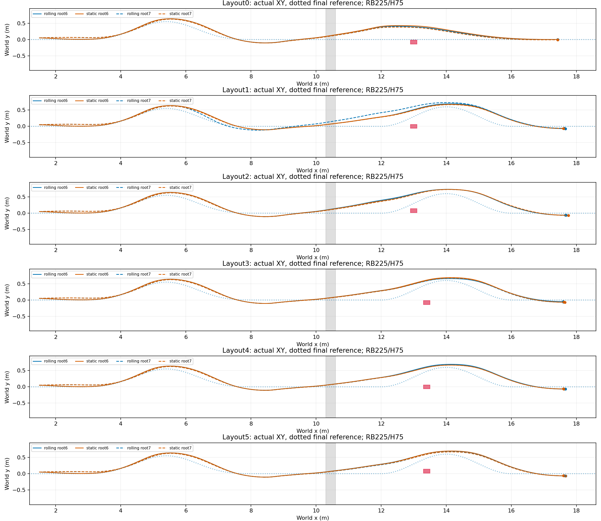

# P2滚动有限库执行

物理任务完成12/12，全程未出现规划覆盖失效且到达11/12；两者分开报告。相对静态同地图/根，平均物理完成时间差0.0038秒。

每200ms在地面阶段查询，完整RB执行期间保持技能归属。共235次批量查询、6次改变计划的发布，历史保持均为True。每次计入物理执行的延迟[0.04]秒，查询加发布耗时均被覆盖：True。计时含读取状态特征、GPU筛选、同步和发布；固定地图净空及运动库离线预计算，不含新地图构建或连续CEM。

|布局|根|物理结果|规划失效|首次失效s|发布s|时长s|
|---|---|---|---|---|---|---|
|0|6|goal|False|None|[0.64]|9.070|
|0|7|goal|False|None|[0.64]|9.060|
|1|6|goal|False|None|[0.64]|9.335|
|1|7|goal|True|2.6|[0.64]|9.320|
|2|6|goal|False|None|[0.64]|9.305|
|2|7|goal|False|None|[0.64]|9.320|
|3|6|goal|False|None|[0.64]|9.285|
|3|7|goal|False|None|[0.64]|9.285|
|4|6|goal|False|None|[0.64]|9.335|
|4|7|goal|False|None|[0.64]|9.300|
|5|6|goal|False|None|[0.64]|9.330|
|5|7|goal|False|None|[0.64]|9.300|

初始只承诺左上游/直下游到x8.3m的前缀，不冒称完整可行计划。筛选使用实测物理状态和381维控制历史的经验覆盖，状态/路径/激活条件不满足时不发布新候选；失去覆盖仍保留失败标志，实际继续控制不解释为已认证安全回退。已承诺路径前缀不变，原物理、地图、技能、目标及沟两侧2m平地不变。

六张既有DEV图和两个复用DEV根；不称独立TEST、连续规划完备性、任意速度域或全任务完成。固定图中主要发生一次有效改路，后续周期查询多为验证当前候选；不把查询次数当多次不同路线优化收益。

原始记录：`/media/qy/6A7E3DB07E3D75C3/STTW_runs/chapter3_playground_sttw_rb_sttw/p2_rolling_library`；完整事件、逐例、时延分位数见summary.json。

## 同路径TRAIN历史扩充：覆盖缺口仍保留

从原72条完整链中复用54条TRAIN记录，只将相同路线、所有跳跃触发之前x≤8.3m的历史并入状态包络；校准裕量逐值不变，后段包络逐值不变。新的12条真实物理回合仍12/12到达，覆盖合格仍11/12。layout01根7的首次覆盖失效由2.6秒移到6.4秒落地后；不能称整段预测域已解决。第二队列295.956秒、234次批量查询、六次改路，全部历史保持且40ms延迟覆盖实际查询/发布耗时。后续不追加无目的历史池或放宽门槛。

[扩充后的全部配对XY和事件](train_support/RESULTS.md)。两批都是DEV，没有独立成功率改善证据；保留原始状态覆盖失败。第一批2.6秒实际位置x5.936m，主要超界项为ESO[3]（偏差/裕量3.196）及disturbance[0]（3.105），不是物理失稳。
