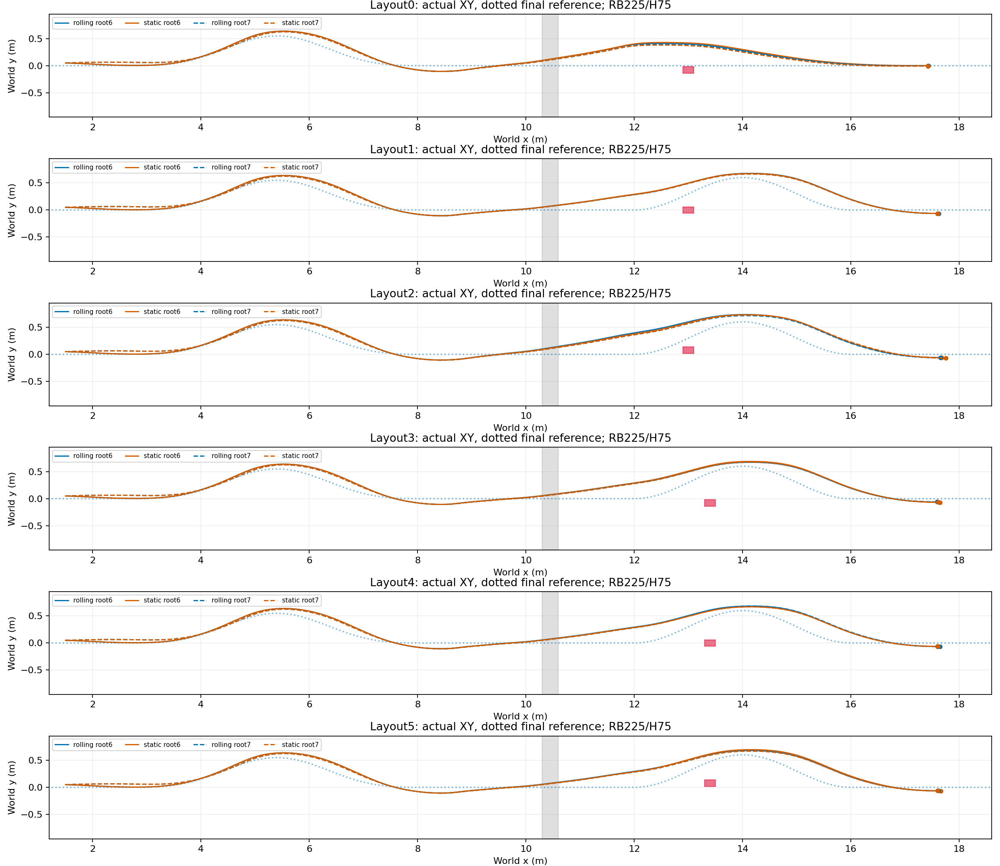

# P2滚动有限库执行

物理任务完成12/12，全程未出现规划覆盖失效且到达11/12；两者分开报告。相对静态同地图/根，平均物理完成时间差-0.0062秒。

每200ms在地面阶段查询，完整RB执行期间保持技能归属。共235次批量查询、6次改变计划的发布，历史保持均为True。每次计入物理执行的延迟[0.04]秒，查询加发布耗时均被覆盖：True。计时含读取状态特征、GPU筛选、同步和发布；固定地图净空及运动库离线预计算，不含新地图构建或连续CEM。

|布局|根|物理结果|规划失效|首次失效s|发布s|时长s|
|---|---|---|---|---|---|---|
|0|6|goal|False|None|[0.64]|9.065|
|0|7|goal|False|None|[0.64]|9.065|
|1|6|goal|False|None|[0.64]|9.300|
|1|7|goal|False|None|[0.64]|9.285|
|2|6|goal|False|None|[0.64]|9.315|
|2|7|goal|False|None|[0.64]|9.300|
|3|6|goal|False|None|[0.64]|9.300|
|3|7|goal|False|None|[0.64]|9.280|
|4|6|goal|True|7.0|[0.64]|9.305|
|4|7|goal|False|None|[0.64]|9.315|
|5|6|goal|False|None|[0.64]|9.300|
|5|7|goal|False|None|[0.64]|9.295|

初始只承诺左上游/直下游到x8.3m的前缀，不冒称完整可行计划。筛选使用实测物理状态和381维控制历史的经验覆盖，状态/路径/激活条件不满足时不发布新候选；失去覆盖仍保留失败标志，实际继续控制不解释为已认证安全回退。已承诺路径前缀不变，原物理、地图、技能、目标及沟两侧2m平地不变。

六张既有DEV图和两个复用DEV根；不称独立TEST、连续规划完备性、任意速度域或全任务完成。固定图中主要发生一次有效改路，后续周期查询多为验证当前候选；不把查询次数当多次不同路线优化收益。

原始记录：`/media/qy/6A7E3DB07E3D75C3/STTW_runs/chapter3_playground_sttw_rb_sttw/p2_rolling_multimap_support`；完整事件、逐例、时延分位数见summary.json。

**P2新增108多地图TRAIN历史支持后，滚动物理12/12、覆盖合格仍11/12。** 原54条跳前补充保留；新增六TRAIN地图1.8m/s的108条完整历史，跳前仅x≤8.3同参考前缀、跳后只匹配激活8.55。原x有效域/phase范围/校准margin/候选/代价/几何净空逐数组完全不变；295.875秒。原layout01根7覆盖失败消失，但layout04根6在7.0/7.2秒出现新越界，仍9.305秒完成目标。候选13同x比对主要为前轮速度历史0.878m/s，来源同槽下界约1.599、margin0.520，最大比例1.385；7.2秒该历史移至更旧帧，比例1.406。不是摔倒/碰撞或最终目标失败。235查询、六改路均保留历史，查询最大1.071ms/发布1.242ms，均覆盖40ms计入物理的延迟。扩展支持未解决全程覆盖，不提高阈值或称P2完全验收；完整XY/逐例/事件见`p2_rolling_multimap_support/RESULTS.md`，外盘同名根；Bark HTTP200。
