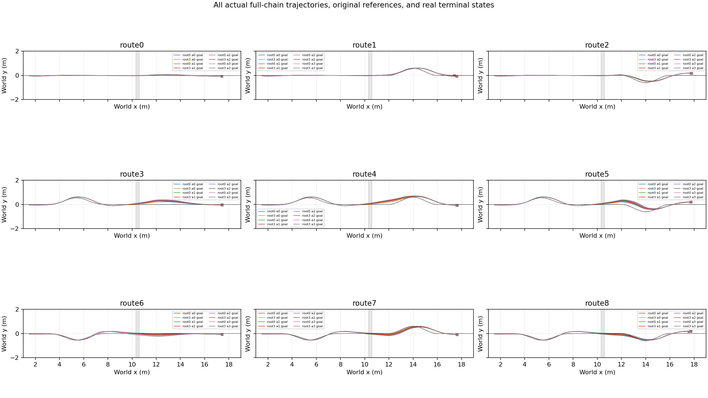

# P2 RB activation sweep

## 当前结论

四个启动位置8.45/8.55/8.65/8.75m各18/18，全链合计72/72目标，RB结束72/72；覆盖3种上游×3种下游方向、两个既有TRAIN初态。24个上游/初态/启动位置组，不是72个独立启动来源，更不是独立TEST。全队列387.56秒，仿真统计合计366.24秒，未训练网络。

保持原粗糙地图、沟前后两米平地、RB225、STTW锁髋膝和原成功门槛。四通道实际目标在控制选择后记录，RB FIFO/观测/上一动作在控制前记录；每条终止行均不计实际施加动作。完整3.5秒快照在所有实际RB入口之前，保存求解器、控制器及RB状态；它是启动前恢复锚点，不冒称恰在RB入口的快照。本批未另做快照恢复实验。锁定阶段髋膝漂移最大0.000212rad。

这些实测启动条件可作为联合规划候选库；尚未验证其间插值域，也未完成同预算分段/联合规划比较。旧71/72的失败记录保留。本次新增库中保存真实动作和FIFO，旧库缺项没有补造。下一步在共同地图和目标下比较联合候选及分段选择，并处理RB时长/结束状态不确定性和回交后的预测模型。

Frozen RB225, same rough map and ditch buffers, H75 with locked hip/knee during STTW. Only activation position changes. Actual targets/FIFO are recorded on GPU and exported after rollout. Complete runtime anchor at3.5s precedes entry; it is not an entry-time reset.

|Activation x m|Full chain goal|RB complete|Outcomes|Max lock drift rad|Evaluation s|
|---:|---:|---:|---|---:|---:|
|8.45|18/18|18/18|{'goal': 18}|9.07e-05|92.38|
|8.55|18/18|18/18|{'goal': 18}|0.000212|91.37|
|8.65|18/18|18/18|{'goal': 18}|4.96e-05|91.25|
|8.75|18/18|18/18|{'goal': 18}|0.000163|91.23|

|Activation x|Route|Root|Outcome|Entry s|Handoff s|End s|
|---:|---:|---:|---|---|---|---:|
|8.45|0|0|goal|3.759999990463257|5.289999961853027|8.720|
|8.45|1|0|goal|3.759999990463257|5.284999847412109|9.045|
|8.45|2|0|goal|3.759999990463257|5.289999961853027|9.145|
|8.45|3|0|goal|4.039999961853027|5.565000057220459|9.030|
|8.45|4|0|goal|4.039999961853027|5.610000133514404|9.290|
|8.45|5|0|goal|4.039999961853027|5.570000171661377|9.495|
|8.45|6|0|goal|4.019999980926514|5.545000076293945|8.985|
|8.45|7|0|goal|4.019999980926514|5.545000076293945|9.340|
|8.45|8|0|goal|4.019999980926514|5.554999828338623|9.360|
|8.45|0|3|goal|3.759999990463257|5.284999847412109|8.730|
|8.45|1|3|goal|3.759999990463257|5.284999847412109|9.020|
|8.45|2|3|goal|3.759999990463257|5.28000020980835|9.135|
|8.45|3|3|goal|4.039999961853027|5.554999828338623|9.010|
|8.45|4|3|goal|4.039999961853027|5.525000095367432|9.285|
|8.45|5|3|goal|4.039999961853027|5.625|9.500|
|8.45|6|3|goal|4.059999942779541|5.590000152587891|9.010|
|8.45|7|3|goal|4.059999942779541|5.570000171661377|9.375|
|8.45|8|3|goal|4.059999942779541|5.559999942779541|9.390|
|8.55|0|0|goal|3.819999933242798|5.25|8.680|
|8.55|1|0|goal|3.819999933242798|5.244999885559082|9.005|
|8.55|2|0|goal|3.799999952316284|5.28000020980835|9.110|
|8.55|3|0|goal|4.099999904632568|5.610000133514404|9.035|
|8.55|4|0|goal|4.099999904632568|5.565000057220459|9.280|
|8.55|5|0|goal|4.119999885559082|5.605000019073486|9.500|
|8.55|6|0|goal|4.079999923706055|5.570000171661377|8.980|
|8.55|7|0|goal|4.079999923706055|5.570000171661377|9.340|
|8.55|8|0|goal|4.079999923706055|5.635000228881836|9.370|
|8.55|0|3|goal|3.819999933242798|5.25|8.690|
|8.55|1|3|goal|3.819999933242798|5.289999961853027|8.935|
|8.55|2|3|goal|3.819999933242798|5.25|9.085|
|8.55|3|3|goal|4.099999904632568|5.565000057220459|9.020|
|8.55|4|3|goal|4.099999904632568|5.565000057220459|9.280|
|8.55|5|3|goal|4.099999904632568|5.559999942779541|9.495|
|8.55|6|3|goal|4.099999904632568|5.565000057220459|9.000|
|8.55|7|3|goal|4.099999904632568|5.570000171661377|9.365|
|8.55|8|3|goal|4.099999904632568|5.565000057220459|9.350|
|8.65|0|0|goal|3.859999895095825|5.25|8.680|
|8.65|1|0|goal|3.859999895095825|5.264999866485596|9.010|
|8.65|2|0|goal|3.859999895095825|5.269999980926514|9.100|
|8.65|3|0|goal|4.159999847412109|5.590000152587891|9.050|
|8.65|4|0|goal|4.159999847412109|5.559999942779541|9.305|
|8.65|5|0|goal|4.159999847412109|5.565000057220459|9.505|
|8.65|6|0|goal|4.139999866485596|5.550000190734863|8.980|
|8.65|7|0|goal|4.139999866485596|5.545000076293945|9.350|
|8.65|8|0|goal|4.139999866485596|5.545000076293945|9.300|
|8.65|0|3|goal|3.880000114440918|5.264999866485596|8.695|
|8.65|1|3|goal|3.880000114440918|5.224999904632568|8.985|
|8.65|2|3|goal|3.880000114440918|5.230000019073486|9.035|
|8.65|3|3|goal|4.139999866485596|5.585000038146973|9.015|
|8.65|4|3|goal|4.139999866485596|5.559999942779541|9.275|
|8.65|5|3|goal|4.139999866485596|5.614999771118164|9.460|
|8.65|6|3|goal|4.159999847412109|5.565000057220459|9.000|
|8.65|7|3|goal|4.159999847412109|5.565000057220459|9.375|
|8.65|8|3|goal|4.159999847412109|5.565000057220459|9.280|
|8.75|0|0|goal|3.9200000762939453|5.275000095367432|8.680|
|8.75|1|0|goal|3.9200000762939453|5.260000228881836|9.005|
|8.75|2|0|goal|3.9200000762939453|5.269999980926514|9.125|
|8.75|3|0|goal|4.21999979019165|5.565000057220459|9.045|
|8.75|4|0|goal|4.21999979019165|5.590000152587891|9.280|
|8.75|5|0|goal|4.21999979019165|5.565000057220459|9.480|
|8.75|6|0|goal|4.199999809265137|5.565000057220459|8.980|
|8.75|7|0|goal|4.199999809265137|5.570000171661377|9.360|
|8.75|8|0|goal|4.199999809265137|5.525000095367432|9.270|
|8.75|0|3|goal|3.9200000762939453|5.224999904632568|8.660|
|8.75|1|3|goal|3.9200000762939453|5.320000171661377|9.005|
|8.75|2|3|goal|3.9200000762939453|5.224999904632568|9.090|
|8.75|3|3|goal|4.199999809265137|5.545000076293945|9.020|
|8.75|4|3|goal|4.199999809265137|5.570000171661377|9.275|
|8.75|5|3|goal|4.199999809265137|5.605000019073486|9.465|
|8.75|6|3|goal|4.260000228881836|5.625|9.055|
|8.75|7|3|goal|4.21999979019165|5.610000133514404|9.385|
|8.75|8|3|goal|4.21999979019165|5.590000152587891|9.360|

All observed starts and failures remain in the library. Success here does not establish an interpolated legal start domain, rolling planning, or joint-planner benefit.
