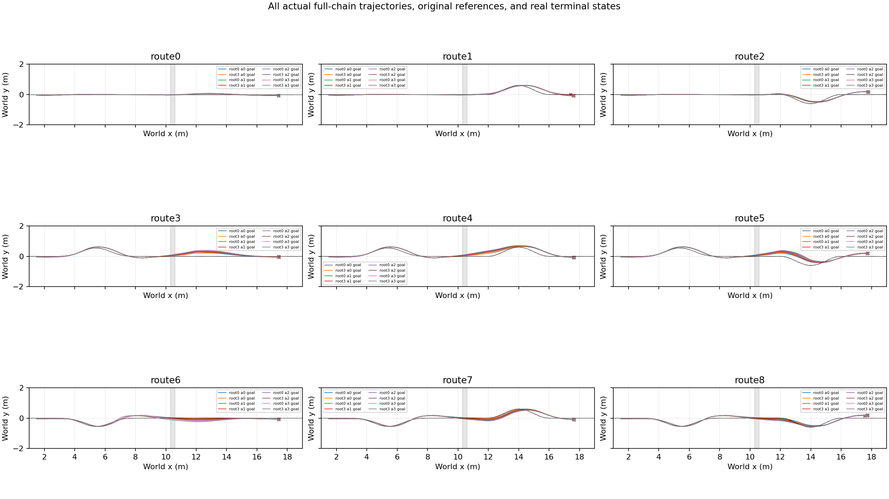
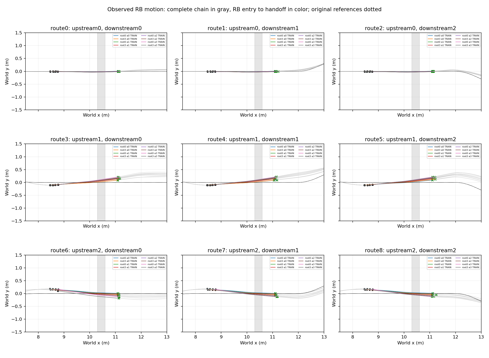

# RB observed motion library

72/72 observed complete RB motions; 24 upstream/root groups.

- 24 upstream/root/activation groups, three downstream siblings per group; not independent episodes
- Motion templates are for prediction only; actual execution remains closed-loop frozen RB225
- Per-geometry 3D supports sampled at5ms are not continuous-time clearance or exact swept-volume unions
- Per-step FIFO/actual targets availability is recorded per case; full runtime anchors are separate and precede entry
- No calibrated nearest-template acceptance radius; do not publish unseen starts from this catalog

|Case|Split|RB complete|Full-chain outcome|Duration s|Peak roll rad|Peak pitch rad|
|---|---|---|---|---:|---:|---:|
|batch00_rb_run3_route0_h75_v0|TRAIN|True|goal|1.530|0.018|0.031|
|batch00_rb_run3_route1_h75_v0|TRAIN|True|goal|1.525|0.018|0.031|
|batch00_rb_run3_route2_h75_v0|TRAIN|True|goal|1.530|0.018|0.031|
|batch00_rb_run3_route3_h75_v0|TRAIN|True|goal|1.525|0.083|0.030|
|batch00_rb_run3_route4_h75_v0|TRAIN|True|goal|1.570|0.083|0.031|
|batch00_rb_run3_route5_h75_v0|TRAIN|True|goal|1.530|0.083|0.031|
|batch00_rb_run3_route6_h75_v0|TRAIN|True|goal|1.525|0.082|0.034|
|batch00_rb_run3_route7_h75_v0|TRAIN|True|goal|1.525|0.081|0.030|
|batch00_rb_run3_route8_h75_v0|TRAIN|True|goal|1.535|0.080|0.033|
|batch00_rb_run3_route0_h75_v1|TRAIN|True|goal|1.525|0.018|0.031|
|batch00_rb_run3_route1_h75_v1|TRAIN|True|goal|1.525|0.018|0.036|
|batch00_rb_run3_route2_h75_v1|TRAIN|True|goal|1.520|0.018|0.031|
|batch00_rb_run3_route3_h75_v1|TRAIN|True|goal|1.515|0.081|0.033|
|batch00_rb_run3_route4_h75_v1|TRAIN|True|goal|1.485|0.081|0.037|
|batch00_rb_run3_route5_h75_v1|TRAIN|True|goal|1.585|0.083|0.031|
|batch00_rb_run3_route6_h75_v1|TRAIN|True|goal|1.530|0.068|0.032|
|batch00_rb_run3_route7_h75_v1|TRAIN|True|goal|1.510|0.068|0.033|
|batch00_rb_run3_route8_h75_v1|TRAIN|True|goal|1.500|0.069|0.032|
|batch01_rb_run3_route0_h75_v0|TRAIN|True|goal|1.430|0.018|0.030|
|batch01_rb_run3_route1_h75_v0|TRAIN|True|goal|1.425|0.018|0.031|
|batch01_rb_run3_route2_h75_v0|TRAIN|True|goal|1.480|0.018|0.031|
|batch01_rb_run3_route3_h75_v0|TRAIN|True|goal|1.510|0.078|0.031|
|batch01_rb_run3_route4_h75_v0|TRAIN|True|goal|1.465|0.079|0.031|
|batch01_rb_run3_route5_h75_v0|TRAIN|True|goal|1.485|0.078|0.035|
|batch01_rb_run3_route6_h75_v0|TRAIN|True|goal|1.490|0.080|0.031|
|batch01_rb_run3_route7_h75_v0|TRAIN|True|goal|1.490|0.080|0.031|
|batch01_rb_run3_route8_h75_v0|TRAIN|True|goal|1.555|0.079|0.031|
|batch01_rb_run3_route0_h75_v1|TRAIN|True|goal|1.430|0.018|0.031|
|batch01_rb_run3_route1_h75_v1|TRAIN|True|goal|1.470|0.019|0.034|
|batch01_rb_run3_route2_h75_v1|TRAIN|True|goal|1.430|0.017|0.035|
|batch01_rb_run3_route3_h75_v1|TRAIN|True|goal|1.465|0.075|0.031|
|batch01_rb_run3_route4_h75_v1|TRAIN|True|goal|1.465|0.075|0.031|
|batch01_rb_run3_route5_h75_v1|TRAIN|True|goal|1.460|0.075|0.035|
|batch01_rb_run3_route6_h75_v1|TRAIN|True|goal|1.465|0.066|0.030|
|batch01_rb_run3_route7_h75_v1|TRAIN|True|goal|1.470|0.067|0.031|
|batch01_rb_run3_route8_h75_v1|TRAIN|True|goal|1.465|0.067|0.030|
|batch02_rb_run3_route0_h75_v0|TRAIN|True|goal|1.390|0.018|0.031|
|batch02_rb_run3_route1_h75_v0|TRAIN|True|goal|1.405|0.019|0.036|
|batch02_rb_run3_route2_h75_v0|TRAIN|True|goal|1.410|0.018|0.031|
|batch02_rb_run3_route3_h75_v0|TRAIN|True|goal|1.430|0.071|0.034|
|batch02_rb_run3_route4_h75_v0|TRAIN|True|goal|1.400|0.071|0.033|
|batch02_rb_run3_route5_h75_v0|TRAIN|True|goal|1.405|0.071|0.030|
|batch02_rb_run3_route6_h75_v0|TRAIN|True|goal|1.410|0.076|0.033|
|batch02_rb_run3_route7_h75_v0|TRAIN|True|goal|1.405|0.076|0.031|
|batch02_rb_run3_route8_h75_v0|TRAIN|True|goal|1.405|0.076|0.031|
|batch02_rb_run3_route0_h75_v1|TRAIN|True|goal|1.385|0.019|0.033|
|batch02_rb_run3_route1_h75_v1|TRAIN|True|goal|1.345|0.017|0.032|
|batch02_rb_run3_route2_h75_v1|TRAIN|True|goal|1.350|0.018|0.032|
|batch02_rb_run3_route3_h75_v1|TRAIN|True|goal|1.445|0.071|0.031|
|batch02_rb_run3_route4_h75_v1|TRAIN|True|goal|1.420|0.071|0.032|
|batch02_rb_run3_route5_h75_v1|TRAIN|True|goal|1.475|0.071|0.031|
|batch02_rb_run3_route6_h75_v1|TRAIN|True|goal|1.405|0.063|0.031|
|batch02_rb_run3_route7_h75_v1|TRAIN|True|goal|1.405|0.063|0.031|
|batch02_rb_run3_route8_h75_v1|TRAIN|True|goal|1.405|0.063|0.031|
|batch03_rb_run3_route0_h75_v0|TRAIN|True|goal|1.355|0.018|0.033|
|batch03_rb_run3_route1_h75_v0|TRAIN|True|goal|1.340|0.019|0.031|
|batch03_rb_run3_route2_h75_v0|TRAIN|True|goal|1.350|0.018|0.030|
|batch03_rb_run3_route3_h75_v0|TRAIN|True|goal|1.345|0.062|0.030|
|batch03_rb_run3_route4_h75_v0|TRAIN|True|goal|1.370|0.062|0.033|
|batch03_rb_run3_route5_h75_v0|TRAIN|True|goal|1.345|0.062|0.033|
|batch03_rb_run3_route6_h75_v0|TRAIN|True|goal|1.365|0.071|0.033|
|batch03_rb_run3_route7_h75_v0|TRAIN|True|goal|1.370|0.072|0.032|
|batch03_rb_run3_route8_h75_v0|TRAIN|True|goal|1.325|0.072|0.032|
|batch03_rb_run3_route0_h75_v1|TRAIN|True|goal|1.305|0.018|0.031|
|batch03_rb_run3_route1_h75_v1|TRAIN|True|goal|1.400|0.019|0.036|
|batch03_rb_run3_route2_h75_v1|TRAIN|True|goal|1.305|0.018|0.031|
|batch03_rb_run3_route3_h75_v1|TRAIN|True|goal|1.345|0.063|0.033|
|batch03_rb_run3_route4_h75_v1|TRAIN|True|goal|1.370|0.063|0.031|
|batch03_rb_run3_route5_h75_v1|TRAIN|True|goal|1.405|0.063|0.031|
|batch03_rb_run3_route6_h75_v1|TRAIN|True|goal|1.365|0.034|0.032|
|batch03_rb_run3_route7_h75_v1|TRAIN|True|goal|1.390|0.059|0.033|
|batch03_rb_run3_route8_h75_v1|TRAIN|True|goal|1.370|0.059|0.033|

## Entry-only nearest TRAIN template on DEV

Errors stop at the shorter actual/template duration; endpoint errors compare each complete endpoint without time warping. No legal-domain radius or uncertainty guarantee is inferred.

|Case|Template|Entry distance|Full actual duration covered|Max XY m|Max 3D support m|Endpoint m|
|---|---|---:|---|---:|---:|---:|
