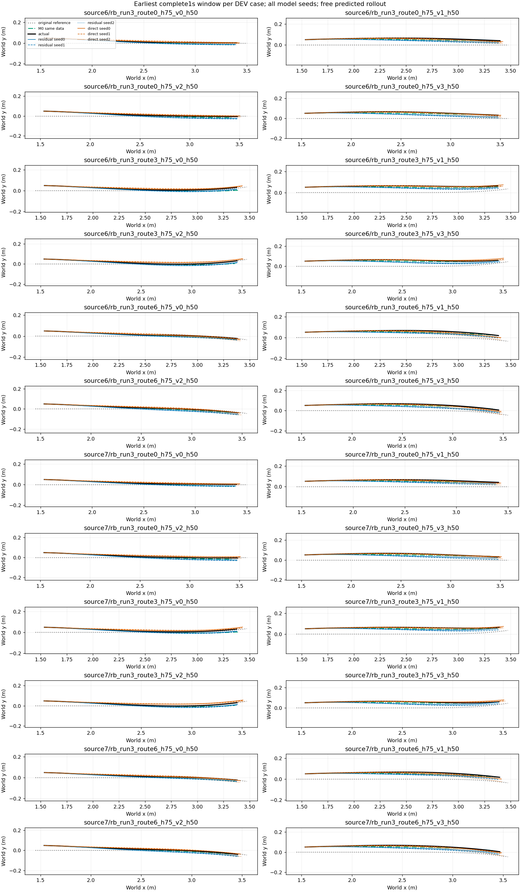
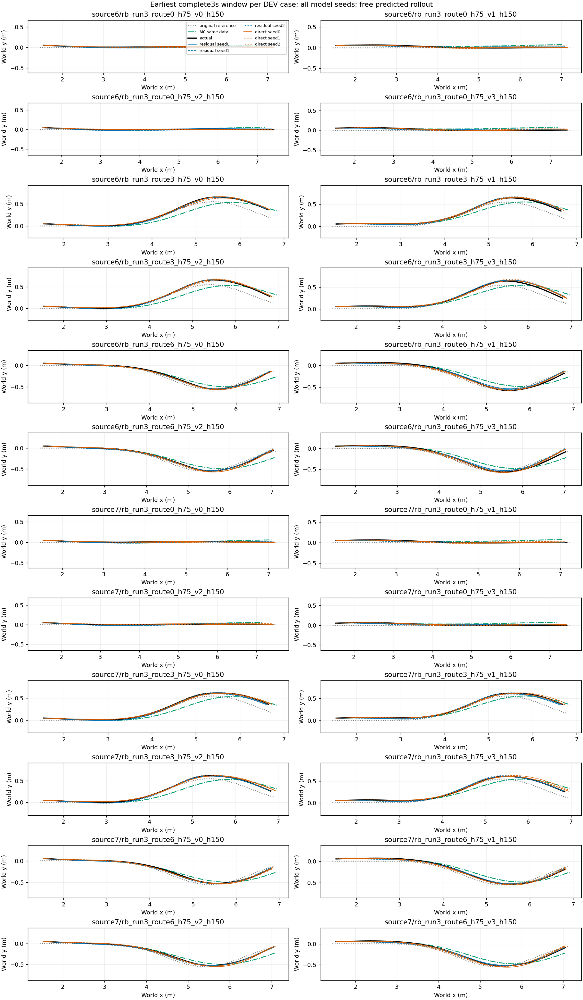
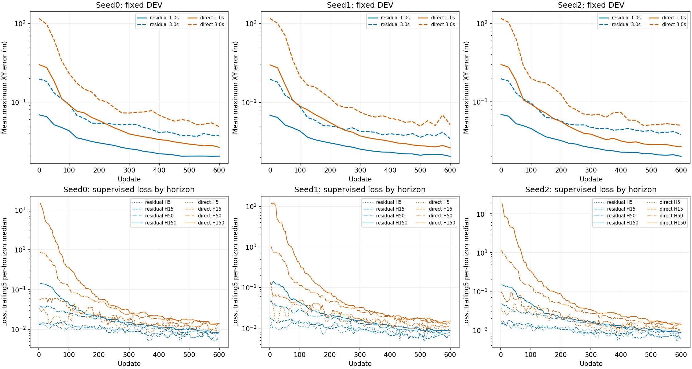

# P3同数据结构模型与直接模型

本报告的模型训练与预测评测只覆盖跳前STTW阶段0，不代表其他阶段或RB预测模型已完成。

同数据M0线性基线初始1秒/3秒平均最大XY误差为0.06859/0.19590m。M0用相同粗糙TRAIN跳前STTW阶段0转移拟合，区别于此前平地名义模型。M1为M0＋地形/历史修正，M2用相同输入、GRU64/128×128头及姿态积分直接预测动态增量；两个学习模型各三个独立初始化、相同采样和更新预算。

|模型|种子|最佳已评估更新|时域s|窗/例|平均最大XY m|P95 m|最坏m|末25次相对改善|
|---|---|---|---|---|---|---|---|---|
|residual|0|575|1.0|356/24|0.02034|0.03739|0.04602|-0.60%|
|residual|0|575|3.0|116/24|0.03765|0.06188|0.07410|0.01%|
|residual|1|600|1.0|356/24|0.02071|0.03488|0.05772|4.47%|
|residual|1|600|3.0|116/24|0.03462|0.05540|0.06966|17.44%|
|residual|2|600|1.0|356/24|0.02003|0.03819|0.05133|4.49%|
|residual|2|600|3.0|116/24|0.03815|0.05984|0.08008|7.84%|
|direct|0|600|1.0|356/24|0.02646|0.05282|0.07312|5.65%|
|direct|0|600|3.0|116/24|0.04837|0.08647|0.11344|10.80%|
|direct|1|600|1.0|356/24|0.02658|0.05043|0.09812|6.40%|
|direct|1|600|3.0|116/24|0.05220|0.10487|0.11191|24.69%|
|direct|2|600|1.0|356/24|0.02656|0.05487|0.07488|2.34%|
|direct|2|600|3.0|116/24|0.04989|0.08296|0.11198|2.52%|

最佳按固定DEV1秒均值在每25次存档中选择，3秒不单独选模；不是所有更新全程最优。重叠窗口非独立样本，各时域覆盖不同；逐例最坏值保存在cases.csv。损失是监督预测损失，不是PPO，没有策略reward/KL指标。学习模型读取真实381维历史作初始化，未来只用预测状态及自身隐状态查询固定地形，不读未来真实历史。

地形描述是预测位置附近15点的高度、坡度、局部高度变化及支撑mask；沟与图外未标为平地支撑。双线性栅格只是模型输入，最终碰撞几何不替换。地图划分、初态及速度以本轮manifest为准；开发预测比较尚无独立TEST或规划收益证明。没有用平均误差宣称全程净空合格、训练正式收敛或完整P3已完成。

原始存档/标量/逐窗口：`/media/qy/6A7E3DB07E3D75C3/STTW_runs/chapter3_playground_sttw_rb_sttw/p3_approach_models`；M0、M1、M2均未修改RB/H75或物理。

本轮M0拟合13943条有效TRAIN转移；来源明细与训练预算见manifest.json。所有模型保留每25轮存档。

跳前phase0；六TRAIN图72轨迹、两DEV_MAP图24轨迹，选择route0/3/6各一条标准下游对应的跳前数据。其他下游来源的跳前物理轨迹并非严格重复，不以去重声明其可互换；原始数据全部保留。历史初态根非P4独立TEST。
