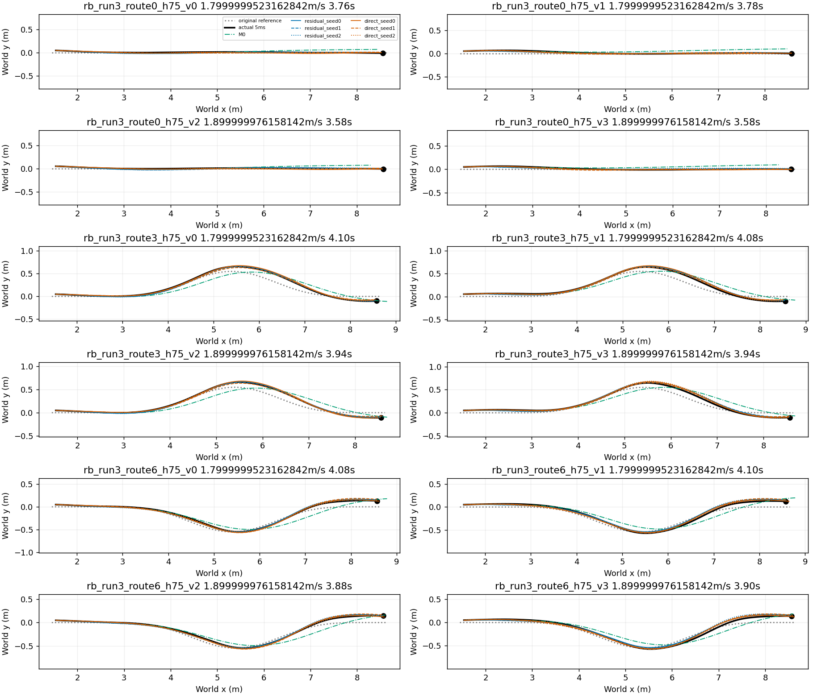
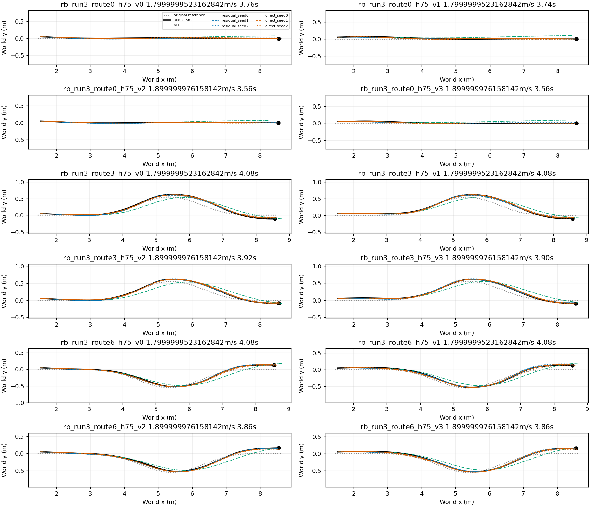

# 多地图模型：完整观察地面段预测配对比较

声明DEV_MAP的全部所选条件；全部模型同一个真实入口状态、历史、速度请求、路线和实际观察终点。逐例实际观察时域见cases.csv，超过训练最长3秒的部分为外推；不同例观察长度不同，不能把本表当共同固定4秒误差。起点为目标阶段首个具备前一步速度的20ms样本（阶段0为0.02秒）；末个20ms样本与真实5ms阶段终点最多相差15ms。实际XY画到该阶段真实终点，补齐区不计误差或成功。

|模型|例数|平均最大XY m|P95 m|最差XY m|最差整车支持m|
|---|---:|---:|---:|---:|---:|
|M0|24|0.20658|0.27809|0.29470|0.28501|
|residual_seed0|24|0.03817|0.05671|0.06062|0.06183|
|residual_seed1|24|0.03775|0.06087|0.06457|0.06384|
|residual_seed2|24|0.04257|0.05866|0.07701|0.08316|
|direct_seed0|24|0.05873|0.10577|0.11698|0.11966|
|direct_seed1|24|0.05107|0.07887|0.08561|0.07895|
|direct_seed2|24|0.05472|0.10202|0.11356|0.11347|

这是已知地图下离线预测比较，未增加新物理成功率，尚无规划器采用结论。M1/M2的三个初始化全部保留，不能把最好种子的某一项误差当统一优势。每例结果见cases.csv，存档身份见models.csv，原始预测和有效样本mask保留在外盘。

原始完整数组、逐模型报告与冻结合同：`/media/qy/6A7E3DB07E3D75C3/STTW_runs/chapter3_playground_sttw_rb_sttw/p3_approach_remaining_continue`。
