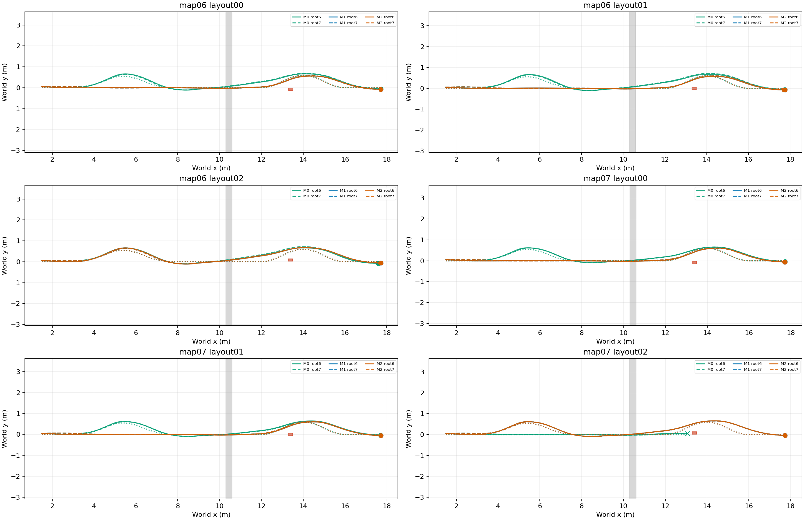

# P3同候选M0/M1/M2实际选路开发比较

两张既有DEV地图×三禁行盒布局×两初态。三个方法共享18条完整路线/速度候选、TRAIN入口历史、成本、底层/RB与物理；分别预测离场并按同一规则校准空间包络。地图/轨迹已用于DEV校准，不是P4独立TEST。静态启动前选路，不是在线神经重规划。

|模型|条件数|物理目标|空间准入且目标|无计划|失败计10秒的均值s|
|---|---:|---:|---:|---:|---:|
|M0|12|10|10|2|9.22625|
|M1|12|12|12|0|8.80417|
|M2|12|12|12|0|8.80417|

空间预测准入但实际失败：M0 0/10, M1 0/12, M2 0/12。分母为实际发布的空间包络准入条件；无计划不归入假可行。

36条方法条件记录对应24条实际轨迹；同布局同配置的重复选择复用同一物理轨迹，不作为独立重复。无计划保留原直线/1.8候选，其物理成功也不消除规划失败。

预测初始化来自map00两个TRAIN样本，未使用未来真实DEV交接状态。地形输入使用当前已知图；区域/坐标扩张是既有DEV最大支持误差+2cm，不是概率界或安全保证。模型和校准包络一起构成被比较系统，不能把差异全归因网络结构。预测使用来源观察时域，未实现新到达时间或目标保持预测证明；实际目标仍按原物理门槛判定。

全部失败如下：
- map7 layout2 M0 root6: forbidden_obstacle_contact, 6.305s, feasible=False.
- map7 layout2 M0 root7: forbidden_obstacle_contact, 6.320s, feasible=False.

M1/M2选中同一配置时不能宣称结构模型胜过直接模型；物理目标改善也要区分减少假可行与避免无计划回退。

原始冻结合同/选择/校准/逐步状态：`/media/qy/6A7E3DB07E3D75C3/STTW_runs/chapter3_playground_sttw_rb_sttw/p3_model_planning`。所有条件见cases.csv。

后验预测约束诊断（不改原物理结果）：已选可行候选的TRAIN来源展开，M0 10/10、M1 12/12、M2 12/12均通过预测roll/pitch/跟踪域/航向域/前视/前进检查。但按来源观测终点的末0.5秒预测目标保持，M0为0/10、M1为10/12、M2为0/12。这些分母是候选的TRAIN来源展开，不能冒充实际DEV初态。原规划只筛空间包络、使用实测源时长成本，未据预测到达/保持筛选；故实际12/12不能证明完整预测终端约束已经实现。详细见prediction_admissibility.csv；原始诊断外盘p3_model_dynamics_audit，0新物理回合。
