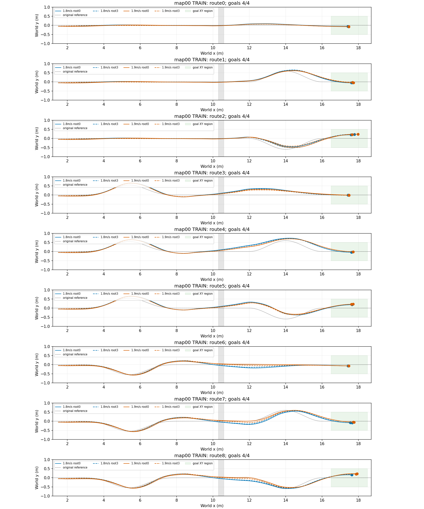
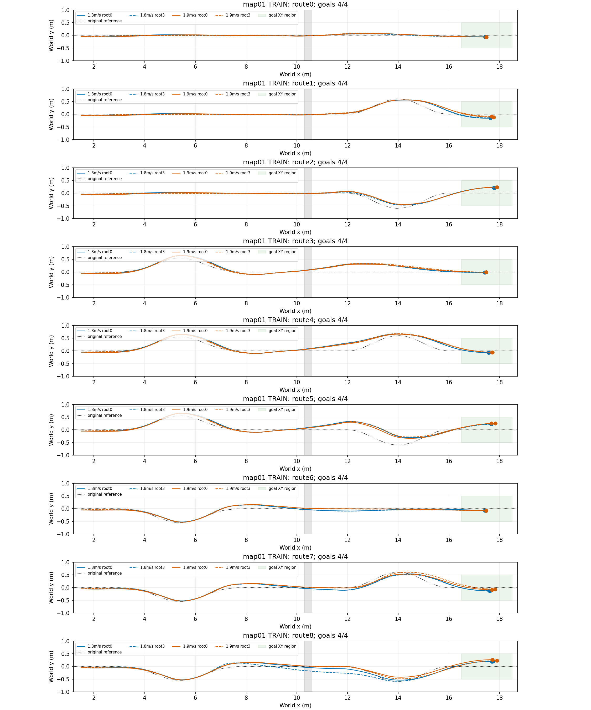
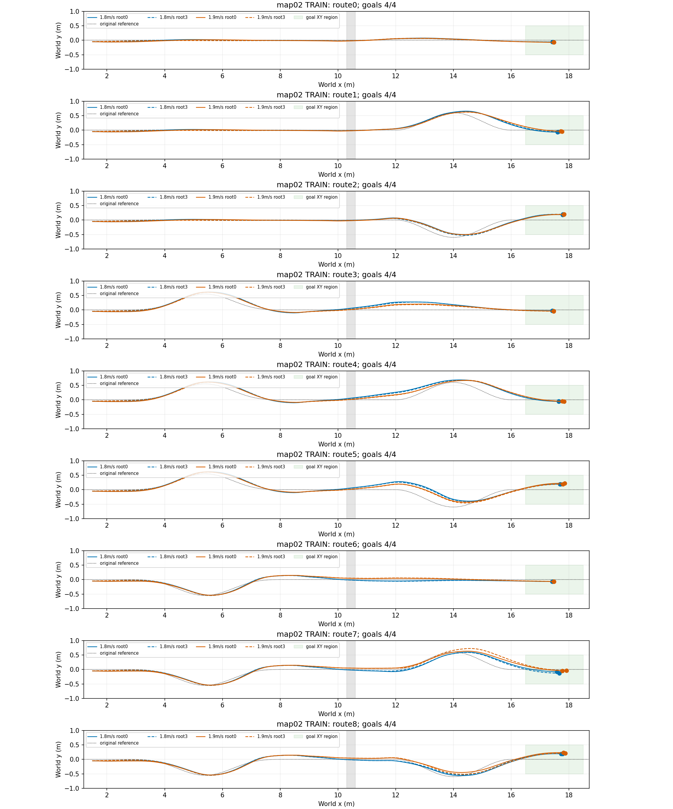
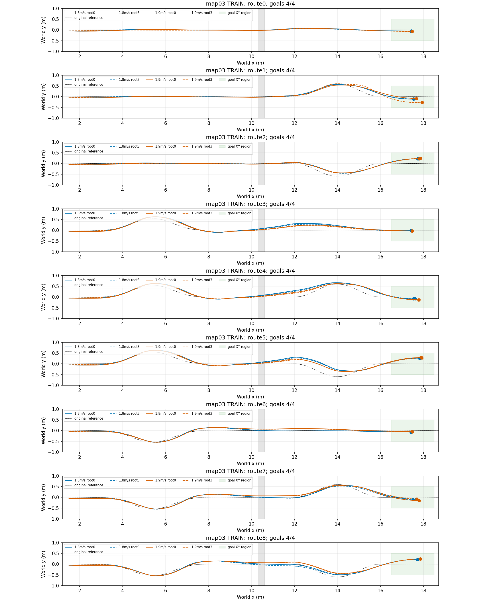
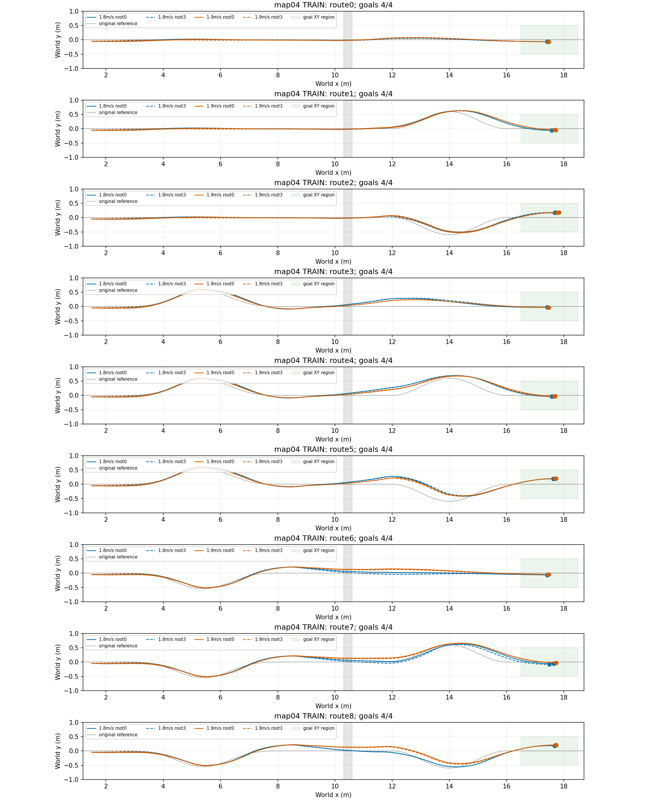
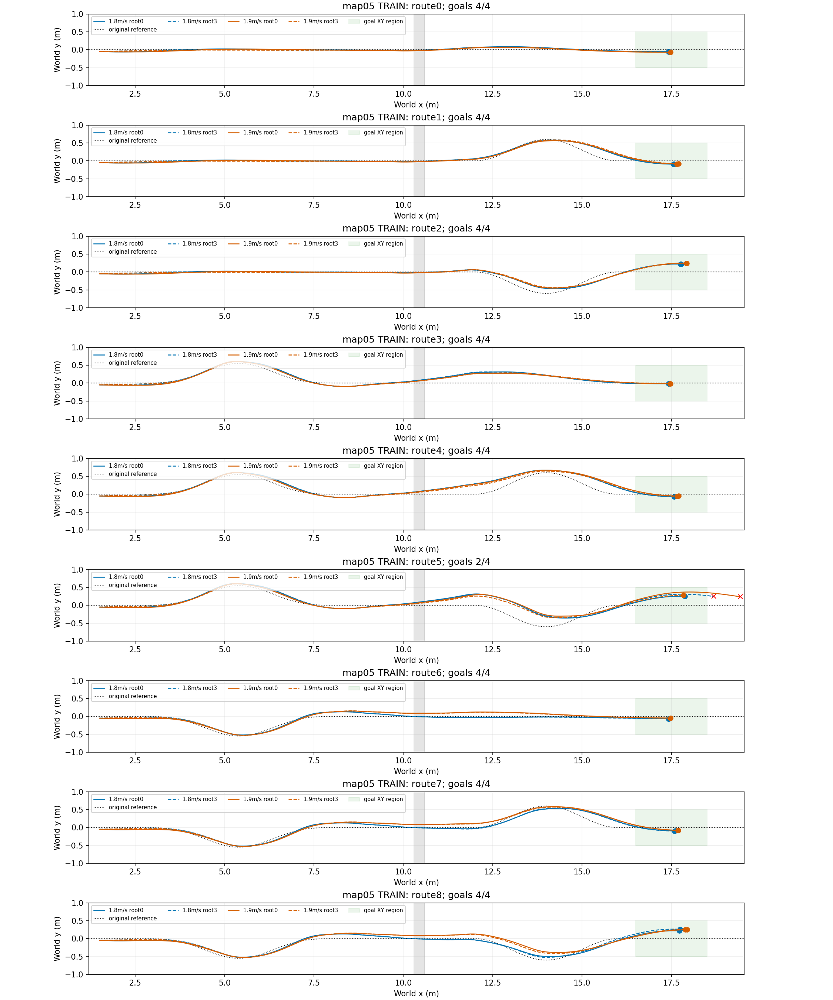
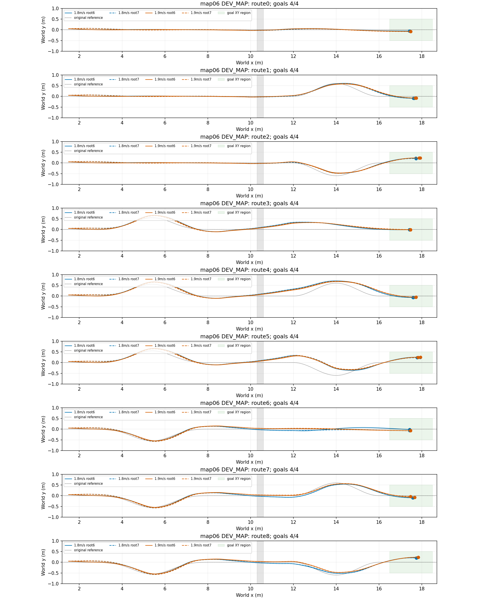
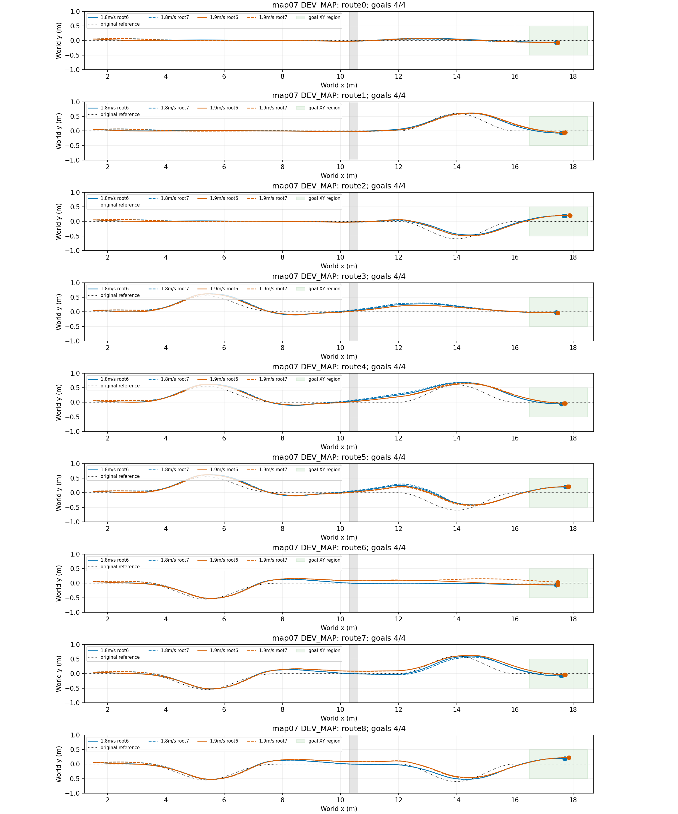

# P3多地图双速度数据采集

所有地图先冻结分组：六TRAIN、两DEV_MAP，初态根已有历史使用，非独立P4 TEST。每图九曲线×两初态×两速度。地形仅改变声明碎石种子和2/4cm脊坡x位置，保留原沟、平地缓冲、技能、物理与目标。没有用失败结果替换地图。

|地图/角色|请求m/s|完整任务|终止分类|
|---|---|---|---|
|map00 TRAIN|1.8|18/18|{'goal': 18}|
|map00 TRAIN|1.9|18/18|{'goal': 18}|
|map01 TRAIN|1.8|18/18|{'goal': 18}|
|map01 TRAIN|1.9|18/18|{'goal': 18}|
|map02 TRAIN|1.8|18/18|{'goal': 18}|
|map02 TRAIN|1.9|18/18|{'goal': 18}|
|map03 TRAIN|1.8|18/18|{'goal': 18}|
|map03 TRAIN|1.9|18/18|{'goal': 18}|
|map04 TRAIN|1.8|18/18|{'goal': 18}|
|map04 TRAIN|1.9|18/18|{'goal': 18}|
|map05 TRAIN|1.8|17/18|{'goal': 17, 'timeout': 1}|
|map05 TRAIN|1.9|17/18|{'goal': 17, 'timeout': 1}|
|map06 DEV_MAP|1.8|18/18|{'goal': 18}|
|map06 DEV_MAP|1.9|18/18|{'goal': 18}|
|map07 DEV_MAP|1.8|18/18|{'goal': 18}|
|map07 DEV_MAP|1.9|18/18|{'goal': 18}|

|失败地图|路线|根|请求|终止|时间s|终点XY m|
|---|---|---|---|---|---|---|
|map05|5|3|1.8|timeout|10.000|18.690/0.248|
|map05|5|0|1.9|timeout|10.000|19.436/0.237|

实际请求最大误差0m/s；锁定阶段髋膝最大漂移0.000203rad。所有条件见episodes.csv，失败轨迹截止真实终点。此处是固定控制器的数据采集，不是新预测器/规划器的收益。

原始配置/物理轨迹/阶段状态：`/media/qy/6A7E3DB07E3D75C3/STTW_runs/chapter3_playground_sttw_rb_sttw/p3_multimap_collection`。

失败目标条件独立重算见timeout_diagnosis.json：航向/路径/速度拒绝时段可重叠，不相加；连续保持为几何重算诊断，不覆盖原在线终止。
map05/rb_run3_route5_h75_v1：目标XY区内1.115s，最大连续合格约0.255s（要求0.5s）；航向/路径/速度分别拒绝0.305/0.365/0.000s。
map05/rb_run3_route5_h75_v2：目标XY区内1.060s，最大连续合格约0.010s（要求0.5s）；航向/路径/速度分别拒绝0.350/0.700/0.000s。
