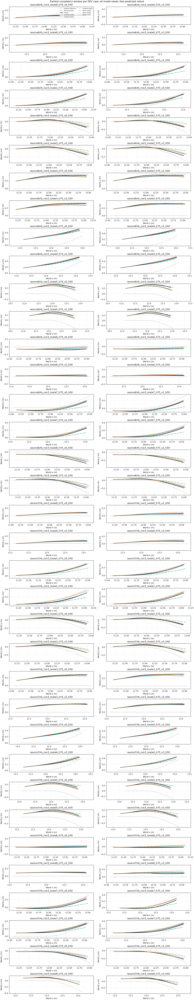
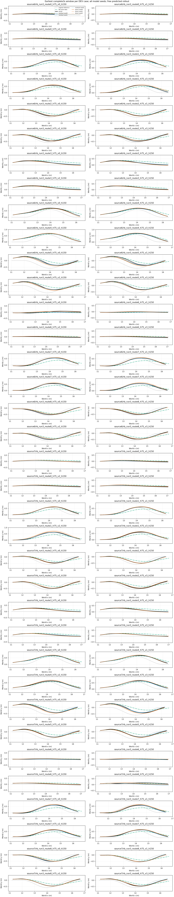
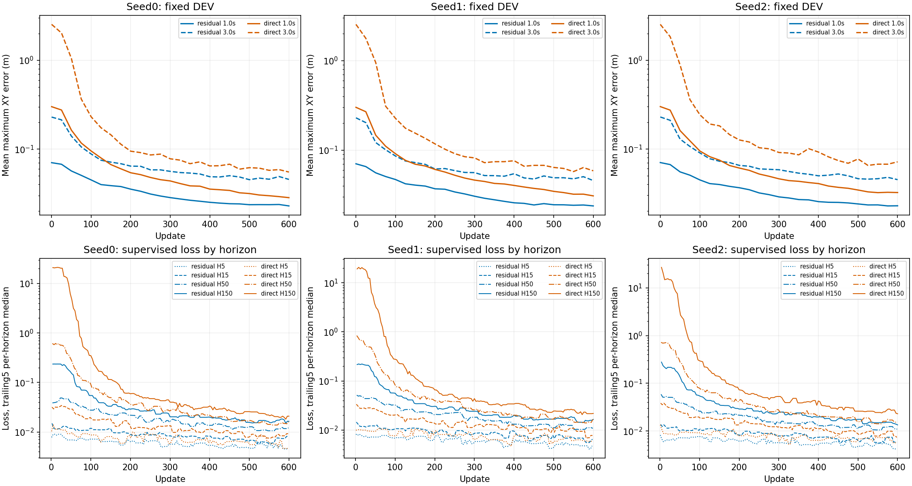

# P3同数据结构模型与直接模型

本报告的模型训练与预测评测只覆盖RB回交后的STTW阶段，不代表跳前或RB预测模型已完成。

同数据M0线性基线初始1秒/3秒平均最大XY误差为0.07032/0.22951m。M0用相同粗糙TRAIN阶段2转移拟合，区别于此前平地名义模型。M1为M0＋地形/历史修正，M2用相同输入、GRU64/128×128头及姿态积分直接预测动态增量；两个学习模型各三个独立初始化、相同采样和更新预算。

|模型|种子|最佳已评估更新|时域s|窗/例|平均最大XY m|P95 m|最坏m|末25次相对改善|
|---|---|---|---|---|---|---|---|---|
|residual|0|600|1.0|961/72|0.02291|0.04414|0.09361|3.62%|
|residual|0|600|3.0|241/72|0.04554|0.07797|0.14328|7.23%|
|residual|1|600|1.0|961/72|0.02379|0.04526|0.08479|2.31%|
|residual|1|600|3.0|241/72|0.04567|0.07987|0.15078|9.52%|
|residual|2|575|1.0|961/72|0.02282|0.04602|0.09865|-0.33%|
|residual|2|575|3.0|241/72|0.04791|0.09591|0.15607|5.86%|
|direct|0|600|1.0|961/72|0.02838|0.05647|0.13135|2.67%|
|direct|0|600|3.0|241/72|0.05512|0.10186|0.15338|6.20%|
|direct|1|600|1.0|961/72|0.03079|0.06243|0.12537|4.35%|
|direct|1|600|3.0|241/72|0.05871|0.11434|0.14208|7.97%|
|direct|2|550|1.0|961/72|0.03220|0.06289|0.15951|0.62%|
|direct|2|550|3.0|241/72|0.06745|0.12681|0.31984|-6.27%|

最佳按固定DEV1秒均值在每25次存档中选择，3秒不单独选模；不是所有更新全程最优。重叠窗口非独立样本，各时域覆盖不同；逐例最坏值保存在cases.csv。损失是监督预测损失，不是PPO，没有策略reward/KL指标。学习模型读取真实381维历史作初始化，未来只用预测状态及自身隐状态查询固定地形，不读未来真实历史。

地形描述是预测位置附近15点的高度、坡度、局部高度变化及支撑mask；沟与图外未标为平地支撑。双线性栅格只是模型输入，最终碰撞几何不替换。本轮六张TRAIN图、两张DEV_MAP图，216条TRAIN及72条DEV轨迹；地图不重叠，但初态根已用于历史开发，非P4独立TEST。尚无规划收益证明。没有用平均误差宣称全程净空合格、训练正式收敛或完整P3已完成。

原始存档/标量/逐窗口：`/media/qy/6A7E3DB07E3D75C3/STTW_runs/chapter3_playground_sttw_rb_sttw/p3_multimap_models`；M0、M1、M2均未修改RB/H75或物理。

本轮M0拟合38487条有效TRAIN转移；来源明细与训练预算见manifest.json。所有模型保留每25轮存档。

收敛判断：末25轮1秒指标相对改善为−0.33%至4.35%，残差seed2最佳575、直接seed2最佳550，其余最佳600。表现接近平台但并非全部稳定收敛；先冻结已评估最佳候选检验规划收益，不无界追加训练。完整剩余离场3.22–4.00秒比较见[配对XY及误差](remaining_motion/RESULTS.md)，超过训练最长3秒部分明确作为时域外推。
