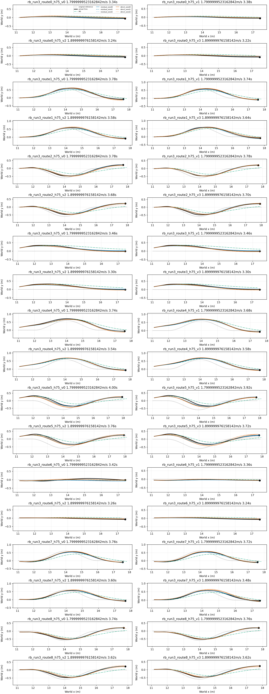
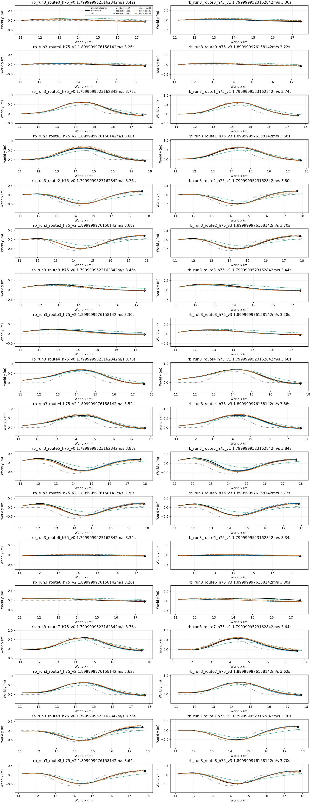

# 多地图模型：完整剩余离场预测配对比较

两个既有DEV_MAP共72条件；全部模型同一个真实入口状态、历史、速度请求、路线和实际观察终点。每例3.22–4.00秒，超过训练最长3秒；不同例观察长度不同，不能把本表当共同固定4秒误差。第一/末个20ms样本与真实5ms事件端点最多相差15ms；实际XY画到真实终点，补齐区不计误差或成功。

|模型|例数|平均最大XY m|P95 m|最差XY m|最差整车支持m|
|---|---:|---:|---:|---:|---:|
|M0|72|0.20307|0.34854|0.38324|0.36986|
|residual_seed0|72|0.05763|0.10198|0.15045|0.15038|
|residual_seed1|72|0.05617|0.10259|0.15474|0.15456|
|residual_seed2|72|0.06101|0.10709|0.15196|0.14852|
|direct_seed0|72|0.06413|0.14859|0.16065|0.18303|
|direct_seed1|72|0.07487|0.12631|0.14772|0.16843|
|direct_seed2|72|0.08643|0.15694|0.18766|0.18603|

这是已知地图下离线预测比较，未增加新物理成功率，尚无规划器采用结论。M1/M2的三个初始化全部保留，不能把最好种子的某一项误差当统一优势。每例结果见cases.csv，存档身份见models.csv，原始预测和有效样本mask保留在外盘。

原始完整数组、逐模型报告与冻结合同：`/media/qy/6A7E3DB07E3D75C3/STTW_runs/chapter3_playground_sttw_rb_sttw/p3_multimap_remaining_motion`。
