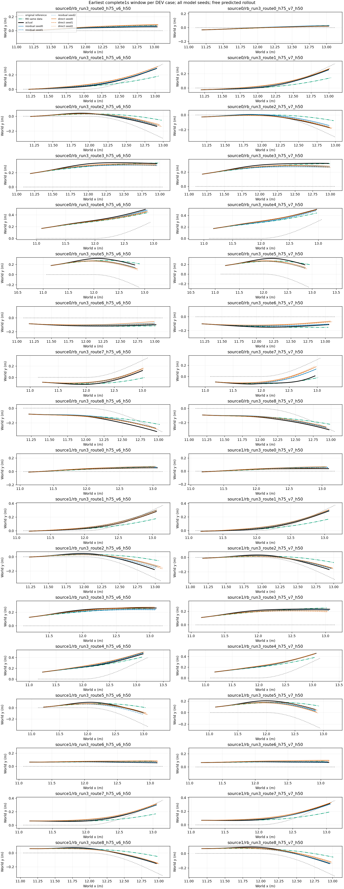
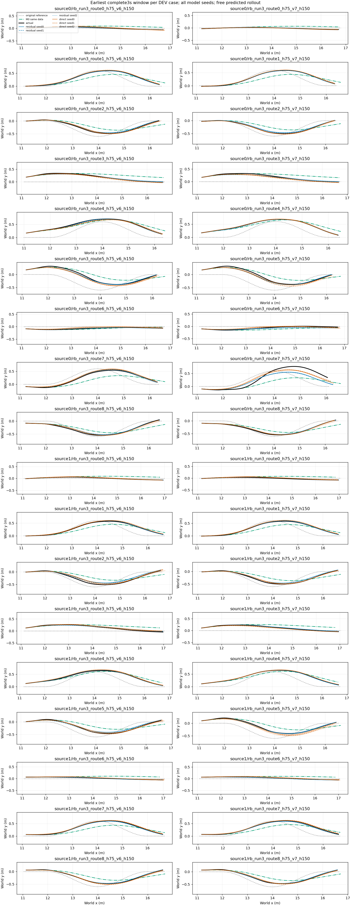
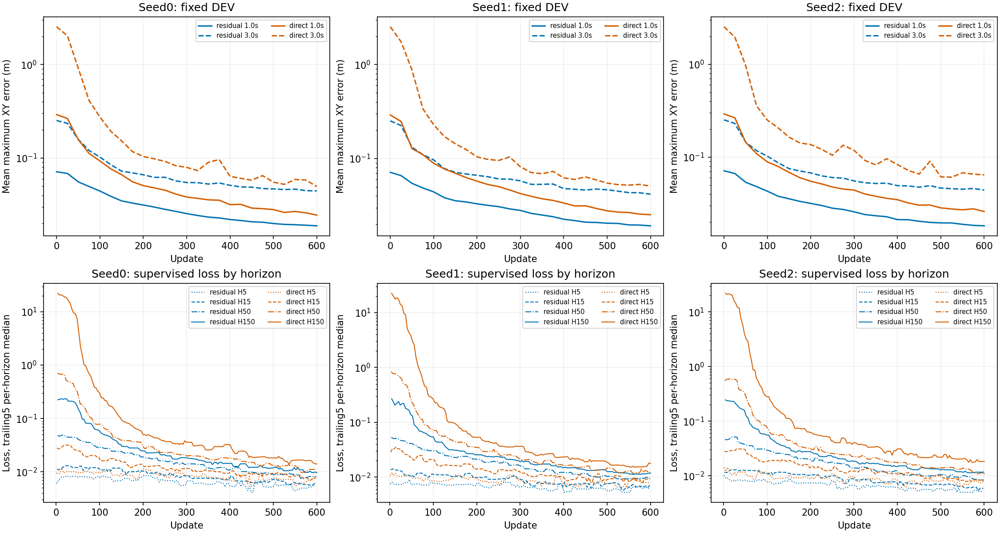

# P3同数据结构模型与直接模型

同数据M0线性基线初始1秒/3秒平均最大XY误差为0.07134/0.25185m。M0用相同粗糙TRAIN阶段2转移拟合，区别于此前平地名义模型。M1为M0＋地形/历史修正，M2用相同输入、GRU64/128×128头及姿态积分直接预测动态增量；两个学习模型各三个独立初始化、相同采样和更新预算。

|模型|种子|最佳已评估更新|时域s|窗/例|平均最大XY m|P95 m|最坏m|末25次相对改善|
|---|---|---|---|---|---|---|---|---|
|residual|0|600|1.0|482/36|0.01887|0.03756|0.23668|1.49%|
|residual|0|600|3.0|122/36|0.04454|0.09058|0.43156|0.66%|
|residual|1|600|1.0|482/36|0.01923|0.03878|0.17187|1.82%|
|residual|1|600|3.0|122/36|0.04168|0.07061|0.38512|3.63%|
|residual|2|600|1.0|482/36|0.01824|0.03595|0.20987|1.09%|
|residual|2|600|3.0|122/36|0.04418|0.08334|0.39070|4.07%|
|direct|0|600|1.0|482/36|0.02457|0.04977|0.28742|5.24%|
|direct|0|600|3.0|122/36|0.04960|0.11114|0.42041|14.74%|
|direct|1|600|1.0|482/36|0.02524|0.05276|0.24161|1.56%|
|direct|1|600|3.0|122/36|0.05090|0.12537|0.33760|4.17%|
|direct|2|600|1.0|482/36|0.02598|0.05872|0.33996|6.56%|
|direct|2|600|3.0|122/36|0.06456|0.17603|0.47734|1.49%|

最佳按固定DEV1秒均值在每25次存档中选择，3秒不单独选模；不是所有更新全程最优。重叠窗口非独立样本，各时域覆盖不同；逐例最坏值保存在cases.csv。损失是监督预测损失，不是PPO，没有策略reward/KL指标。学习模型读取真实381维历史作初始化，未来只用预测状态及自身隐状态查询固定地形，不读未来真实历史。

地形描述是预测位置附近15点的高度、坡度、局部高度变化及支撑mask；沟与图外未标为平地支撑。双线性栅格只是模型输入，最终碰撞几何不替换。此处同一地图、既有TRAIN/DEV初态（来源及速度以本轮manifest为准），尚无独立新地图或规划收益证明。没有用平均误差宣称全程净空合格、训练正式收敛或完整P3已完成。

原始存档/标量/逐窗口：`/media/qy/6A7E3DB07E3D75C3/STTW_runs/chapter3_playground_sttw_rb_sttw/p3_multispeed_models`；M0、M1、M2均未修改RB/H75或物理。

本轮M0拟合18997条有效TRAIN转移；来源明细与训练预算见manifest.json。所有模型保留每25轮存档。

原1.8训练来源p1_phase2_collection的激活位置8.60m，新1.9来源为8.55m；本次双速度拟合同时覆盖这些入口变化，不能当作仅速度单因素对照。新地图采集统一8.55m，尚未执行。

[逐路线整车预测诊断：geometry](geometry/RESULTS.md)。六模型best均在600预算末端，尚未证明收敛；扩大实际数据覆盖后再训练。

双速度拟合后的35组整车几何复测已完成（288.200秒）。同一未用于拟合的1.8→1.9切换DEV轨迹，M1三个种子的1秒平均最大XY降至0.0199–0.0201m，旧1.8模型约0.086m；1秒整车支持最差0.0824–0.0912m，3秒0.0975–0.1189m。1.9→1.8的1秒支持最差0.0488–0.0506m；滚动两例为0.0265–0.0403m。原1.8静态困难例的3秒支持最差仍0.3562–0.3798m；不能因切换改善就采用全时域规划。所有五集合、三种子、M0/M1/M2见[整车几何与完整XY](geometry/RESULTS.md)。
