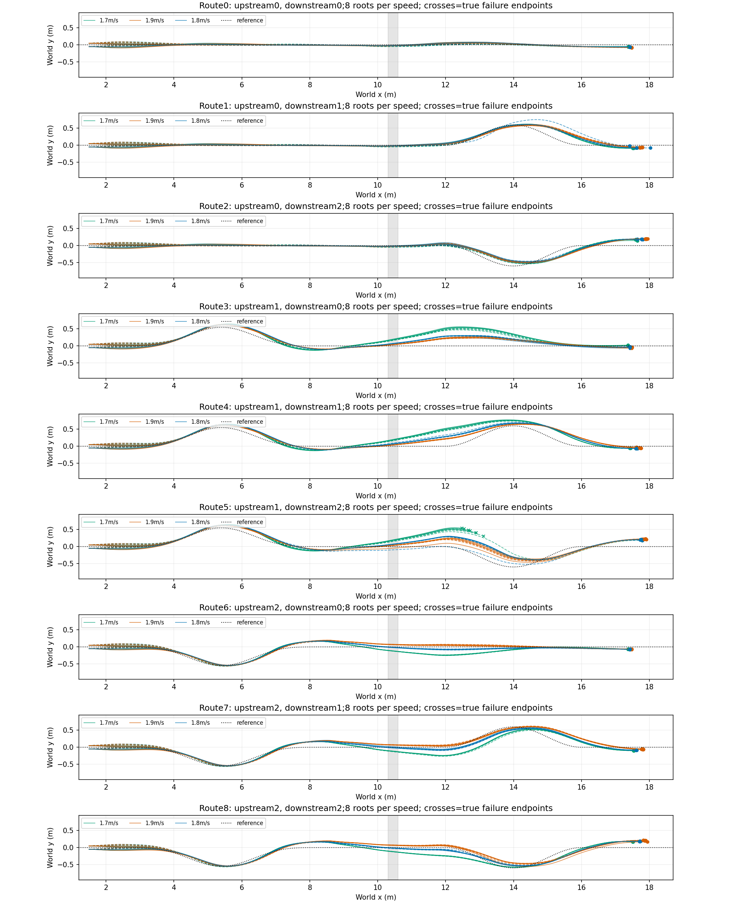

# P3相邻速度请求的完整链验证

|请求m/s|全程成功|失败|平均惩罚时间s|离散命令域准入|
|---|---|---|---|---|
|1.7|65/72|{'tracking_domain_exit': 7}|9.5672|False|
|1.8|72/72|{}|9.1623|True|
|1.9|72/72|{}|8.8260|True|

每个速度54TRAIN来源初态条件＋18复用DEV根条件，不称独立TEST。共216条件，198新增物理回合＋18同身份1.8m/s轨迹复用；初始水平速度幅值仍1.8m/s，按既有初始航向旋转，包含到请求速度的过渡。只改变两个STTW阶段的速度请求；RB原生策略、锁定/释放/回交、原粗糙地形、沟两侧2m平地、激活x8.55及10秒/0.5秒保持标准不变。

|路线|1.7m/s|1.8m/s|1.9m/s|
|---|---|---|---|
|0|8/8|8/8|8/8|
|1|8/8|8/8|8/8|
|2|8/8|8/8|8/8|
|3|8/8|8/8|8/8|
|4|8/8|8/8|8/8|
|5|1/8|8/8|8/8|
|6|8/8|8/8|8/8|
|7|8/8|8/8|8/8|
|8|8/8|8/8|8/8|

## 真实失败条件

|请求|路线|根|终止|时间s|终点x/y m|
|---|---|---|---|---|---|
|1.7|5|0|tracking_domain_exit|6.765|12.551/0.524|
|1.7|5|1|tracking_domain_exit|7.095|13.122/0.305|
|1.7|5|2|tracking_domain_exit|6.730|12.483/0.542|
|1.7|5|3|tracking_domain_exit|6.830|12.676/0.486|
|1.7|5|4|tracking_domain_exit|6.965|12.898/0.404|
|1.7|5|6|tracking_domain_exit|6.865|12.727/0.469|
|1.7|5|7|tracking_domain_exit|6.930|12.888/0.408|

实际逐步请求误差最大0m/s，STTW锁定阶段关节漂移最大0.000212rad；全部逐例见episodes.csv。只有72/72完成的离散值进入本实验限定命令域，不由邻点成功推断区间可用。当前规划器仍固定1.8m/s，尚未接入速度节点优化。

原始记录：`/media/qy/6A7E3DB07E3D75C3/STTW_runs/chapter3_playground_sttw_rb_sttw/p3_speed_domain`；命令域：同目录validated_command_domain.json。
