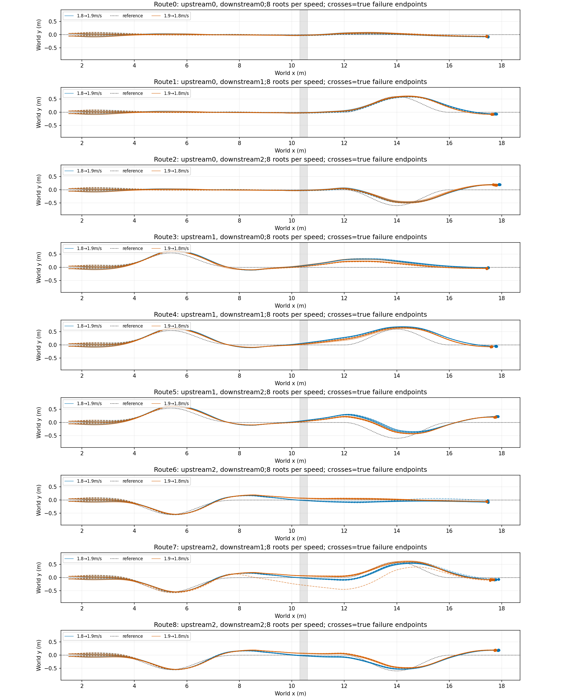

# P3跳前与回交后不同速度请求验证

|请求m/s|全程成功|失败|平均惩罚时间s|离散命令域准入|
|---|---|---|---|---|
|1.8→1.9|72/72|{}|9.0319|True|
|1.9→1.8|72/72|{}|8.9639|True|

每个速度54TRAIN来源初态条件＋18复用DEV根条件，不称独立TEST。共144新增物理回合，两组阶段请求各72条，没有物理轨迹复用；初始水平速度幅值仍1.8m/s，按既有初始航向旋转，包含到请求速度的过渡。跳前与落地回交后STTW请求不同，在真实RB回交事件改变；RB原生策略、锁定/释放/回交、原粗糙地形、沟两侧2m平地、激活x8.55及10秒/0.5秒保持标准不变。

|路线|1.8→1.9m/s|1.9→1.8m/s|
|---|---|---|
|0|8/8|8/8|
|1|8/8|8/8|
|2|8/8|8/8|
|3|8/8|8/8|
|4|8/8|8/8|
|5|8/8|8/8|
|6|8/8|8/8|
|7|8/8|8/8|
|8|8/8|8/8|

## 真实失败条件

|请求|路线|根|终止|时间s|终点x/y m|
|---|---|---|---|---|---|

实际逐步请求误差最大0m/s，STTW锁定阶段关节漂移最大0.000189rad；全部逐例见episodes.csv。只有72/72完成的离散值进入本实验限定命令域，不由邻点成功推断区间可用。当前规划器仍固定1.8m/s，尚未接入速度节点优化。

原始记录：`/media/qy/6A7E3DB07E3D75C3/STTW_runs/chapter3_playground_sttw_rb_sttw/p3_speed_phase_switch`；命令域：同目录validated_command_domain.json。

准入只适用于两个指定阶段的有序速度对，不代表STTW阶段任意时刻切换，也不代表新增速度的预测模型已验证。
