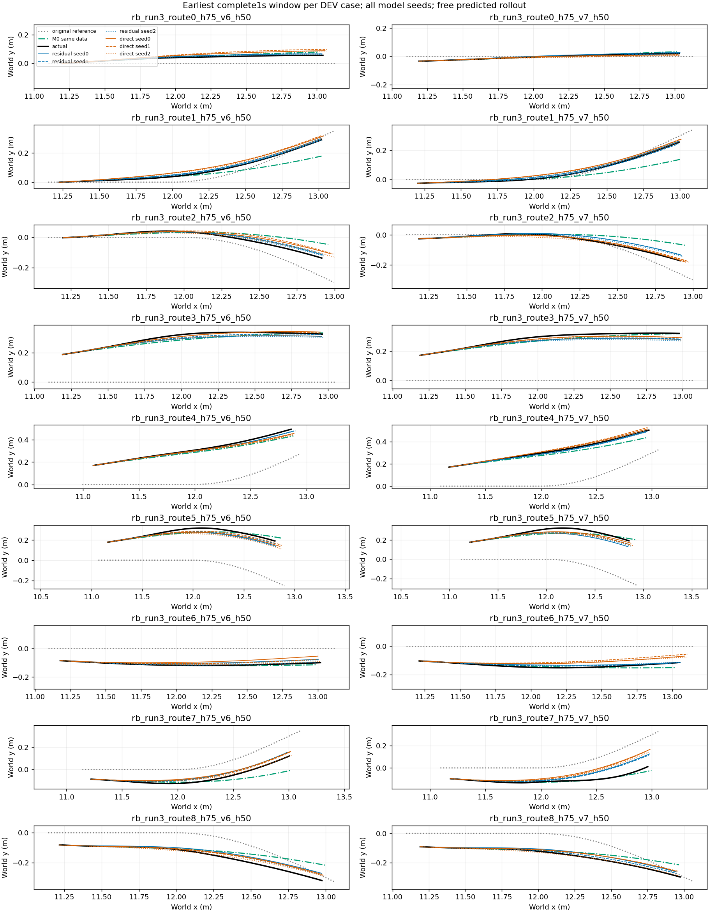
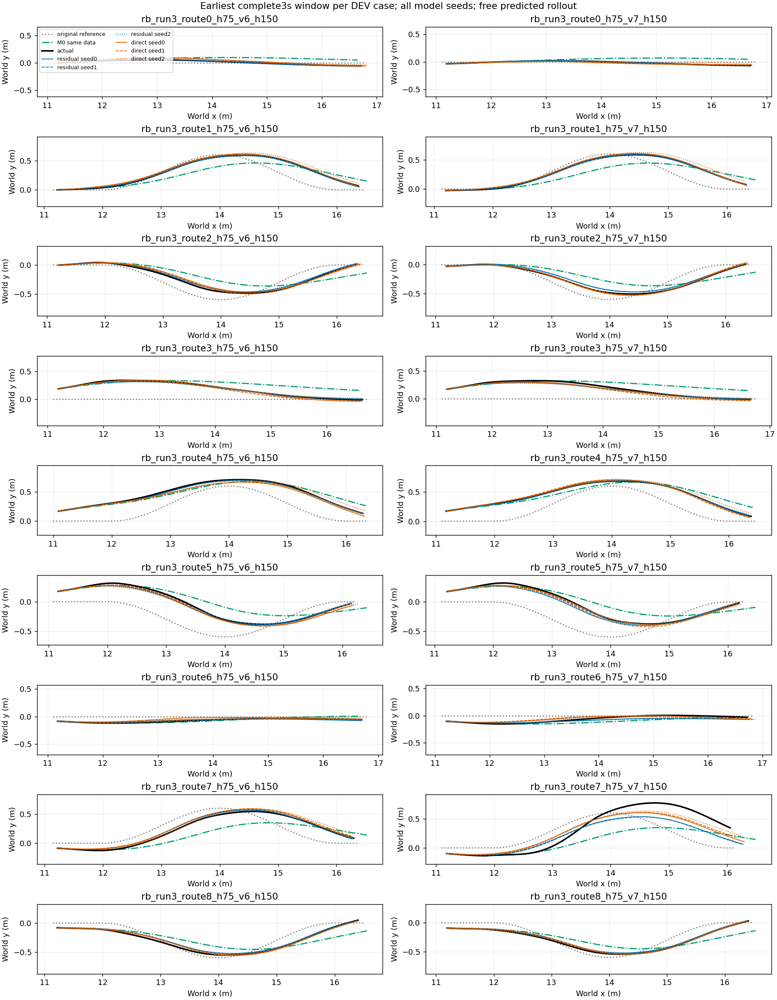
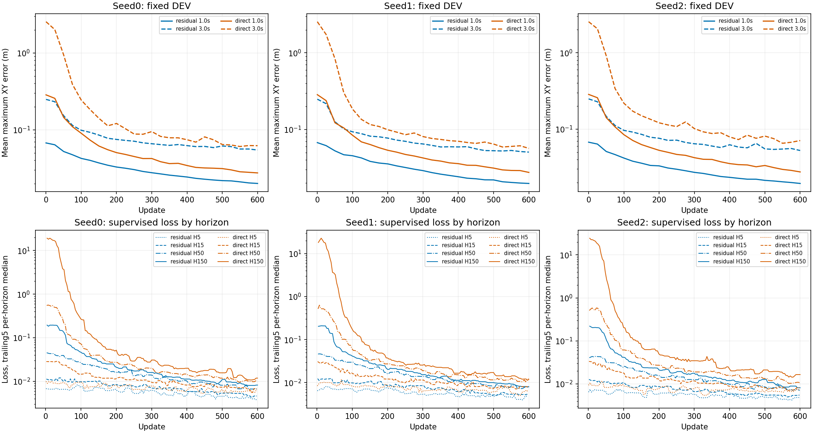

# P3同数据结构模型与直接模型

同数据M0线性基线初始1秒/3秒平均最大XY误差为0.06742/0.24857m。M0用相同9546条粗糙TRAIN阶段2转移拟合，区别于此前平地名义模型。M1为M0＋地形/历史修正，M2用相同输入、GRU64/128×128头及姿态积分直接预测动态增量；两个学习模型各三个独立初始化、相同采样和更新预算。

|模型|种子|最佳已评估更新|时域s|窗/例|平均最大XY m|P95 m|最坏m|末25次相对改善|
|---|---|---|---|---|---|---|---|---|
|residual|0|600|1.0|247/18|0.02002|0.04745|0.22691|1.63%|
|residual|0|600|3.0|67/18|0.05454|0.32356|0.40590|2.94%|
|residual|1|600|1.0|247/18|0.01976|0.04469|0.16911|1.24%|
|residual|1|600|3.0|67/18|0.05066|0.27668|0.38700|1.76%|
|residual|2|600|1.0|247/18|0.01942|0.04253|0.20198|2.72%|
|residual|2|600|3.0|67/18|0.05243|0.30773|0.39434|5.87%|
|direct|0|600|1.0|247/18|0.02746|0.05705|0.29895|1.73%|
|direct|0|600|3.0|67/18|0.06208|0.24281|0.47327|0.37%|
|direct|1|600|1.0|247/18|0.02753|0.07296|0.23542|5.43%|
|direct|1|600|3.0|67/18|0.05670|0.20508|0.32221|7.55%|
|direct|2|600|1.0|247/18|0.02750|0.06820|0.34779|4.43%|
|direct|2|600|3.0|67/18|0.07081|0.22313|0.44108|-5.19%|

最佳按固定DEV1秒均值在每25次存档中选择，3秒不单独选模；不是所有更新全程最优。重叠窗口非独立样本，各时域覆盖不同；逐例最坏值保存在cases.csv。损失是监督预测损失，不是PPO，没有策略reward/KL指标。学习模型读取真实381维历史作初始化，未来只用预测状态及自身隐状态查询固定地形，不读未来真实历史。

地形描述是预测位置附近15点的高度、坡度、局部高度变化及支撑mask；沟与图外未标为平地支撑。双线性栅格只是模型输入，最终碰撞几何不替换。此处同一地图、既有TRAIN/DEV初态，尚无独立新地图或规划收益证明。没有用平均误差宣称全程净空合格、训练正式收敛或完整P3已完成。

原始存档/标量/逐窗口：`/media/qy/6A7E3DB07E3D75C3/STTW_runs/chapter3_playground_sttw_rb_sttw/p3_structured_models_continue`；M0、M1、M2均未修改RB/H75或物理。

[逐路线整车预测诊断：geometry](geometry/RESULTS.md)。六模型best均在600预算末端，尚未证明收敛；扩大实际数据覆盖后再训练。

[逐路线整车预测诊断：speed_geometry](speed_geometry/RESULTS.md)。六模型best均在600预算末端，尚未证明收敛；扩大实际数据覆盖后再训练。
