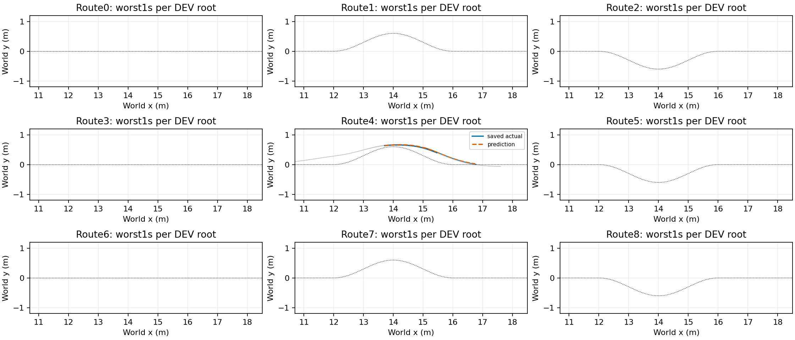
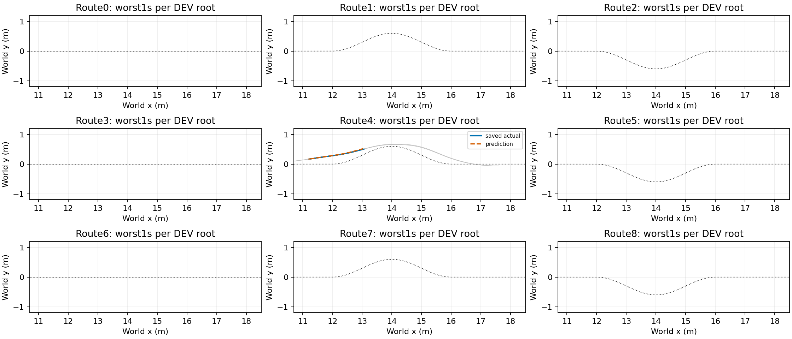
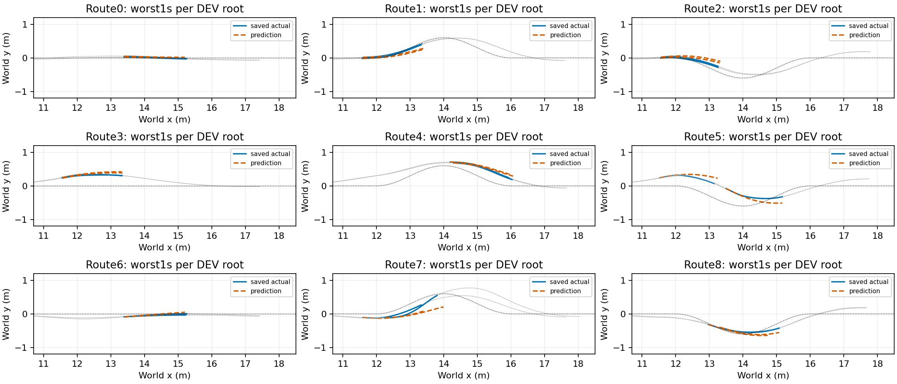
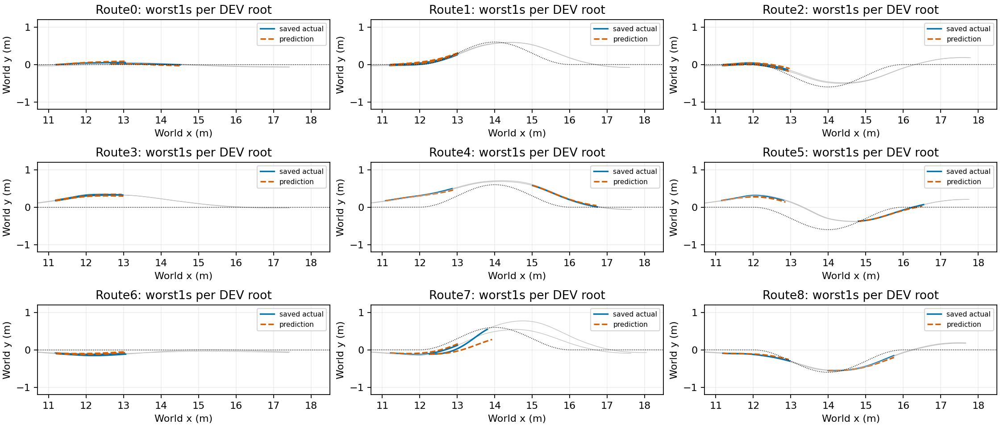
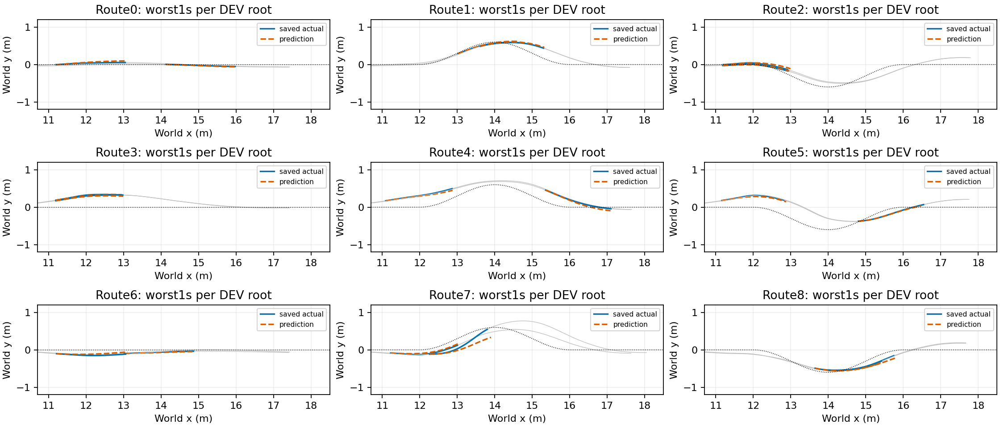
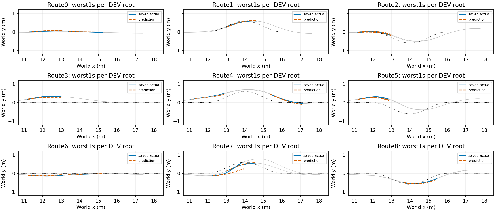
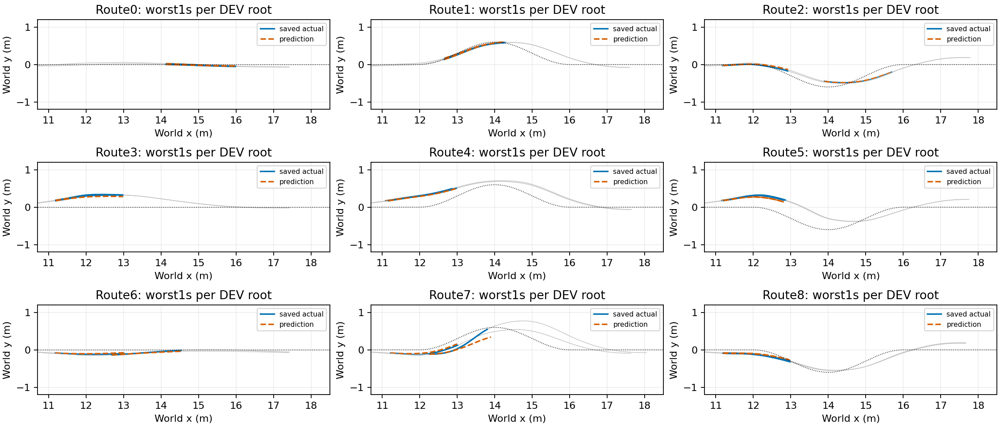
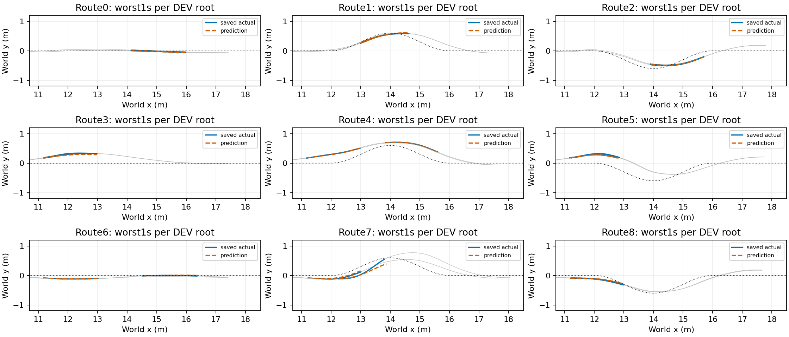
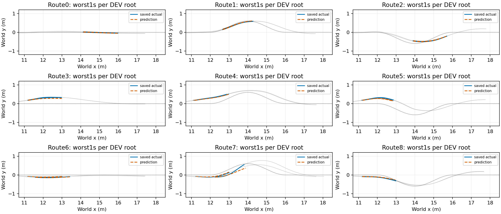

# 整车支持误差与滚动历史复测

固定600轮候选；M0同数据ARX。静态18个既有DEV条件，滚动2个既有DEV条件。所有预测只使用窗口入口真实历史，之后自由展开；无新物理成功率。

|集合/模型|时域s|窗/例|均值XY m|P95 XY m|最差XY m|最差整车XYZ支持m|
|---|---:|---|---:|---:|---:|---:|
|rolling_M0|0.1|36/2|0.00251|0.00686|0.00938|0.01418|
|rolling_M0|0.3|34/2|0.01179|0.02378|0.02763|0.03080|
|rolling_M0|1.0|28/2|0.06004|0.08665|0.10825|0.11623|
|rolling_M0|2.0|18/2|0.10548|0.18318|0.18750|0.20010|
|rolling_M0|3.0|8/2|0.15055|0.19690|0.19710|0.20439|
|rolling_direct_seed0|0.1|36/2|0.00174|0.00573|0.00730|0.01587|
|rolling_direct_seed0|0.3|34/2|0.00531|0.01492|0.01780|0.02831|
|rolling_direct_seed0|1.0|28/2|0.01630|0.02739|0.02784|0.02833|
|rolling_direct_seed0|2.0|18/2|0.02724|0.05037|0.05468|0.05152|
|rolling_direct_seed0|3.0|8/2|0.03057|0.05000|0.05468|0.05152|
|rolling_direct_seed1|0.1|36/2|0.00174|0.00547|0.00710|0.01425|
|rolling_direct_seed1|0.3|34/2|0.00555|0.01328|0.01813|0.02982|
|rolling_direct_seed1|1.0|28/2|0.02048|0.04937|0.05068|0.05452|
|rolling_direct_seed1|2.0|18/2|0.03251|0.06587|0.08285|0.07683|
|rolling_direct_seed1|3.0|8/2|0.03829|0.07586|0.08285|0.07777|
|rolling_direct_seed2|0.1|36/2|0.00183|0.00604|0.00759|0.01633|
|rolling_direct_seed2|0.3|34/2|0.00620|0.01601|0.01774|0.02530|
|rolling_direct_seed2|1.0|28/2|0.01672|0.03023|0.03256|0.03376|
|rolling_direct_seed2|2.0|18/2|0.03432|0.05841|0.06733|0.06576|
|rolling_direct_seed2|3.0|8/2|0.05596|0.10139|0.11011|0.10335|
|rolling_residual_seed0|0.1|36/2|0.00173|0.00586|0.00834|0.01201|
|rolling_residual_seed0|0.3|34/2|0.00525|0.01665|0.02194|0.02321|
|rolling_residual_seed0|1.0|28/2|0.01294|0.02341|0.02753|0.02492|
|rolling_residual_seed0|2.0|18/2|0.02123|0.03562|0.05322|0.04556|
|rolling_residual_seed0|3.0|8/2|0.02757|0.04915|0.05739|0.05664|
|rolling_residual_seed1|0.1|36/2|0.00187|0.00588|0.00859|0.01324|
|rolling_residual_seed1|0.3|34/2|0.00620|0.01717|0.02109|0.02365|
|rolling_residual_seed1|1.0|28/2|0.01445|0.02176|0.03517|0.03261|
|rolling_residual_seed1|2.0|18/2|0.01854|0.03076|0.04535|0.03826|
|rolling_residual_seed1|3.0|8/2|0.02258|0.03957|0.04570|0.04196|
|rolling_residual_seed2|0.1|36/2|0.00167|0.00562|0.00743|0.01011|
|rolling_residual_seed2|0.3|34/2|0.00547|0.01552|0.01852|0.01992|
|rolling_residual_seed2|1.0|28/2|0.01261|0.02317|0.02908|0.03197|
|rolling_residual_seed2|2.0|18/2|0.02087|0.03160|0.04800|0.04005|
|rolling_residual_seed2|3.0|8/2|0.02443|0.04503|0.05176|0.04928|
|static_M0|0.1|331/18|0.00301|0.00873|0.01582|0.01818|
|static_M0|0.3|313/18|0.01324|0.03243|0.05956|0.07367|
|static_M0|1.0|247/18|0.06742|0.14836|0.39094|0.39903|
|static_M0|2.0|157/18|0.16801|0.32124|0.57336|0.48931|
|static_M0|3.0|67/18|0.24857|0.45912|0.57381|0.48931|
|static_direct_seed0|0.1|331/18|0.00260|0.00698|0.01061|0.02069|
|static_direct_seed0|0.3|313/18|0.00841|0.02180|0.04502|0.05457|
|static_direct_seed0|1.0|247/18|0.02746|0.05705|0.29895|0.31630|
|static_direct_seed0|2.0|157/18|0.04584|0.12297|0.47327|0.43080|
|static_direct_seed0|3.0|67/18|0.06208|0.24281|0.47327|0.43080|
|static_direct_seed1|0.1|331/18|0.00264|0.00731|0.01160|0.02061|
|static_direct_seed1|0.3|313/18|0.00844|0.02120|0.03724|0.06643|
|static_direct_seed1|1.0|247/18|0.02753|0.07296|0.23542|0.25026|
|static_direct_seed1|2.0|157/18|0.04259|0.12794|0.31692|0.29026|
|static_direct_seed1|3.0|67/18|0.05670|0.20508|0.32221|0.29026|
|static_direct_seed2|0.1|331/18|0.00265|0.00743|0.01133|0.02030|
|static_direct_seed2|0.3|313/18|0.00865|0.02322|0.04225|0.06687|
|static_direct_seed2|1.0|247/18|0.02750|0.06820|0.34779|0.35195|
|static_direct_seed2|2.0|157/18|0.04811|0.12841|0.44108|0.35203|
|static_direct_seed2|3.0|67/18|0.07081|0.22313|0.44108|0.43835|
|static_residual_seed0|0.1|331/18|0.00244|0.00676|0.01173|0.01513|
|static_residual_seed0|0.3|313/18|0.00743|0.02144|0.04842|0.07525|
|static_residual_seed0|1.0|247/18|0.02002|0.04745|0.22691|0.25203|
|static_residual_seed0|2.0|157/18|0.03524|0.07110|0.40590|0.36217|
|static_residual_seed0|3.0|67/18|0.05454|0.32356|0.40590|0.36346|
|static_residual_seed1|0.1|331/18|0.00251|0.00657|0.01192|0.01464|
|static_residual_seed1|0.3|313/18|0.00760|0.02021|0.05067|0.07831|
|static_residual_seed1|1.0|247/18|0.01976|0.04469|0.16911|0.18965|
|static_residual_seed1|2.0|157/18|0.03530|0.07978|0.34661|0.33336|
|static_residual_seed1|3.0|67/18|0.05066|0.27668|0.38700|0.35743|
|static_residual_seed2|0.1|331/18|0.00244|0.00671|0.01202|0.01444|
|static_residual_seed2|0.3|313/18|0.00735|0.01980|0.04917|0.07573|
|static_residual_seed2|1.0|247/18|0.01942|0.04253|0.20198|0.22553|
|static_residual_seed2|2.0|157/18|0.03436|0.07401|0.37566|0.35103|
|static_residual_seed2|3.0|67/18|0.05243|0.30773|0.39434|0.36512|

逐路线完整结果见per_route.csv；worst_windows.csv保留各模型各时域最差整车支持窗口的路线、初态和真实锚点。窗口重叠，不能把窗口数当独立样本。

M1在静态DEV的1秒整车支持最差误差为0.190–0.252m，3秒为0.357–0.365m。滚动两例1秒为0.025–0.033m，但两例不足以证明覆盖整个滚动域；原覆盖失败仍保留。M2的3秒尾部有种子优于M1，不能宣称M1在所有误差指标占优。当前没有以这些数值自动扩充安全裕量或采用长时域规划。

全覆盖XY：每个模型/条件选择自己的最差1秒XY窗口，窗口锚点可不同，不能视为逐点配对误差图。原始完整轨迹及参考为底图，预测曲线仅覆盖所选有效窗口。

原始逐窗口/模型身份/数组：`/media/qy/6A7E3DB07E3D75C3/STTW_runs/chapter3_playground_sttw_rb_sttw/p3_prediction_geometry`。
