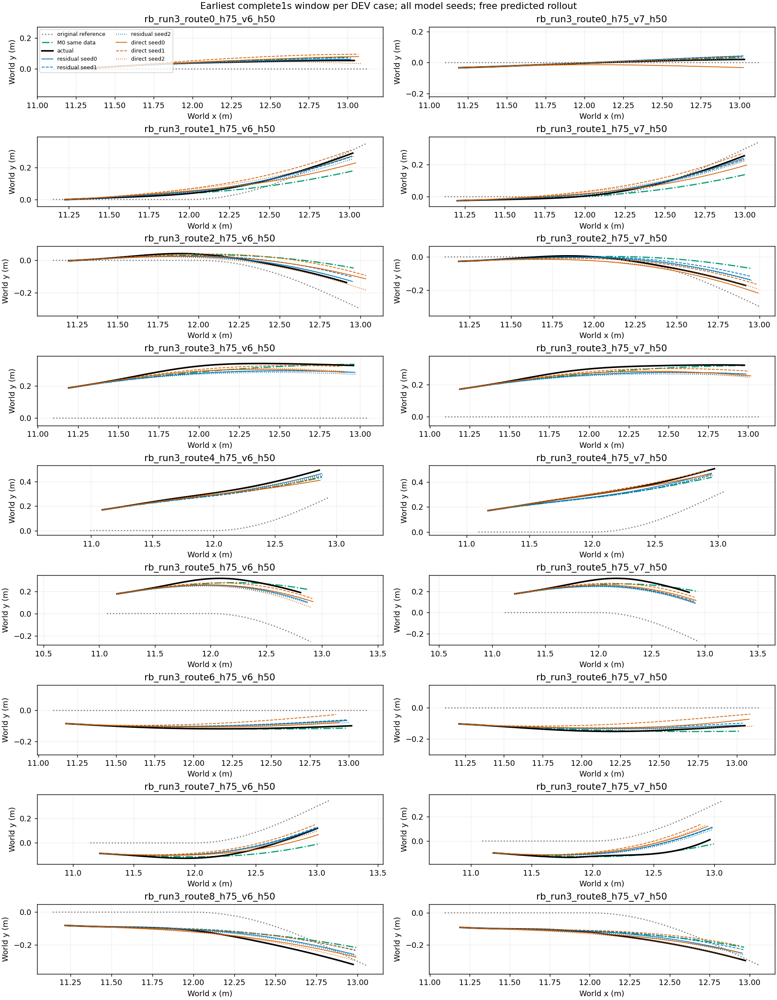
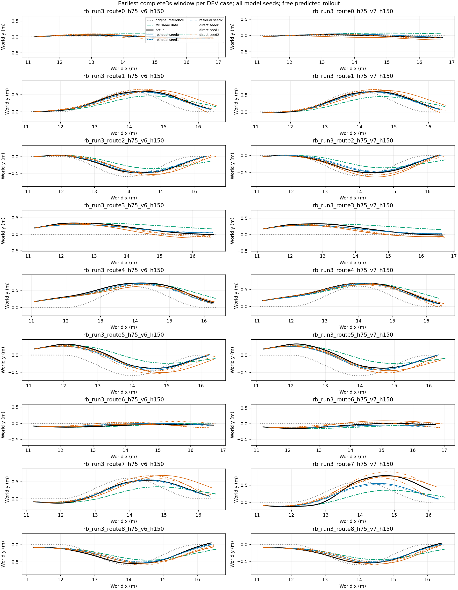
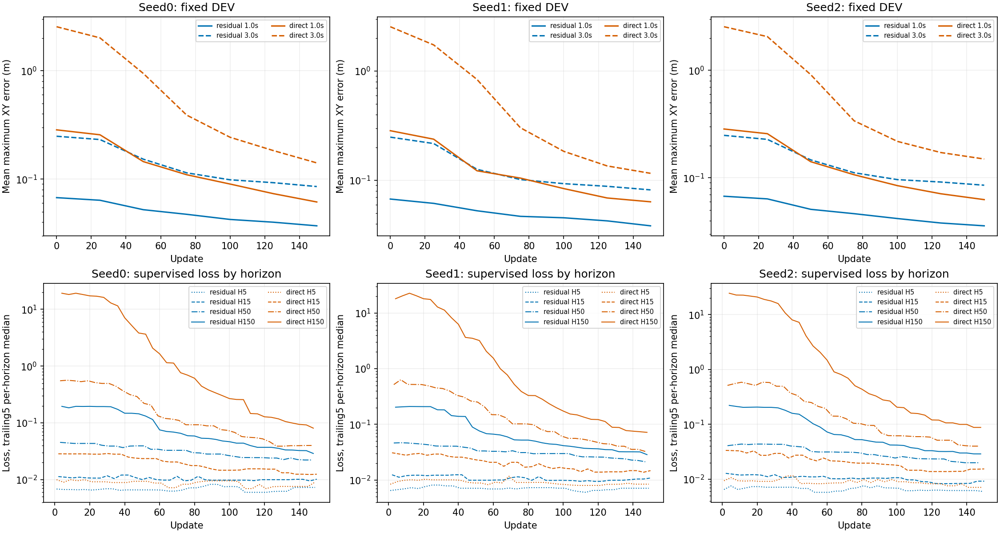

# P3同数据结构模型与直接模型

同数据M0线性基线初始1秒/3秒平均最大XY误差为0.06742/0.24857m。M0用相同9546条粗糙TRAIN阶段2转移拟合，区别于此前平地名义模型。M1为M0＋地形/历史修正，M2用相同输入、GRU64/128×128头及姿态积分直接预测动态增量；两个学习模型各三个独立初始化、相同采样和更新预算。

|模型|种子|最佳已评估更新|时域s|窗/例|平均最大XY m|P95 m|最坏m|末25次相对改善|
|---|---|---|---|---|---|---|---|---|
|residual|0|150|1.0|247/18|0.03704|0.07050|0.27787|7.40%|
|residual|0|150|3.0|67/18|0.08534|0.30876|0.52361|7.87%|
|residual|1|150|1.0|247/18|0.03834|0.07571|0.25487|9.91%|
|residual|1|150|3.0|67/18|0.08179|0.30736|0.45185|7.23%|
|residual|2|150|1.0|247/18|0.03576|0.07129|0.25606|5.87%|
|residual|2|150|3.0|67/18|0.08539|0.33447|0.48007|6.60%|
|direct|0|150|1.0|247/18|0.06147|0.13119|0.43683|16.20%|
|direct|0|150|3.0|67/18|0.14102|0.26514|0.72404|23.02%|
|direct|1|150|1.0|247/18|0.06361|0.12277|0.37145|7.74%|
|direct|1|150|3.0|67/18|0.11596|0.26160|0.51074|14.42%|
|direct|2|150|1.0|247/18|0.06270|0.12788|0.48825|11.80%|
|direct|2|150|3.0|67/18|0.14969|0.31823|0.70640|12.95%|

最佳按固定DEV1秒均值在每25次存档中选择，3秒不单独选模；不是所有更新全程最优。重叠窗口非独立样本，各时域覆盖不同；逐例最坏值保存在cases.csv。损失是监督预测损失，不是PPO，没有策略reward/KL指标。学习模型读取真实381维历史作初始化，未来只用预测状态及自身隐状态查询固定地形，不读未来真实历史。

地形描述是预测位置附近15点的高度、坡度、局部高度变化及支撑mask；沟与图外未标为平地支撑。双线性栅格只是模型输入，最终碰撞几何不替换。此处同一地图、既有TRAIN/DEV初态，尚无独立新地图或规划收益证明。没有用平均误差宣称全程净空合格、训练正式收敛或完整P3已完成。

原始存档/标量/逐窗口：`/media/qy/6A7E3DB07E3D75C3/STTW_runs/chapter3_playground_sttw_rb_sttw/p3_structured_models`；M0、M1、M2均未修改RB/H75或物理。
