# 速度域迁移：冻结1.8模型尚不支持1.9预测

冻结600轮候选；M0同数据ARX。三组速度条件各18个既有DEV初态；模型只训练过1.8m/s。本次使用真实phase2速度请求作未来固定命令，不读取未来物理/控制历史，无新增仿真。
当phase2请求1.9时，M1三种子1秒平均最大XY约0.086m、3秒约0.29m；返回1.8时为约0.015m/0.03m。所有均值及最差值保留如下。物理144/144成功不能推出旧预测器跨速度可用；下一步需要包含实际速度输入的数据拟合，不能继续只在旧1.8数据堆训练轮数。

|集合/模型|时域s|窗/例|均值XY m|P95 XY m|最差XY m|最差整车XYZ支持m|
|---|---:|---|---:|---:|---:|---:|
|constant19_M0|0.1|314/18|0.00510|0.00958|0.01385|0.02180|
|constant19_M0|0.3|296/18|0.02563|0.04132|0.04934|0.06796|
|constant19_M0|1.0|235/18|0.11434|0.17101|0.21661|0.24908|
|constant19_M0|2.0|145/18|0.25220|0.35881|0.42412|0.40436|
|constant19_M0|3.0|55/18|0.31773|0.45414|0.47747|0.43852|
|constant19_direct_seed0|0.1|314/18|0.00320|0.00840|0.01874|0.02851|
|constant19_direct_seed0|0.3|296/18|0.01667|0.03110|0.04709|0.04874|
|constant19_direct_seed0|1.0|235/18|0.08409|0.11433|0.13710|0.12966|
|constant19_direct_seed0|2.0|145/18|0.18275|0.21779|0.23645|0.23710|
|constant19_direct_seed0|3.0|55/18|0.28923|0.32818|0.34246|0.34171|
|constant19_direct_seed1|0.1|314/18|0.00320|0.00863|0.02004|0.02893|
|constant19_direct_seed1|0.3|296/18|0.01690|0.02950|0.04945|0.05079|
|constant19_direct_seed1|1.0|235/18|0.09000|0.12152|0.14500|0.14651|
|constant19_direct_seed1|2.0|145/18|0.19729|0.24607|0.28051|0.28298|
|constant19_direct_seed1|3.0|55/18|0.30368|0.36164|0.37328|0.37453|
|constant19_direct_seed2|0.1|314/18|0.00313|0.00828|0.01999|0.02823|
|constant19_direct_seed2|0.3|296/18|0.01616|0.03353|0.04817|0.05365|
|constant19_direct_seed2|1.0|235/18|0.08281|0.11194|0.13876|0.14260|
|constant19_direct_seed2|2.0|145/18|0.17932|0.21663|0.24546|0.24453|
|constant19_direct_seed2|3.0|55/18|0.27055|0.31909|0.36410|0.35876|
|constant19_residual_seed0|0.1|314/18|0.00401|0.00869|0.01332|0.01919|
|constant19_residual_seed0|0.3|296/18|0.01975|0.03418|0.04492|0.04881|
|constant19_residual_seed0|1.0|235/18|0.08560|0.10562|0.12617|0.12508|
|constant19_residual_seed0|2.0|145/18|0.18898|0.22701|0.24653|0.25008|
|constant19_residual_seed0|3.0|55/18|0.29432|0.33829|0.34268|0.34555|
|constant19_residual_seed1|0.1|314/18|0.00402|0.00904|0.01436|0.01899|
|constant19_residual_seed1|0.3|296/18|0.02015|0.03527|0.04545|0.04861|
|constant19_residual_seed1|1.0|235/18|0.08636|0.10880|0.12308|0.12516|
|constant19_residual_seed1|2.0|145/18|0.18902|0.22833|0.24453|0.24842|
|constant19_residual_seed1|3.0|55/18|0.29434|0.33351|0.34366|0.34711|
|constant19_residual_seed2|0.1|314/18|0.00393|0.00858|0.01233|0.01720|
|constant19_residual_seed2|0.3|296/18|0.01999|0.03256|0.04352|0.04708|
|constant19_residual_seed2|1.0|235/18|0.08623|0.10706|0.11978|0.11907|
|constant19_residual_seed2|2.0|145/18|0.18762|0.22389|0.24585|0.24957|
|constant19_residual_seed2|3.0|55/18|0.28992|0.33838|0.34985|0.35347|
|switch18to19_M0|0.1|314/18|0.00511|0.00969|0.01351|0.01802|
|switch18to19_M0|0.3|296/18|0.02544|0.04170|0.05534|0.06007|
|switch18to19_M0|1.0|238/18|0.11327|0.16616|0.20661|0.23885|
|switch18to19_M0|2.0|148/18|0.24961|0.35661|0.41414|0.41115|
|switch18to19_M0|3.0|58/18|0.31821|0.44495|0.46031|0.43674|
|switch18to19_direct_seed0|0.1|314/18|0.00307|0.00845|0.01624|0.02491|
|switch18to19_direct_seed0|0.3|296/18|0.01688|0.03052|0.05150|0.05405|
|switch18to19_direct_seed0|1.0|238/18|0.08573|0.11425|0.12986|0.13177|
|switch18to19_direct_seed0|2.0|148/18|0.18048|0.22105|0.24280|0.22905|
|switch18to19_direct_seed0|3.0|58/18|0.28578|0.32875|0.35943|0.35344|
|switch18to19_direct_seed1|0.1|314/18|0.00308|0.00861|0.01718|0.02525|
|switch18to19_direct_seed1|0.3|296/18|0.01695|0.03149|0.05421|0.05648|
|switch18to19_direct_seed1|1.0|238/18|0.09048|0.12084|0.14953|0.15365|
|switch18to19_direct_seed1|2.0|148/18|0.19415|0.24105|0.26993|0.27142|
|switch18to19_direct_seed1|3.0|58/18|0.29836|0.35492|0.39063|0.38796|
|switch18to19_direct_seed2|0.1|314/18|0.00297|0.00823|0.01699|0.02515|
|switch18to19_direct_seed2|0.3|296/18|0.01634|0.03167|0.05639|0.05920|
|switch18to19_direct_seed2|1.0|238/18|0.08296|0.11119|0.13337|0.13734|
|switch18to19_direct_seed2|2.0|148/18|0.17726|0.21535|0.25876|0.26008|
|switch18to19_direct_seed2|3.0|58/18|0.26293|0.31330|0.33546|0.33876|
|switch18to19_residual_seed0|0.1|314/18|0.00398|0.00967|0.01315|0.01726|
|switch18to19_residual_seed0|0.3|296/18|0.01973|0.03418|0.05307|0.05461|
|switch18to19_residual_seed0|1.0|238/18|0.08554|0.10750|0.11688|0.12073|
|switch18to19_residual_seed0|2.0|148/18|0.18755|0.22816|0.24196|0.24473|
|switch18to19_residual_seed0|3.0|58/18|0.29146|0.33425|0.34307|0.34521|
|switch18to19_residual_seed1|0.1|314/18|0.00400|0.00982|0.01289|0.01791|
|switch18to19_residual_seed1|0.3|296/18|0.02021|0.03626|0.05299|0.05574|
|switch18to19_residual_seed1|1.0|238/18|0.08636|0.10931|0.12421|0.12596|
|switch18to19_residual_seed1|2.0|148/18|0.19014|0.22971|0.24280|0.24489|
|switch18to19_residual_seed1|3.0|58/18|0.29534|0.33417|0.34364|0.34641|
|switch18to19_residual_seed2|0.1|314/18|0.00393|0.00916|0.01315|0.01851|
|switch18to19_residual_seed2|0.3|296/18|0.01993|0.03416|0.05111|0.05236|
|switch18to19_residual_seed2|1.0|238/18|0.08581|0.10693|0.11751|0.12020|
|switch18to19_residual_seed2|2.0|148/18|0.18670|0.22797|0.25010|0.25100|
|switch18to19_residual_seed2|3.0|58/18|0.28838|0.33728|0.34520|0.34828|
|switch19to18_M0|0.1|331/18|0.00285|0.00884|0.01437|0.01573|
|switch19to18_M0|0.3|313/18|0.01297|0.03418|0.05672|0.05762|
|switch19to18_M0|1.0|246/18|0.06525|0.14854|0.19822|0.20291|
|switch19to18_M0|2.0|156/18|0.15636|0.30203|0.34308|0.34644|
|switch19to18_M0|3.0|66/18|0.22678|0.36472|0.37481|0.37894|
|switch19to18_direct_seed0|0.1|331/18|0.00236|0.00680|0.01155|0.02316|
|switch19to18_direct_seed0|0.3|313/18|0.00724|0.01796|0.03197|0.03440|
|switch19to18_direct_seed0|1.0|246/18|0.02024|0.03925|0.08219|0.07791|
|switch19to18_direct_seed0|2.0|156/18|0.03184|0.06627|0.15802|0.16329|
|switch19to18_direct_seed0|3.0|66/18|0.03635|0.07340|0.10858|0.11177|
|switch19to18_direct_seed1|0.1|331/18|0.00242|0.00705|0.01173|0.02390|
|switch19to18_direct_seed1|0.3|313/18|0.00748|0.01838|0.03494|0.03778|
|switch19to18_direct_seed1|1.0|246/18|0.02153|0.04423|0.09794|0.10016|
|switch19to18_direct_seed1|2.0|156/18|0.03386|0.07361|0.10722|0.10744|
|switch19to18_direct_seed1|3.0|66/18|0.03994|0.07876|0.11692|0.12213|
|switch19to18_direct_seed2|0.1|331/18|0.00244|0.00728|0.01242|0.02375|
|switch19to18_direct_seed2|0.3|313/18|0.00763|0.01878|0.03704|0.04120|
|switch19to18_direct_seed2|1.0|246/18|0.02192|0.04132|0.10284|0.09623|
|switch19to18_direct_seed2|2.0|156/18|0.04103|0.07879|0.15617|0.15823|
|switch19to18_direct_seed2|3.0|66/18|0.06124|0.14187|0.20462|0.20695|
|switch19to18_residual_seed0|0.1|331/18|0.00220|0.00678|0.01101|0.01380|
|switch19to18_residual_seed0|0.3|313/18|0.00636|0.01649|0.03268|0.03510|
|switch19to18_residual_seed0|1.0|246/18|0.01525|0.02805|0.04906|0.04907|
|switch19to18_residual_seed0|2.0|156/18|0.02424|0.04319|0.07738|0.06903|
|switch19to18_residual_seed0|3.0|66/18|0.02895|0.05038|0.08387|0.07704|
|switch19to18_residual_seed1|0.1|331/18|0.00228|0.00694|0.01041|0.01465|
|switch19to18_residual_seed1|0.3|313/18|0.00651|0.01637|0.03084|0.03440|
|switch19to18_residual_seed1|1.0|246/18|0.01522|0.02816|0.05977|0.05567|
|switch19to18_residual_seed1|2.0|156/18|0.02384|0.04677|0.07332|0.07535|
|switch19to18_residual_seed1|3.0|66/18|0.02864|0.05290|0.07332|0.07535|
|switch19to18_residual_seed2|0.1|331/18|0.00221|0.00651|0.01113|0.01257|
|switch19to18_residual_seed2|0.3|313/18|0.00632|0.01602|0.02992|0.03122|
|switch19to18_residual_seed2|1.0|246/18|0.01517|0.02649|0.06042|0.05549|
|switch19to18_residual_seed2|2.0|156/18|0.02467|0.04510|0.07900|0.07830|
|switch19to18_residual_seed2|3.0|66/18|0.03212|0.06090|0.08812|0.08276|

逐路线完整结果见per_route.csv；worst_windows.csv保留各模型各时域最差整车支持窗口的路线、初态和真实锚点。窗口重叠，不能把窗口数当独立样本。

全覆盖XY：每个模型/条件选择自己的最差1秒XY窗口，窗口锚点可不同，不能视为逐点配对误差图。原始完整轨迹及参考为底图，预测曲线仅覆盖所选有效窗口。

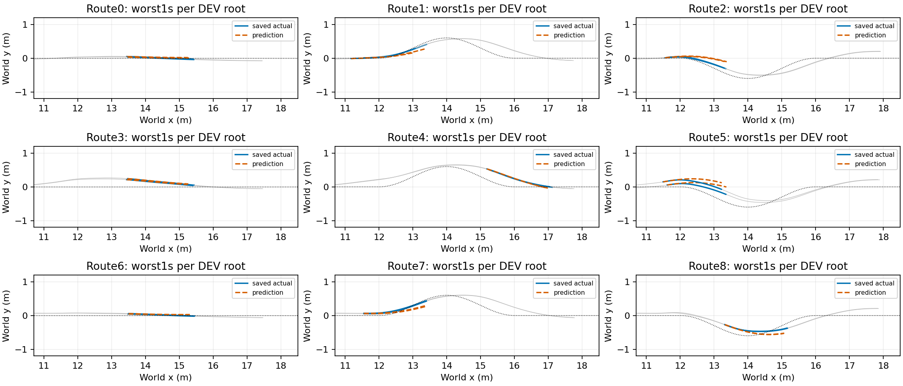

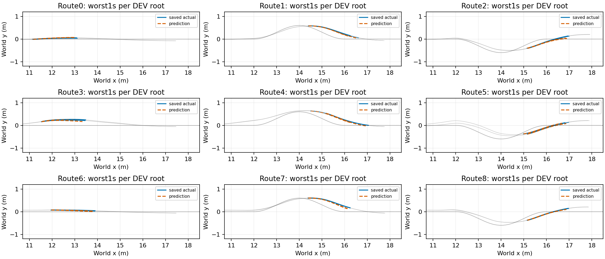

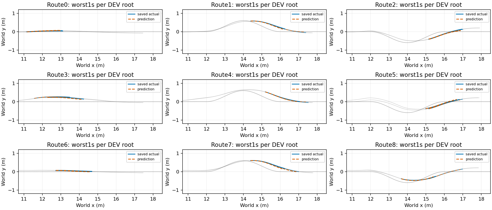

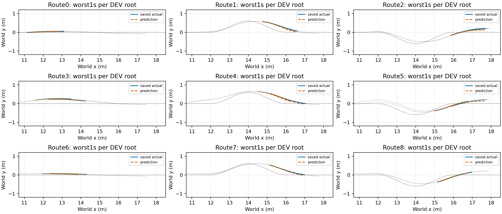

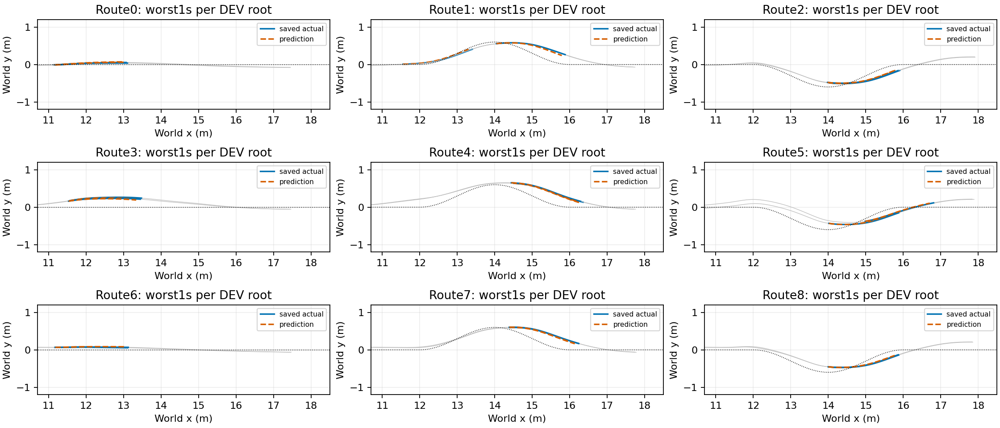

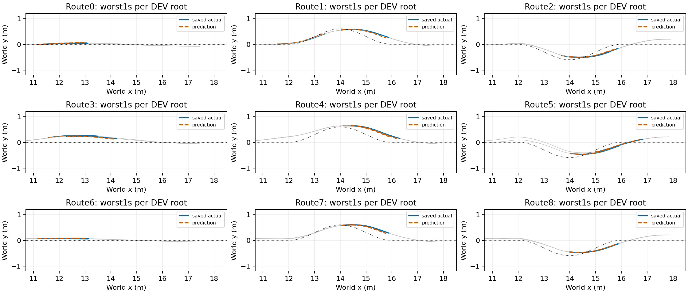

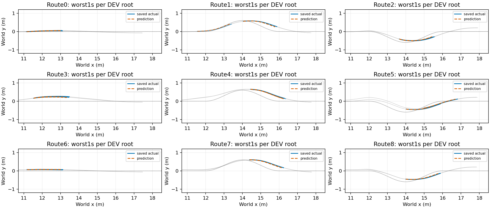

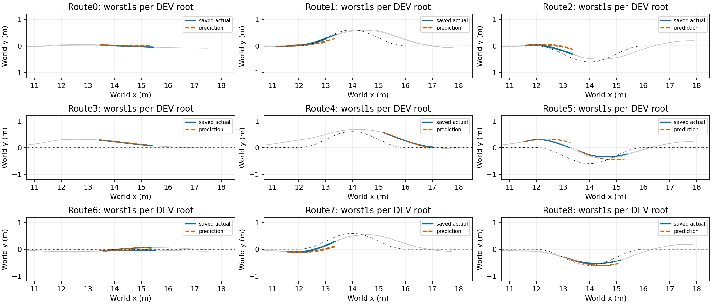

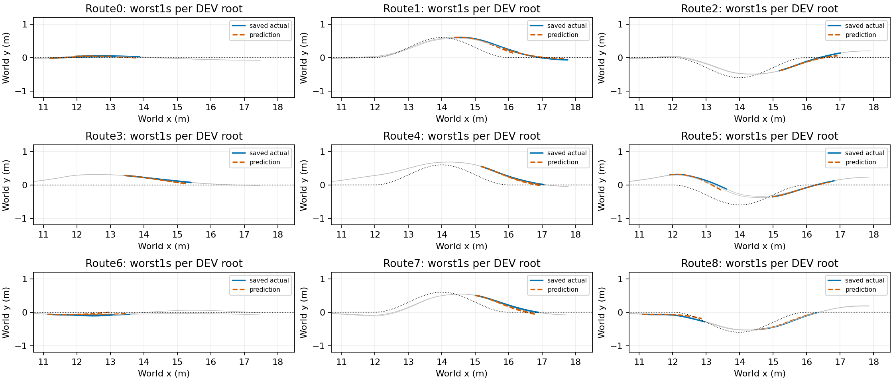

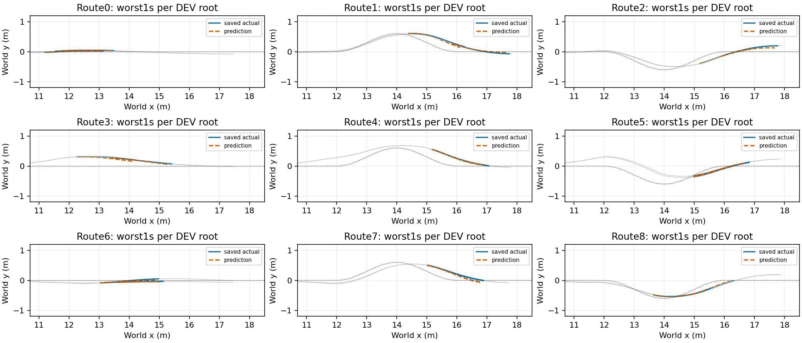

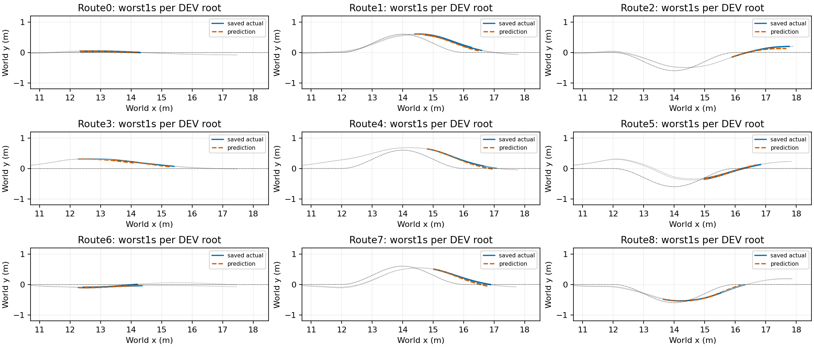

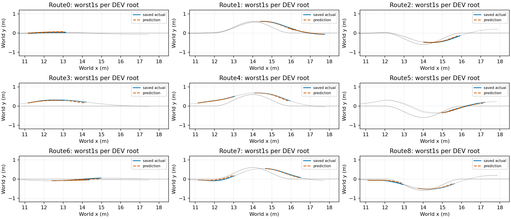

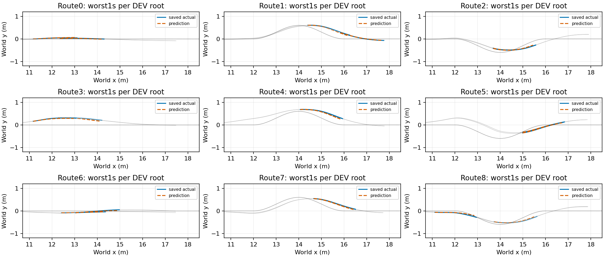

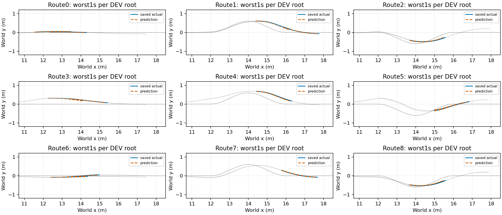

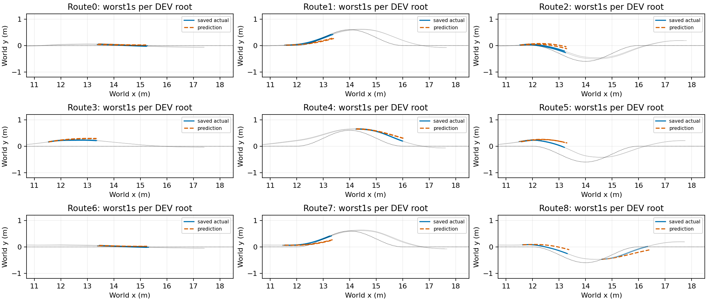

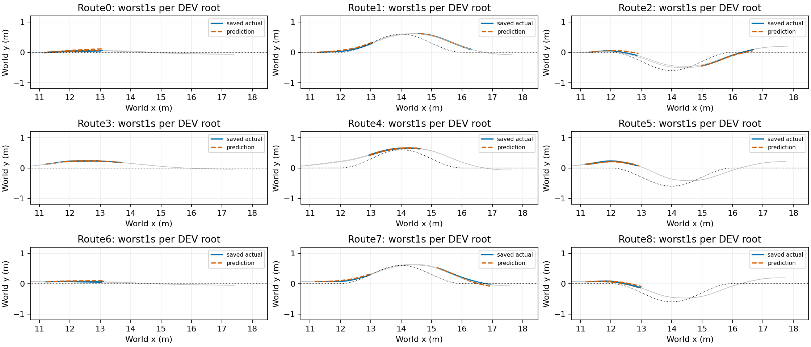

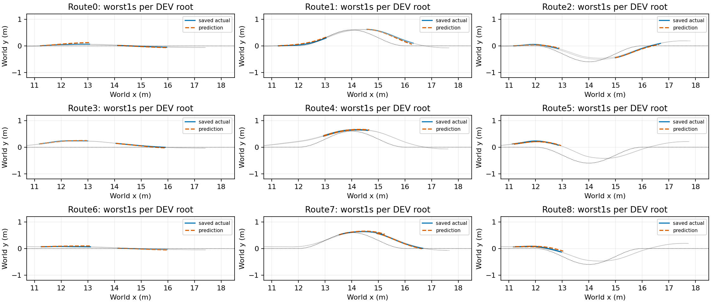

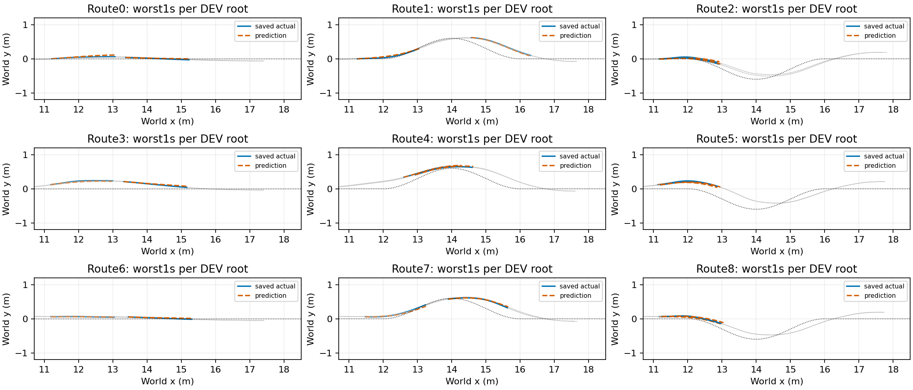

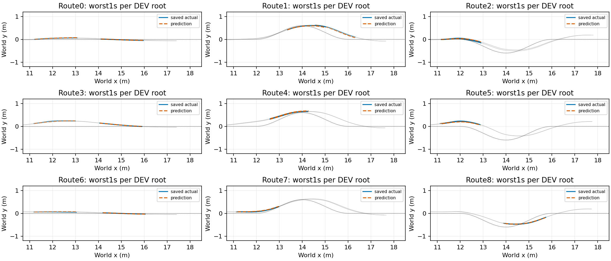

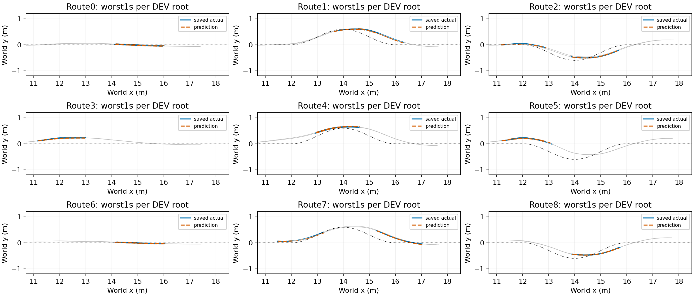

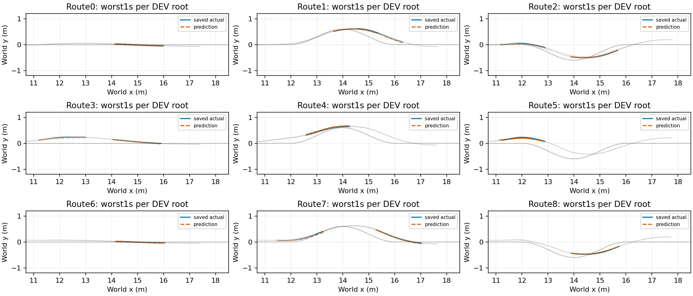

原始逐窗口/模型身份/数组：`/media/qy/6A7E3DB07E3D75C3/STTW_runs/chapter3_playground_sttw_rb_sttw/p3_speed_prediction`。
