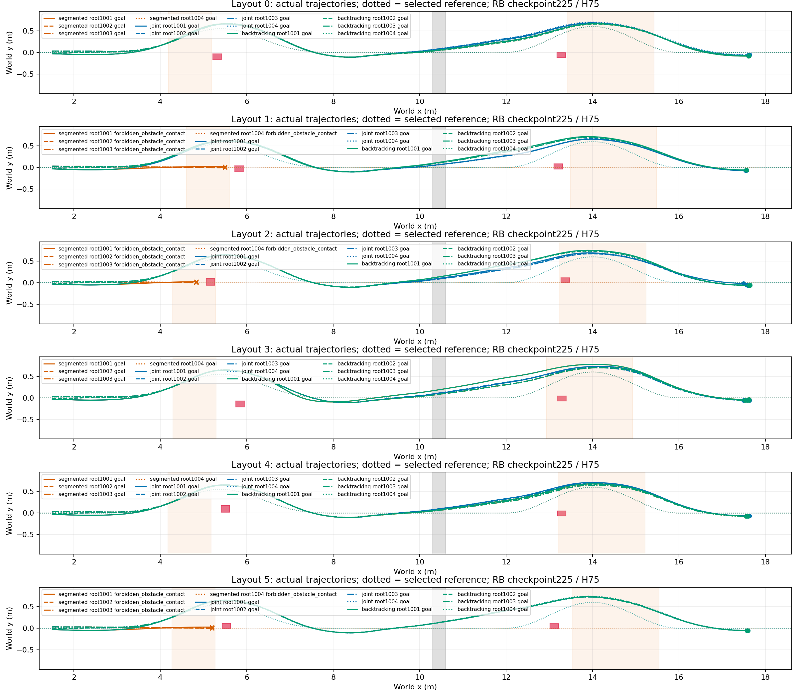
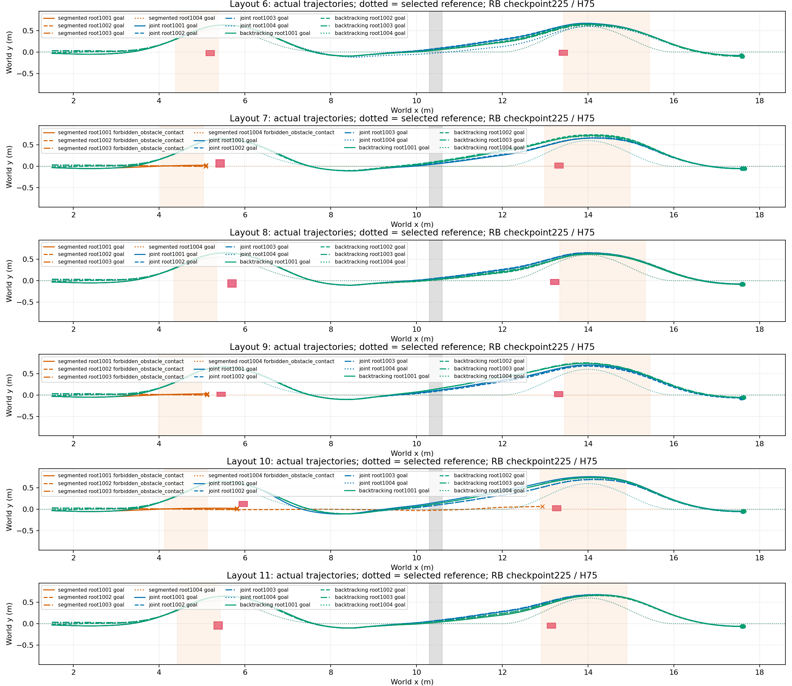
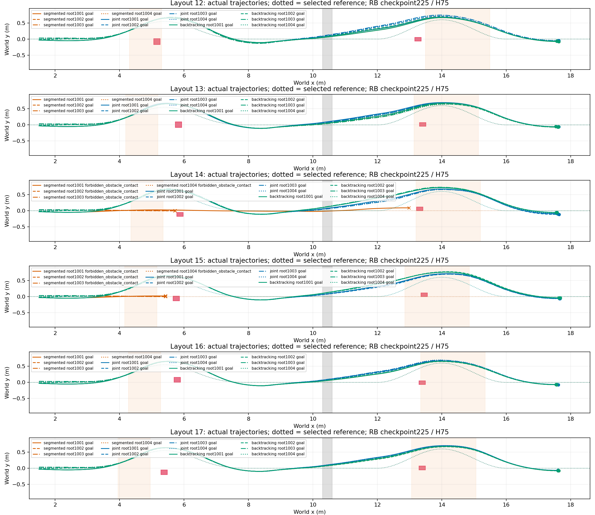
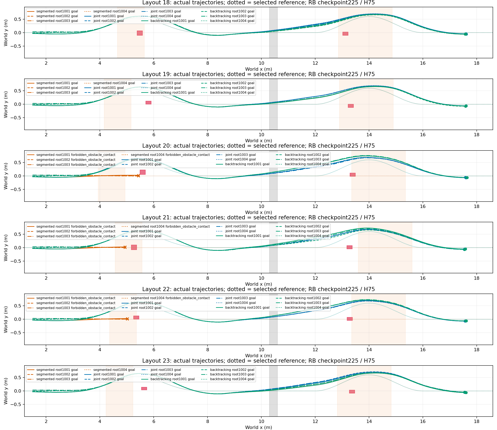
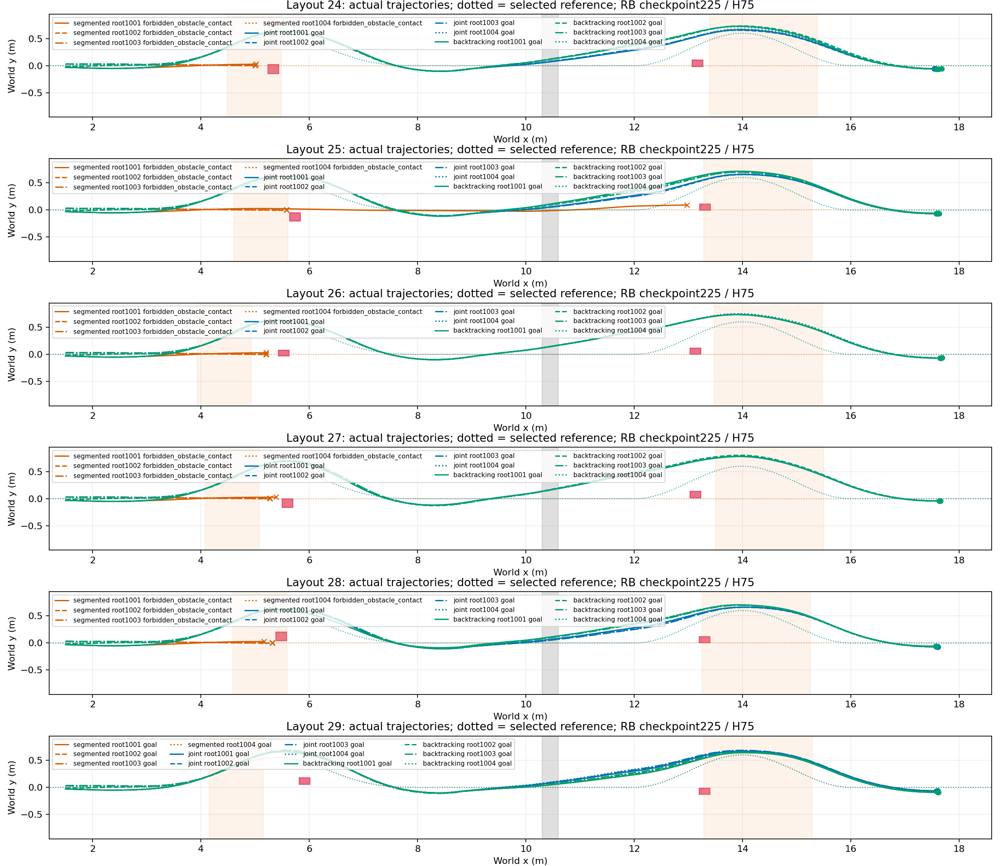
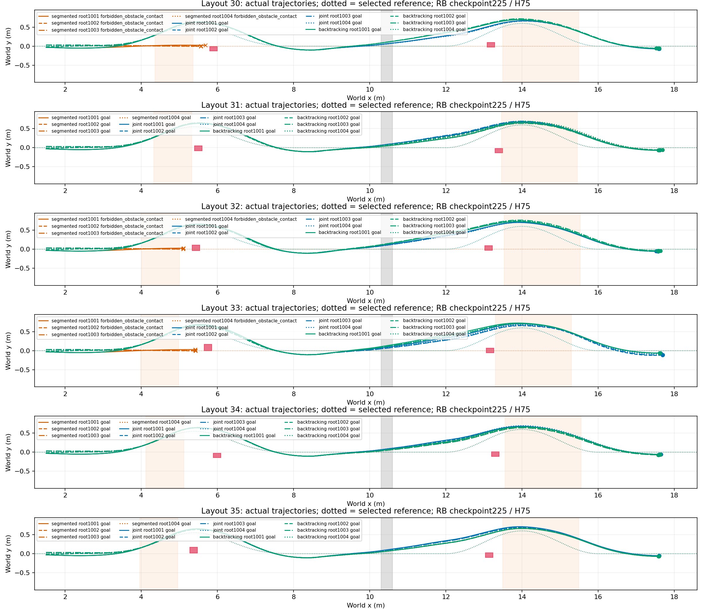
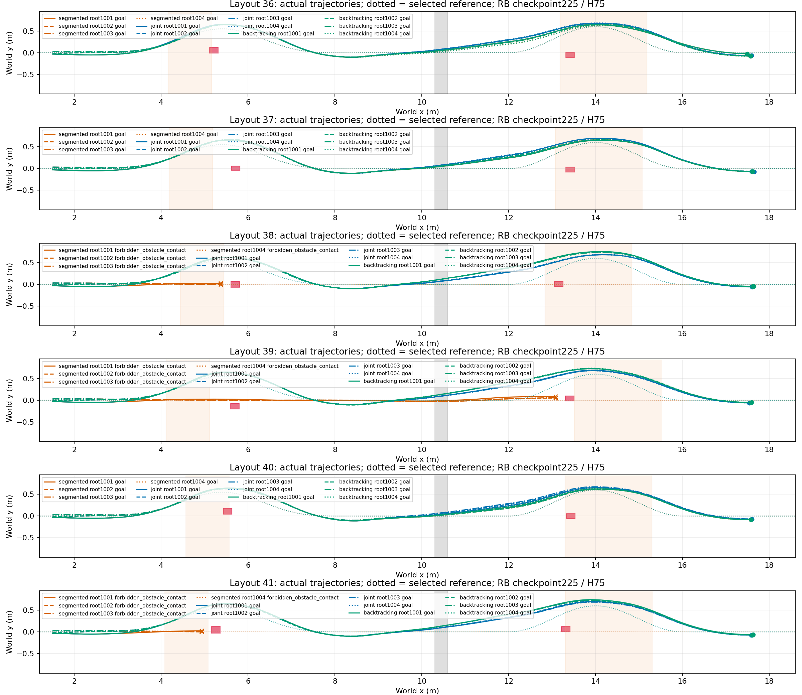
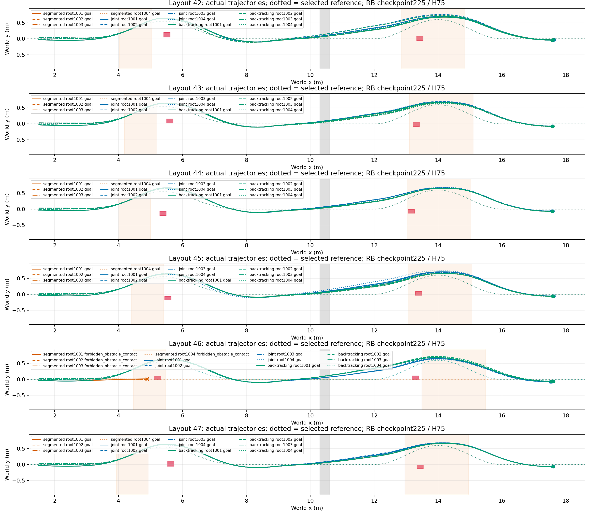
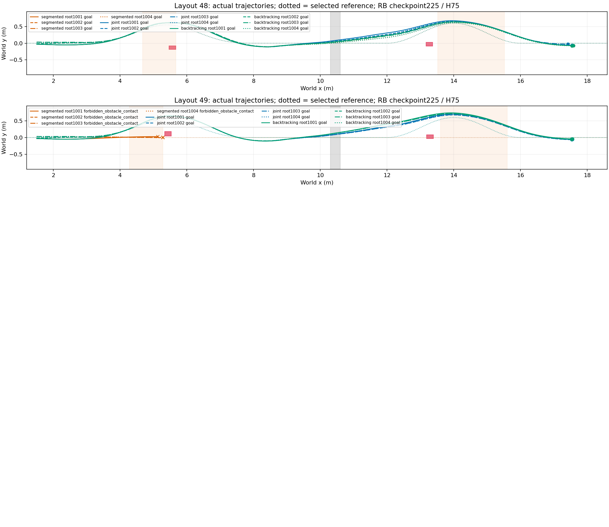

# New-map E2: joint versus strong backtracking

Primary comparison: joint versus backtracking; greedy segmented is secondary. Same36 TRAIN candidates and unchanged DEV-calibrated envelopes. E3 outcomes on these maps had already been inspected before this E2 run; algorithms and thresholds were not tuned from them. Static selection, not rolling neural planning.

|Method|Tasks|Physical goals|Admitted plan goals|No-plan physical goals|Penalized seconds|
|---|---:|---:|---:|---:|---:|
|segmented|200|104|104|0|9.62968|
|joint|200|200|200|0|9.28338|
|backtracking|200|200|200|0|9.28483|

All cases, failures, true endpoints, locking drift and source trajectory paths are in [summary.json](summary.json). Paired confidence intervals resample entire maps; four roots recur across50 maps. [Paired statistics](paired_statistics.json). No-plan keeps the original incumbent; actual successes still count in the physical denominator. Same-selection trajectories are reused, not independent replications.

Frozen protocol and original data: `/media/qy/6A7E3DB07E3D75C3/STTW_runs/chapter3_playground_sttw_rb_sttw/p4_joint_test`. This comparison does not complete E1 or rolling-domain validation.
