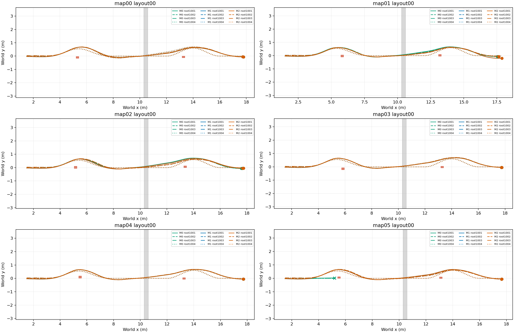
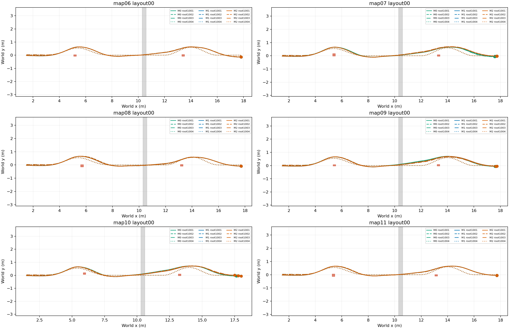
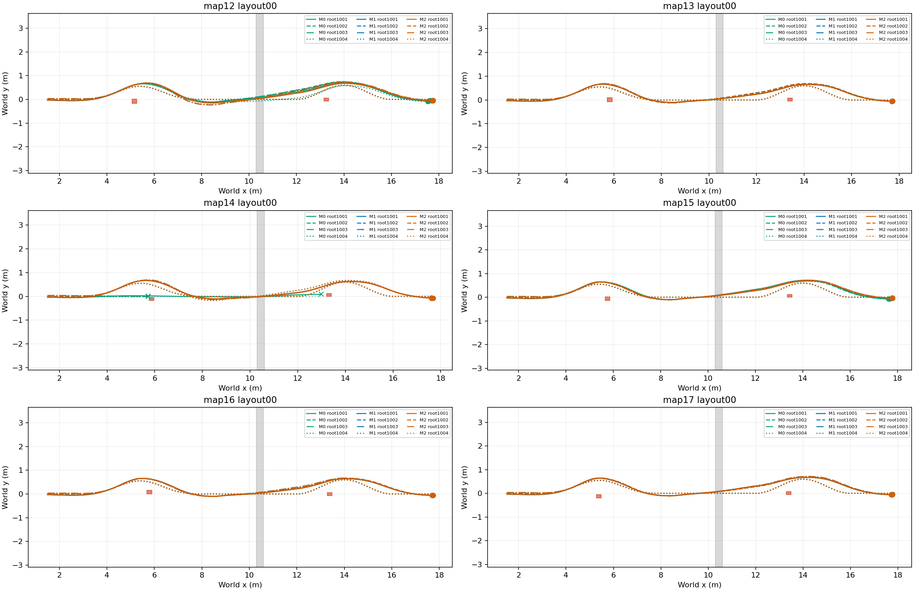
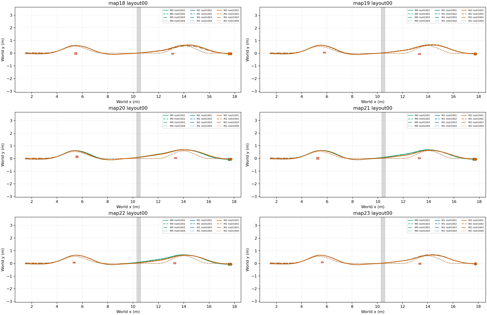
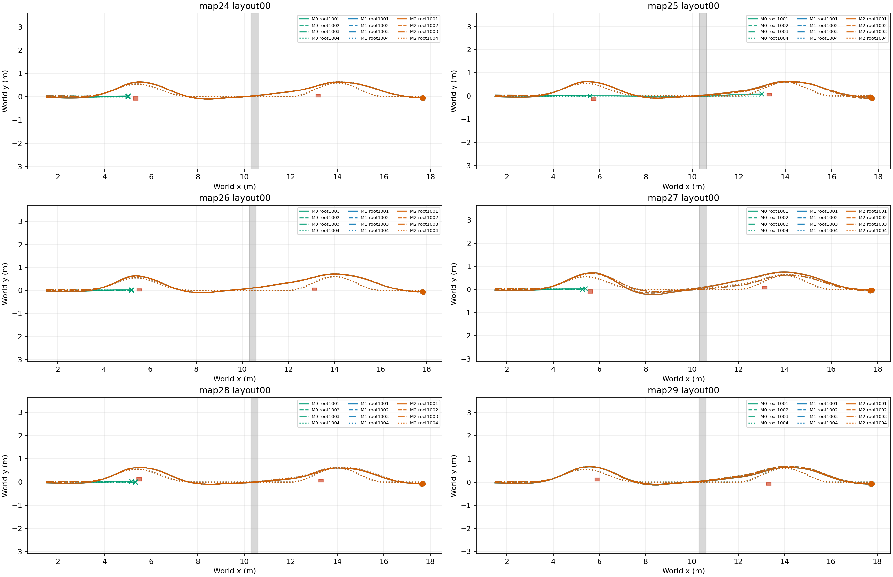
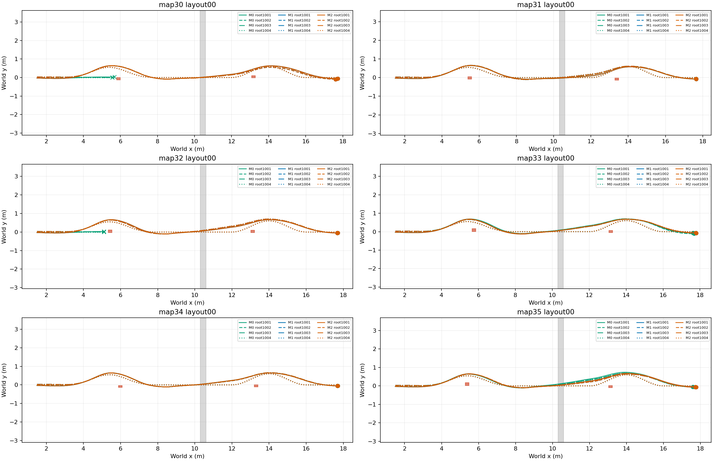
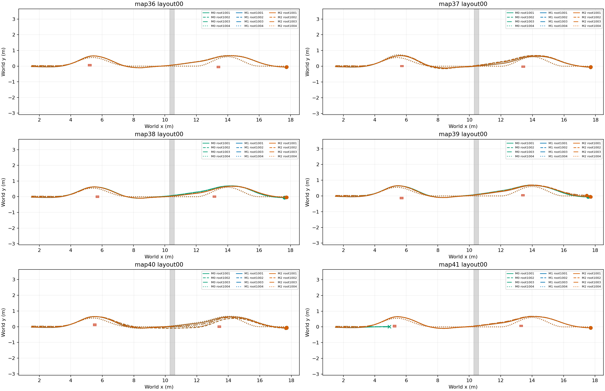
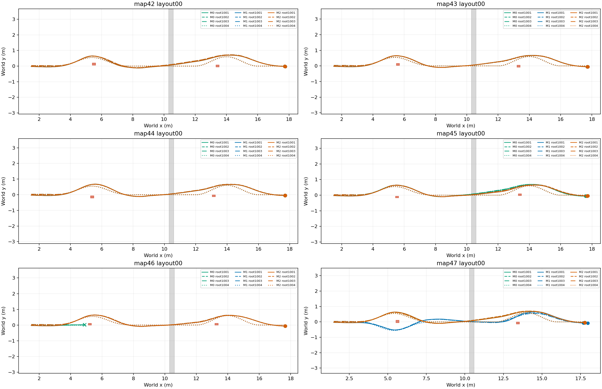
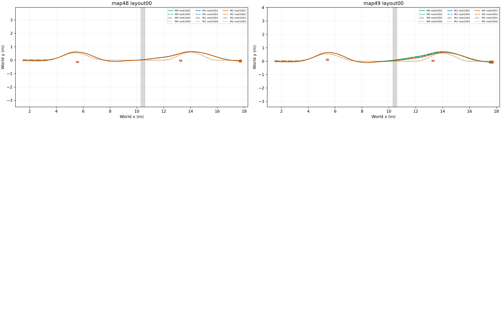

# Frozen new-map/new-root model planning TEST

Static18-candidate comparison with measured TRAIN approach/RB prefixes and learned departure. All methods use the same new maps/roots and fixed physical goal. Model-specific margins were frozen from DEV before execution. This is not online neural replanning or completion of E1/E2/P4.

|Model|Tasks|Physical goals|Admitted plan goals|No plan|Admitted execution failures|Penalized seconds|
|---|---:|---:|---:|---:|---:|---:|
|M0|200|156|156|44|0|9.31165|
|M1|200|200|200|0|0|8.99923|
|M2|200|200|200|0|0|8.99805|

600 method conditions, 312 unique physical trajectories. Failures and no-plan cases remain in cases.csv. Four starting roots are reused across maps; bootstrap resamples whole maps. Failure penalties are10s. No-plan retains the original straight1.8 candidate and remains a planning failure even if physically successful.

Frozen protocol: `/media/qy/6A7E3DB07E3D75C3/STTW_runs/chapter3_playground_sttw_rb_sttw/p4_test_catalog/catalog.json`; raw results: `/media/qy/6A7E3DB07E3D75C3/STTW_runs/chapter3_playground_sttw_rb_sttw/p4_model_test`.

Paired statistics: [JSON](paired_statistics.json). M1 versus M0 is primary; other comparisons are secondary. No safety guarantee or topology/network superiority is inferred from aggregate success alone.

逐布局失败：map05、14、24、25、26、27、28、30、32、41、46，各四个根；M0共44次均为无计划后沿原直线触及禁止障碍。M1/M2仅map47选择不同，其他49图选择一致。两者均200/200，不证明结构模型的独立成功优势。

M1−M0成功率差22个百分点，地图组bootstrap描述性95%区间[12,34]个百分点；失败计10秒的配对均时差−0.312425秒，区间[−0.425856,−0.209399]秒；156共同成功条件的均时差−0.114263秒。准入执行失败分别0/156、0/200、0/200，不能据此声称减少假可行。零观察失败也不等于总体风险为零。

该测试只更换同一地图家族内的布局/碎石种子/脊坡位置和起始根；不支持任意地形或实车泛化。新布局在跳前也有障碍，保留所有失败。GPU队列3150.010秒，计划准备79.700秒，无策略训练。

完成通知原进程因虚拟环境Python缺少os.pidfd_open而启动失败。收取结果后已用/usr/bin/python3补发，terminal_bark.json记录HTTP200。后续PID通知器固定使用该系统解释器，不重启已完成实验。
