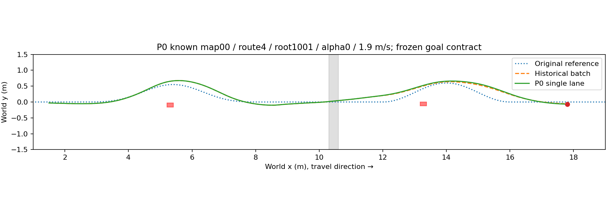

# 新任务书 P0：基线复算（未完成验收）

从原 plans.json 与各真实运行 status.json 重新关联600方法条件，得到M0 156/200、M1 200/200、M2 200/200；312唯一运行，轨迹文件均存在。M0无计划44、准入后失败0；M1/M2均为0。未重新执行600条件，也未逐帧重建成功标签。

已fetch：本地与远端均为256ebfcb。任务书原文及哈希与复算数据见本目录。完整actor/资产身份manifest、一个真实smoke及拒绝原因日志仍待完成；本阶段不能标为完成。

## 真实复现与接口审查

已冻结baseline_manifest.json：有效RB actor来自shared225（覆盖registry原actor），地面actor、XML、地图、路线、配置、控制器、名义模型及校准文件均记录实际SHA256。原map00/layout00、route4、root1001、1.9m/s，保留原variant1，只缩为一个物理车道。新运行目录为外盘taskbook_20261115_p0；10秒完整任务，0训练，墙钟上限900秒。启动服务ch3-taskbook-p0.service；尚未收取结果，不记成功。

源码审查：playground_snapshot.capture保存全部MJX叶子（含约束/warm start）、GroundAdapter、RB状态、runtime、tick与context。runner仍显式拒绝rolling planner快照恢复，尚不满足新P1。HistoryDynamics.rollout每次用控制历史初始化hidden、不返回记忆，且髋膝保持不变，不能作为RB全关节预测器。接触子步row t对应之前5ms；控制历史在阶段事件后、control前采集，后续数据管线须保留该方向。

P0仍缺：真实smoke结果与XY、依赖版本/生成模型身份补录，以及阶段/时刻/几何体/约束/原始与扩张净空/裕量来源的逐候选拒绝日志。旧净空数组不等于这些字段全部齐备。

## 已完成的真实smoke

1/1完成，目标8.995秒、保持0.505秒；RB进入3.940秒，远岸触地5.080秒，交回5.390秒。禁行碰撞/非轮接触均0。单车道与历史批量逐例结果及共同窗口差保存在smoke_result.json，该差不是同引擎重复运行噪声基准。依赖和新生成模型hash已补录。P0仍需补齐逐候选拒绝日志，不称整阶段验收。
