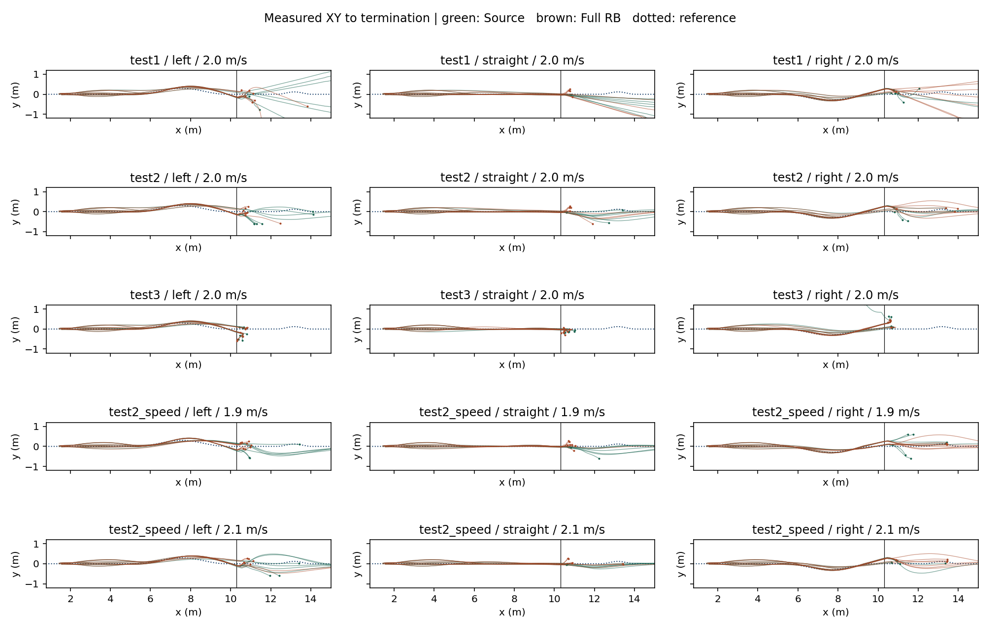

# 第二章原生高台与 STTW 锁摆交接

弯道接近调整后，另 24 个光滑高台初态中，两策略各有 23/24 个根能左右都交回。原第三章粗糙区和中央墙上的实测见[弯道与交回对照](approach_alignment/RESULTS.md)。

首轮拆因中，0.16 m 高台上确认了双轮腾空、台面双轮承重、锁摆交回和完成台上终点保持的实例。2.0 m/s 接近时，Full RB 三方向的整程成功为左 0/8、直 0/8、右 3/8。同图同起点的左右任务反转与跨地图增益仍待验证。[成功录像](rb_right_root0.mp4) · [240 条串联逐例记录](approach_cases.csv) · [运行合同及原始轨迹目录](protocol.json)

## Test 0　原始初态直接调用策略

第二章 XML 的台面高 0.16 m、长 4 m、宽 2 m，前缘 x=3.6 m，台下有连续地面。轮与地面、轮与台面的显式碰撞对沿用原参数，滑动摩擦两分量为 5.0 和 0.5。两份冻结策略共用第二章名义初态库第一批的前 32 行，控制周期 20 ms。每个物理组合各有 32 个 Source 和 32 个 Full RB 回合。Full RB 是 seed 8113001 的第 9 轮学生 transition_128000，注册名 rb_run1。[实际 XY](direct_xy.png) · [256 个直接回合、原批次同一行标签](direct_cases.csv)

| 积分器与物理步长 | Source 原稳定恢复 | Full RB 原稳定恢复 | Source 腾空、台面承重且恢复 | Full RB 腾空、台面承重且恢复 |
|---|---:|---:|---:|---:|
| implicitfast，1 ms | 22/32 | 11/32 | 22/32 | 11/32 |
| RK4，1 ms | 27/32 | 22/32 | 27/32 | 22/32 |
| implicitfast，5 ms | 3/32 | 2/32 | 3/32 | 2/32 |
| RK4，5 ms | 20/32 | 31/32 | 19/32 | 30/32 |

原归档同 32 行的稳定恢复为 Source 22/32、Full RB 31/32。用 RK4、5 ms 重跑，Full RB 的逐行标签全部重现，Source 有两行不同。固定 1 ms 换积分器使 Full RB 多恢复 11 条；固定 RK4 从 1 ms 改回 5 ms 又多 9 条。积分器和步长共同影响迁移。直接测试依据 50 Hz 的接触力与轮胎几何核验腾空，不能从这些采样点推断每个物理子步都卸载。

## Test 1–3　同批初态的锁摆接近、跳台与交回

保留地面 H75 的 5 ms 控制周期与 RB 的 20 ms 策略周期，整段采用 RK4、1 ms 物理。初态库前 8 行各执行三条接近路线，同一行的姿态及速度保留，沿前进方向（世界 x 轴）把起点平移到接近段。台阶前缘平移至 x=10.3 m。接管的根坐标偏移为 −1.1 m，跳跃信号窗口为前缘的 −1.1 至 +0.4 m，观测距离取近缘减去车体碰撞外形的最前点。平台上有弯道和终点窗口。此次拆因场景未加墙体和越野起伏。

| 2.0 m/s，8 初态 × 3 方向 | Source | Full RB |
|---|---:|---:|
| Test 1　RB 持续接管，腾空后双轮台面承重 | 21/24 | 19/24 |
| Test 1　再通过第二章稳定前进判据 | 16/24 | 13/24 |
| Test 2　打开落地回正，腾空后双轮台面承重 | 22/24 | 19/24 |
| Test 2　随后锁摆交回 H75 | 18/24 | 12/24 |
| Test 2　交回后在台上完成终点保持 | 4/24 | 3/24 |
| Test 3　同接管锚点，0.55 m 等高空沟，腾空后远岸双轮承重 / 交回 / 整程 | 0/24 · 0/24 · 0/24 | 0/24 · 0/24 · 0/24 |

Test 1 的稳定恢复用 50 Hz 保存位姿重建原程序的上升、顶点、有效落地和持续 25 步恢复判据。Test 2 和 3 用 1 ms 子步法向力、5 ms 轮胎几何与台面接触检测核验飞行和承重，再读取控制权切换和终点保持。对空沟的比较同时改变岸面高度和缺口支撑，不能估计单独增高 0.16 m 的效应。第一版空沟跑法把观测锚点放到了远岸，已用近岸重跑全部 48 条；表格和 CSV 只使用纠正后的结果。

各组合的起步 qpos/qvel 逐行相同。Test 1 与 Test 2 分别运行，接管时刻的 XY 差中位数为 0，最大 4.9 cm，前向速度差最大 0.166 m/s。Test 2 与 Test 3 接管速度差最大 0.625 m/s。表中组间差额描述这批端到端重跑；严格分离同一落地状态下的切换损失需复用同一物理快照。

## 接近方向与请求速度

每个方向 8 个相同初态。每格为经腾空与台面承重核验的「交回 / 整程」次数。只改变接近速度请求，交回后的请求始终为 2.0 m/s。

| 策略 | 请求 m/s | 左弯 | 直行 | 右弯 |
|---|---:|---:|---:|---:|
| Source | 1.9 | 5 / 1 | 7 / 0 | 6 / 2 |
| Source | 2.0 | 7 / 2 | 7 / 1 | 4 / 1 |
| Source | 2.1 | 8 / 1 | 6 / 0 | 2 / 1 |
| Full RB | 1.9 | 0 / 0 | 1 / 0 | 8 / 3 |
| Full RB | 2.0 | 1 / 0 | 4 / 0 | 7 / 3 |
| Full RB | 2.1 | 2 / 0 | 3 / 2 | 7 / 3 |

2.0 m/s 时同一起点左右均交回，Source 为 3/8，Full RB 为 1/8。Full RB 左弯在三个速度下合计 0/24 次整程成功。按请求设定的 2.0 m/s 并不等于实测入口速度，Full RB 名义组实测世界 x 速度为 1.88–2.44 m/s。原生高台与 RK4 使当前链条能够执行，数据仍不足以采用 Full RB 作为优于 Source 的第三章规划基线。

Full RB 在名义组的 12 次合格交回中，3 条完成终点，2 条退出跟踪域，7 条到时。两策略共 17 条交回后到时的车在 8 s 时均已驶过目标窗口，末端 x=16.65–19.18 m，窗口上界为 14.15 m。单独核对窗口内的速度门限，Full RB 这 7 条均能连续满足 0.5 s；其中 4 条单看横向路径距离就无法连续达标 0.5 s。后续定位应对照左右弯接管姿态和台上路径、航向误差。

右弯初态 0 的实测卸载段是 4.000–4.570 s，4.600 s 双轮在台面承重，4.830 s 锁摆交回，并通过终点保持。录像由保存的实际位姿重放，叠加当时前后轮法向力。所有比率均来自开发诊断，无训练更新。
