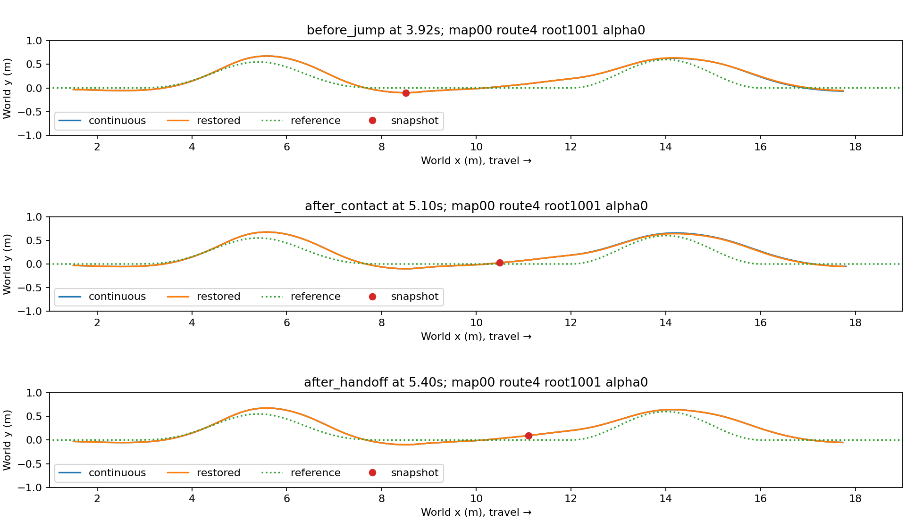
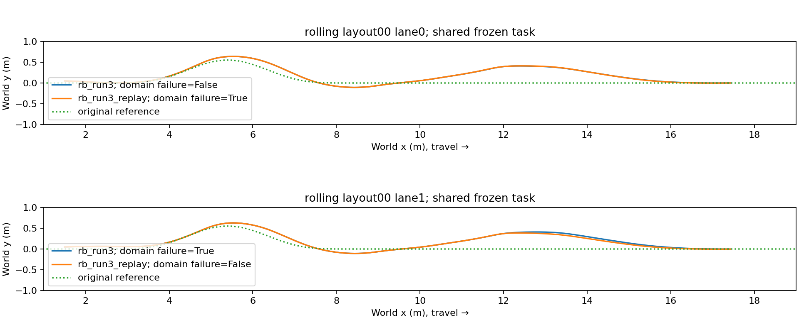

# P1完整物理快照：初轮未验收

[宽沟重验，含经接触与位姿核实的回交录像、三阶段快照复查](wide_gap/RESULTS.md)。下文为历史窄沟。

六条物理运行均到目标，三次恢复瞬间qpos/qvel、动作、控制器和RB历史完全一致。随后轨迹出现差异；三条独立连续运行自身也有差异。起跳前恢复在所列五字段均不超过三连续运行的最大差；触地后动作最大差4.51051，超过重复运行4.17509，不能判通过。其余逐字段与事件时间见summary.json；不以6/6到达代替一致性。

5.40秒快照在阶段事件前捕获，本次交回事件正好5.40秒，不满足“交回后”测试。保留原记录，另测5.60秒并以实际phase确认。滚动规划器快照和世界模型100=40+60尚未完成真实验收。

## 后续证据

5.60秒补测已确认phase=2，实测交回5.410秒；连续与恢复均8.965秒到目标。恢复瞬间五字段完全相同，全程最大差qpos0.02072、qvel0.17866、动作0.02298、控制历史0.20227、RB历史2.38980，均小于初轮三连续运行基准。单位按对应原始字段，不混称位置误差。初轮触地后动作超界结论仍保留。

最初两个恢复实验中，第一次数值差先在qvel出现（起跳前3.7253e-9、触地后1.6764e-8），前一步输入动作完全一致；支持数值求解差异先出现，尚不足以证明后续全部偏差只来自求解器。

地面M1 residual_seed2冻结best的GPU模型续接已实际验证：100步与40步→序列化next_state→60步，pose/velocity/domain及最终hidden逐位相同；旧API输出也逐位相同。结果model_resume.json。仅增加地面预测记忆续接，无训练、无RB全关节预测或真实控制器历史预测声明。滚动planner pending状态已接线，真实测试运行与结果单独收取。

## 滚动规划快照实测

0.22秒保存0.20秒查询的待发布计划，连续/恢复均在0.24秒发布；后续0.64秒改选候选30、触发8.75m一致。各78事件中首个待发布及实际改路事件一致，后段有29个事件的选择/准入/发布字段不同，4/4物理到目标、动作所有权差0。但两车道planning_failed从[false,true]变为[true,false]，不能称全程状态域一致性已通过。记录rolling_resume.json。

## 同起点求解基准

[固定四次内存恢复与一次序列化恢复](same_state/RESULTS.md)：触地后同一完整快照，6/6到目标。序列化对连续运行的五字段误差与四事件时差均在四次内存恢复的范围内，恢复瞬间零差。该轮通过所声明工程基准；原首轮触地后超界保留，不能将有限重复范围当概率界。滚动规划版本仍需对应基准完成后再判P1整体状态。

## 滚动版本同快照重复仍未通过

[固定四次内存恢复基准](rolling_same_state/RESULTS.md)：12/12目标，但两根数值/事件比较未通过。root6 qpos与RB历史超界；root7 qpos/qvel及交回时间超界（序列化差80ms，内存基准40ms）。六次的实际改路均0.64秒候选30，查询延迟均40ms，未发现实际改路或延迟变更。覆盖失败在纯内存重复也变化。固定样本已结束，不增加重复数或裕量。下一步仅试验体树质心/惯量的固定顺序GPU累加，物理参数和成功标准不变，默认关闭；这是数值实现诊断，尚未采用。

## 固定顺序数值版本与P2使用边界

[固定顺序体树累加结果](tree_order/RESULTS.md)：12/12目标，两根的序列化/连续差均在本轮四内存重复范围内，恢复瞬间零差。原生数值版本的未通过记录保留；部分内存重复范围更大，因此不宣称整体稳定性改善或确定性。两个核按固定顺序计算同一体树层的质心/复合惯量求和，物理参数不变，默认关闭。P2在配置中显式固定该数值版本，按本轮有限工程基准推进；模型100=40+60逐位一致、三个交接位置与完整planner状态证据仍如前。

P2只做已知地图DEV的真实Oracle分叉：完整物理/控制/历史快照不重置，改变路线请求，保留已执行几何前缀；原控制时序、slew和执行器保持。离线反事实切换不冒充在线承诺前视发布（P6另验收），不允许把Oracle真实未来用于测试规划。
