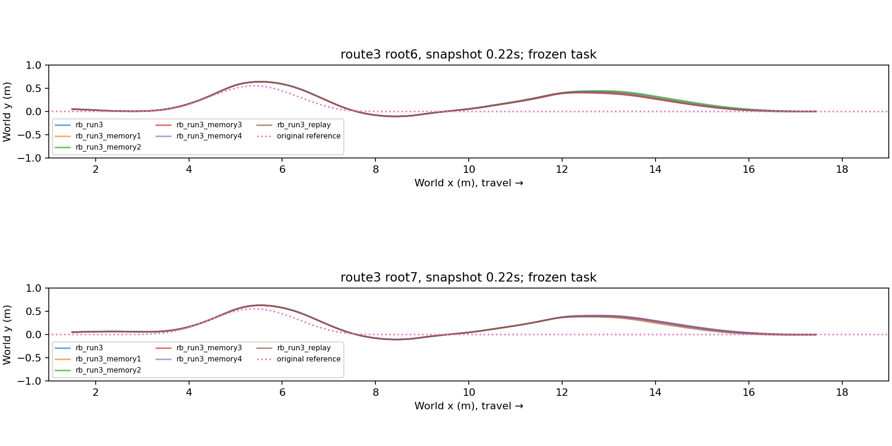

# 同快照内存/序列化恢复对照

固定四次内存恢复，不随结果追加；同物理与目标。比较恢复点至共同真实终点的五类字段最大绝对差，以及起跳/触地/交回/目标时间，全部原始数值见summary.json。混合字段的最大值不解释为单一位置单位；不是统计置信界或严格确定性证明。

- route3 root6：数值与事件基准未通过；终止 ['goal', 'goal', 'goal', 'goal', 'goal', 'goal']；覆盖失败 [False, False, True, False, False, False]。
- route3 root7：数值与事件基准未通过；终止 ['goal', 'goal', 'goal', 'goal', 'goal', 'goal']；覆盖失败 [True, False, False, False, True, False]。
