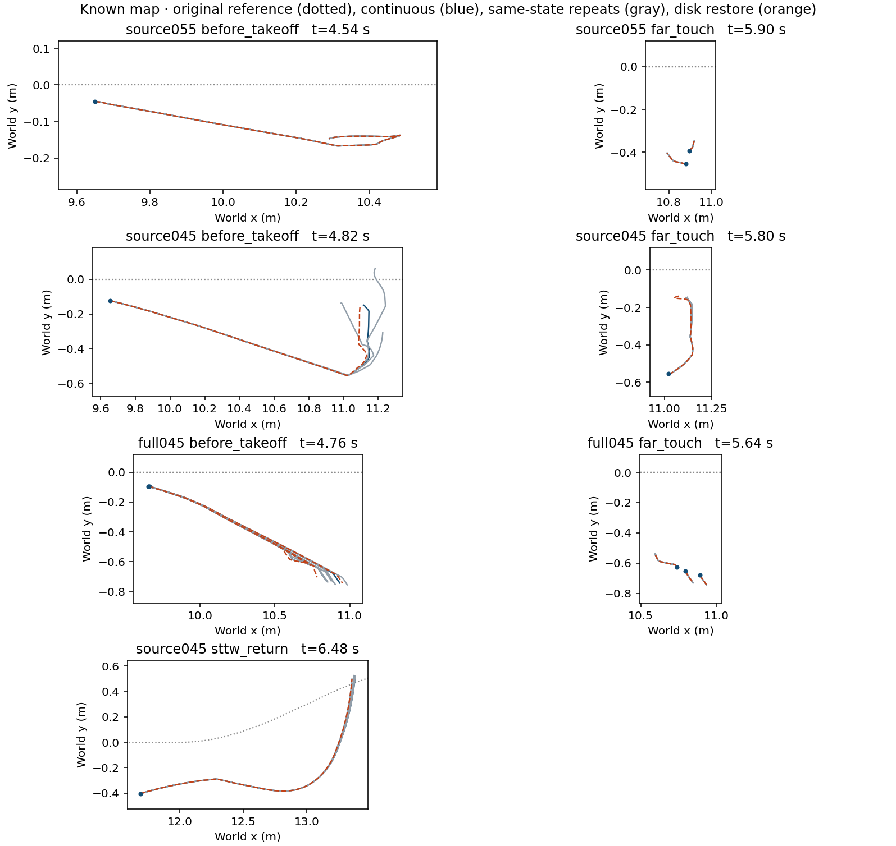
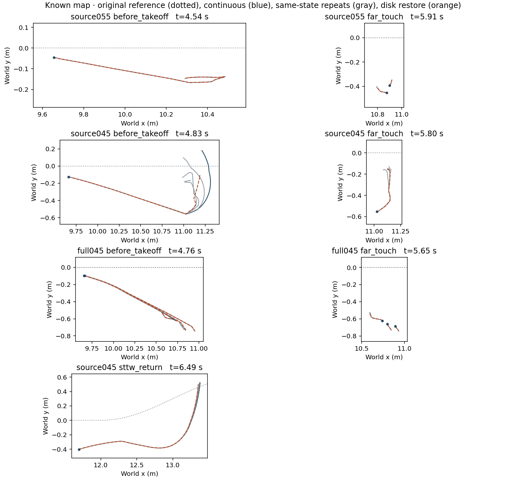

# P1 宽沟完整快照复验

**初版 12 条阶段轨迹中，8 条的磁盘恢复误差落在同状态重复范围内，4 条超出。** 起跳前、远岸触地后和实际回交后都有测量。恢复当步的位姿、速度、控制动作、地面控制历史和跳跃网络历史全部相同。P1 的整段数值验收仍未通过。

## 回交确实发生在一次飞越之后

已知开发地图，沟宽 0.45 米，使用冻结的原始 Source 与锁摆 H75。复用先前运行 5.800 秒的完整状态，接点位姿及速度与原轨迹逐项相同。以接点前原始记录和接点后的新仿真一起重算轮胎位置、质心及每毫秒接触载荷。

| route1 v3 的实测事件 | 结果 |
|---|---:|
| 全车连续无支撑 | 624 ms |
| 初始质心垂直速度 / 质心上升 | 2.62 m/s / 0.358 m |
| 沟上两轮最低净高 | 0.312 m |
| 远岸双轮承重 | 5.835 s |
| 交回锁摆 STTW / 保存完整状态 | 6.460 s / 6.480 s |
| 自然终点 | 8.020 s 驶出跟踪范围 |

[双视角实测录像](return.mp4) · [离地至落地六帧](jump.jpg) · [技能身份及实测数据](return.json)。视频以半速播放，完整飞行可从视频第 10.4 秒左右观看。本例满足预先定义的双轴空中跨岸，后轮蹬离附加标签为否。此前 0.55 米原始 Source 真跳并终点保持的单例与两次复跑见[上一阶段](../../p0_active_jump/RESULTS.md)。

## 连续、内存及磁盘恢复

三组各 36 条，从相同初始条件执行。0.55 米 Source、0.45 米 Source、0.45 米 Full RecoveryBridge Run 1 分别有 0、13、8 次严格空中跨岸，各组交回及到达目标均为 0。首次无回交后，用上述 5.800 秒已存状态另跑 36 条补回交，用真实起跳和双轮承重筛选；最早有合格证据的存档位于 6.480 秒。每批只对快照所记录阶段的实际车道评价。阶段轨迹可以来自同一车道，12 条并非 12 个独立种子。

比较连续轨迹和最后一次磁盘恢复，逐个字段、事件是否发生、时间和终止类型取同一真实观察窗口。有限基准取另外三次相同开始状态的运行之间的最大差，包括一次磁盘启动及两次内存恢复。单独两次内存恢复的差也保留。动作只在实际施加的时间点比较。12 条均复现终止类别，其中 11 条物理失败，1 条驶出跟踪范围。

| 技能、沟宽和时刻 | 全部字段在重复范围内 | 超界实例 |
|---|---:|---|
| Source 0.55 m，起跳前 / 远岸触地后 | 1/1、2/2 | 无 |
| Source 0.45 m，起跳前 / 远岸触地后 | 1/1、0/1 | 触地后最大 XY 差 5.49 cm，重复范围 1.61 cm |
| Full RB1 0.45 m，起跳前 / 远岸触地后 | 2/3、2/3 | 起跳前一条 XY 差 7.53 cm，重复范围 1.15 cm。触地后一条位姿及 RB 历史超界 |
| Source 0.45 m，实际回交后 | 0/1 | XY 差 2.409 cm，重复范围 2.361 cm。动作与控制历史也超界 |

远岸触地组捕获的是首次实测远岸接触附近仍有轮子承重的时刻，对每条完整飞越的认定另用双轮位置和载荷。各字段、分母、首次分歧步和真实终止见[逐例比较](continuity.json)。两种沟宽、两种地面几何及轮胎接触配置的 16 组各 36 条结果见[逐组汇总](contacts.csv)。Full RB1 的八组均无严格飞越后的双轮远岸承重与目标保持。

## 第一个 1 ms 的力从哪里开始分歧

在 5 个已保存车道状态上，固定整批状态、执行动作、关节锁定与阻尼，每处重复求解同一个 1 ms 物理步 5 次。既有版本中，执行器力、被动力、偏置和无约束加速度在五处均逐位相同。五处约束广义力均有差异，远岸触地例同一分量的最大极差为 0.11647，广义速度最大极差为 0.000232。广义量含平动与转动自由度，这些最大值按原字段记录。

候选实现在 GPU 上按几何体、接触点、接触坐标系和接触轴重排活动约束方程，保留原系数和接触地址映射。原物理参数、求解迭代数与动作不变。触地与回交各一处的这五次单步结果逐位相同，Full RB1 起跳前三处仍有差异。首次候选编译失败已修复，CPU 排列回归检查逐项核对 Jacobian、六种行系数和接触轴反向索引。[两版本逐字段单步数据](one_ms.json)。

原始评测位于本机 `active_jump_rebuild_map48/{handoff_snapshot_repeat,return_from_measured_flight,physics_first_substep,constraint_order_substep}`。完整轨迹复评采用同一组真实阶段快照，先连续推进一个 5 ms 控制步再分叉，用三次纯内存重复测基线。配置、输出及终态在 `active_jump_rebuild_map48/constraint_order_handoff`。

## 固定约束行顺序的整段复验

七组均正常结束，GPU 作业合计 38.5 分钟。连续运行从原存档推进 5 ms 后分叉，另取三次纯内存恢复的最大两两差作为逐例基准。12 条阶段轨迹有 **6 条**通过全部字段和事件验收。初轮 8/12 的恢复时刻及重复基准不同，两次比例不能直接衡量改进。

| 阶段 | 全部字段通过 | 关键结果 |
|---|---:|---|
| Source 0.55 m 起跳前、远岸接触后 | 1/1、2/2 | 三条轨迹在共同窗口内 XY 完全一致 |
| Source 0.45 m 起跳前、远岸接触后 | 0/1、1/1 | 起跳前连续轨迹驶出跟踪范围，三次内存及一次磁盘恢复均物理失败 |
| Full RB1 0.45 m 起跳前、远岸接触后 | 0/3、2/3 | 起跳前车道 10 的最大 XY 差 17.46 cm，重复范围 2.58 cm |
| Source 0.45 m 实际回交后 | 0/1 | 全部驶出跟踪范围。XY 差 2.34 cm，重复范围 1.37 cm |

[逐例字段、终止与误差](ordered_rows.json)。这组结果未达到 P1 的整段要求。

### 相同接触方程为何给出不同的力

沿用五个实际状态，每个状态用同一控制指令重复五次，观察第一个 1 ms 子步。在约束行已排序时，活动约束数、雅可比矩阵、约束质量和参考加速度在每个状态内逐位一致。Full RB1 起跳前的三个车道仍有接触力分歧。固定刚体内力、搜索方向范数和求解目标的求和顺序后，无约束加速度已一致，三个车道仍有接触力差异。

原 GPU Newton 求解器允许多个接触同时向同一摩擦锥 Hessian 矩阵元素累加。候选实现为每个世界的每个矩阵元素指定单一写入线程，沿已排序的接触法向方程求和。在前述修改上加入这一项后，五个状态各五次相同子步的全部 14 个记录字段逐位一致。CPU 回归将候选的约束代价与双接触 Hessian 对照原引擎，并检查有效自由度边界。开发中发现梯度缓冲有填充维度，正式对照采用修正后的有效自由度；初版探针排除。几何、接触参数、冻结策略与控制周期均沿用原配置。

[三个数值版本的逐字段极差](solver_probes.csv)。单步结果的适用范围限于这些状态。整段复验原始输出在本机 `active_jump_rebuild_map48/cone_order_handoff`，运行入口和冻结配置随批次保存。

最先完成的两组是 Full RB1 起跳前的三个车道，以及原始 Source 真跳后 6.485 秒已交回锁摆 STTW 的一个车道。四条阶段轨迹从分叉到共同真实终点，连续与磁盘恢复的位姿、速度、实际施加动作、网络及控制历史和终止时刻均逐位相同。三条仍物理失败，回交后一条仍驶出跟踪范围。[四条阶段轨迹比较](solver_first_two_groups.json)。七组完整验收待收齐。
