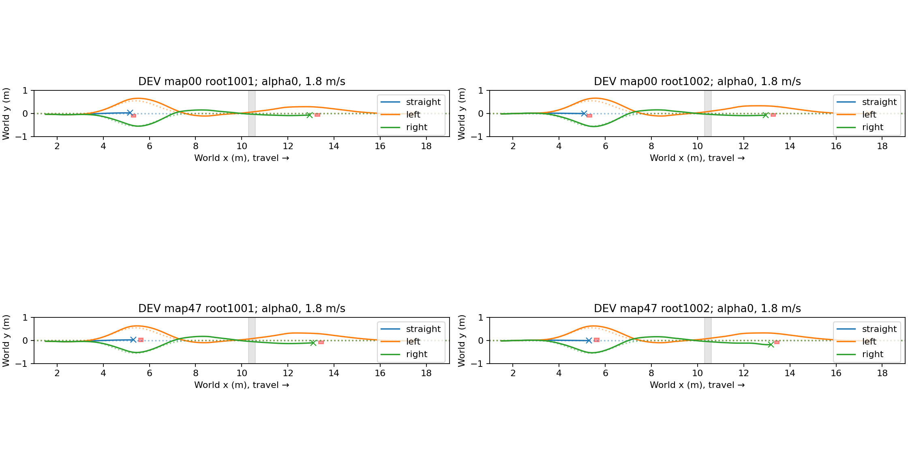

# P2真实同快照Oracle：接近阶段已完成

两张已知地图00/47×两根1001/1002×三接近路线，共12条。所有同根分支首帧qpos/qvel/controller_state/RB_state逐位一致。直线4/4在跳前撞障；左、右接近各4/4跨沟并交回，左接近原直线驶离4/4目标，右接近原直线驶离4/4落地后碰撞。尚不能据此认定右接近没有可行后续。

从八个真实交回状态各测试三条驶离，共24物理后缀；加12个失败前缀单元形成36格矩阵。沿原10秒总时钟，不重置物理/控制/历史，不改变目标。离线Oracle路线请求切换不冒充在线承诺前视更新。矩阵/配对视频/状态占据图仍待交付。

map00直线根1001在1.975秒base_collision与planning_obstacle_0的原生几何距离−0.004307m，支持实际碰撞归因；净空从保存的5ms位姿用mj_geomDistance重建，无物理重跑，不作连续碰撞界。
