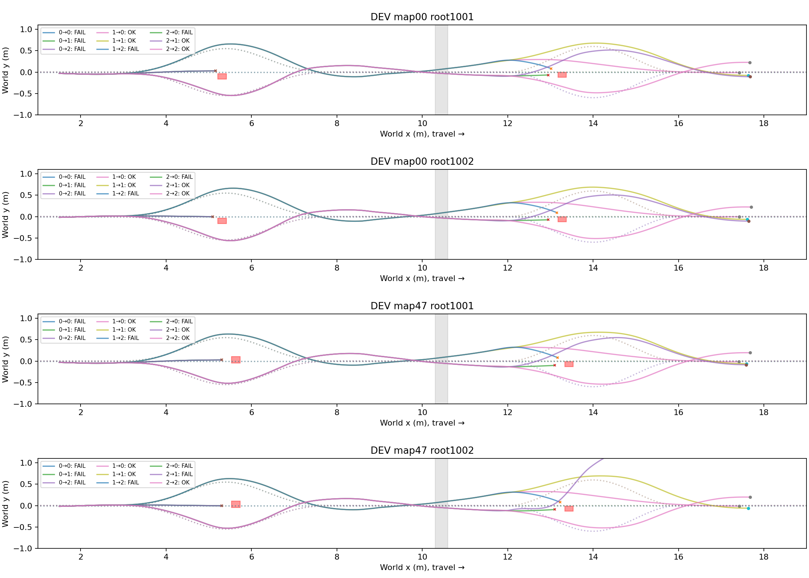

# P2首轮Oracle：未找到仅一种接近有后续的案例

两个已知DEV地图×两初态×三接近×三驶离=36格；15完成、12格跳前失败、8格落地后碰撞、1格落地后跟踪域退出。左右接近在每个初态均至少有一条可行后续，因此不支持目标机制案例。保留全部反例，不用固定直行后续的失败代替完整候选枚举。

路线0/1/2=直/左/右。每格仅表示当前三条有限驶离路线，不能解释为全部物理可能路线。

|地图/初态|直接近后直/左/右|左接近后直/左/右|右接近后直/左/右|
|---|---|---|---|
|0/1001|跳前失败 / 跳前失败 / 跳前失败|成功 / 成功 / 失败|失败 / 成功 / 成功|
|0/1002|跳前失败 / 跳前失败 / 跳前失败|成功 / 成功 / 失败|失败 / 成功 / 成功|
|47/1001|跳前失败 / 跳前失败 / 跳前失败|成功 / 成功 / 失败|失败 / 成功 / 成功|
|47/1002|跳前失败 / 跳前失败 / 跳前失败|成功 / 成功 / 失败|失败 / 失败 / 成功|

同根接近首帧及同交回快照的三驶离首帧qpos/qvel/controller_state/RB_state均逐位相同；验证记录[接近](approach_results.json)、[驶离](departure_identity.json)。模型记忆未参与本Oracle，它是实际仿真候选上界。

[完整36格CSV](oracle_matrix.csv)含全程时钟、失败阶段、源路径和原生几何最小障碍距离/时刻/车体部位。净空按5ms保存姿态计算，不是连续时域界；未用新预测器或学习结果替代真实轨迹。物理共12接近分支与24驶离后缀，另4条base用于建立初始快照；不把36格当36次独立完整运行。

原map00/47中右接近改驶离可恢复成功。下一次另存开发地图48，在x12.65–12.75、y−1.35–0.125加局部挡墙（沟后2m平地外），依据已知DEV轨迹设计；不是未见TEST、不是成功结论。冻结原10秒目标与物理/策略，重新真实运行验证，不覆盖本轮结果。
