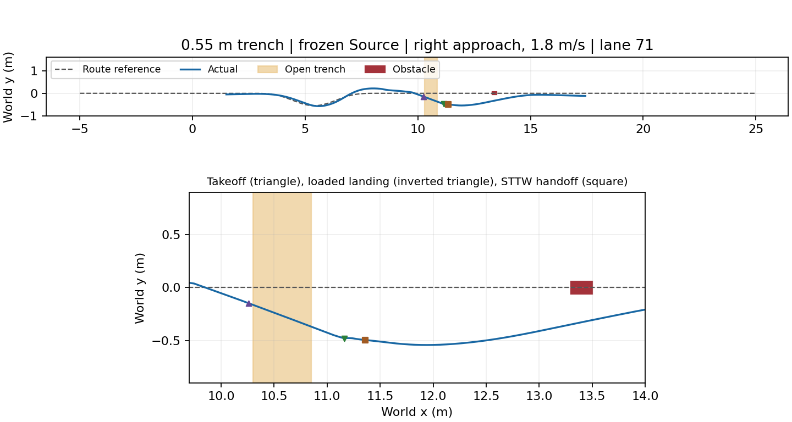

# P2 宽沟配对分叉

**0.55 米沟出现一条从接近、腾空到避障和终点保持的完整轨迹。** 在原始 Source 的 84 个触发候选中，初态 3、第 71 车道、右弯接近、1.8 m/s、距近岸 1.95 m 切换获得这条结果。录像由每 5 ms 保存的仿真位姿回放，接触力以 1 ms 采样。[完整录像](source_055_goal.mp4) · [实测事件](trigger_goal.json)

- 起跳前，后轮在近岸承重。全车连续卸载 495 ms，起跳竖直质心速度 2.10 m/s，质心升高 0.239 m，空中后轴越过远岸。轮胎与两侧岸体的最小距离下界为 1.86 mm。前轮起跳时已探出近岸，轮胎在沟内最低低于岸面 42.2 mm，因此“起飞时双轴均在近岸且沟上轮胎全程高于岸面”的严格指标记为 0。
- 6.350 s 双轮远岸承重，6.495 s 交回锁摆 STTW。全程禁区接触 0 步，车体与出口障碍的逐帧三维距离下界为 0.127 m。9.915 s 达到终点保持 0.505 s。
- 触发筛查使用两种冻结技能、两张已知地图；初态标签 TRAIN。每组 84 个候选，按方案计数。两车道复验选择了 10 个接近方案，均未到达合格落地，30 个矩阵单元均未完成。同参数对批次布局敏感，单条成功仍不足以确认跨阶段选择规律。[全部 336 个候选](trigger_cases.csv) · [复验 30 个单元](trigger_replays.csv)

| 沟宽 | 冻结技能 | 飞越 / 候选 | 远岸双轮承重 | 交回 STTW | 终点保持 |
|---|---|---:|---:|---:|---:|
| 0.45 m | Full RB Run 1 | 14/84 | 3 | 0 | 0 |
| 0.45 m | Source | 21/84 | 10 | 0 | 0 |
| 0.55 m | Full RB Run 1 | 1/84 | 0 | 0 | 0 |
| 0.55 m | Source | 3/84 | 1 | 1 | 1 |

## 从同一完整初态复验成功与失败

第 71 车道使用成功时的完整 84 车道快照，保留其余 83 车道指令。重复右弯接近后，位姿、速度、控制器历史、跳跃网络历史、实际动作和轨迹全部逐项相同，再次到达终点。将该车道改为左弯接近，速度同为 1.8 m/s、距近岸 1.85 m 触发，整车卸载 632 ms、质心升高 0.388 m，双轴严格飞越，沟上轮胎净高至少 0.215 m。随后有远岸接触，但在 6.195 s 物理失败，未达到双轮承重或 STTW 接管条件。[右弯成功录像](source_055_goal.mp4) · [左弯飞越后失败录像](source_055_left_failure.mp4) · [重复运行字段](reference_replay.json)

成功方案在 6.350 s 的同一落地快照还执行了三种驶离指令。保持原路线在 9.915 s 达到目标；改为左绕在 7.670 s 接触禁区；改为右绕避开障碍，到 10.000 s 超时。连续段和新分支在拼接点的位置、速度逐项相同。10.000 s 取自右绕实际最后一帧，旧运行摘要错误地继承了生成初态快照时的 0.005 s 时限。完整接近配对仍在筛查，当前左弯反例的失败发生在完成落地之前。[同车道已执行矩阵](matched_lane71.csv)

## 固定触发位置的首轮配对

**0.45 米沟已找到同一初态、不同接近路线均真实飞越的配对；两个方案都没有完成落地后的任务。** 两张已知开发地图各用两个初态，从同一个完整快照分别发布直行、左弯、右弯接近和 1.8、1.9 m/s 请求。跳跃技能接管的位置和 α 在各技能内固定。沟沿用前后各两米平地区；出口禁行障碍位于 x=13.3–13.5 m。0.45 和 0.55 米地图的轮胎接触配置不同，跨图差异不能单独归因于沟宽。

| 沟宽 | 冻结技能 | 接近方案数 | 经载荷与位姿确认的飞越 | 随后远岸双轮承重 | 有可行驶离方案 |
|---|---|---:|---:|---:|---:|
| 0.45 m | Full RecoveryBridge Run 1 | 12 | 2 | 0 | 0 |
| 0.45 m | 原始 Source | 12 | 8 | 1 | 0 |
| 0.55 m | Full RecoveryBridge Run 1 | 12 | 0 | 0 | 0 |
| 0.55 m | 原始 Source | 12 | 0 | 0 | 0 |

48 个接近方案各对应三个驶离指令，共 144 个矩阵单元。47 个前缀未得到合格落地，保留对应的 141 个单元。唯一合格的落地保留原直行后缀，再从其完整快照真实执行左绕、右绕，三个后缀都在锁摆 STTW 接管前物理失败。[完整矩阵](oracle_matrix.csv)中的障碍距离为每 5 ms 用碰撞几何包围盒计算的三维分离距离下界；物理碰撞另由仿真判定。原生几何距离查询曾在明显分离时返回零，发布矩阵已从存档位姿重算。

## 同初态、同速的两次真实飞越

0.45 米沟，Source，初态 0，速度 1.8 m/s。两条轨迹都满足严格的双轴空中跨岸判据。

| 实测量 | 左弯接近 | 右弯接近 |
|---|---:|---:|
| 整车连续卸载 | 658 ms | 658 ms |
| 质心上升 | 0.436 m | 0.433 m |
| 沟上轮胎最低净高 | 0.274 m | 0.317 m |
| 远岸双轮同时承重 | 未达到 | 6.715 s |
| 原直行后缀物理失败时刻 | 6.765 s | 6.935 s |
| 全程距禁行障碍的保守下界 | 2.156 m | 1.619 m |

[左弯接近录像](source_root0_left_1.8_straight.mp4) · [右弯接近录像](source_root0_right_1.8_straight.mp4) · [起跳、腾空及初次触地六帧](paired_flight.jpg) · [状态与占据图](paired_states_occupancy.png)。视频为原始姿态半速回放，约第 11.5 秒开始起跳。占据图每 0.1 s 显示一次整车碰撞几何的 XY 外包范围。

在相同地图、技能与初态内，两两比较路线或速度不同的接近方案。120/120 对起始位姿、速度、跳跃网络历史相同；在两者仍处于 STTW 接近阶段时，120/120 对实际施加的执行器目标和 XY 均有差异，最大成对 XY 分离 1.291 m。由此可见指令能改变真实接近过程。现有证据的瓶颈在飞越后的承重与交回。原始目录为本机 `active_jump_rebuild_map48/p2_physical_oracle`，`analysis/` 内保留逐对指令记录和完整矩阵。后续触发位置试验单独登记。
