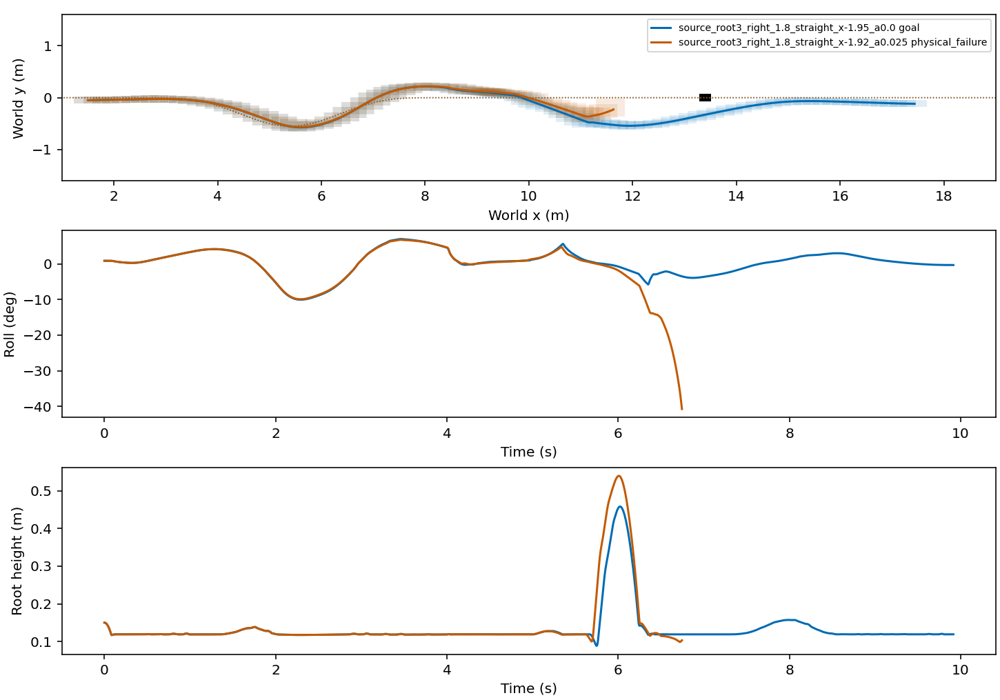
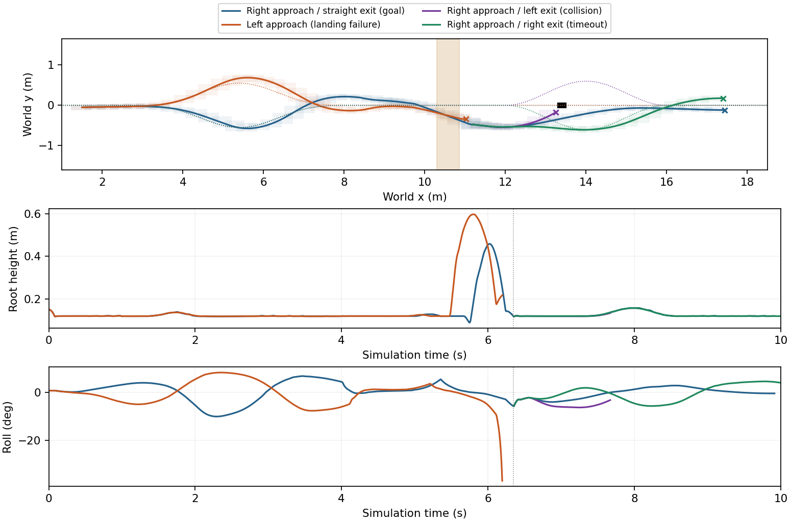
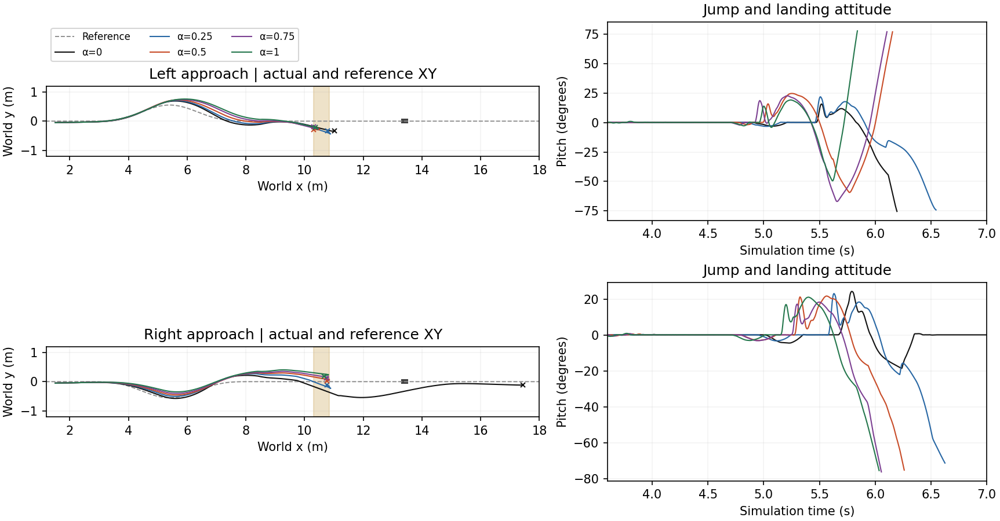

# P2 宽沟配对分叉

**同一完整初态，两种接近方案均实测飞越并双轮落地；只有 A 在本轮三个驶离候选中有可行后续。** 已知 TRAIN 地图，根 3、车道 51、0.55 m 原生接触、冻结 Source、右弯接近、请求速度 1.8 m/s。两个接近方案的初始位姿、速度、控制与网络历史逐项相同；每种分别与其筛查复跑的位姿、速度、两类历史和实际指令整段相同。末端保持要求 0.500 s，统一截止 10 s。

| 方案（接近 α，提前触发距离） | 整车卸载 / 质心升高 | 双轮远岸承重 / 交回锁摆 | 原路线 | 左绕 | 右绕 |
|---|---|---|---|---|---|
| A（0，1.95 m） | 495 ms / 0.239 m | 6.350 / 6.495 s | 9.915 s 完成 | 7.670 s 碰禁区 | 到时保持 0.430 s，失败 |
| B（0.025，1.92 m） | 561 ms / 0.311 m | 6.500 s / 未交回 | 6.745 s 失稳 | 同时刻失稳 | 同时刻失稳 |

[成功录像 A](source_root3_right_1.8_straight_x-1.95_a0.0.mp4) · [落地后失稳录像 B](source_root3_right_1.8_straight_x-1.92_a0.025.mp4) · [六个单元原始矩阵](dual_landing_matrix.csv)。两条视频均按记录位姿半速回放，第 12 秒为仿真 6.000 s；此时两条轨迹都在飞行中。实际告警和载荷记录以原始轨迹为准。两个方案均不满足更严的双轴岸面上方判据；本配对核验后轮近岸支撑、整车卸载、升高、远岸双轮承重。候选分叉点核对位姿与速度一致。B 在能执行驶离转向前就已失稳；不能写成 B 被障碍撞倒，不能隔离 α 与触发位置的单独作用，不能推断独立测试成功率。

以下为较早的筛查与对照。

**0.55 米沟出现一条从接近、腾空到避障和终点保持的完整轨迹。** 在原始 Source 的 84 个触发候选中，初态 3、第 71 车道、右弯接近、1.8 m/s、距近岸 1.95 m 切换获得这条结果。录像由每 5 ms 保存的仿真位姿回放，接触力以 1 ms 采样。[完整录像](source_055_goal.mp4) · [实测事件](trigger_goal.json)

- 起跳前，后轮在近岸承重。全车连续卸载 495 ms，起跳竖直质心速度 2.10 m/s，质心升高 0.239 m，空中后轴越过远岸。轮胎与两侧岸体的最小距离下界为 1.86 mm。前轮起跳时已探出近岸，轮胎在沟内最低低于岸面 42.2 mm，因此“起飞时双轴均在近岸且沟上轮胎全程高于岸面”的严格指标记为 0。
- 6.350 s 双轮远岸承重，6.495 s 交回锁摆 STTW。全程禁区接触 0 步，车体与出口障碍的逐帧三维距离下界为 0.127 m。9.915 s 达到终点保持 0.505 s。
- 触发筛查使用两种冻结技能、两张已知地图；初态标签 TRAIN。每组 84 个候选，按方案计数。两车道复验选择了 10 个接近方案，均未到达合格落地，30 个矩阵单元均未完成。同参数对批次布局敏感，单条成功仍不足以确认跨阶段选择规律。[全部 336 个候选](trigger_cases.csv) · [复验 30 个单元](trigger_replays.csv)

| 沟宽 | 冻结技能 | 飞越 / 候选 | 远岸双轮承重 | 交回 STTW | 终点保持 |
|---|---|---:|---:|---:|---:|
| 0.45 m | Full RB Run 1 | 14/84 | 3 | 0 | 0 |
| 0.45 m | Source | 21/84 | 10 | 0 | 0 |
| 0.55 m | Full RB Run 1 | 1/84 | 0 | 0 | 0 |
| 0.55 m | Source | 3/84 | 1 | 1 | 1 |

## 从同一完整初态复验成功与失败

第 71 车道使用成功时的完整 84 车道快照，保留其余 83 车道指令。重复右弯接近后，位姿、速度、控制器历史、跳跃网络历史、实际动作和轨迹全部逐项相同，再次到达终点。将该车道改为左弯接近，速度同为 1.8 m/s、距近岸 1.85 m 触发，整车卸载 632 ms、质心升高 0.388 m，双轴严格飞越，沟上轮胎净高至少 0.215 m。随后有远岸接触，但在 6.195 s 物理失败，终止帧侧倾 −37.1°、俯仰 −75.4°，未达到双轮承重或 STTW 接管条件。[右弯成功录像](source_055_goal.mp4) · [左弯飞越后失败录像](source_055_left_failure.mp4) · [重复运行字段](reference_replay.json)

成功轨迹上，跳前 800 个和交回后 684 个有效 STTW 指令中，髋、膝目标各自在所在阶段保持固定；实测关节与锁定值的最大偏差为 0.000036 rad。双轮承重帧前后轮分别为 494 N、52 N。两种接近的实际 XY 最大分离 1.263 m；路线与触发位置同时改变，因此无法分辨哪一项单独导致了落地差异。[控制动作与锁摆记录](matched_controls.json)

成功方案在 6.350 s 的同一落地快照还执行了三种驶离指令。保持原路线在 9.915 s 达到目标；改为左绕在 7.670 s 接触禁区；改为右绕避开障碍，到 10.000 s 时已在目标区保持 0.430 s，距规定的 0.500 s 还差 0.070 s，记为超时。连续段和新分支在拼接点的位置、速度逐项相同。10.000 s 取自右绕实际最后一帧，旧运行摘要错误地继承了生成初态快照时的 0.005 s 时限。8 个接近方案、24 个矩阵单元全部完成。距岸 1.94 m 和 1.95 m 触发的右弯在本次采样下产生完全相同的位姿、动作和终点；矩阵有 2 个成功单元，对应同一条物理轨迹。左弯反例的失败发生在完成落地之前。[同车道已执行矩阵](matched_lane71.csv)

## 同一初态改变接近阶段的 α

保留上面的左右两套接近方案、1.8 m/s 请求、同一完整初态和 GPU 车道，仅改变接近 α。跳跃技能仍是冻结 Source，落地后的 STTW α 始终为 0。表中括号内为首次轮胎远岸接触的仿真时间。α=0 复用已验收的配对轨迹。

| 接近 α | 左弯结果 | 右弯结果 |
|---|---|---|
| 0 | 真实飞越，远岸接触（6.115 s）后失败 | 真实飞越，远岸接触（6.240 s），承重、交回并完成 |
| 0.25 | 远岸接触（6.095 s）后失败 | 远岸接触（6.220 s）后失败 |
| 0.50 | 物理失败，无远岸接触 | 远岸接触（5.940 s）后失败 |
| 0.75 | 物理失败，无远岸接触 | 远岸接触（5.985 s）后失败 |
| 1.00 | 物理失败，无远岸接触 | 物理失败，无远岸接触 |

8 个新接近方案均未通过飞越判据。相对相同路线的 α=0，对应接近阶段的最大实际 XY 差异为 0.087–0.380 m，最大转向目标差异为 0.038–0.113 rad。右弯交给 Source 的时间从 4.000 s 提前至 3.800 s，左弯从 4.100 s 提前至 3.920 s。8 个方案均未到达合格的落地快照，因此 24 个矩阵单元都记为前段失败，实际驶离分叉数为 0。这组开发样本没有显示提高接近 α 能改善落地。[逐方案数值](approach_alpha_events.csv) · [24 个矩阵单元](approach_alpha_matrix.csv)

[相同初态和速度请求下，Source 接管瞬间的实测速率](approach_alpha_entry_speed.csv)。取首次技能接管帧的世界水平速度沿车头航向的投影。根 3、车道 71、右弯接近时，α=0、0.5、1 的实测依次为 1.794、1.829、2.037 m/s，只有 α=0 稳定交回。左弯依次为 1.822、1.833、1.845 m/s，三者均未稳定交回。右弯两端相差 0.243 m/s，且入沟位置与航向也不同；三个相同的 1.8 m/s 请求不足以构成实速匹配的 H4 对照。六条历史轨迹在此按原条件重读，数据角色为已知开发图。

## 固定触发位置的首轮配对

**0.45 米沟已找到同一初态、不同接近路线均真实飞越的配对；两个方案都没有完成落地后的任务。** 两张已知开发地图各用两个初态，从同一个完整快照分别发布直行、左弯、右弯接近和 1.8、1.9 m/s 请求。跳跃技能接管的位置和 α 在各技能内固定。沟沿用前后各两米平地区；出口禁行障碍位于 x=13.3–13.5 m。0.45 和 0.55 米地图的轮胎接触配置不同，跨图差异不能单独归因于沟宽。

| 沟宽 | 冻结技能 | 接近方案数 | 经载荷与位姿确认的飞越 | 随后远岸双轮承重 | 有可行驶离方案 |
|---|---|---:|---:|---:|---:|
| 0.45 m | Full RecoveryBridge Run 1 | 12 | 2 | 0 | 0 |
| 0.45 m | 原始 Source | 12 | 8 | 1 | 0 |
| 0.55 m | Full RecoveryBridge Run 1 | 12 | 0 | 0 | 0 |
| 0.55 m | 原始 Source | 12 | 0 | 0 | 0 |

48 个接近方案各对应三个驶离指令，共 144 个矩阵单元。47 个前缀未得到合格落地，保留对应的 141 个单元。唯一合格的落地保留原直行后缀，再从其完整快照真实执行左绕、右绕，三个后缀都在锁摆 STTW 接管前物理失败。[完整矩阵](oracle_matrix.csv)中的障碍距离为每 5 ms 用碰撞几何包围盒计算的三维分离距离下界；物理碰撞另由仿真判定。原生几何距离查询曾在明显分离时返回零，发布矩阵已从存档位姿重算。

## 同初态、同速的两次真实飞越

0.45 米沟，Source，初态 0，速度 1.8 m/s。两条轨迹都满足严格的双轴空中跨岸判据。

| 实测量 | 左弯接近 | 右弯接近 |
|---|---:|---:|
| 整车连续卸载 | 658 ms | 658 ms |
| 质心上升 | 0.436 m | 0.433 m |
| 沟上轮胎最低净高 | 0.274 m | 0.317 m |
| 远岸双轮同时承重 | 未达到 | 6.715 s |
| 原直行后缀物理失败时刻 | 6.765 s | 6.935 s |
| 全程距禁行障碍的保守下界 | 2.156 m | 1.619 m |

[左弯接近录像](source_root0_left_1.8_straight.mp4) · [右弯接近录像](source_root0_right_1.8_straight.mp4) · [起跳、腾空及初次触地六帧](paired_flight.jpg) · [状态与占据图](paired_states_occupancy.png)。视频为原始姿态半速回放，约第 11.5 秒开始起跳。占据图每 0.1 s 显示一次整车碰撞几何的 XY 外包范围。

在相同地图、技能与初态内，两两比较路线或速度不同的接近方案。120/120 对起始位姿、速度、跳跃网络历史相同；在两者仍处于 STTW 接近阶段时，120/120 对实际施加的执行器目标和 XY 均有差异，最大成对 XY 分离 1.291 m。由此可见指令能改变真实接近过程。现有证据的瓶颈在飞越后的承重与交回。原始目录为本机 `active_jump_rebuild_map48/p2_physical_oracle`，`analysis/` 内保留逐对指令记录和完整矩阵。后续触发位置试验单独登记。
