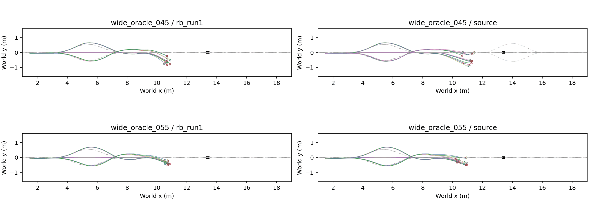

# P2 宽沟配对分叉

**0.45 米沟已找到同一初态、不同接近路线均真实飞越的配对；两个方案都没有完成落地后的任务。** 两张已知开发地图各用两个初态，从同一个完整快照分别发布直行、左弯、右弯接近和 1.8、1.9 m/s 请求。跳跃技能接管的位置和 α 在各技能内固定。沟沿用前后各两米平地区；出口禁行障碍位于 x=13.3–13.5 m。0.45 和 0.55 米地图的轮胎接触配置不同，跨图差异不能单独归因于沟宽。

| 沟宽 | 冻结技能 | 接近方案数 | 经载荷与位姿确认的飞越 | 随后远岸双轮承重 | 有可行驶离方案 |
|---|---|---:|---:|---:|---:|
| 0.45 m | Full RecoveryBridge Run 1 | 12 | 2 | 0 | 0 |
| 0.45 m | 原始 Source | 12 | 8 | 1 | 0 |
| 0.55 m | Full RecoveryBridge Run 1 | 12 | 0 | 0 | 0 |
| 0.55 m | 原始 Source | 12 | 0 | 0 | 0 |

48 个接近方案各对应三个驶离指令，共 144 个矩阵单元。47 个前缀未得到合格落地，保留对应的 141 个单元。唯一合格的落地保留原直行后缀，再从其完整快照真实执行左绕、右绕，三个后缀都在锁摆 STTW 接管前物理失败。[完整矩阵](oracle_matrix.csv)中的障碍距离为每 5 ms 用碰撞几何包围盒计算的三维分离距离下界；物理碰撞另由仿真判定。原生几何距离查询曾在明显分离时返回零，发布矩阵已从存档位姿重算。

## 同初态、同速的两次真实飞越

0.45 米沟，Source，初态 0，速度 1.8 m/s。两条轨迹都满足严格的双轴空中跨岸判据。

| 实测量 | 左弯接近 | 右弯接近 |
|---|---:|---:|
| 整车连续卸载 | 658 ms | 658 ms |
| 质心上升 | 0.436 m | 0.433 m |
| 沟上轮胎最低净高 | 0.274 m | 0.317 m |
| 远岸双轮同时承重 | 未达到 | 6.715 s |
| 原直行后缀物理失败时刻 | 6.765 s | 6.935 s |
| 全程距禁行障碍的保守下界 | 2.156 m | 1.619 m |

[左弯接近录像](source_root0_left_1.8_straight.mp4) · [右弯接近录像](source_root0_right_1.8_straight.mp4) · [起跳、腾空及初次触地六帧](paired_flight.jpg) · [状态与占据图](paired_states_occupancy.png)。视频为原始姿态半速回放，约第 11.5 秒开始起跳。占据图每 0.1 s 显示一次整车碰撞几何的 XY 外包范围。

在相同地图、技能与初态内，两两比较路线或速度不同的接近方案。120/120 对起始位姿、速度、跳跃网络历史相同；在两者仍处于 STTW 接近阶段时，120/120 对实际施加的执行器目标和 XY 均有差异，最大成对 XY 分离 1.291 m。由此可见指令能改变真实接近过程。现有证据的瓶颈在飞越后的承重与交回。原始目录为本机 `active_jump_rebuild_map48/p2_physical_oracle`，`analysis/` 内保留逐对指令记录和完整矩阵。后续触发位置试验单独登记。
