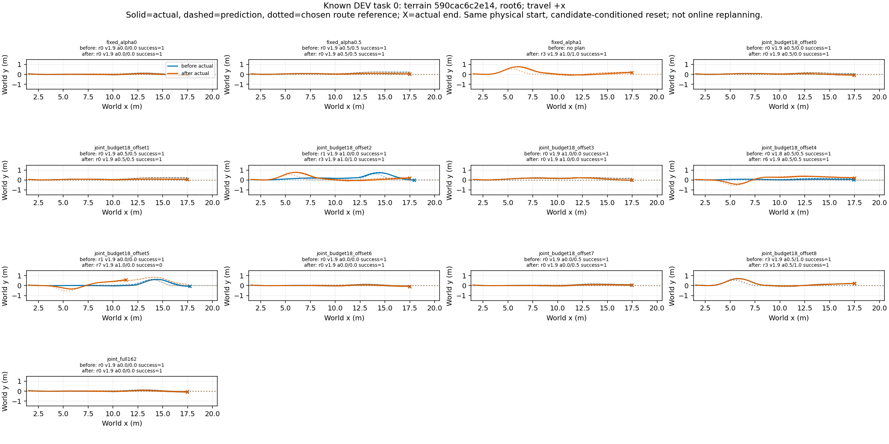
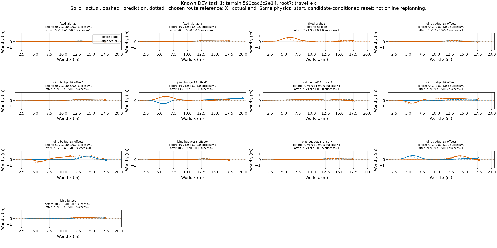
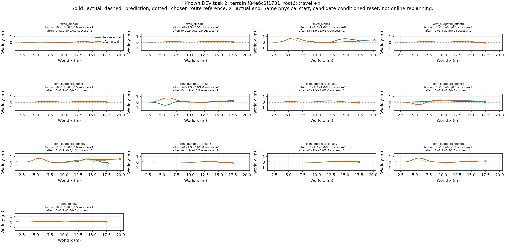
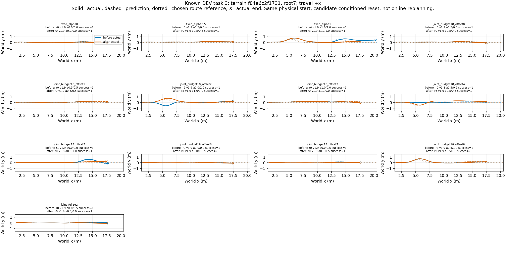

# P5 有限路线/速度/阶段α选择

仅4个已知DEV地图/初态任务，非独立TEST。每任务候选为9路线×2速度×9阶段α组合=162；最终方法条件104，选择引用51条已有真实运行，未新增物理执行。九个等预算候选排列重复同4任务，不能当独立种子。speed-only在本协议等同fixed-alpha0，不重复宣称一个独立算法。

|方法|每任务查询|入口暴露前成功/4|入口暴露后成功/4|
|---|---:|---:|---:|
|固定α0／仅选速度（同时选路线）|18|4|4|
|固定α0.5|18|4|4|
|固定α1|18|0（2无方案）|4|
|速度+阶段α完整枚举|162|4|4|
|速度+阶段α，18查询offset0|18|4|4|
|offset1|18|4|4|
|offset2|18|3|4|
|offset3|18|4|4|
|offset4|18|4|4|
|offset5|18|4|1|
|offset6|18|4|4|
|offset7|18|4|4|
|offset8|18|4|4|

**没有观察到α选择相对固定α0的任务成功率收益。** 固定α0已经4/4；完整枚举增加查询没有提高成功分母。入口暴露改善固定α1选择，但等预算offset5退步：两例tracking_domain_exit、一例timeout。不能用某个最好排列掩盖该反例，也不能把原始准入率提高称为可靠性提升。

选择仅使用预测admitted及goal_time_s，按预定alpha/route/speed破同分，实际标签只用于事后评分和Oracle可行解存在性。全部方法/任务均存在实际可行候选；no-plan并非物理不可行。各查询子集、选择和原始轨迹见decisions.json；未校准raw gates，研究结论仅限该已知DEV筛查。

初态审查发现：物理qpos/qvel、RB历史及非reset控制器carry逐值一致，但reset()按候选指令生成末帧参考、nominal/rates及路径projection/follower字段。因此这是**任务开始时选择方案、随后候选条件初始化**，不是行驶中同完整快照重规划。差异和身份核验在contract.json保留，未静默忽略。路线/速度/阶段α选择及候选排列协议是在已有DEV误差审查后定义的探索性比较，不宣称预注册。

源码：learning/cli/compare_conditional_alpha_selection.py。原始运行/预测复用，未改变物理、成功门槛或训练标签。P5完整RB对照、校准与独立最终验证仍未完成，P6未完成。
