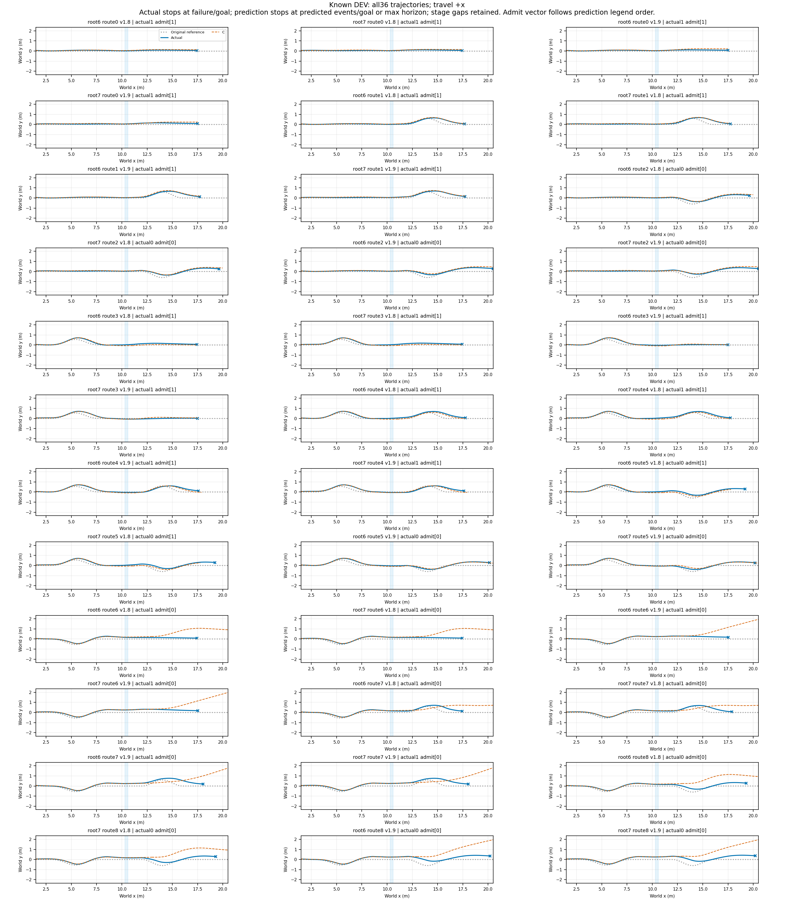
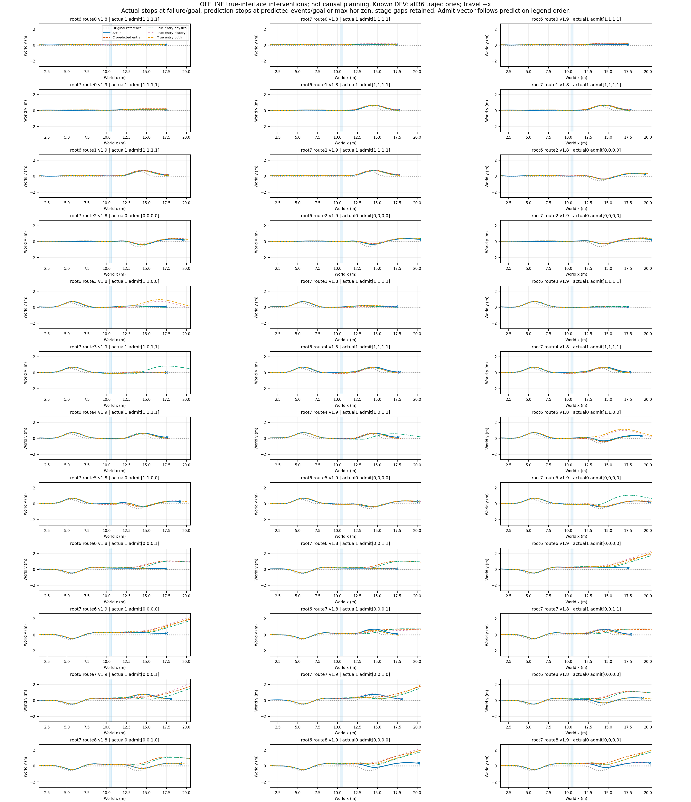

# P5 条件完整串联：已知DEV诊断

完整648例均保留实际/原参考/预测图：
- [alpha_source18](/media/qy/6A7E3DB07E3D75C3/STTW_runs/chapter3_playground_sttw_rb_sttw/taskbook_20261115_p5_alpha_models/conditional_chain/grid/reports/alpha_source18/xy.png)
- [alpha_source19](/media/qy/6A7E3DB07E3D75C3/STTW_runs/chapter3_playground_sttw_rb_sttw/taskbook_20261115_p5_alpha_models/conditional_chain/grid/reports/alpha_source19/xy.png)
- [alpha_source20](/media/qy/6A7E3DB07E3D75C3/STTW_runs/chapter3_playground_sttw_rb_sttw/taskbook_20261115_p5_alpha_models/conditional_chain/grid/reports/alpha_source20/xy.png)
- [alpha_source21](/media/qy/6A7E3DB07E3D75C3/STTW_runs/chapter3_playground_sttw_rb_sttw/taskbook_20261115_p5_alpha_models/conditional_chain/grid/reports/alpha_source21/xy.png)
- [alpha_source22](/media/qy/6A7E3DB07E3D75C3/STTW_runs/chapter3_playground_sttw_rb_sttw/taskbook_20261115_p5_alpha_models/conditional_chain/grid/reports/alpha_source22/xy.png)
- [alpha_source23](/media/qy/6A7E3DB07E3D75C3/STTW_runs/chapter3_playground_sttw_rb_sttw/taskbook_20261115_p5_alpha_models/conditional_chain/grid/reports/alpha_source23/xy.png)
- [alpha_source24](/media/qy/6A7E3DB07E3D75C3/STTW_runs/chapter3_playground_sttw_rb_sttw/taskbook_20261115_p5_alpha_models/conditional_chain/grid/reports/alpha_source24/xy.png)
- [alpha_source25](/media/qy/6A7E3DB07E3D75C3/STTW_runs/chapter3_playground_sttw_rb_sttw/taskbook_20261115_p5_alpha_models/conditional_chain/grid/reports/alpha_source25/xy.png)
- [alpha_source26](/media/qy/6A7E3DB07E3D75C3/STTW_runs/chapter3_playground_sttw_rb_sttw/taskbook_20261115_p5_alpha_models/conditional_chain/grid/reports/alpha_source26/xy.png)
- [alpha_source27](/media/qy/6A7E3DB07E3D75C3/STTW_runs/chapter3_playground_sttw_rb_sttw/taskbook_20261115_p5_alpha_models/conditional_chain/grid/reports/alpha_source27/xy.png)
- [alpha_source28](/media/qy/6A7E3DB07E3D75C3/STTW_runs/chapter3_playground_sttw_rb_sttw/taskbook_20261115_p5_alpha_models/conditional_chain/grid/reports/alpha_source28/xy.png)
- [alpha_source29](/media/qy/6A7E3DB07E3D75C3/STTW_runs/chapter3_playground_sttw_rb_sttw/taskbook_20261115_p5_alpha_models/conditional_chain/grid/reports/alpha_source29/xy.png)
- [alpha_source30](/media/qy/6A7E3DB07E3D75C3/STTW_runs/chapter3_playground_sttw_rb_sttw/taskbook_20261115_p5_alpha_models/conditional_chain/grid/reports/alpha_source30/xy.png)
- [alpha_source31](/media/qy/6A7E3DB07E3D75C3/STTW_runs/chapter3_playground_sttw_rb_sttw/taskbook_20261115_p5_alpha_models/conditional_chain/grid/reports/alpha_source31/xy.png)
- [alpha_source32](/media/qy/6A7E3DB07E3D75C3/STTW_runs/chapter3_playground_sttw_rb_sttw/taskbook_20261115_p5_alpha_models/conditional_chain/grid/reports/alpha_source32/xy.png)
- [alpha_source33](/media/qy/6A7E3DB07E3D75C3/STTW_runs/chapter3_playground_sttw_rb_sttw/taskbook_20261115_p5_alpha_models/conditional_chain/grid/reports/alpha_source33/xy.png)
- [alpha_source34](/media/qy/6A7E3DB07E3D75C3/STTW_runs/chapter3_playground_sttw_rb_sttw/taskbook_20261115_p5_alpha_models/conditional_chain/grid/reports/alpha_source34/xy.png)
- [alpha_source35](/media/qy/6A7E3DB07E3D75C3/STTW_runs/chapter3_playground_sttw_rb_sttw/taskbook_20261115_p5_alpha_models/conditional_chain/grid/reports/alpha_source35/xy.png)

两张地图、九种阶段α组合、两速度、九路线、两初态，共648条件；仅预测查询，物理结果复用已冻结DEV399成功/249失败。正确准入242、误准入41、误拒绝157、正确拒绝208。无新裕量校准，不能称可靠规划或独立TEST；每单元见cells.json，每例见cases.json。复用36已完成查询，其余预测62.13秒。

首组中间α36例的2误准入为route5、1.8m/s两个初态，实际timeout但预测9.22–9.24秒完成。8误拒绝集中上游分支2的route6/7，缺少可接受交回/锁定状态；不能从此推断机器人实际跳跃失败。

|离线入口替换|正确准入|误准入|误拒绝|正确拒绝|
|---|---:|---:|---:|---:|
|无，原串联|16|2|8|10|
|真实物理状态|14|2|10|10|
|真实历史|18|1|6|11|
|两者|20|0|4|12|

互换使用未来真实入口，只作误差传播诊断，不能部署。单独物理替换非单调改善，联合入口误差值得处理。所有执行门槛、物理和控制技能未修改。

后续已缓存648 TRAIN及648 DEV的因果预测入口，按原划分供既有50% TRAIN入口暴露训练；训练结果尚未计入本报告。完整输入身份见原始conditional_chain/selection.json，缓存来源见conditional_jump/entry_exposure600/entry_sources.json。

[预测入口暴露后的配对结果](entry_exposure/README.md)：正确准入336、误准入56、误拒绝63、正确拒绝193；召回提升但准入风险上升，未采用。
