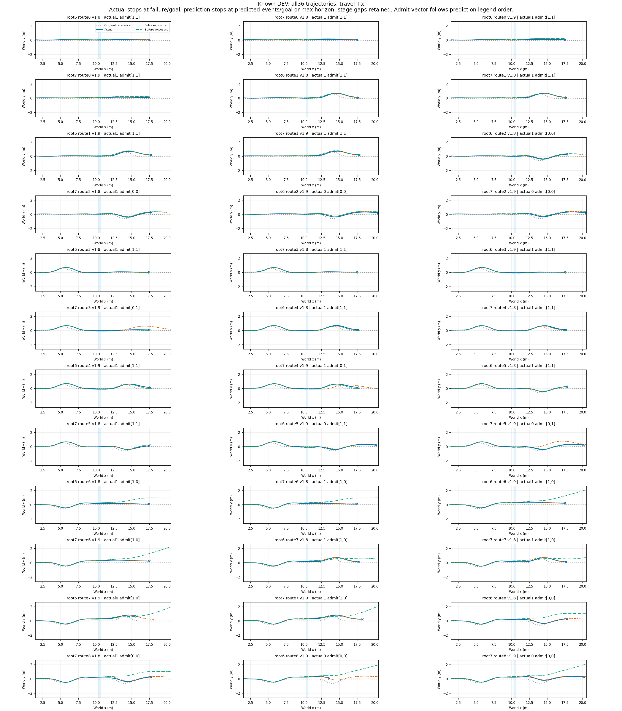

# 预测入口暴露后的配对全链结果

全部648例的配对图：
- [alpha_source18](/media/qy/6A7E3DB07E3D75C3/STTW_runs/chapter3_playground_sttw_rb_sttw/taskbook_20261115_p5_alpha_models/conditional_chain_exposure/grid/reports/alpha_source18/xy.png)
- [alpha_source19](/media/qy/6A7E3DB07E3D75C3/STTW_runs/chapter3_playground_sttw_rb_sttw/taskbook_20261115_p5_alpha_models/conditional_chain_exposure/grid/reports/alpha_source19/xy.png)
- [alpha_source20](/media/qy/6A7E3DB07E3D75C3/STTW_runs/chapter3_playground_sttw_rb_sttw/taskbook_20261115_p5_alpha_models/conditional_chain_exposure/grid/reports/alpha_source20/xy.png)
- [alpha_source21](/media/qy/6A7E3DB07E3D75C3/STTW_runs/chapter3_playground_sttw_rb_sttw/taskbook_20261115_p5_alpha_models/conditional_chain_exposure/grid/reports/alpha_source21/xy.png)
- [alpha_source22](/media/qy/6A7E3DB07E3D75C3/STTW_runs/chapter3_playground_sttw_rb_sttw/taskbook_20261115_p5_alpha_models/conditional_chain_exposure/grid/reports/alpha_source22/xy.png)
- [alpha_source23](/media/qy/6A7E3DB07E3D75C3/STTW_runs/chapter3_playground_sttw_rb_sttw/taskbook_20261115_p5_alpha_models/conditional_chain_exposure/grid/reports/alpha_source23/xy.png)
- [alpha_source24](/media/qy/6A7E3DB07E3D75C3/STTW_runs/chapter3_playground_sttw_rb_sttw/taskbook_20261115_p5_alpha_models/conditional_chain_exposure/grid/reports/alpha_source24/xy.png)
- [alpha_source25](/media/qy/6A7E3DB07E3D75C3/STTW_runs/chapter3_playground_sttw_rb_sttw/taskbook_20261115_p5_alpha_models/conditional_chain_exposure/grid/reports/alpha_source25/xy.png)
- [alpha_source26](/media/qy/6A7E3DB07E3D75C3/STTW_runs/chapter3_playground_sttw_rb_sttw/taskbook_20261115_p5_alpha_models/conditional_chain_exposure/grid/reports/alpha_source26/xy.png)
- [alpha_source27](/media/qy/6A7E3DB07E3D75C3/STTW_runs/chapter3_playground_sttw_rb_sttw/taskbook_20261115_p5_alpha_models/conditional_chain_exposure/grid/reports/alpha_source27/xy.png)
- [alpha_source28](/media/qy/6A7E3DB07E3D75C3/STTW_runs/chapter3_playground_sttw_rb_sttw/taskbook_20261115_p5_alpha_models/conditional_chain_exposure/grid/reports/alpha_source28/xy.png)
- [alpha_source29](/media/qy/6A7E3DB07E3D75C3/STTW_runs/chapter3_playground_sttw_rb_sttw/taskbook_20261115_p5_alpha_models/conditional_chain_exposure/grid/reports/alpha_source29/xy.png)
- [alpha_source30](/media/qy/6A7E3DB07E3D75C3/STTW_runs/chapter3_playground_sttw_rb_sttw/taskbook_20261115_p5_alpha_models/conditional_chain_exposure/grid/reports/alpha_source30/xy.png)
- [alpha_source31](/media/qy/6A7E3DB07E3D75C3/STTW_runs/chapter3_playground_sttw_rb_sttw/taskbook_20261115_p5_alpha_models/conditional_chain_exposure/grid/reports/alpha_source31/xy.png)
- [alpha_source32](/media/qy/6A7E3DB07E3D75C3/STTW_runs/chapter3_playground_sttw_rb_sttw/taskbook_20261115_p5_alpha_models/conditional_chain_exposure/grid/reports/alpha_source32/xy.png)
- [alpha_source33](/media/qy/6A7E3DB07E3D75C3/STTW_runs/chapter3_playground_sttw_rb_sttw/taskbook_20261115_p5_alpha_models/conditional_chain_exposure/grid/reports/alpha_source33/xy.png)
- [alpha_source34](/media/qy/6A7E3DB07E3D75C3/STTW_runs/chapter3_playground_sttw_rb_sttw/taskbook_20261115_p5_alpha_models/conditional_chain_exposure/grid/reports/alpha_source34/xy.png)
- [alpha_source35](/media/qy/6A7E3DB07E3D75C3/STTW_runs/chapter3_playground_sttw_rb_sttw/taskbook_20261115_p5_alpha_models/conditional_chain_exposure/grid/reports/alpha_source35/xy.png)

|同648已知DEV|适配前|入口暴露后|
|---|---:|---:|
|正确准入|242|336|
|误准入|41|56|
|误拒绝|157|63|
|正确拒绝|208|193|

129项准入发生变化，104项纠正、25项变错；逐项见admission_changes.json。原始实际399成功/249失败未改变。召回改善但误准入增加，不采用为可靠规划器，不能用总正确数掩盖误准入。

从条件迁移6850模型/Adam续接600次，固定TRAIN入口批次50%替换为因果预测状态/历史，剩余保留真实入口；DEV同时评价两类入口。每25次存档，已评估最优7450位于预算末，尚无正式收敛结论。训练110.79秒、648例串联66.84秒；Bark完成回执sent/HTTP200。

仅已知DEV、seed0，无新物理或控制策略训练。配对前后只改跳跃预测权重，地面模型、历史桥、任务门槛及物理保持一致。接下来用保存的有限候选协议比较固定alpha/速度选择/阶段alpha选择；协议明确speed-only与fixed-alpha0的重合，不捏造独立基线。候选初态匹配尚待完整核验，选择结果尚未运行。
